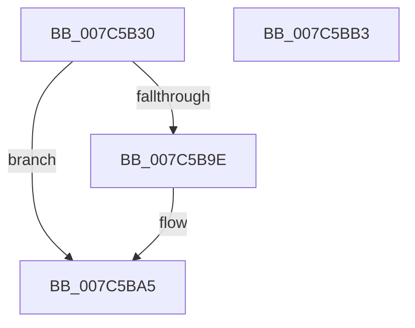

# ExpGetLeapSecondDataRegistryKeyHandle

- RVA: `0x007C5B30`–`0x007C5BB4` (길이 `132` bytes)
- VA: `0x00000001407C5B30`
- 실행 섹션: `PAGE`
- PDB 이름 있음: `예`; PDB Function 태그: `아니요`
- unwind 정보 RVA: `0x000AF604`
- 디코드: `32`개 명령, `132/132` bytes 표시
- 미해석 바이트: `0` (있으면 어셈블리에 `.byte`로 보존)

> 이 문서는 커널 이미지의 기계어와 PDB 기호를 분석해 생성했습니다. 4번과 5번은 함수 원형과 자료형을 바이너리 사용 방식에서 추정한 C 해석이며 원본 소스 복구 결과는 아닙니다.

## 1. Dependencies

- 직접 호출 지점: **1**; 고유 호출 대상: **1**
- 직접 호출자로 확인된 함수: **2**
- RIP 상대 이미지 참조: **1**

### Outgoing calls
- `0x007C5B95` → [ZwCreateKey](../../text/6A/ZwCreateKey_function_006AD470.md) (function, `0x006AD470`)

### Direct callers
- [ExSetLeapSecondEnabled](ExSetLeapSecondEnabled_function_007C59F8.md) at `0x007C5A14`
- [ExpReadLeapSecondData](ExpReadLeapSecondData_function_007C5EAC.md) at `0x007C5F57`

### Static image references
- `0x007C5B43` → RVA `0x0000BD70` (`.rdata`; read)

## 2. Other-region calls and transfers

- 다른 실행 섹션으로 향하는 call: **1**
  - `0x007C5B95` → [ZwCreateKey](../../text/6A/ZwCreateKey_function_006AD470.md) (`PAGE` → `.text`)
- 별도 외부 분기/꼬리 이동을 확인하지 못했습니다.

## 3. Assembly (complete function range)

```asm
007C5B30  48 89 5C 24 08                  mov qword ptr [rsp + 8], rbx
007C5B35  55                              push rbp
007C5B36  48 8B EC                        mov rbp, rsp
007C5B39  48 83 EC 70                     sub rsp, 0x70
007C5B3D  48 83 64 24 30 00               and qword ptr [rsp + 0x30], 0
007C5B43  48 8D 05 26 62 84 FF            lea rax, [rip - 0x7b9dda]
007C5B4A  83 64 24 28 00                  and dword ptr [rsp + 0x28], 0
007C5B4F  4C 8D 45 D0                     lea r8, [rbp - 0x30]
007C5B53  48 83 64 24 20 00               and qword ptr [rsp + 0x20], 0
007C5B59  48 8B D9                        mov rbx, rcx
007C5B5C  48 83 65 18 00                  and qword ptr [rbp + 0x18], 0
007C5B61  48 8D 4D 18                     lea rcx, [rbp + 0x18]
007C5B65  83 65 EC 00                     and dword ptr [rbp - 0x14], 0
007C5B69  0F 57 C0                        xorps xmm0, xmm0
007C5B6C  48 83 65 D8 00                  and qword ptr [rbp - 0x28], 0
007C5B71  45 33 C9                        xor r9d, r9d
007C5B74  48 C7 45 D0 30 00 00 00         mov qword ptr [rbp - 0x30], 0x30
007C5B7C  BA 19 00 02 00                  mov edx, 0x20019
007C5B81  83 65 D4 00                     and dword ptr [rbp - 0x2c], 0
007C5B85  48 89 45 E0                     mov qword ptr [rbp - 0x20], rax
007C5B89  F3 0F 7F 45 F0                  movdqu xmmword ptr [rbp - 0x10], xmm0
007C5B8E  C7 45 E8 40 02 00 00            mov dword ptr [rbp - 0x18], 0x240
007C5B95  E8 D6 78 EE FF                  call 0x1406ad470
007C5B9A  85 C0                           test eax, eax
007C5B9C  78 07                           js 0x1407c5ba5
007C5B9E  48 8B 4D 18                     mov rcx, qword ptr [rbp + 0x18]
007C5BA2  48 89 0B                        mov qword ptr [rbx], rcx
007C5BA5  48 8B 9C 24 80 00 00 00         mov rbx, qword ptr [rsp + 0x80]
007C5BAD  48 83 C4 70                     add rsp, 0x70
007C5BB1  5D                              pop rbp
007C5BB2  C3                              ret
007C5BB3  CC                              int3
```

## 4. C-style interpretation (structured pseudocode)

```c
__int64 __fastcall ExpGetLeapSecondDataRegistryKeyHandle(__int64 a1, __int64 a2, __int64 a3, int a4)
{
    __int64 result;
    __int64 v_rsp;
    unsigned __int64 v_stack_m18;
    unsigned int v_stack_m1C;
    unsigned int v_stack_m20;
    unsigned __int64 v_stack_m28;
    unsigned __int64 v_stack_m30;
    unsigned int v_stack_m34;
    unsigned __int64 v_stack_m38;
    unsigned __int64 v_stack_m48;
    unsigned int v_stack_m50;
    unsigned __int64 v_stack_m58;
    unsigned __int64 v_stack_p10;
    unsigned __int64 v_stack_p8;

    v_stack_p8 = v_rbx;
    v_rsp = (v_rsp) - (112);
    a4 = 0;
    v_stack_m38 = 48;
    v_stack_m28 = v_rip - 8101338;
    v_stack_m18 = v_xmm0;
    v_stack_m20 = 576;
    result = ZwCreateKey(v_stack_p10, (unsigned int)(0x20019ULL), v_stack_m38, a4);
    if (!(sign_flag)) {
        a1 = v_stack_p10;
        *(unsigned __int64 *)(a1) = a1;
    }
    v_rsp = (v_rsp) + (112);
    return result;
}
```

## 5. (Beta) C Style

```c
int64_t ExpGetLeapSecondDataRegistryKeyHandle(void *Arg1, int64_t Arg2, int64_t Arg3, int32_t Arg4)
{
    uint8_t *arg1 = (uint8_t *)Arg1;

    int64_t result;
    int64_t local_rsp;
    uint64_t v_stack_m18;
    uint32_t v_stack_m1C;
    uint32_t v_stack_m20;
    uint64_t v_stack_m28;
    uint64_t v_stack_m30;
    uint32_t v_stack_m34;
    uint64_t v_stack_m38;
    uint64_t v_stack_m48;
    uint32_t v_stack_m50;
    uint64_t v_stack_m58;
    uint64_t v_stack_p10;
    uint64_t v_stack_p8;

    v_stack_p8 = local_rbx;
    local_rsp = (local_rsp) - (112);
    Arg4 = 0;
    v_stack_m38 = 48;
    v_stack_m28 = v_rip - 8101338;
    v_stack_m18 = v_xmm0;
    v_stack_m20 = 576;
    result = ZwCreateKey(v_stack_p10, (uint32_t)(0x20019ULL), v_stack_m38, Arg4);
    if (!(sign_flag)) {
        Arg1 = v_stack_p10;
        *(void **)(arg1) = Arg1;
    }
    local_rsp = (local_rsp) + (112);
    return result;
}
```

### 관측된 메모리 오프셋

구조체 형식이 확인되지 않은 접근은 인자 기준의 오프셋으로만 기록했습니다.

| 기준 인자 | 오프셋 표현 | 폭 (bit) | 접근 |
|---|---:|---:|---|
| `Arg1` | `+ 0x0` | `64` | `W` |

## 6. Execution-region graph

[열기: 2D/3D 그래프와 함수 탐색 컨트롤 패널](../../../control-panel.html?section=page&rva=0x007C5B30&view=graph)

- 2D 그래프는 위에서 아래로 흐르고, 3D 그래프는 빈 공간을 드래그해 회전합니다. Shift+드래그는 이동, 휠은 확대·축소, 함수 노드 선택은 대상 보고서 이동입니다.

### Static fallback


