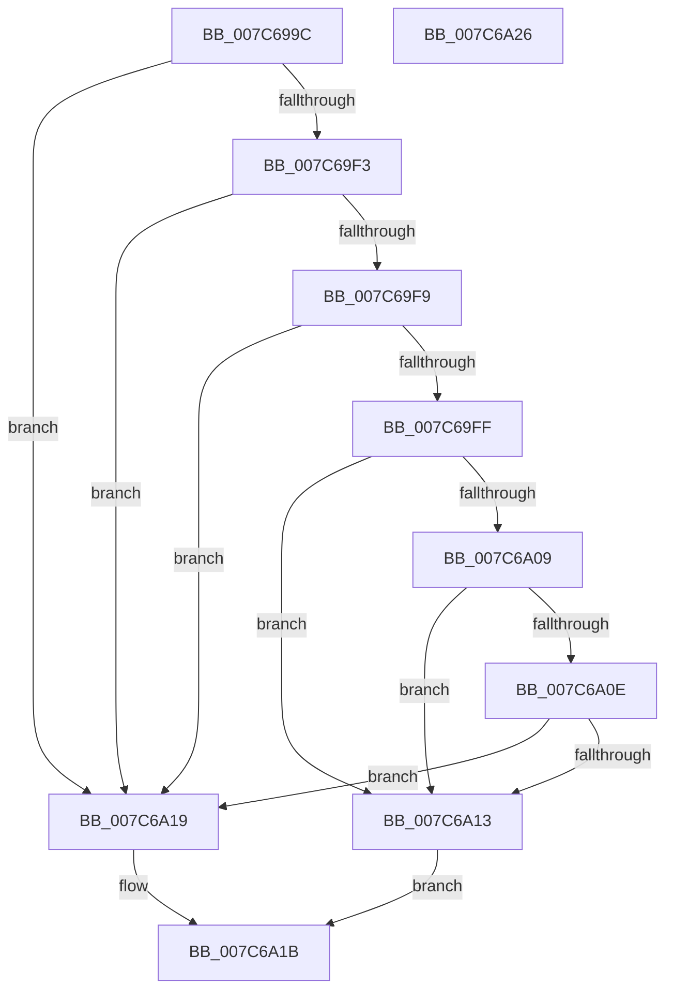

# ExpGetNtProductTypeFromLicenseValue

- RVA: `0x007C699C`–`0x007C6A27` (길이 `139` bytes)
- VA: `0x00000001407C699C`
- 실행 섹션: `PAGE`
- PDB 이름 있음: `예`; PDB Function 태그: `아니요`
- unwind 정보 RVA: `0x000BB544`
- 디코드: `43`개 명령, `139/139` bytes 표시
- 미해석 바이트: `0` (있으면 어셈블리에 `.byte`로 보존)

> 이 문서는 커널 이미지의 기계어와 PDB 기호를 분석해 생성했습니다. 4번과 5번은 함수 원형과 자료형을 바이너리 사용 방식에서 추정한 C 해석이며 원본 소스 복구 결과는 아닙니다.

## 1. Dependencies

- 직접 호출 지점: **2**; 고유 호출 대상: **2**
- 직접 호출자로 확인된 함수: **1**
- RIP 상대 이미지 참조: **1**

### Outgoing calls
- `0x007C69CA` → [RtlInitUnicodeString](../../text/42/RtlInitUnicodeString_function_0042A780.md) (function, `0x0042A780`)
- `0x007C69EA` → [NtQueryLicenseValue](../96/NtQueryLicenseValue_function_0096BCC0.md) (function, `0x0096BCC0`)

### Direct callers
- [ExpWatchProductTypeInitialization](../../init/C5/ExpWatchProductTypeInitialization_function_00C52170.md) at `0x00C521FC`

### Static image references
- `0x007C69A9` → RVA `0x00B4AE40` (`PAGE`; read)

## 2. Other-region calls and transfers

- 다른 실행 섹션으로 향하는 call: **1**
  - `0x007C69CA` → [RtlInitUnicodeString](../../text/42/RtlInitUnicodeString_function_0042A780.md) (`PAGE` → `.text`)
- 별도 외부 분기/꼬리 이동을 확인하지 못했습니다.

## 3. Assembly (complete function range)

```asm
007C699C  48 89 5C 24 08                  mov qword ptr [rsp + 8], rbx
007C69A1  55                              push rbp
007C69A2  48 8B EC                        mov rbp, rsp
007C69A5  48 83 EC 40                     sub rsp, 0x40
007C69A9  48 8B 15 90 44 38 00            mov rdx, qword ptr [rip + 0x384490]
007C69B0  48 8B D9                        mov rbx, rcx
007C69B3  83 65 18 00                     and dword ptr [rbp + 0x18], 0
007C69B7  48 8D 4D F0                     lea rcx, [rbp - 0x10]
007C69BB  83 65 20 00                     and dword ptr [rbp + 0x20], 0
007C69BF  0F 57 C0                        xorps xmm0, xmm0
007C69C2  83 65 28 00                     and dword ptr [rbp + 0x28], 0
007C69C6  0F 11 45 F0                     movups xmmword ptr [rbp - 0x10], xmm0
007C69CA  E8 B1 3D C6 FF                  call 0x14042a780
007C69CF  48 8D 45 20                     lea rax, [rbp + 0x20]
007C69D3  41 B9 04 00 00 00               mov r9d, 4
007C69D9  4C 8D 45 28                     lea r8, [rbp + 0x28]
007C69DD  48 89 44 24 20                  mov qword ptr [rsp + 0x20], rax
007C69E2  48 8D 55 18                     lea rdx, [rbp + 0x18]
007C69E6  48 8D 4D F0                     lea rcx, [rbp - 0x10]
007C69EA  E8 D1 52 1A 00                  call 0x14096bcc0
007C69EF  85 C0                           test eax, eax
007C69F1  78 26                           js 0x1407c6a19
007C69F3  83 7D 18 04                     cmp dword ptr [rbp + 0x18], 4
007C69F7  75 20                           jne 0x1407c6a19
007C69F9  83 7D 20 04                     cmp dword ptr [rbp + 0x20], 4
007C69FD  75 1A                           jne 0x1407c6a19
007C69FF  8B 4D 28                        mov ecx, dword ptr [rbp + 0x28]
007C6A02  8B C1                           mov eax, ecx
007C6A04  83 E8 01                        sub eax, 1
007C6A07  74 0A                           je 0x1407c6a13
007C6A09  83 E8 01                        sub eax, 1
007C6A0C  74 05                           je 0x1407c6a13
007C6A0E  83 F8 01                        cmp eax, 1
007C6A11  75 06                           jne 0x1407c6a19
007C6A13  89 0B                           mov dword ptr [rbx], ecx
007C6A15  B0 01                           mov al, 1
007C6A17  EB 02                           jmp 0x1407c6a1b
007C6A19  32 C0                           xor al, al
007C6A1B  48 8B 5C 24 50                  mov rbx, qword ptr [rsp + 0x50]
007C6A20  48 83 C4 40                     add rsp, 0x40
007C6A24  5D                              pop rbp
007C6A25  C3                              ret
007C6A26  CC                              int3
```

## 4. C-style interpretation (structured pseudocode)

```c
__int64 __fastcall ExpGetNtProductTypeFromLicenseValue(__int64 a1)
{
    __int64 result;
    __int64 v_rsp;
    unsigned __int64 v_stack_m18;
    unsigned __int64 v_stack_m28;
    unsigned int v_stack_p10;
    unsigned int v_stack_p18;
    unsigned int v_stack_p20;
    unsigned __int64 v_stack_p8;

    v_stack_p8 = v_rbx;
    v_rsp = (v_rsp) - (64);
    v_stack_m18 = v_xmm0;
    result = RtlInitUnicodeString(v_stack_m18, *(unsigned __int64 *)(v_rip + 3687568), a3, a4);
    v_stack_m28 = v_stack_p18;
    result = NtQueryLicenseValue(v_stack_m18, v_stack_p10, v_stack_p20, 4);
    if (sign_flag) goto loc_007C6A19;
    if (v_stack_p10 != 4) goto loc_007C6A19;
    if (v_stack_p18 != 4) goto loc_007C6A19;
    result = (unsigned int)(((unsigned int)((unsigned int)((unsigned int)(v_stack_p20)))) - (1));
    if (condition_is_equal) goto loc_007C6A13;
    result = (unsigned int)((result) - (1));
    if (condition_is_equal) goto loc_007C6A13;
    if (((unsigned int)(result)) != 1) goto loc_007C6A19;
loc_007C6A13:
    *(unsigned int *)(a1) = (unsigned int)((unsigned int)(v_stack_p20));
    goto loc_007C6A1B;
loc_007C6A19:
    result = 0;
loc_007C6A1B:
    v_rsp = (v_rsp) + (64);
    return result;
}
```

## 5. (Beta) C Style

```c
int64_t ExpGetNtProductTypeFromLicenseValue(void *Arg1)
{
    uint8_t *arg1 = (uint8_t *)Arg1;

    int64_t result;
    int64_t local_rsp;
    uint64_t v_stack_m18;
    uint64_t v_stack_m28;
    uint32_t v_stack_p10;
    uint32_t v_stack_p18;
    uint32_t v_stack_p20;
    uint64_t v_stack_p8;

    v_stack_p8 = local_rbx;
    local_rsp = (local_rsp) - (64);
    v_stack_m18 = v_xmm0;
    result = RtlInitUnicodeString(v_stack_m18, *(uint64_t *)(v_rip + 0x384490), a3, a4);
    v_stack_m28 = v_stack_p18;
    result = NtQueryLicenseValue(v_stack_m18, v_stack_p10, v_stack_p20, 4);
    if (sign_flag) goto loc_007C6A19;
    if (v_stack_p10 != 4) goto loc_007C6A19;
    if (v_stack_p18 != 4) goto loc_007C6A19;
    result = (uint32_t)(((uint32_t)((uint32_t)((uint32_t)(v_stack_p20)))) - (1));
    if (condition_is_equal) goto loc_007C6A13;
    result = (uint32_t)((result) - (1));
    if (condition_is_equal) goto loc_007C6A13;
    if (((uint32_t)(result)) != 1) goto loc_007C6A19;
loc_007C6A13:
    *(uint32_t *)(arg1) = (uint32_t)((uint32_t)(v_stack_p20));
    goto loc_007C6A1B;
loc_007C6A19:
    result = 0;
loc_007C6A1B:
    local_rsp = (local_rsp) + (64);
    return result;
}
```

### 관측된 메모리 오프셋

구조체 형식이 확인되지 않은 접근은 인자 기준의 오프셋으로만 기록했습니다.

| 기준 인자 | 오프셋 표현 | 폭 (bit) | 접근 |
|---|---:|---:|---|
| `Arg1` | `+ 0x0` | `32` | `W` |

## 6. Execution-region graph

[열기: 2D/3D 그래프와 함수 탐색 컨트롤 패널](../../../control-panel.html?section=page&rva=0x007C699C&view=graph)

- 2D 그래프는 위에서 아래로 흐르고, 3D 그래프는 빈 공간을 드래그해 회전합니다. Shift+드래그는 이동, 휠은 확대·축소, 함수 노드 선택은 대상 보고서 이동입니다.

### Static fallback


