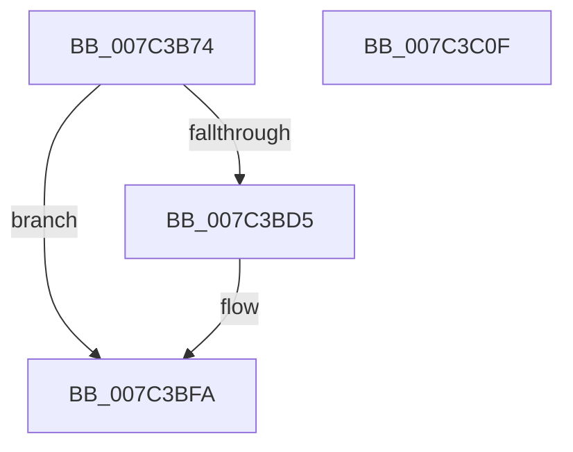

# ExpGetObjectInformation

- RVA: `0x007C3B74`–`0x007C3C10` (길이 `156` bytes)
- VA: `0x00000001407C3B74`
- 실행 섹션: `PAGE`
- PDB 이름 있음: `예`; PDB Function 태그: `아니요`
- unwind 정보 RVA: `0x0007D3C0`
- 디코드: `42`개 명령, `156/156` bytes 표시
- 미해석 바이트: `0` (있으면 어셈블리에 `.byte`로 보존)

> 이 문서는 커널 이미지의 기계어와 PDB 기호를 분석해 생성했습니다. 4번과 5번은 함수 원형과 자료형을 바이너리 사용 방식에서 추정한 C 해석이며 원본 소스 복구 결과는 아닙니다.

## 1. Dependencies

- 직접 호출 지점: **3**; 고유 호출 대상: **3**
- 직접 호출자로 확인된 함수: **1**
- RIP 상대 이미지 참조: **0**

### Outgoing calls
- `0x007C3BCC` → [ExLockUserBuffer](../95/ExLockUserBuffer_function_009533B8.md) (function, `0x009533B8`)
- `0x007C3BE7` → [ObGetObjectInformation](../9D/ObGetObjectInformation_function_009DADE0.md) (function, `0x009DADE0`)
- `0x007C3BF3` → [ExUnlockUserBuffer](../../text/29/ExUnlockUserBuffer_function_0029F258.md) (function, `0x0029F258`)

### Direct callers
- [ExpQuerySystemInformation](../A5/ExpQuerySystemInformation_function_00A57858.md) at `0x00A5811D`

### Static image references
- 디코드된 RIP-relative 메모리 참조가 없습니다.

## 2. Other-region calls and transfers

- 다른 실행 섹션으로 향하는 call: **1**
  - `0x007C3BF3` → [ExUnlockUserBuffer](../../text/29/ExUnlockUserBuffer_function_0029F258.md) (`PAGE` → `.text`)
- 별도 외부 분기/꼬리 이동을 확인하지 못했습니다.

## 3. Assembly (complete function range)

```asm
007C3B74  4C 8B DC                        mov r11, rsp
007C3B77  49 89 5B 08                     mov qword ptr [r11 + 8], rbx
007C3B7B  49 89 6B 10                     mov qword ptr [r11 + 0x10], rbp
007C3B7F  49 89 73 18                     mov qword ptr [r11 + 0x18], rsi
007C3B83  57                              push rdi
007C3B84  48 83 EC 40                     sub rsp, 0x40
007C3B88  41 83 21 00                     and dword ptr [r9], 0
007C3B8C  41 8B F8                        mov edi, r8d
007C3B8F  65 48 8B 04 25 88 01 00 00      mov rax, qword ptr gs:[0x188]
007C3B98  48 8B F2                        mov rsi, rdx
007C3B9B  49 83 63 20 00                  and qword ptr [r11 + 0x20], 0
007C3BA0  49 8B D9                        mov rbx, r9
007C3BA3  49 83 63 E8 00                  and qword ptr [r11 - 0x18], 0
007C3BA8  8B E9                           mov ebp, ecx
007C3BAA  41 B9 01 00 00 00               mov r9d, 1
007C3BB0  8B D7                           mov edx, edi
007C3BB2  44 8A 80 32 02 00 00            mov r8b, byte ptr [rax + 0x232]
007C3BB9  48 8B CE                        mov rcx, rsi
007C3BBC  49 8D 43 E8                     lea rax, [r11 - 0x18]
007C3BC0  49 89 43 E0                     mov qword ptr [r11 - 0x20], rax
007C3BC4  49 8D 43 20                     lea rax, [r11 + 0x20]
007C3BC8  49 89 43 D8                     mov qword ptr [r11 - 0x28], rax
007C3BCC  E8 E7 F7 18 00                  call 0x1409533b8
007C3BD1  85 C0                           test eax, eax
007C3BD3  78 25                           js 0x1407c3bfa
007C3BD5  4C 8B 44 24 68                  mov r8, qword ptr [rsp + 0x68]
007C3BDA  44 8B CF                        mov r9d, edi
007C3BDD  48 8B D6                        mov rdx, rsi
007C3BE0  48 89 5C 24 20                  mov qword ptr [rsp + 0x20], rbx
007C3BE5  8B CD                           mov ecx, ebp
007C3BE7  E8 F4 71 21 00                  call 0x1409dade0
007C3BEC  48 8B 4C 24 30                  mov rcx, qword ptr [rsp + 0x30]
007C3BF1  8B D8                           mov ebx, eax
007C3BF3  E8 60 B6 AD FF                  call 0x14029f258
007C3BF8  8B C3                           mov eax, ebx
007C3BFA  48 8B 5C 24 50                  mov rbx, qword ptr [rsp + 0x50]
007C3BFF  48 8B 6C 24 58                  mov rbp, qword ptr [rsp + 0x58]
007C3C04  48 8B 74 24 60                  mov rsi, qword ptr [rsp + 0x60]
007C3C09  48 83 C4 40                     add rsp, 0x40
007C3C0D  5F                              pop rdi
007C3C0E  C3                              ret
007C3C0F  CC                              int3
```

## 4. C-style interpretation (structured pseudocode)

```c
__int64 __fastcall ExpGetObjectInformation(int a1, __int64 a2, int a3, __int64 a4)
{
    __int64 result;
    __int64 v_rbx;
    __int64 v_rsp;
    unsigned __int64 v_stack_m18;
    unsigned __int64 v_stack_m28;
    unsigned __int64 v_stack_p10;
    unsigned __int64 v_stack_p18;
    unsigned __int64 v_stack_p20;
    unsigned __int64 v_stack_p8;

    *(unsigned __int64 *)(v_rsp + 8) = v_rbx;
    *(unsigned __int64 *)(v_rsp + 16) = v_rbp;
    *(unsigned __int64 *)(v_rsp + 24) = v_rsi;
    v_rsp = (v_rsp) - (64);
    *(unsigned __int64 *)(v_rsp - 32) = v_rsp - 24;
    *(unsigned __int64 *)(v_rsp - 40) = v_rsp + 32;
    result = ExLockUserBuffer(a2, (unsigned int)((unsigned int)((unsigned int)(a3))), *(unsigned __int8 *)(*(unsigned __int64 *)(gs_base + (0 + 392)) + 562), 1);
    v_rbx = a4;
    if (!(sign_flag)) {
        a3 = v_stack_p20;
        a4 = (unsigned int)((unsigned int)(a3));
        a2 = a2;
        v_stack_m28 = a4;
        a1 = (unsigned int)((unsigned int)(a1));
        result = ObGetObjectInformation(a1, a2, a3, a4);
        a1 = v_stack_m18;
        v_rbx = (unsigned int)(result);
        result = ExUnlockUserBuffer(a1, a2, a3, a4);
        result = (unsigned int)(v_rbx);
    }
    v_rsp = (v_rsp) + (64);
    return result;
}
```

## 5. (Beta) C Style

```c
int64_t ExpGetObjectInformation(int32_t Arg1, int64_t Arg2, int32_t Arg3, void *Arg4)
{
    uint8_t *arg4 = (uint8_t *)Arg4;

    int64_t result;
    int64_t local_rbx;
    int64_t local_rsp;
    uint64_t v_stack_m18;
    uint64_t v_stack_m28;
    uint64_t v_stack_p10;
    uint64_t v_stack_p18;
    uint64_t v_stack_p20;
    uint64_t v_stack_p8;

    *(uint64_t *)(local_rsp + 0x8) = local_rbx;
    *(uint64_t *)(local_rsp + 0x10) = local_rbp;
    *(uint64_t *)(local_rsp + 0x18) = local_rsi;
    local_rsp = (local_rsp) - (64);
    *(uint64_t *)(local_rsp - 0x20) = local_rsp - 24;
    *(uint64_t *)(local_rsp - 0x28) = local_rsp + 32;
    result = ExLockUserBuffer(Arg2, (uint32_t)((uint32_t)((uint32_t)(Arg3))), *(uint8_t *)(*(uint64_t *)(gs_base + (0 + 0x188)) + 0x232), 1);
    local_rbx = Arg4;
    if (!(sign_flag)) {
        Arg3 = v_stack_p20;
        Arg4 = (uint32_t)((uint32_t)(Arg3));
        Arg2 = Arg2;
        v_stack_m28 = Arg4;
        Arg1 = (uint32_t)((uint32_t)(Arg1));
        result = ObGetObjectInformation(Arg1, Arg2, Arg3, Arg4);
        Arg1 = v_stack_m18;
        local_rbx = (uint32_t)(result);
        result = ExUnlockUserBuffer(Arg1, Arg2, Arg3, Arg4);
        result = (uint32_t)(local_rbx);
    }
    local_rsp = (local_rsp) + (64);
    return result;
}
```

### 관측된 메모리 오프셋

구조체 형식이 확인되지 않은 접근은 인자 기준의 오프셋으로만 기록했습니다.

| 기준 인자 | 오프셋 표현 | 폭 (bit) | 접근 |
|---|---:|---:|---|
| `Arg4` | `+ 0x0` | `32` | `R/W` |

## 6. Execution-region graph

[열기: 2D/3D 그래프와 함수 탐색 컨트롤 패널](../../../control-panel.html?section=page&rva=0x007C3B74&view=graph)

- 2D 그래프는 위에서 아래로 흐르고, 3D 그래프는 빈 공간을 드래그해 회전합니다. Shift+드래그는 이동, 휠은 확대·축소, 함수 노드 선택은 대상 보고서 이동입니다.

### Static fallback


