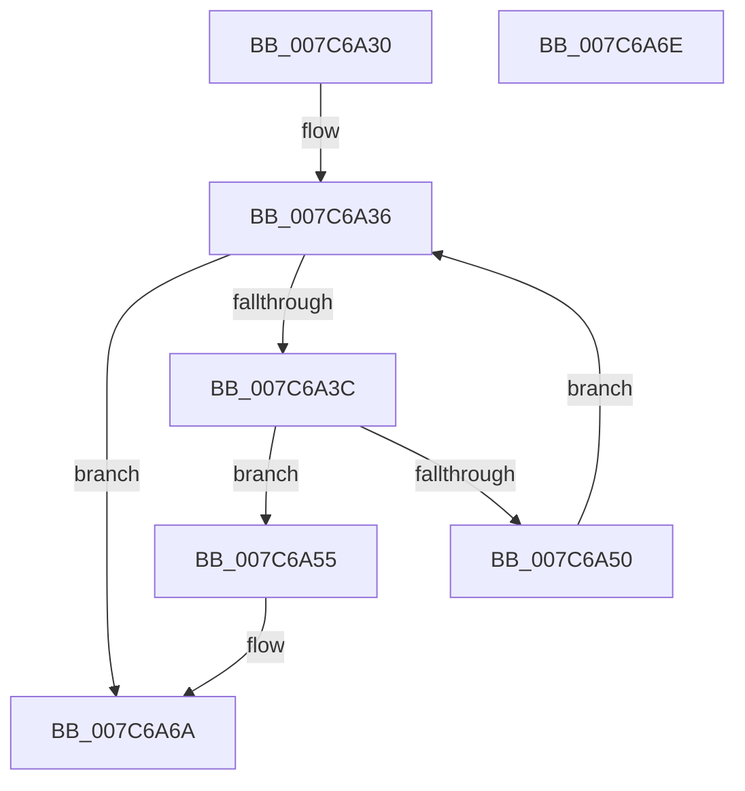

# ExpGetProductInfoSuiteTypeMap

- RVA: `0x007C6A30`–`0x007C6A6F` (길이 `63` bytes)
- VA: `0x00000001407C6A30`
- 실행 섹션: `PAGE`
- PDB 이름 있음: `예`; PDB Function 태그: `아니요`
- unwind 정보 RVA: `0x000DB714`
- 디코드: `19`개 명령, `63/63` bytes 표시
- 미해석 바이트: `0` (있으면 어셈블리에 `.byte`로 보존)

> 이 문서는 커널 이미지의 기계어와 PDB 기호를 분석해 생성했습니다. 4번과 5번은 함수 원형과 자료형을 바이너리 사용 방식에서 추정한 C 해석이며 원본 소스 복구 결과는 아닙니다.

## 1. Dependencies

- 직접 호출 지점: **0**; 고유 호출 대상: **0**
- 직접 호출자로 확인된 함수: **2**
- RIP 상대 이미지 참조: **1**

### Outgoing calls
- 직접 디코드된 call 명령이 없습니다.

### Direct callers
- [ExGetSuiteMask](ExGetSuiteMask_function_007C68D0.md) at `0x007C6941`
- [ExpInitSystemPhase1](../../init/C5/ExpInitSystemPhase1_function_00C51508.md) at `0x00C51753`

### Static image references
- `0x007C6A3F` → RVA `0x00B4F480` (`ExpProductInfoSuiteTypeMap`; read)

## 2. Other-region calls and transfers

- 다른 실행 섹션으로 향하는 call: **0**
- 별도 외부 분기/꼬리 이동을 확인하지 못했습니다.

## 3. Assembly (complete function range)

```asm
007C6A30  45 33 C9                        xor r9d, r9d
007C6A33  45 8B C1                        mov r8d, r9d
007C6A36  41 83 F8 33                     cmp r8d, 0x33
007C6A3A  73 2E                           jae 0x1407c6a6a
007C6A3C  41 8B C0                        mov eax, r8d
007C6A3F  4C 8D 15 3A 8A 38 00            lea r10, [rip + 0x388a3a]
007C6A46  48 8D 04 40                     lea rax, [rax + rax*2]
007C6A4A  41 39 0C 82                     cmp dword ptr [r10 + rax*4], ecx
007C6A4E  74 05                           je 0x1407c6a55
007C6A50  41 FF C0                        inc r8d
007C6A53  EB E1                           jmp 0x1407c6a36
007C6A55  F2 41 0F 10 04 82               movsd xmm0, qword ptr [r10 + rax*4]
007C6A5B  41 B1 01                        mov r9b, 1
007C6A5E  41 8B 44 82 08                  mov eax, dword ptr [r10 + rax*4 + 8]
007C6A63  F2 0F 11 02                     movsd qword ptr [rdx], xmm0
007C6A67  89 42 08                        mov dword ptr [rdx + 8], eax
007C6A6A  41 8A C1                        mov al, r9b
007C6A6D  C3                              ret
007C6A6E  CC                              int3
```

## 4. C-style interpretation (structured pseudocode)

```c
__int64 __fastcall ExpGetProductInfoSuiteTypeMap(int a1, __int64 a2, __int64 a3, int a4)
{
    a4 = 0;
loc_007C6A36:
    if (0 >= 51) goto loc_007C6A6A;
    if ((*(unsigned int *)(v_rip + 3705402 + 0 + 0 * 2 * 4)) == a1) goto loc_007C6A55;
    a3 = (unsigned int)((0) + 1);
    goto loc_007C6A36;
loc_007C6A55:
    *(unsigned __int64 *)(a2) = v_xmm0;
    *(unsigned int *)(a2 + 8) = (unsigned int)((unsigned int)(*(unsigned int *)(v_rip + 3705402 + 0 + 0 * 2 * 4 + 8)));
loc_007C6A6A:
    return 1;
}
```

## 5. (Beta) C Style

```c
int64_t ExpGetProductInfoSuiteTypeMap(int32_t Arg1, void *Arg2, int64_t Arg3, int32_t Arg4)
{
    uint8_t *arg2 = (uint8_t *)Arg2;

    Arg4 = 0;
loc_007C6A36:
    if (0 >= 51) goto loc_007C6A6A;
    if ((*(uint32_t *)(v_rip + 0x388A3A + 0x0 + 0x0 * 2 * 4)) == Arg1) goto loc_007C6A55;
    Arg3 = (uint32_t)((0) + 1);
    goto loc_007C6A36;
loc_007C6A55:
    *(uint64_t *)(arg2) = v_xmm0;
    *(uint32_t *)(arg2 + 0x8) = (uint32_t)((uint32_t)(*(uint32_t *)(v_rip + 0x388A3A + 0x0 + 0x0 * 2 * 4 + 0x8)));
loc_007C6A6A:
    return 1;
}
```

### 관측된 메모리 오프셋

구조체 형식이 확인되지 않은 접근은 인자 기준의 오프셋으로만 기록했습니다.

| 기준 인자 | 오프셋 표현 | 폭 (bit) | 접근 |
|---|---:|---:|---|
| `Arg2` | `+ 0x0` | `64` | `W` |
| `Arg2` | `+ 0x8` | `32` | `W` |

## 6. Execution-region graph

[열기: 2D/3D 그래프와 함수 탐색 컨트롤 패널](../../../control-panel.html?section=page&rva=0x007C6A30&view=graph)

- 2D 그래프는 위에서 아래로 흐르고, 3D 그래프는 빈 공간을 드래그해 회전합니다. Shift+드래그는 이동, 휠은 확대·축소, 함수 노드 선택은 대상 보고서 이동입니다.

### Static fallback


