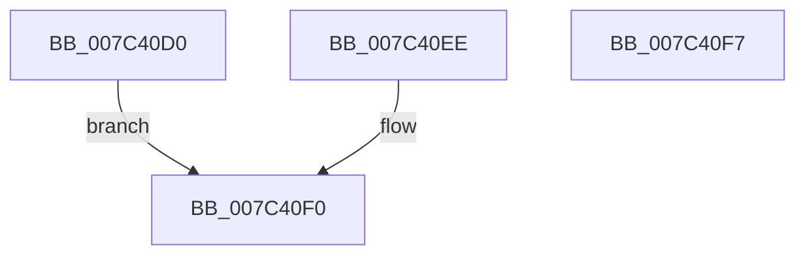

# ExpGetSystemProcessorFeaturesInformation

- RVA: `0x007C40D0`–`0x007C40F8` (길이 `40` bytes)
- VA: `0x00000001407C40D0`
- 실행 섹션: `PAGE`
- PDB 이름 있음: `예`; PDB Function 태그: `아니요`
- unwind 정보 RVA: `0x000D4254`
- 디코드: `13`개 명령, `40/40` bytes 표시
- 미해석 바이트: `0` (있으면 어셈블리에 `.byte`로 보존)

> 이 문서는 커널 이미지의 기계어와 PDB 기호를 분석해 생성했습니다. 4번과 5번은 함수 원형과 자료형을 바이너리 사용 방식에서 추정한 C 해석이며 원본 소스 복구 결과는 아닙니다.

## 1. Dependencies

- 직접 호출 지점: **0**; 고유 호출 대상: **0**
- 직접 호출자로 확인된 함수: **1**
- RIP 상대 이미지 참조: **1**

### Outgoing calls
- 직접 디코드된 call 명령이 없습니다.

### Direct callers
- [ExpQuerySystemInformation](../A5/ExpQuerySystemInformation_function_00A57858.md) at `0x00A5A279`

### Static image references
- `0x007C40D6` → RVA `0x00FC6B30` (`ALMOSTRO`; read)

## 2. Other-region calls and transfers

- 다른 실행 섹션으로 향하는 call: **0**
- 별도 외부 분기/꼬리 이동을 확인하지 못했습니다.

## 3. Assembly (complete function range)

```asm
007C40D0  48 83 EC 18                     sub rsp, 0x18
007C40D4  33 D2                           xor edx, edx
007C40D6  48 8B 05 53 2A 80 00            mov rax, qword ptr [rip + 0x802a53]
007C40DD  48 89 01                        mov qword ptr [rcx], rax
007C40E0  48 89 51 08                     mov qword ptr [rcx + 8], rdx
007C40E4  48 89 51 10                     mov qword ptr [rcx + 0x10], rdx
007C40E8  48 89 51 18                     mov qword ptr [rcx + 0x18], rdx
007C40EC  EB 02                           jmp 0x1407c40f0
007C40EE  8B D0                           mov edx, eax
007C40F0  8B C2                           mov eax, edx
007C40F2  48 83 C4 18                     add rsp, 0x18
007C40F6  C3                              ret
007C40F7  CC                              int3
```

## 4. C-style interpretation (structured pseudocode)

```c
__int64 __fastcall ExpGetSystemProcessorFeaturesInformation(__int64 a1, int a2)
{
    __int64 v_rsp;

    v_rsp = (v_rsp) - (24);
    a2 = 0;
    *(unsigned __int64 *)(a1) = *(unsigned __int64 *)(v_rip + 8399443);
    *(unsigned __int64 *)(a1 + 8) = 0;
    *(unsigned __int64 *)(a1 + 16) = 0;
    *(unsigned __int64 *)(a1 + 24) = 0;
    goto loc_007C40F0;
loc_007C40F0:
    v_rsp = (v_rsp) + (24);
    return 0;
}
```

## 5. (Beta) C Style

```c
int64_t ExpGetSystemProcessorFeaturesInformation(void *Arg1, int32_t Arg2)
{
    uint8_t *arg1 = (uint8_t *)Arg1;

    int64_t local_rsp;

    local_rsp = (local_rsp) - (24);
    Arg2 = 0;
    *(uint64_t *)(arg1) = *(uint64_t *)(v_rip + 0x802A53);
    *(uint64_t *)(arg1 + 0x8) = 0;
    *(uint64_t *)(arg1 + 0x10) = 0;
    *(uint64_t *)(arg1 + 0x18) = 0;
    goto loc_007C40F0;
loc_007C40F0:
    local_rsp = (local_rsp) + (24);
    return 0;
}
```

### 관측된 메모리 오프셋

구조체 형식이 확인되지 않은 접근은 인자 기준의 오프셋으로만 기록했습니다.

| 기준 인자 | 오프셋 표현 | 폭 (bit) | 접근 |
|---|---:|---:|---|
| `Arg1` | `+ 0x0` | `64` | `W` |
| `Arg1` | `+ 0x8` | `64` | `W` |
| `Arg1` | `+ 0x10` | `64` | `W` |
| `Arg1` | `+ 0x18` | `64` | `W` |

## 6. Execution-region graph

[열기: 2D/3D 그래프와 함수 탐색 컨트롤 패널](../../../control-panel.html?section=page&rva=0x007C40D0&view=graph)

- 2D 그래프는 위에서 아래로 흐르고, 3D 그래프는 빈 공간을 드래그해 회전합니다. Shift+드래그는 이동, 휠은 확대·축소, 함수 노드 선택은 대상 보고서 이동입니다.

### Static fallback


