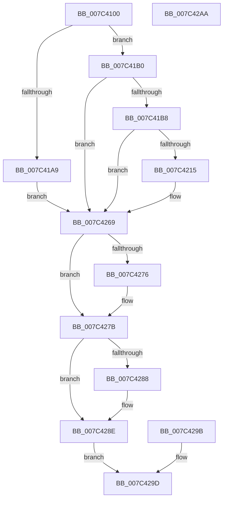

# ExpGetSystemWriteConstraintInformation

- RVA: `0x007C4100`–`0x007C42AB` (길이 `427` bytes)
- VA: `0x00000001407C4100`
- 실행 섹션: `PAGE`
- PDB 이름 있음: `예`; PDB Function 태그: `아니요`
- unwind 정보 RVA: `0x000D404C`
- 디코드: `93`개 명령, `427/427` bytes 표시
- 미해석 바이트: `0` (있으면 어셈블리에 `.byte`로 보존)

> 이 문서는 커널 이미지의 기계어와 PDB 기호를 분석해 생성했습니다. 4번과 5번은 함수 원형과 자료형을 바이너리 사용 방식에서 추정한 C 해석이며 원본 소스 복구 결과는 아닙니다.

## 1. Dependencies

- 직접 호출 지점: **5**; 고유 호출 대상: **4**
- 직접 호출자로 확인된 함수: **1**
- RIP 상대 이미지 참조: **1**

### Outgoing calls
- `0x007C419B` → [ZwCreateFile](../../text/6A/ZwCreateFile_function_006ADB70.md) (function, `0x006ADB70`)
- `0x007C420A` → [ZwCreateEvent](../../text/6A/ZwCreateEvent_function_006AD9D0.md) (function, `0x006AD9D0`)
- `0x007C425B` → [ZwDeviceIoControlFile](../../text/6A/ZwDeviceIoControlFile_function_006AD1B0.md) (function, `0x006AD1B0`)
- `0x007C4276` → [ZwClose](../../text/6A/ZwClose_function_006AD2B0.md) (function, `0x006AD2B0`)
- `0x007C4288` → [ZwClose](../../text/6A/ZwClose_function_006AD2B0.md) (function, `0x006AD2B0`)

### Direct callers
- [ExpQuerySystemInformation](../A5/ExpQuerySystemInformation_function_00A57858.md) at `0x00A5ACBB`

### Static image references
- `0x007C4126` → RVA `0x00B4BE18` (`PAGE`; read)

## 2. Other-region calls and transfers

- 다른 실행 섹션으로 향하는 call: **5**
  - `0x007C419B` → [ZwCreateFile](../../text/6A/ZwCreateFile_function_006ADB70.md) (`PAGE` → `.text`)
  - `0x007C420A` → [ZwCreateEvent](../../text/6A/ZwCreateEvent_function_006AD9D0.md) (`PAGE` → `.text`)
  - `0x007C425B` → [ZwDeviceIoControlFile](../../text/6A/ZwDeviceIoControlFile_function_006AD1B0.md) (`PAGE` → `.text`)
  - `0x007C4276` → [ZwClose](../../text/6A/ZwClose_function_006AD2B0.md) (`PAGE` → `.text`)
  - `0x007C4288` → [ZwClose](../../text/6A/ZwClose_function_006AD2B0.md) (`PAGE` → `.text`)
- 별도 외부 분기/꼬리 이동을 확인하지 못했습니다.

## 3. Assembly (complete function range)

```asm
007C4100  4C 8B DC                        mov r11, rsp
007C4103  53                              push rbx
007C4104  56                              push rsi
007C4105  57                              push rdi
007C4106  48 81 EC E0 00 00 00            sub rsp, 0xe0
007C410D  48 8B F9                        mov rdi, rcx
007C4110  33 F6                           xor esi, esi
007C4112  49 89 73 10                     mov qword ptr [r11 + 0x10], rsi
007C4116  49 89 73 18                     mov qword ptr [r11 + 0x18], rsi
007C411A  49 C7 43 B8 30 00 00 00         mov qword ptr [r11 - 0x48], 0x30
007C4122  49 89 73 C0                     mov qword ptr [r11 - 0x40], rsi
007C4126  48 8D 05 EB 7C 38 00            lea rax, [rip + 0x387ceb]
007C412D  49 89 43 C8                     mov qword ptr [r11 - 0x38], rax
007C4131  49 C7 43 D0 40 02 00 00         mov qword ptr [r11 - 0x30], 0x240
007C4139  0F 57 C0                        xorps xmm0, xmm0
007C413C  F3 41 0F 7F 43 D8               movdqu xmmword ptr [r11 - 0x28], xmm0
007C4142  33 C0                           xor eax, eax
007C4144  41 0F 11 43 88                  movups xmmword ptr [r11 - 0x78], xmm0
007C4149  41 0F 11 43 98                  movups xmmword ptr [r11 - 0x68], xmm0
007C414E  49 89 43 A8                     mov qword ptr [r11 - 0x58], rax
007C4152  41 89 43 B0                     mov dword ptr [r11 - 0x50], eax
007C4156  0F 11 44 24 70                  movups xmmword ptr [rsp + 0x70], xmm0
007C415B  49 89 73 20                     mov qword ptr [r11 + 0x20], rsi
007C415F  89 74 24 50                     mov dword ptr [rsp + 0x50], esi
007C4163  48 89 74 24 48                  mov qword ptr [rsp + 0x48], rsi
007C4168  C7 44 24 40 20 00 00 00         mov dword ptr [rsp + 0x40], 0x20
007C4170  C7 44 24 38 01 00 00 00         mov dword ptr [rsp + 0x38], 1
007C4178  89 74 24 30                     mov dword ptr [rsp + 0x30], esi
007C417C  C7 44 24 28 80 00 00 00         mov dword ptr [rsp + 0x28], 0x80
007C4184  48 89 74 24 20                  mov qword ptr [rsp + 0x20], rsi
007C4189  4C 8D 4C 24 70                  lea r9, [rsp + 0x70]
007C418E  4D 8D 43 B8                     lea r8, [r11 - 0x48]
007C4192  BA 00 00 10 00                  mov edx, 0x100000
007C4197  49 8D 4B 10                     lea rcx, [r11 + 0x10]
007C419B  E8 D0 99 EE FF                  call 0x1406adb70
007C41A0  8B D8                           mov ebx, eax
007C41A2  3D 34 00 00 C0                  cmp eax, 0xc0000034
007C41A7  75 07                           jne 0x1407c41b0
007C41A9  8B DE                           mov ebx, esi
007C41AB  E9 B9 00 00 00                  jmp 0x1407c4269
007C41B0  85 C0                           test eax, eax
007C41B2  0F 88 B1 00 00 00               js 0x1407c4269
007C41B8  C7 84 24 80 00 00 00 30 00 00 00  mov dword ptr [rsp + 0x80], 0x30
007C41C3  48 89 B4 24 88 00 00 00         mov qword ptr [rsp + 0x88], rsi
007C41CB  C7 84 24 98 00 00 00 40 02 00 00  mov dword ptr [rsp + 0x98], 0x240
007C41D6  48 89 B4 24 90 00 00 00         mov qword ptr [rsp + 0x90], rsi
007C41DE  0F 57 C0                        xorps xmm0, xmm0
007C41E1  F3 0F 7F 84 24 A0 00 00 00      movdqu xmmword ptr [rsp + 0xa0], xmm0
007C41EA  40 88 74 24 20                  mov byte ptr [rsp + 0x20], sil
007C41EF  41 B9 01 00 00 00               mov r9d, 1
007C41F5  4C 8D 84 24 80 00 00 00         lea r8, [rsp + 0x80]
007C41FD  BA 03 00 1F 00                  mov edx, 0x1f0003
007C4202  48 8D 8C 24 10 01 00 00         lea rcx, [rsp + 0x110]
007C420A  E8 C1 97 EE FF                  call 0x1406ad9d0
007C420F  8B D8                           mov ebx, eax
007C4211  85 C0                           test eax, eax
007C4213  78 54                           js 0x1407c4269
007C4215  C7 44 24 48 08 00 00 00         mov dword ptr [rsp + 0x48], 8
007C421D  48 8D 84 24 18 01 00 00         lea rax, [rsp + 0x118]
007C4225  48 89 44 24 40                  mov qword ptr [rsp + 0x40], rax
007C422A  89 74 24 38                     mov dword ptr [rsp + 0x38], esi
007C422E  48 89 74 24 30                  mov qword ptr [rsp + 0x30], rsi
007C4233  C7 44 24 28 0C 0A 22 00         mov dword ptr [rsp + 0x28], 0x220a0c
007C423B  48 8D 44 24 70                  lea rax, [rsp + 0x70]
007C4240  48 89 44 24 20                  mov qword ptr [rsp + 0x20], rax
007C4245  45 33 C9                        xor r9d, r9d
007C4248  45 33 C0                        xor r8d, r8d
007C424B  48 8B 94 24 10 01 00 00         mov rdx, qword ptr [rsp + 0x110]
007C4253  48 8B 8C 24 08 01 00 00         mov rcx, qword ptr [rsp + 0x108]
007C425B  E8 50 8F EE FF                  call 0x1406ad1b0
007C4260  8B D8                           mov ebx, eax
007C4262  85 C0                           test eax, eax
007C4264  0F 49 5C 24 70                  cmovns ebx, dword ptr [rsp + 0x70]
007C4269  48 8B 8C 24 08 01 00 00         mov rcx, qword ptr [rsp + 0x108]
007C4271  48 85 C9                        test rcx, rcx
007C4274  74 05                           je 0x1407c427b
007C4276  E8 35 90 EE FF                  call 0x1406ad2b0
007C427B  48 8B 8C 24 10 01 00 00         mov rcx, qword ptr [rsp + 0x110]
007C4283  48 85 C9                        test rcx, rcx
007C4286  74 06                           je 0x1407c428e
007C4288  E8 23 90 EE FF                  call 0x1406ad2b0
007C428D  90                              nop
007C428E  48 8B 84 24 18 01 00 00         mov rax, qword ptr [rsp + 0x118]
007C4296  48 89 07                        mov qword ptr [rdi], rax
007C4299  EB 02                           jmp 0x1407c429d
007C429B  8B D8                           mov ebx, eax
007C429D  8B C3                           mov eax, ebx
007C429F  48 81 C4 E0 00 00 00            add rsp, 0xe0
007C42A6  5F                              pop rdi
007C42A7  5E                              pop rsi
007C42A8  5B                              pop rbx
007C42A9  C3                              ret
007C42AA  CC                              int3
```

## 4. C-style interpretation (structured pseudocode)

```c
__int64 __fastcall ExpGetSystemWriteConstraintInformation(__int64 a1)
{
    __int64 result;
    __int64 v_rbx;
    __int64 v_rsi;
    __int64 v_rsp;
    unsigned __int64 v_stack_m58;
    unsigned int v_stack_m60;
    unsigned __int64 v_stack_m68;
    unsigned __int64 v_stack_m70;
    unsigned int v_stack_m78;
    unsigned __int64 v_stack_m88;
    unsigned int v_stack_mA8;
    unsigned __int64 v_stack_mB0;
    unsigned int v_stack_mB8;
    unsigned int v_stack_mC0;
    unsigned int v_stack_mC8;
    unsigned int v_stack_mD0;
    unsigned __int64 v_stack_mD8;
    unsigned __int64 v_stack_p10;
    unsigned __int64 v_stack_p18;
    unsigned __int64 v_stack_p20;

    v_rsp = (v_rsp) - (224);
    v_rsi = 0;
    *(unsigned __int64 *)(v_rsp + 16) = 0;
    *(unsigned __int64 *)(v_rsp + 24) = 0;
    *(unsigned __int64 *)(v_rsp - 72) = 48;
    *(unsigned __int64 *)(v_rsp - 64) = 0;
    *(unsigned __int64 *)(v_rsp - 56) = v_rip + 3701995;
    *(unsigned __int64 *)(v_rsp - 48) = 576;
    *(unsigned __int64 *)(v_rsp - 40) = v_xmm0;
    result = 0;
    *(unsigned __int64 *)(v_rsp - 120) = v_xmm0;
    *(unsigned __int64 *)(v_rsp - 104) = v_xmm0;
    *(unsigned __int64 *)(v_rsp - 88) = 0;
    *(unsigned int *)(v_rsp - 80) = 0;
    v_stack_m88 = v_xmm0;
    *(unsigned __int64 *)(v_rsp + 32) = 0;
    v_stack_mA8 = 0;
    v_stack_mB0 = 0;
    v_stack_mB8 = 32;
    v_stack_mC0 = 1;
    v_stack_mC8 = 0;
    v_stack_mD0 = 128;
    v_stack_mD8 = 0;
    result = ZwCreateFile(v_rsp + 16, (unsigned int)(0x100000ULL), v_rsp - 72, v_stack_m88);
    if (((unsigned int)(result)) != 0xC0000034ULL) goto loc_007C41B0;
    goto loc_007C4269;
loc_007C41B0:
    if (sign_flag) goto loc_007C4269;
    v_stack_m78 = 48;
    v_stack_m70 = 0;
    v_stack_m60 = 576;
    v_stack_m68 = 0;
    v_stack_m58 = v_xmm0;
    v_stack_mD8 = 0;
    result = ZwCreateEvent(v_stack_p18, (unsigned int)(0x1F0003ULL), v_stack_m78, 1);
    v_rbx = (unsigned int)((unsigned int)(result));
    if (!(sign_flag)) {
        v_stack_mB0 = 8;
        result = v_stack_p20;
        v_stack_mB8 = result;
        v_stack_mC0 = 0;
        v_stack_mC8 = 0;
        v_stack_mD0 = 0x220A0CULL;
        result = v_stack_m88;
        v_stack_mD8 = result;
        a4 = 0;
        a3 = 0;
        a2 = v_stack_p18;
        a1 = v_stack_p10;
        result = ZwDeviceIoControlFile(a1, a2, a3, a4);
        v_rbx = (unsigned int)(result);
        if (!sign_flag) { v_rbx = v_stack_m88; }
    }
    if (v_stack_p10 != 0) {
        result = ZwClose(v_stack_p10, a2, a3, a4);
    }
    if (v_stack_p18 != 0) {
        result = ZwClose(v_stack_p18, a2, a3, a4);
    }
    *(unsigned __int64 *)(a1) = v_stack_p20;
    goto loc_007C429D;
loc_007C429D:
    v_rsp = (v_rsp) + (224);
    return (unsigned int)((unsigned int)(v_rbx));
}
```

## 5. (Beta) C Style

```c
int64_t ExpGetSystemWriteConstraintInformation(void *Arg1)
{
    uint8_t *arg1 = (uint8_t *)Arg1;

    int64_t result;
    int64_t local_rbx;
    int64_t local_rsi;
    int64_t local_rsp;
    uint64_t v_stack_m58;
    uint32_t v_stack_m60;
    uint64_t v_stack_m68;
    uint64_t v_stack_m70;
    uint32_t v_stack_m78;
    uint64_t v_stack_m88;
    uint32_t v_stack_mA8;
    uint64_t v_stack_mB0;
    uint32_t v_stack_mB8;
    uint32_t v_stack_mC0;
    uint32_t v_stack_mC8;
    uint32_t v_stack_mD0;
    uint64_t v_stack_mD8;
    uint64_t v_stack_p10;
    uint64_t v_stack_p18;
    uint64_t v_stack_p20;

    local_rsp = (local_rsp) - (224);
    local_rsi = 0;
    *(uint64_t *)(local_rsp + 0x10) = 0;
    *(uint64_t *)(local_rsp + 0x18) = 0;
    *(uint64_t *)(local_rsp - 0x48) = 48;
    *(uint64_t *)(local_rsp - 0x40) = 0;
    *(uint64_t *)(local_rsp - 0x38) = v_rip + 3701995;
    *(uint64_t *)(local_rsp - 0x30) = 576;
    *(uint64_t *)(local_rsp - 0x28) = v_xmm0;
    result = 0;
    *(uint64_t *)(local_rsp - 0x78) = v_xmm0;
    *(uint64_t *)(local_rsp - 0x68) = v_xmm0;
    *(uint64_t *)(local_rsp - 0x58) = 0;
    *(uint32_t *)(local_rsp - 0x50) = 0;
    v_stack_m88 = v_xmm0;
    *(uint64_t *)(local_rsp + 0x20) = 0;
    v_stack_mA8 = 0;
    v_stack_mB0 = 0;
    v_stack_mB8 = 32;
    v_stack_mC0 = 1;
    v_stack_mC8 = 0;
    v_stack_mD0 = 128;
    v_stack_mD8 = 0;
    result = ZwCreateFile(local_rsp + 16, (uint32_t)(0x100000ULL), local_rsp - 72, v_stack_m88);
    if (((uint32_t)(result)) != 0xC0000034ULL) goto loc_007C41B0;
    goto loc_007C4269;
loc_007C41B0:
    if (sign_flag) goto loc_007C4269;
    v_stack_m78 = 48;
    v_stack_m70 = 0;
    v_stack_m60 = 576;
    v_stack_m68 = 0;
    v_stack_m58 = v_xmm0;
    v_stack_mD8 = 0;
    result = ZwCreateEvent(v_stack_p18, (uint32_t)(0x1F0003ULL), v_stack_m78, 1);
    local_rbx = (uint32_t)((uint32_t)(result));
    if (!(sign_flag)) {
        v_stack_mB0 = 8;
        result = v_stack_p20;
        v_stack_mB8 = result;
        v_stack_mC0 = 0;
        v_stack_mC8 = 0;
        v_stack_mD0 = 0x220A0CULL;
        result = v_stack_m88;
        v_stack_mD8 = result;
        a4 = 0;
        a3 = 0;
        a2 = v_stack_p18;
        Arg1 = v_stack_p10;
        result = ZwDeviceIoControlFile(Arg1, a2, a3, a4);
        local_rbx = (uint32_t)(result);
        if (!sign_flag) { local_rbx = v_stack_m88; }
    }
    if (v_stack_p10 != 0) {
        result = ZwClose(v_stack_p10, a2, a3, a4);
    }
    if (v_stack_p18 != 0) {
        result = ZwClose(v_stack_p18, a2, a3, a4);
    }
    *(uint64_t *)(arg1) = v_stack_p20;
    goto loc_007C429D;
loc_007C429D:
    local_rsp = (local_rsp) + (224);
    return (uint32_t)((uint32_t)(local_rbx));
}
```

### 관측된 메모리 오프셋

구조체 형식이 확인되지 않은 접근은 인자 기준의 오프셋으로만 기록했습니다.

| 기준 인자 | 오프셋 표현 | 폭 (bit) | 접근 |
|---|---:|---:|---|
| `Arg1` | `+ 0x0` | `64` | `W` |

## 6. Execution-region graph

[열기: 2D/3D 그래프와 함수 탐색 컨트롤 패널](../../../control-panel.html?section=page&rva=0x007C4100&view=graph)

- 2D 그래프는 위에서 아래로 흐르고, 3D 그래프는 빈 공간을 드래그해 회전합니다. Shift+드래그는 이동, 휠은 확대·축소, 함수 노드 선택은 대상 보고서 이동입니다.

### Static fallback


