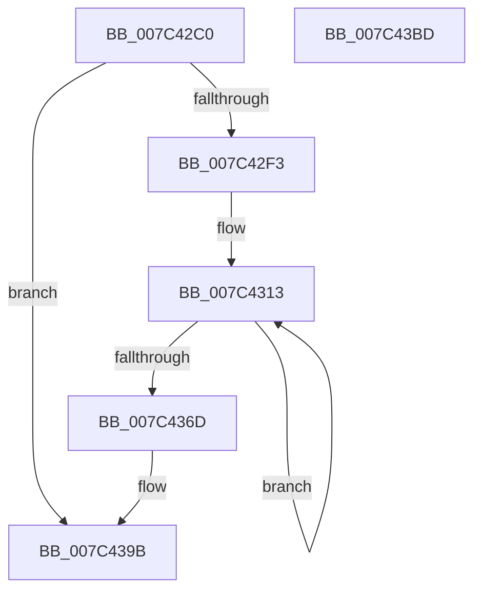

# ExpInitBootEntropyInformation

- RVA: `0x007C42C0`–`0x007C43BE` (길이 `254` bytes)
- VA: `0x00000001407C42C0`
- 실행 섹션: `PAGE`
- PDB 이름 있음: `예`; PDB Function 태그: `아니요`
- unwind 정보 RVA: `0x00060BC4`
- 디코드: `61`개 명령, `254/254` bytes 표시
- 미해석 바이트: `0` (있으면 어셈블리에 `.byte`로 보존)

> 이 문서는 커널 이미지의 기계어와 PDB 기호를 분석해 생성했습니다. 4번과 5번은 함수 원형과 자료형을 바이너리 사용 방식에서 추정한 C 해석이며 원본 소스 복구 결과는 아닙니다.

## 1. Dependencies

- 직접 호출 지점: **1**; 고유 호출 대상: **1**
- 직접 호출자로 확인된 함수: **0**
- RIP 상대 이미지 참조: **1**

### Outgoing calls
- `0x007C42FE` → [memset](../../text/6C/memset_function_006C6C40.md) (function, `0x006C6C40`)

### Direct callers
- 이 함수 시작 RVA로 연결되는 직접 call은 확인되지 않았습니다. 간접 호출은 완전히 역산할 수 없습니다.

### Static image references
- `0x007C42CF` → RVA `0x00FC6B20` (`ALMOSTRO`; read)

## 2. Other-region calls and transfers

- 다른 실행 섹션으로 향하는 call: **1**
  - `0x007C42FE` → [memset](../../text/6C/memset_function_006C6C40.md) (`PAGE` → `.text`)
- 별도 외부 분기/꼬리 이동을 확인하지 못했습니다.

## 3. Assembly (complete function range)

```asm
007C42C0  48 89 5C 24 08                  mov qword ptr [rsp + 8], rbx
007C42C5  48 89 74 24 10                  mov qword ptr [rsp + 0x10], rsi
007C42CA  57                              push rdi
007C42CB  48 83 EC 20                     sub rsp, 0x20
007C42CF  48 8B 05 4A 28 80 00            mov rax, qword ptr [rip + 0x80284a]
007C42D6  48 8B F2                        mov rsi, rdx
007C42D9  48 8B 1A                        mov rbx, qword ptr [rdx]
007C42DC  48 8B B8 F0 00 00 00            mov rdi, qword ptr [rax + 0xf0]
007C42E3  48 81 C7 58 01 00 00            add rdi, 0x158
007C42EA  48 85 DB                        test rbx, rbx
007C42ED  0F 84 A8 00 00 00               je 0x1407c439b
007C42F3  33 D2                           xor edx, edx
007C42F5  41 B8 48 04 00 00               mov r8d, 0x448
007C42FB  48 8B CB                        mov rcx, rbx
007C42FE  E8 3D 29 F0 FF                  call 0x1406c6c40
007C4303  48 8B D7                        mov rdx, rdi
007C4306  48 8D 4B 10                     lea rcx, [rbx + 0x10]
007C430A  48 2B D3                        sub rdx, rbx
007C430D  41 B8 0A 00 00 00               mov r8d, 0xa
007C4313  8B 44 0A F8                     mov eax, dword ptr [rdx + rcx - 8]
007C4317  89 41 F8                        mov dword ptr [rcx - 8], eax
007C431A  48 8B 04 0A                     mov rax, qword ptr [rdx + rcx]
007C431E  48 89 01                        mov qword ptr [rcx], rax
007C4321  8B 44 0A 08                     mov eax, dword ptr [rdx + rcx + 8]
007C4325  89 41 08                        mov dword ptr [rcx + 8], eax
007C4328  8B 44 0A 0C                     mov eax, dword ptr [rdx + rcx + 0xc]
007C432C  89 41 0C                        mov dword ptr [rcx + 0xc], eax
007C432F  48 8B 44 0A 10                  mov rax, qword ptr [rdx + rcx + 0x10]
007C4334  48 89 41 10                     mov qword ptr [rcx + 0x10], rax
007C4338  8B 44 0A 18                     mov eax, dword ptr [rdx + rcx + 0x18]
007C433C  89 41 18                        mov dword ptr [rcx + 0x18], eax
007C433F  0F 10 44 0A 1C                  movups xmm0, xmmword ptr [rdx + rcx + 0x1c]
007C4344  48 8D 49 68                     lea rcx, [rcx + 0x68]
007C4348  0F 11 41 B4                     movups xmmword ptr [rcx - 0x4c], xmm0
007C434C  0F 10 4C 0A C4                  movups xmm1, xmmword ptr [rdx + rcx - 0x3c]
007C4351  0F 11 49 C4                     movups xmmword ptr [rcx - 0x3c], xmm1
007C4355  0F 10 44 0A D4                  movups xmm0, xmmword ptr [rdx + rcx - 0x2c]
007C435A  0F 11 41 D4                     movups xmmword ptr [rcx - 0x2c], xmm0
007C435E  0F 10 4C 0A E4                  movups xmm1, xmmword ptr [rdx + rcx - 0x1c]
007C4363  0F 11 49 E4                     movups xmmword ptr [rcx - 0x1c], xmm1
007C4367  49 83 E8 01                     sub r8, 1
007C436B  75 A6                           jne 0x1407c4313
007C436D  8B 07                           mov eax, dword ptr [rdi]
007C436F  89 03                           mov dword ptr [rbx], eax
007C4371  0F 10 87 18 04 00 00            movups xmm0, xmmword ptr [rdi + 0x418]
007C4378  0F 11 83 18 04 00 00            movups xmmword ptr [rbx + 0x418], xmm0
007C437F  0F 10 8F 28 04 00 00            movups xmm1, xmmword ptr [rdi + 0x428]
007C4386  0F 11 8B 28 04 00 00            movups xmmword ptr [rbx + 0x428], xmm1
007C438D  0F 10 87 38 04 00 00            movups xmm0, xmmword ptr [rdi + 0x438]
007C4394  0F 11 83 38 04 00 00            movups xmmword ptr [rbx + 0x438], xmm0
007C439B  48 8B 5C 24 30                  mov rbx, qword ptr [rsp + 0x30]
007C43A0  33 C0                           xor eax, eax
007C43A2  B9 48 04 00 00                  mov ecx, 0x448
007C43A7  F3 AA                           rep stosb byte ptr [rdi], al
007C43A9  48 83 0E FF                     or qword ptr [rsi], 0xffffffffffffffff
007C43AD  B8 01 00 00 00                  mov eax, 1
007C43B2  48 8B 74 24 38                  mov rsi, qword ptr [rsp + 0x38]
007C43B7  48 83 C4 20                     add rsp, 0x20
007C43BB  5F                              pop rdi
007C43BC  C3                              ret
007C43BD  CC                              int3
```

## 4. C-style interpretation (structured pseudocode)

```c
__int64 __fastcall ExpInitBootEntropyInformation(__int64 a1, __int64 a2)
{
    __int64 result;
    __int64 v_rdi;
    __int64 v_rsp;
    unsigned __int64 v_stack_p10;
    unsigned __int64 v_stack_p8;

    v_stack_p8 = v_rbx;
    v_stack_p10 = v_rsi;
    v_rsp = (v_rsp) - (32);
    v_rdi = (*(unsigned __int64 *)(*(unsigned __int64 *)(v_rip + 8398922) + 240)) + (344);
    if (*(unsigned __int64 *)(a2) == 0) goto loc_007C439B;
    a2 = 0;
    result = memset(*(unsigned __int64 *)(a2), a2, (unsigned int)(0x448ULL), a4);
    a2 = (v_rdi) - (*(unsigned __int64 *)(a2));
loc_007C4313:
    *(unsigned int *)(*(unsigned __int64 *)(a2) + 16 - 8) = (unsigned int)((unsigned int)(*(unsigned int *)(a2 + *(unsigned __int64 *)(a2) + 16 * 1 - 8)));
    *(unsigned __int64 *)(*(unsigned __int64 *)(a2) + 16) = *(unsigned __int64 *)(a2 + *(unsigned __int64 *)(a2) + 16 * 1);
    *(unsigned int *)(*(unsigned __int64 *)(a2) + 16 + 8) = (unsigned int)((unsigned int)(*(unsigned int *)(a2 + *(unsigned __int64 *)(a2) + 16 * 1 + 8)));
    *(unsigned int *)(*(unsigned __int64 *)(a2) + 16 + 12) = (unsigned int)((unsigned int)(*(unsigned int *)(a2 + *(unsigned __int64 *)(a2) + 16 * 1 + 12)));
    *(unsigned __int64 *)(*(unsigned __int64 *)(a2) + 16 + 16) = *(unsigned __int64 *)(a2 + *(unsigned __int64 *)(a2) + 16 * 1 + 16);
    *(unsigned int *)(*(unsigned __int64 *)(a2) + 16 + 24) = (unsigned int)((unsigned int)(*(unsigned int *)(a2 + *(unsigned __int64 *)(a2) + 16 * 1 + 24)));
    *(unsigned __int64 *)(*(unsigned __int64 *)(a2) + 16 + 104 - 76) = v_xmm0;
    *(unsigned __int64 *)(*(unsigned __int64 *)(a2) + 16 + 104 - 60) = v_xmm1;
    *(unsigned __int64 *)(*(unsigned __int64 *)(a2) + 16 + 104 - 44) = v_xmm0;
    *(unsigned __int64 *)(*(unsigned __int64 *)(a2) + 16 + 104 - 28) = v_xmm1;
    a3 = (10) - (1);
    if (condition_is_not_equal) goto loc_007C4313;
    *(unsigned int *)(*(unsigned __int64 *)(a2)) = (unsigned int)((unsigned int)(*(unsigned int *)(v_rdi)));
    *(unsigned __int64 *)(*(unsigned __int64 *)(a2) + 1048) = v_xmm0;
    *(unsigned __int64 *)(*(unsigned __int64 *)(a2) + 1064) = v_xmm1;
    *(unsigned __int64 *)(*(unsigned __int64 *)(a2) + 1080) = v_xmm0;
loc_007C439B:
    result = 0;
    v_rsp = (v_rsp) + (32);
    return 1;
}
```

## 5. (Beta) C Style

```c
int64_t ExpInitBootEntropyInformation(int64_t Arg1, void *Arg2)
{
    uint8_t *arg2 = (uint8_t *)Arg2;

    int64_t result;
    int64_t local_rdi;
    int64_t local_rsp;
    uint64_t v_stack_p10;
    uint64_t v_stack_p8;

    v_stack_p8 = local_rbx;
    v_stack_p10 = local_rsi;
    local_rsp = (local_rsp) - (32);
    local_rdi = (*(uint64_t *)(*(uint64_t *)(v_rip + 0x80284A) + 0xF0)) + (344);
    if (*(uint64_t *)(arg2) == 0) goto loc_007C439B;
    Arg2 = 0;
    result = memset(*(uint64_t *)(arg2), Arg2, (uint32_t)(0x448ULL), a4);
    Arg2 = (local_rdi) - (*(uint64_t *)(arg2));
loc_007C4313:
    *(uint32_t *)(*(uint64_t *)(arg2) + 0x10 - 0x8) = (uint32_t)((uint32_t)(*(uint32_t *)(arg2 + *(uint64_t *)(arg2) + 0x10 * 1 - 0x8)));
    *(uint64_t *)(*(uint64_t *)(arg2) + 0x10) = *(uint64_t *)(arg2 + *(uint64_t *)(arg2) + 0x10 * 1);
    *(uint32_t *)(*(uint64_t *)(arg2) + 0x10 + 0x8) = (uint32_t)((uint32_t)(*(uint32_t *)(arg2 + *(uint64_t *)(arg2) + 0x10 * 1 + 0x8)));
    *(uint32_t *)(*(uint64_t *)(arg2) + 0x10 + 0xC) = (uint32_t)((uint32_t)(*(uint32_t *)(arg2 + *(uint64_t *)(arg2) + 0x10 * 1 + 0xC)));
    *(uint64_t *)(*(uint64_t *)(arg2) + 0x10 + 0x10) = *(uint64_t *)(arg2 + *(uint64_t *)(arg2) + 0x10 * 1 + 0x10);
    *(uint32_t *)(*(uint64_t *)(arg2) + 0x10 + 0x18) = (uint32_t)((uint32_t)(*(uint32_t *)(arg2 + *(uint64_t *)(arg2) + 0x10 * 1 + 0x18)));
    *(uint64_t *)(*(uint64_t *)(arg2) + 0x10 + 0x68 - 0x4C) = v_xmm0;
    *(uint64_t *)(*(uint64_t *)(arg2) + 0x10 + 0x68 - 0x3C) = v_xmm1;
    *(uint64_t *)(*(uint64_t *)(arg2) + 0x10 + 0x68 - 0x2C) = v_xmm0;
    *(uint64_t *)(*(uint64_t *)(arg2) + 0x10 + 0x68 - 0x1C) = v_xmm1;
    a3 = (10) - (1);
    if (condition_is_not_equal) goto loc_007C4313;
    *(uint32_t *)(*(uint64_t *)(arg2)) = (uint32_t)((uint32_t)(*(uint32_t *)(local_rdi)));
    *(uint64_t *)(*(uint64_t *)(arg2) + 0x418) = v_xmm0;
    *(uint64_t *)(*(uint64_t *)(arg2) + 0x428) = v_xmm1;
    *(uint64_t *)(*(uint64_t *)(arg2) + 0x438) = v_xmm0;
loc_007C439B:
    result = 0;
    local_rsp = (local_rsp) + (32);
    return 1;
}
```

### 관측된 메모리 오프셋

구조체 형식이 확인되지 않은 접근은 인자 기준의 오프셋으로만 기록했습니다.

| 기준 인자 | 오프셋 표현 | 폭 (bit) | 접근 |
|---|---:|---:|---|
| `Arg2` | `+ 0x0` | `64` | `R` |
| `Arg2` | `+ 0x0` | `64` | `R/W` |

## 6. Execution-region graph

[열기: 2D/3D 그래프와 함수 탐색 컨트롤 패널](../../../control-panel.html?section=page&rva=0x007C42C0&view=graph)

- 2D 그래프는 위에서 아래로 흐르고, 3D 그래프는 빈 공간을 드래그해 회전합니다. Shift+드래그는 이동, 휠은 확대·축소, 함수 노드 선택은 대상 보고서 이동입니다.

### Static fallback


