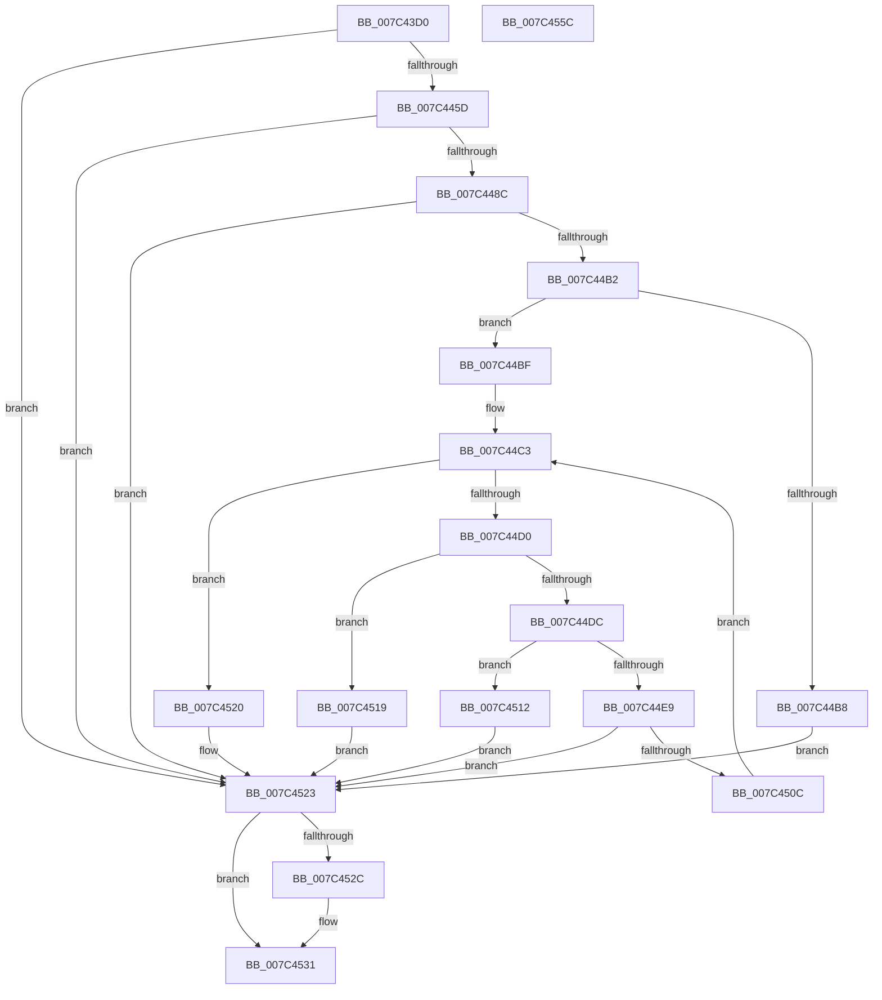

# ExpInitFullProcessSecurityInfo

- RVA: `0x007C43D0`–`0x007C455D` (길이 `397` bytes)
- VA: `0x00000001407C43D0`
- 실행 섹션: `PAGE`
- PDB 이름 있음: `예`; PDB Function 태그: `아니요`
- unwind 정보 RVA: `0x000D430C`
- 디코드: `107`개 명령, `397/397` bytes 표시
- 미해석 바이트: `0` (있으면 어셈블리에 `.byte`로 보존)

> 이 문서는 커널 이미지의 기계어와 PDB 기호를 분석해 생성했습니다. 4번과 5번은 함수 원형과 자료형을 바이너리 사용 방식에서 추정한 C 해석이며 원본 소스 복구 결과는 아닙니다.

## 1. Dependencies

- 직접 호출 지점: **9**; 고유 호출 대상: **9**
- 직접 호출자로 확인된 함수: **0**
- RIP 상대 이미지 참조: **4**

### Outgoing calls
- `0x007C440D` → [memset](../../text/6C/memset_function_006C6C40.md) (function, `0x006C6C40`)
- `0x007C444E` → [ZwOpenKey](../../text/6A/ZwOpenKey_function_006AD310.md) (function, `0x006AD310`)
- `0x007C447D` → [ZwQueryValueKey](../../text/6A/ZwQueryValueKey_function_006AD3B0.md) (function, `0x006AD3B0`)
- `0x007C44A7` → [RtlGetDaclSecurityDescriptor](../../text/45/RtlGetDaclSecurityDescriptor_function_00459570.md) (function, `0x00459570`)
- `0x007C44D3` → [RtlValidSid](../92/RtlValidSid_function_00929710.md) (function, `0x00929710`)
- `0x007C44DF` → [RtlLengthSid](../../text/45/RtlLengthSid_function_0045D270.md) (function, `0x0045D270`)
- `0x007C4501` → [RtlpAddKnownAce](../92/RtlpAddKnownAce_function_00929A20.md) (function, `0x00929A20`)
- `0x007C452C` → [ZwClose](../../text/6A/ZwClose_function_006AD2B0.md) (function, `0x006AD2B0`)
- `0x007C453F` → [_security_check_cookie](../../text/6A/_security_check_cookie_function_006AC640.md) (function, `0x006AC640`)

### Direct callers
- 이 함수 시작 RVA로 연결되는 직접 call은 확인되지 않았습니다. 간접 호출은 완전히 역산할 수 없습니다.

### Static image references
- `0x007C43EA` → RVA `0x00E0A740` (`.data`; read)
- `0x007C4417` → RVA `0x00B4BE08` (`PAGE`; read)
- `0x007C4476` → RVA `0x00E092E0` (`.data`; read)
- `0x007C4491` → RVA `0x00FD8C00` (`PAGEDATA`; read)

## 2. Other-region calls and transfers

- 다른 실행 섹션으로 향하는 call: **7**
  - `0x007C440D` → [memset](../../text/6C/memset_function_006C6C40.md) (`PAGE` → `.text`)
  - `0x007C444E` → [ZwOpenKey](../../text/6A/ZwOpenKey_function_006AD310.md) (`PAGE` → `.text`)
  - `0x007C447D` → [ZwQueryValueKey](../../text/6A/ZwQueryValueKey_function_006AD3B0.md) (`PAGE` → `.text`)
  - `0x007C44A7` → [RtlGetDaclSecurityDescriptor](../../text/45/RtlGetDaclSecurityDescriptor_function_00459570.md) (`PAGE` → `.text`)
  - `0x007C44DF` → [RtlLengthSid](../../text/45/RtlLengthSid_function_0045D270.md) (`PAGE` → `.text`)
  - `0x007C452C` → [ZwClose](../../text/6A/ZwClose_function_006AD2B0.md) (`PAGE` → `.text`)
  - `0x007C453F` → [_security_check_cookie](../../text/6A/_security_check_cookie_function_006AC640.md) (`PAGE` → `.text`)
- 별도 외부 분기/꼬리 이동을 확인하지 못했습니다.

## 3. Assembly (complete function range)

```asm
007C43D0  48 89 5C 24 08                  mov qword ptr [rsp + 8], rbx
007C43D5  48 89 74 24 10                  mov qword ptr [rsp + 0x10], rsi
007C43DA  55                              push rbp
007C43DB  57                              push rdi
007C43DC  41 57                           push r15
007C43DE  48 8D 6C 24 B9                  lea rbp, [rsp - 0x47]
007C43E3  48 81 EC E0 00 00 00            sub rsp, 0xe0
007C43EA  48 8B 05 4F 63 64 00            mov rax, qword ptr [rip + 0x64634f]
007C43F1  48 33 C4                        xor rax, rsp
007C43F4  48 89 45 37                     mov qword ptr [rbp + 0x37], rax
007C43F8  49 8B F0                        mov rsi, r8
007C43FB  C6 45 97 00                     mov byte ptr [rbp - 0x69], 0
007C43FF  BF 50 00 00 00                  mov edi, 0x50
007C4404  48 8D 4D E7                     lea rcx, [rbp - 0x19]
007C4408  44 8B C7                        mov r8d, edi
007C440B  33 D2                           xor edx, edx
007C440D  E8 2E 28 F0 FF                  call 0x1406c6c40
007C4412  48 83 65 B7 00                  and qword ptr [rbp - 0x49], 0
007C4417  48 8D 05 EA 79 38 00            lea rax, [rip + 0x3879ea]
007C441E  83 65 9B 00                     and dword ptr [rbp - 0x65], 0
007C4422  4C 8D 45 AF                     lea r8, [rbp - 0x51]
007C4426  48 83 65 9F 00                  and qword ptr [rbp - 0x61], 0
007C442B  8D 57 B1                        lea edx, [rdi - 0x4f]
007C442E  0F 57 C0                        xorps xmm0, xmm0
007C4431  48 89 45 BF                     mov qword ptr [rbp - 0x41], rax
007C4435  48 8D 4D 9F                     lea rcx, [rbp - 0x61]
007C4439  48 C7 45 AF 30 00 00 00         mov qword ptr [rbp - 0x51], 0x30
007C4441  F3 0F 7F 45 CF                  movdqu xmmword ptr [rbp - 0x31], xmm0
007C4446  48 C7 45 C7 40 02 00 00         mov qword ptr [rbp - 0x39], 0x240
007C444E  E8 BD 8E EE FF                  call 0x1406ad310
007C4453  8B D8                           mov ebx, eax
007C4455  85 C0                           test eax, eax
007C4457  0F 88 C6 00 00 00               js 0x1407c4523
007C445D  48 8B 4D 9F                     mov rcx, qword ptr [rbp - 0x61]
007C4461  48 8D 45 9B                     lea rax, [rbp - 0x65]
007C4465  48 89 44 24 28                  mov qword ptr [rsp + 0x28], rax
007C446A  4C 8D 4D E7                     lea r9, [rbp - 0x19]
007C446E  44 8D 47 B2                     lea r8d, [rdi - 0x4e]
007C4472  89 7C 24 20                     mov dword ptr [rsp + 0x20], edi
007C4476  48 8D 15 63 4E 64 00            lea rdx, [rip + 0x644e63]
007C447D  E8 2E 8F EE FF                  call 0x1406ad3b0
007C4482  8B D8                           mov ebx, eax
007C4484  85 C0                           test eax, eax
007C4486  0F 88 97 00 00 00               js 0x1407c4523
007C448C  48 83 65 A7 00                  and qword ptr [rbp - 0x59], 0
007C4491  4C 8D 3D 68 47 81 00            lea r15, [rip + 0x814768]
007C4498  49 8B CF                        mov rcx, r15
007C449B  4C 8D 4D 98                     lea r9, [rbp - 0x68]
007C449F  4C 8D 45 A7                     lea r8, [rbp - 0x59]
007C44A3  48 8D 55 97                     lea rdx, [rbp - 0x69]
007C44A7  E8 C4 50 C9 FF                  call 0x140459570
007C44AC  8B D8                           mov ebx, eax
007C44AE  85 C0                           test eax, eax
007C44B0  78 71                           js 0x1407c4523
007C44B2  80 7D 97 00                     cmp byte ptr [rbp - 0x69], 0
007C44B6  75 07                           jne 0x1407c44bf
007C44B8  BB 79 00 00 C0                  mov ebx, 0xc0000079
007C44BD  EB 64                           jmp 0x1407c4523
007C44BF  48 8D 7D F3                     lea rdi, [rbp - 0xd]
007C44C3  8B 45 EF                        mov eax, dword ptr [rbp - 0x11]
007C44C6  48 8D 4C 05 D3                  lea rcx, [rbp + rax - 0x2d]
007C44CB  48 3B F9                        cmp rdi, rcx
007C44CE  77 50                           ja 0x1407c4520
007C44D0  48 8B CF                        mov rcx, rdi
007C44D3  E8 38 52 16 00                  call 0x140929710
007C44D8  84 C0                           test al, al
007C44DA  74 3D                           je 0x1407c4519
007C44DC  48 8B CF                        mov rcx, rdi
007C44DF  E8 8C 8D C9 FF                  call 0x14045d270
007C44E4  83 F8 20                        cmp eax, 0x20
007C44E7  75 29                           jne 0x1407c4512
007C44E9  48 8B 4D A7                     mov rcx, qword ptr [rbp - 0x59]
007C44ED  44 8D 48 E1                     lea r9d, [rax - 0x1f]
007C44F1  C6 44 24 28 00                  mov byte ptr [rsp + 0x28], 0
007C44F6  8D 50 E2                        lea edx, [rax - 0x1e]
007C44F9  45 33 C0                        xor r8d, r8d
007C44FC  48 89 7C 24 20                  mov qword ptr [rsp + 0x20], rdi
007C4501  E8 1A 55 16 00                  call 0x140929a20
007C4506  8B D8                           mov ebx, eax
007C4508  85 C0                           test eax, eax
007C450A  78 17                           js 0x1407c4523
007C450C  48 83 C7 20                     add rdi, 0x20
007C4510  EB B1                           jmp 0x1407c44c3
007C4512  BB 29 02 00 C0                  mov ebx, 0xc0000229
007C4517  EB 0A                           jmp 0x1407c4523
007C4519  BB 78 00 00 C0                  mov ebx, 0xc0000078
007C451E  EB 03                           jmp 0x1407c4523
007C4520  4C 89 3E                        mov qword ptr [rsi], r15
007C4523  48 8B 4D 9F                     mov rcx, qword ptr [rbp - 0x61]
007C4527  48 85 C9                        test rcx, rcx
007C452A  74 05                           je 0x1407c4531
007C452C  E8 7F 8D EE FF                  call 0x1406ad2b0
007C4531  F7 D3                           not ebx
007C4533  C1 EB 1F                        shr ebx, 0x1f
007C4536  8B C3                           mov eax, ebx
007C4538  48 8B 4D 37                     mov rcx, qword ptr [rbp + 0x37]
007C453C  48 33 CC                        xor rcx, rsp
007C453F  E8 FC 80 EE FF                  call 0x1406ac640
007C4544  4C 8D 9C 24 E0 00 00 00         lea r11, [rsp + 0xe0]
007C454C  49 8B 5B 20                     mov rbx, qword ptr [r11 + 0x20]
007C4550  49 8B 73 28                     mov rsi, qword ptr [r11 + 0x28]
007C4554  49 8B E3                        mov rsp, r11
007C4557  41 5F                           pop r15
007C4559  5F                              pop rdi
007C455A  5D                              pop rbp
007C455B  C3                              ret
007C455C  CC                              int3
```

## 4. C-style interpretation (structured pseudocode)

```c
__int64 __fastcall ExpInitFullProcessSecurityInfo(__int64 a1, int a2, __int64 a3)
{
    __int64 result;
    __int64 v_rbx;
    __int64 v_rdi;
    __int64 v_rsp;
    unsigned __int64 v_stack_m18;
    unsigned __int64 v_stack_m28;
    unsigned __int64 v_stack_m5F;
    unsigned __int64 v_stack_m6C;
    unsigned int v_stack_m70;
    unsigned __int64 v_stack_m78;
    unsigned __int64 v_stack_m90;
    unsigned __int64 v_stack_m98;
    unsigned __int64 v_stack_mA0;
    unsigned __int64 v_stack_mA8;
    unsigned __int64 v_stack_mB0;
    unsigned __int64 v_stack_mB8;
    unsigned __int64 v_stack_mC0;
    unsigned int v_stack_mC4;
    unsigned __int64 v_stack_mC7;
    unsigned __int8 v_stack_mC8;
    unsigned __int64 v_stack_mD0;
    unsigned int v_stack_mD8;
    unsigned __int64 v_stack_p10;
    unsigned __int64 v_stack_p8;

    v_stack_p8 = v_rbx;
    v_stack_p10 = v_rsi;
    v_rsp = (v_rsp) - (224);
    result = (*(unsigned __int64 *)(v_rip + 6579023)) ^ (v_rsp);
    v_stack_m28 = result;
    v_stack_mC8 = 0;
    a2 = 0;
    result = memset(v_stack_m78, a2, 80, a4);
    v_stack_mA0 = v_rip + 3701226;
    v_stack_mB0 = 48;
    v_stack_m90 = v_xmm0;
    v_stack_m98 = 576;
    result = ZwOpenKey(v_stack_mC0, 80 - 79, v_stack_mB0, a4);
    if (sign_flag) goto loc_007C4523;
    v_stack_mD0 = v_stack_mC4;
    v_stack_mD8 = 80;
    result = ZwQueryValueKey(v_stack_mC0, v_rip + 6573667, 80 - 78, v_stack_m78);
    if (sign_flag) goto loc_007C4523;
    result = RtlGetDaclSecurityDescriptor(v_rip + 8472424, v_stack_mC8, v_stack_mB8, v_stack_mC7);
    if (sign_flag) goto loc_007C4523;
    if (v_stack_mC8 != 0) goto loc_007C44BF;
    goto loc_007C4523;
loc_007C44BF:
loc_007C44C3:
    if (v_stack_m6C > (v_stack_m5F + (unsigned int)(v_stack_m70) * 1 - 45)) goto loc_007C4520;
    result = RtlValidSid(v_stack_m6C, v_stack_mC8, v_stack_mB8, v_stack_mC7);
    if ((unsigned __int8)(result) == 0) goto loc_007C4519;
    result = RtlLengthSid(v_stack_m6C, v_stack_mC8, v_stack_mB8, v_stack_mC7);
    if (((unsigned int)(result)) != 32) goto loc_007C4512;
    v_stack_mD0 = 0;
    a3 = 0;
    v_stack_mD8 = v_stack_m6C;
    result = RtlpAddKnownAce(v_stack_mB8, result - 30, a3, result - 31);
    if (sign_flag) goto loc_007C4523;
    v_rdi = (v_stack_m6C) + (32);
    goto loc_007C44C3;
loc_007C4512:
    goto loc_007C4523;
loc_007C4519:
    goto loc_007C4523;
loc_007C4520:
    *(unsigned __int64 *)(a3) = v_rip + 8472424;
loc_007C4523:
    if (v_stack_mC0 != 0) {
        result = ZwClose(v_stack_mC0, result - 30, a3, result - 31);
    }
    v_rbx = (unsigned int)(~((unsigned int)(0xC0000078ULL)));
    v_rbx = (unsigned int)((v_rbx) >> (31));
    a1 = (v_stack_m28) ^ (v_rsp);
    result = _security_check_cookie(a1, result - 30, a3, result - 31);
    return result;
}
```

## 5. (Beta) C Style

```c
int64_t ExpInitFullProcessSecurityInfo(int64_t Arg1, int32_t Arg2, void *Arg3)
{
    uint8_t *arg3 = (uint8_t *)Arg3;

    int64_t result;
    int64_t local_rbx;
    int64_t local_rdi;
    int64_t local_rsp;
    uint64_t v_stack_m18;
    uint64_t v_stack_m28;
    uint64_t v_stack_m5F;
    uint64_t v_stack_m6C;
    uint32_t v_stack_m70;
    uint64_t v_stack_m78;
    uint64_t v_stack_m90;
    uint64_t v_stack_m98;
    uint64_t v_stack_mA0;
    uint64_t v_stack_mA8;
    uint64_t v_stack_mB0;
    uint64_t v_stack_mB8;
    uint64_t v_stack_mC0;
    uint32_t v_stack_mC4;
    uint64_t v_stack_mC7;
    uint8_t v_stack_mC8;
    uint64_t v_stack_mD0;
    uint32_t v_stack_mD8;
    uint64_t v_stack_p10;
    uint64_t v_stack_p8;

    v_stack_p8 = local_rbx;
    v_stack_p10 = local_rsi;
    local_rsp = (local_rsp) - (224);
    result = (*(uint64_t *)(v_rip + 0x64634F)) ^ (local_rsp);
    v_stack_m28 = result;
    v_stack_mC8 = 0;
    Arg2 = 0;
    result = memset(v_stack_m78, Arg2, 80, a4);
    v_stack_mA0 = v_rip + 3701226;
    v_stack_mB0 = 48;
    v_stack_m90 = v_xmm0;
    v_stack_m98 = 576;
    result = ZwOpenKey(v_stack_mC0, 80 - 79, v_stack_mB0, a4);
    if (sign_flag) goto loc_007C4523;
    v_stack_mD0 = v_stack_mC4;
    v_stack_mD8 = 80;
    result = ZwQueryValueKey(v_stack_mC0, v_rip + 6573667, 80 - 78, v_stack_m78);
    if (sign_flag) goto loc_007C4523;
    result = RtlGetDaclSecurityDescriptor(v_rip + 8472424, v_stack_mC8, v_stack_mB8, v_stack_mC7);
    if (sign_flag) goto loc_007C4523;
    if (v_stack_mC8 != 0) goto loc_007C44BF;
    goto loc_007C4523;
loc_007C44BF:
loc_007C44C3:
    if (v_stack_m6C > (v_stack_m5F + (uint32_t)(v_stack_m70) * 1 - 45)) goto loc_007C4520;
    result = RtlValidSid(v_stack_m6C, v_stack_mC8, v_stack_mB8, v_stack_mC7);
    if ((uint8_t)(result) == 0) goto loc_007C4519;
    result = RtlLengthSid(v_stack_m6C, v_stack_mC8, v_stack_mB8, v_stack_mC7);
    if (((uint32_t)(result)) != 32) goto loc_007C4512;
    v_stack_mD0 = 0;
    Arg3 = 0;
    v_stack_mD8 = v_stack_m6C;
    result = RtlpAddKnownAce(v_stack_mB8, result - 30, Arg3, result - 31);
    if (sign_flag) goto loc_007C4523;
    local_rdi = (v_stack_m6C) + (32);
    goto loc_007C44C3;
loc_007C4512:
    goto loc_007C4523;
loc_007C4519:
    goto loc_007C4523;
loc_007C4520:
    *(uint64_t *)(arg3) = v_rip + 8472424;
loc_007C4523:
    if (v_stack_mC0 != 0) {
        result = ZwClose(v_stack_mC0, result - 30, Arg3, result - 31);
    }
    local_rbx = (uint32_t)(~((uint32_t)(0xC0000078ULL)));
    local_rbx = (uint32_t)((local_rbx) >> (31));
    Arg1 = (v_stack_m28) ^ (local_rsp);
    result = _security_check_cookie(Arg1, result - 30, Arg3, result - 31);
    return result;
}
```

### 관측된 메모리 오프셋

구조체 형식이 확인되지 않은 접근은 인자 기준의 오프셋으로만 기록했습니다.

| 기준 인자 | 오프셋 표현 | 폭 (bit) | 접근 |
|---|---:|---:|---|
| `Arg3` | `+ 0x0` | `64` | `W` |

## 6. Execution-region graph

[열기: 2D/3D 그래프와 함수 탐색 컨트롤 패널](../../../control-panel.html?section=page&rva=0x007C43D0&view=graph)

- 2D 그래프는 위에서 아래로 흐르고, 3D 그래프는 빈 공간을 드래그해 회전합니다. Shift+드래그는 이동, 휠은 확대·축소, 함수 노드 선택은 대상 보고서 이동입니다.

### Static fallback


