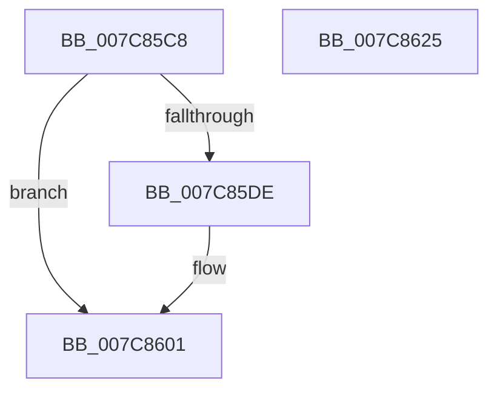

# ExpInitLicensing

- RVA: `0x007C85C8`–`0x007C8626` (길이 `94` bytes)
- VA: `0x00000001407C85C8`
- 실행 섹션: `PAGE`
- PDB 이름 있음: `예`; PDB Function 태그: `아니요`
- unwind 정보 RVA: `0x000DB714`
- 디코드: `18`개 명령, `94/94` bytes 표시
- 미해석 바이트: `0` (있으면 어셈블리에 `.byte`로 보존)

> 이 문서는 커널 이미지의 기계어와 PDB 기호를 분석해 생성했습니다. 4번과 5번은 함수 원형과 자료형을 바이너리 사용 방식에서 추정한 C 해석이며 원본 소스 복구 결과는 아닙니다.

## 1. Dependencies

- 직접 호출 지점: **0**; 고유 호출 대상: **0**
- 직접 호출자로 확인된 함수: **2**
- RIP 상대 이미지 참조: **5**

### Outgoing calls
- 직접 디코드된 call 명령이 없습니다.

### Direct callers
- [sub_006578CC](../../text/65/Unknown_function_006578CC.md) at `0x006579B4`
- [InitBootProcessor](../../init/C1/InitBootProcessor_function_00C1B1C8.md) at `0x00C1B2C8`

### Static image references
- `0x007C85C8` → RVA `0x00FCF940` (`CACHEALI`; read)
- `0x007C85DE` → RVA `0x010146C0` (`INITDATA`; read)
- `0x007C85E5` → RVA `0x010286C0` (`INITDATA`; write)
- `0x007C85F0` → RVA `0x00FE7CC0` (`PAGEDATA`; write)
- `0x007C85F7` → RVA `0x00FE7CC0` (`PAGEDATA`; read)

## 2. Other-region calls and transfers

- 다른 실행 섹션으로 향하는 call: **0**
- 별도 외부 분기/꼬리 이동을 확인하지 못했습니다.

## 3. Assembly (complete function range)

```asm
007C85C8  48 8D 15 71 73 80 00            lea rdx, [rip + 0x807371]
007C85CF  45 33 C0                        xor r8d, r8d
007C85D2  48 8D 81 68 03 00 00            lea rax, [rcx + 0x368]
007C85D9  48 3B CA                        cmp rcx, rdx
007C85DC  75 23                           jne 0x1407c8601
007C85DE  48 8D 0D DB C0 84 00            lea rcx, [rip + 0x84c0db]
007C85E5  48 C7 05 D0 00 86 00 00 40 01 00  mov qword ptr [rip + 0x8600d0], 0x14000
007C85F0  48 89 0D C9 F6 81 00            mov qword ptr [rip + 0x81f6c9], rcx
007C85F7  48 8D 0D C2 F6 81 00            lea rcx, [rip + 0x81f6c2]
007C85FE  48 89 08                        mov qword ptr [rax], rcx
007C8601  48 8B 00                        mov rax, qword ptr [rax]
007C8604  83 88 B8 B7 00 00 FF            or dword ptr [rax + 0xb7b8], 0xffffffff
007C860B  44 89 40 08                     mov dword ptr [rax + 8], r8d
007C860F  44 89 80 8C B7 00 00            mov dword ptr [rax + 0xb78c], r8d
007C8616  4C 89 80 F8 B6 00 00            mov qword ptr [rax + 0xb6f8], r8
007C861D  4C 89 80 B0 B7 00 00            mov qword ptr [rax + 0xb7b0], r8
007C8624  C3                              ret
007C8625  CC                              int3
```

## 4. C-style interpretation (structured pseudocode)

```c
__int64 __fastcall ExpInitLicensing(__int64 a1, __int64 a2, int a3)
{
    a3 = 0;
    if (a1 == (v_rip + 8418161)) {
        a1 = v_rip + 8700123;
        *(unsigned __int64 *)(v_rip + 8782032) = 0x14000ULL;
        *(unsigned __int64 *)(v_rip + 8517321) = a1;
        a1 = v_rip + 8517314;
        *(unsigned __int64 *)(a1 + 872) = a1;
    }
    *(unsigned int *)(*(unsigned __int64 *)(a1 + 872) + 8) = 0;
    *(unsigned int *)(*(unsigned __int64 *)(a1 + 872) + 46988) = 0;
    *(unsigned __int64 *)(*(unsigned __int64 *)(a1 + 872) + 46840) = 0;
    *(unsigned __int64 *)(*(unsigned __int64 *)(a1 + 872) + 47024) = 0;
    return *(unsigned __int64 *)(a1 + 872);
}
```

## 5. (Beta) C Style

```c
int64_t ExpInitLicensing(void *Arg1, int64_t Arg2, int32_t Arg3)
{
    uint8_t *arg1 = (uint8_t *)Arg1;

    Arg3 = 0;
    if (Arg1 == (v_rip + 8418161)) {
        Arg1 = v_rip + 8700123;
        *(uint64_t *)(v_rip + 0x8600D0) = 0x14000ULL;
        *(void **)(v_rip + 0x81F6C9) = Arg1;
        Arg1 = v_rip + 8517314;
        *(void **)(arg1 + 0x368) = Arg1;
    }
    *(uint32_t *)(*(uint64_t *)(arg1 + 0x368) + 0x8) = 0;
    *(uint32_t *)(*(uint64_t *)(arg1 + 0x368) + 0xB78C) = 0;
    *(uint64_t *)(*(uint64_t *)(arg1 + 0x368) + 0xB6F8) = 0;
    *(uint64_t *)(*(uint64_t *)(arg1 + 0x368) + 0xB7B0) = 0;
    return *(uint64_t *)(arg1 + 0x368);
}
```

### 관측된 메모리 오프셋

구조체 형식이 확인되지 않은 접근은 인자 기준의 오프셋으로만 기록했습니다.

| 기준 인자 | 오프셋 표현 | 폭 (bit) | 접근 |
|---|---:|---:|---|
| `Arg1` | `+ 0x0` | `64` | `R` |
| `Arg1` | `+ 0x0` | `64` | `W` |
| `Arg1` | `+ 0x368` | `64` | `R` |

## 6. Execution-region graph

[열기: 2D/3D 그래프와 함수 탐색 컨트롤 패널](../../../control-panel.html?section=page&rva=0x007C85C8&view=graph)

- 2D 그래프는 위에서 아래로 흐르고, 3D 그래프는 빈 공간을 드래그해 회전합니다. Shift+드래그는 이동, 휠은 확대·축소, 함수 노드 선택은 대상 보고서 이동입니다.

### Static fallback


