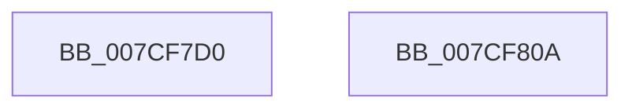

# ExpIoPoolDeadlockWorker

- RVA: `0x007CF7D0`–`0x007CF80B` (길이 `59` bytes)
- VA: `0x00000001407CF7D0`
- 실행 섹션: `PAGE`
- PDB 이름 있음: `예`; PDB Function 태그: `아니요`
- unwind 정보 RVA: `0x0005CC98`
- 디코드: `16`개 명령, `59/59` bytes 표시
- 미해석 바이트: `0` (있으면 어셈블리에 `.byte`로 보존)

> 이 문서는 커널 이미지의 기계어와 PDB 기호를 분석해 생성했습니다. 4번과 5번은 함수 원형과 자료형을 바이너리 사용 방식에서 추정한 C 해석이며 원본 소스 복구 결과는 아닙니다.

## 1. Dependencies

- 직접 호출 지점: **1**; 고유 호출 대상: **1**
- 직접 호출자로 확인된 함수: **0**
- RIP 상대 이미지 참조: **1**

### Outgoing calls
- `0x007CF800` → [DbgkWerCaptureLiveKernelDump](../AC/DbgkWerCaptureLiveKernelDump_function_00AC1E90.md) (function, `0x00AC1E90`)

### Direct callers
- 이 함수 시작 RVA로 연결되는 직접 call은 확인되지 않았습니다. 간접 호출은 완전히 역산할 수 없습니다.

### Static image references
- `0x007CF7E9` → RVA `0x00B08A50` (` ?? ::NNGAKEGL::`string'`; read)

## 2. Other-region calls and transfers

- 다른 실행 섹션으로 향하는 call: **0**
- 별도 외부 분기/꼬리 이동을 확인하지 못했습니다.

## 3. Assembly (complete function range)

```asm
007CF7D0  4C 8B DC                        mov r11, rsp
007CF7D3  48 83 EC 58                     sub rsp, 0x58
007CF7D7  4C 63 01                        movsxd r8, dword ptr [rcx]
007CF7DA  33 C0                           xor eax, eax
007CF7DC  4C 8B 49 08                     mov r9, qword ptr [rcx + 8]
007CF7E0  BA C5 01 00 00                  mov edx, 0x1c5
007CF7E5  89 44 24 40                     mov dword ptr [rsp + 0x40], eax
007CF7E9  48 8D 0D 60 92 33 00            lea rcx, [rip + 0x339260]
007CF7F0  49 89 43 E0                     mov qword ptr [r11 - 0x20], rax
007CF7F4  49 89 43 D8                     mov qword ptr [r11 - 0x28], rax
007CF7F8  49 89 43 D0                     mov qword ptr [r11 - 0x30], rax
007CF7FC  49 89 43 C8                     mov qword ptr [r11 - 0x38], rax
007CF800  E8 8B 26 2F 00                  call 0x140ac1e90
007CF805  48 83 C4 58                     add rsp, 0x58
007CF809  C3                              ret
007CF80A  CC                              int3
```

## 4. C-style interpretation (structured pseudocode)

```c
__int64 __fastcall ExpIoPoolDeadlockWorker(__int64 a1)
{
    __int64 result;
    __int64 v_rsp;
    unsigned int v_stack_m18;

    v_rsp = (v_rsp) - (88);
    result = 0;
    v_stack_m18 = 0;
    *(unsigned __int64 *)(v_rsp - 32) = 0;
    *(unsigned __int64 *)(v_rsp - 40) = 0;
    *(unsigned __int64 *)(v_rsp - 48) = 0;
    *(unsigned __int64 *)(v_rsp - 56) = 0;
    result = DbgkWerCaptureLiveKernelDump(v_rip + 3379808, 453, (int)(*(unsigned int *)(a1)), *(unsigned __int64 *)(a1 + 8));
    v_rsp = (v_rsp) + (88);
    return result;
}
```

## 5. (Beta) C Style

```c
int64_t ExpIoPoolDeadlockWorker(void *Arg1)
{
    uint8_t *arg1 = (uint8_t *)Arg1;

    int64_t result;
    int64_t local_rsp;
    uint32_t v_stack_m18;

    local_rsp = (local_rsp) - (88);
    result = 0;
    v_stack_m18 = 0;
    *(uint64_t *)(local_rsp - 0x20) = 0;
    *(uint64_t *)(local_rsp - 0x28) = 0;
    *(uint64_t *)(local_rsp - 0x30) = 0;
    *(uint64_t *)(local_rsp - 0x38) = 0;
    result = DbgkWerCaptureLiveKernelDump(v_rip + 3379808, 453, (int32_t)(*(uint32_t *)(arg1)), *(uint64_t *)(arg1 + 0x8));
    local_rsp = (local_rsp) + (88);
    return result;
}
```

### 관측된 메모리 오프셋

구조체 형식이 확인되지 않은 접근은 인자 기준의 오프셋으로만 기록했습니다.

| 기준 인자 | 오프셋 표현 | 폭 (bit) | 접근 |
|---|---:|---:|---|
| `Arg1` | `+ 0x0` | `32` | `R` |
| `Arg1` | `+ 0x8` | `64` | `R` |

## 6. Execution-region graph

[열기: 2D/3D 그래프와 함수 탐색 컨트롤 패널](../../../control-panel.html?section=page&rva=0x007CF7D0&view=graph)

- 2D 그래프는 위에서 아래로 흐르고, 3D 그래프는 빈 공간을 드래그해 회전합니다. Shift+드래그는 이동, 휠은 확대·축소, 함수 노드 선택은 대상 보고서 이동입니다.

### Static fallback


