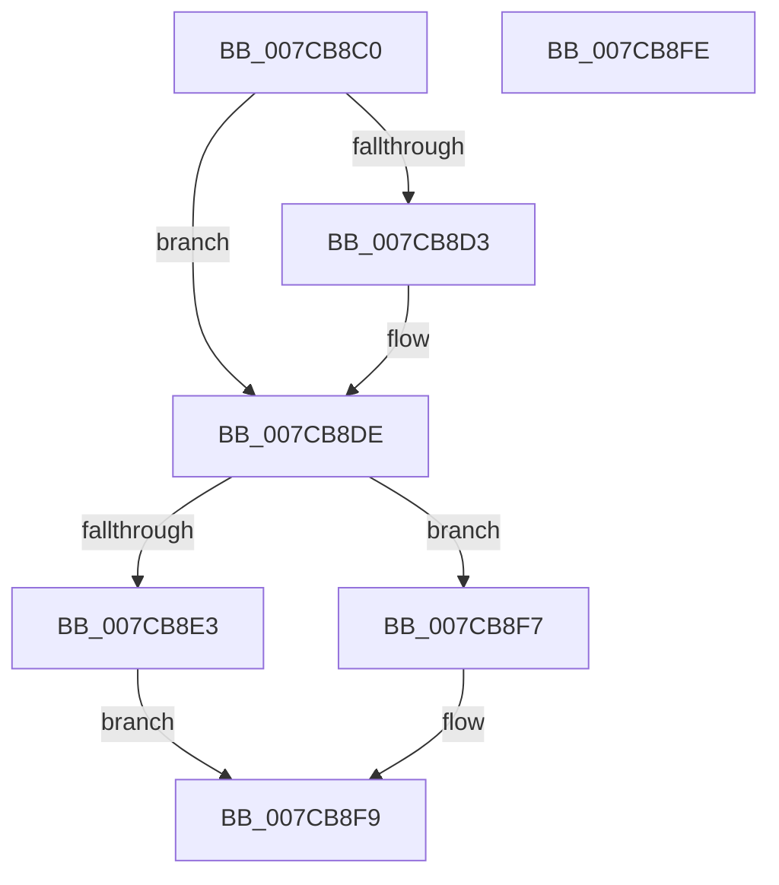

# ExpIsDriverEntry

- RVA: `0x007CB8C0`–`0x007CB8FF` (길이 `63` bytes)
- VA: `0x00000001407CB8C0`
- 실행 섹션: `PAGE`
- PDB 이름 있음: `예`; PDB Function 태그: `아니요`
- unwind 정보 RVA: `0x0005C788`
- 디코드: `19`개 명령, `63/63` bytes 표시
- 미해석 바이트: `0` (있으면 어셈블리에 `.byte`로 보존)

> 이 문서는 커널 이미지의 기계어와 PDB 기호를 분석해 생성했습니다. 4번과 5번은 함수 원형과 자료형을 바이너리 사용 방식에서 추정한 C 해석이며 원본 소스 복구 결과는 아닙니다.

## 1. Dependencies

- 직접 호출 지점: **1**; 고유 호출 대상: **1**
- 직접 호출자로 확인된 함수: **0**
- RIP 상대 이미지 참조: **2**

### Outgoing calls
- `0x007CB8EB` → [ExpTranslateDriverEntryNameToId](ExpTranslateDriverEntryNameToId_function_007CCB40.md) (function, `0x007CCB40`)

### Direct callers
- 이 함수 시작 RVA로 연결되는 직접 call은 확인되지 않았습니다. 간접 호출은 완전히 역산할 수 없습니다.

### Static image references
- `0x007CB8CA` → RVA `0x000394B8` (`.rdata`; read)
- `0x007CB8D7` → RVA `0x000394C0` (`.rdata`; read)

## 2. Other-region calls and transfers

- 다른 실행 섹션으로 향하는 call: **0**
- 별도 외부 분기/꼬리 이동을 확인하지 못했습니다.

## 3. Assembly (complete function range)

```asm
007CB8C0  48 83 EC 28                     sub rsp, 0x28
007CB8C4  48 8B 01                        mov rax, qword ptr [rcx]
007CB8C7  4C 8B C2                        mov r8, rdx
007CB8CA  48 2B 05 E7 DB 86 FF            sub rax, qword ptr [rip - 0x792419]
007CB8D1  75 0B                           jne 0x1407cb8de
007CB8D3  48 8B 41 08                     mov rax, qword ptr [rcx + 8]
007CB8D7  48 2B 05 E2 DB 86 FF            sub rax, qword ptr [rip - 0x79241e]
007CB8DE  48 85 C0                        test rax, rax
007CB8E1  75 14                           jne 0x1407cb8f7
007CB8E3  48 8D 54 24 40                  lea rdx, [rsp + 0x40]
007CB8E8  49 8B C8                        mov rcx, r8
007CB8EB  E8 50 12 00 00                  call 0x1407ccb40
007CB8F0  85 C0                           test eax, eax
007CB8F2  0F 95 C0                        setne al
007CB8F5  EB 02                           jmp 0x1407cb8f9
007CB8F7  32 C0                           xor al, al
007CB8F9  48 83 C4 28                     add rsp, 0x28
007CB8FD  C3                              ret
007CB8FE  CC                              int3
```

## 4. C-style interpretation (structured pseudocode)

```c
__int64 __fastcall ExpIsDriverEntry(__int64 a1, __int64 a2)
{
    __int64 result;
    __int64 v_rsp;
    unsigned __int64 v_stack_p18;

    v_rsp = (v_rsp) - (40);
    result = (*(unsigned __int64 *)(a1)) - (*(unsigned __int64 *)(v_rip - 7939097));
    if (!(condition_is_not_equal)) {
        result = *(unsigned __int64 *)(a1 + 8);
        result = (result) - (*(unsigned __int64 *)(v_rip - 7939102));
    }
    if (result != 0) goto loc_007CB8F7;
    result = ExpTranslateDriverEntryNameToId(a2, v_stack_p18, a2, a4);
    result = ((unsigned int)(result) != 0) ? 1 : 0;
    goto loc_007CB8F9;
loc_007CB8F7:
    result = 0;
loc_007CB8F9:
    v_rsp = (v_rsp) + (40);
    return result;
}
```

## 5. (Beta) C Style

```c
int64_t ExpIsDriverEntry(void *Arg1, int64_t Arg2)
{
    uint8_t *arg1 = (uint8_t *)Arg1;

    int64_t result;
    int64_t local_rsp;
    uint64_t v_stack_p18;

    local_rsp = (local_rsp) - (40);
    result = (*(uint64_t *)(arg1)) - (*(uint64_t *)(v_rip - 0x792419));
    if (!(condition_is_not_equal)) {
        result = *(uint64_t *)(arg1 + 0x8);
        result = (result) - (*(uint64_t *)(v_rip - 0x79241E));
    }
    if (result != 0) goto loc_007CB8F7;
    result = ExpTranslateDriverEntryNameToId(Arg2, v_stack_p18, Arg2, a4);
    result = ((uint32_t)(result) != 0) ? 1 : 0;
    goto loc_007CB8F9;
loc_007CB8F7:
    result = 0;
loc_007CB8F9:
    local_rsp = (local_rsp) + (40);
    return result;
}
```

### 관측된 메모리 오프셋

구조체 형식이 확인되지 않은 접근은 인자 기준의 오프셋으로만 기록했습니다.

| 기준 인자 | 오프셋 표현 | 폭 (bit) | 접근 |
|---|---:|---:|---|
| `Arg1` | `+ 0x0` | `64` | `R` |
| `Arg1` | `+ 0x8` | `64` | `R` |

## 6. Execution-region graph

[열기: 2D/3D 그래프와 함수 탐색 컨트롤 패널](../../../control-panel.html?section=page&rva=0x007CB8C0&view=graph)

- 2D 그래프는 위에서 아래로 흐르고, 3D 그래프는 빈 공간을 드래그해 회전합니다. Shift+드래그는 이동, 휠은 확대·축소, 함수 노드 선택은 대상 보고서 이동입니다.

### Static fallback


