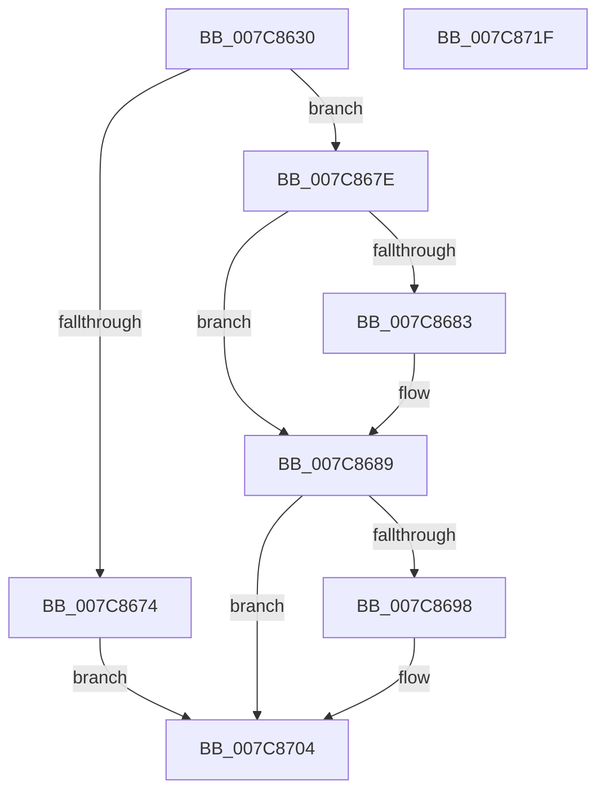

# ExpKernelExpirationDateCacheProvider

- RVA: `0x007C8630`–`0x007C8720` (길이 `240` bytes)
- VA: `0x00000001407C8630`
- 실행 섹션: `PAGE`
- PDB 이름 있음: `예`; PDB Function 태그: `아니요`
- unwind 정보 RVA: `0x000D4E3C`
- 디코드: `70`개 명령, `240/240` bytes 표시
- 미해석 바이트: `0` (있으면 어셈블리에 `.byte`로 보존)

> 이 문서는 커널 이미지의 기계어와 PDB 기호를 분석해 생성했습니다. 4번과 5번은 함수 원형과 자료형을 바이너리 사용 방식에서 추정한 C 해석이며 원본 소스 복구 결과는 아닙니다.

## 1. Dependencies

- 직접 호출 지점: **3**; 고유 호출 대상: **3**
- 직접 호출자로 확인된 함수: **0**
- RIP 상대 이미지 참조: **1**

### Outgoing calls
- `0x007C868D` → [SeCodeIntegrityGetBuildExpiryTime](../79/SeCodeIntegrityGetBuildExpiryTime_function_0079B7E0.md) (function, `0x0079B7E0`)
- `0x007C86A0` → [RtlTimeToTimeFields](../../text/42/RtlTimeToTimeFields_function_0042E0F0.md) (function, `0x0042E0F0`)
- `0x007C870D` → [_security_check_cookie](../../text/6A/_security_check_cookie_function_006AC640.md) (function, `0x006AC640`)

### Direct callers
- 이 함수 시작 RVA로 연결되는 직접 call은 확인되지 않았습니다. 간접 호출은 완전히 역산할 수 없습니다.

### Static image references
- `0x007C863F` → RVA `0x00E0A740` (`.data`; read)

## 2. Other-region calls and transfers

- 다른 실행 섹션으로 향하는 call: **2**
  - `0x007C86A0` → [RtlTimeToTimeFields](../../text/42/RtlTimeToTimeFields_function_0042E0F0.md) (`PAGE` → `.text`)
  - `0x007C870D` → [_security_check_cookie](../../text/6A/_security_check_cookie_function_006AC640.md) (`PAGE` → `.text`)
- 별도 외부 분기/꼬리 이동을 확인하지 못했습니다.

## 3. Assembly (complete function range)

```asm
007C8630  48 89 5C 24 08                  mov qword ptr [rsp + 8], rbx
007C8635  55                              push rbp
007C8636  56                              push rsi
007C8637  57                              push rdi
007C8638  48 8B EC                        mov rbp, rsp
007C863B  48 83 EC 50                     sub rsp, 0x50
007C863F  48 8B 05 FA 20 64 00            mov rax, qword ptr [rip + 0x6420fa]
007C8646  48 33 C4                        xor rax, rsp
007C8649  48 89 45 F8                     mov qword ptr [rbp - 8], rax
007C864D  48 8B 45 40                     mov rax, qword ptr [rbp + 0x40]
007C8651  0F 57 C0                        xorps xmm0, xmm0
007C8654  83 65 F4 00                     and dword ptr [rbp - 0xc], 0
007C8658  49 8B F8                        mov rdi, r8
007C865B  48 83 65 E0 00                  and qword ptr [rbp - 0x20], 0
007C8660  48 8B 75 48                     mov rsi, qword ptr [rbp + 0x48]
007C8664  C7 00 10 00 00 00               mov dword ptr [rax], 0x10
007C866A  0F 11 45 D0                     movups xmmword ptr [rbp - 0x30], xmm0
007C866E  41 83 F9 10                     cmp r9d, 0x10
007C8672  73 0A                           jae 0x1407c867e
007C8674  BB 23 00 00 C0                  mov ebx, 0xc0000023
007C8679  E9 86 00 00 00                  jmp 0x1407c8704
007C867E  48 85 D2                        test rdx, rdx
007C8681  74 06                           je 0x1407c8689
007C8683  C7 02 03 00 00 00               mov dword ptr [rdx], 3
007C8689  48 8D 4D E0                     lea rcx, [rbp - 0x20]
007C868D  E8 4E 31 FD FF                  call 0x14079b7e0
007C8692  8B D8                           mov ebx, eax
007C8694  85 C0                           test eax, eax
007C8696  78 6C                           js 0x1407c8704
007C8698  48 8D 55 D0                     lea rdx, [rbp - 0x30]
007C869C  48 8D 4D E0                     lea rcx, [rbp - 0x20]
007C86A0  E8 4B 5A C6 FF                  call 0x14042e0f0
007C86A5  0F B7 45 D4                     movzx eax, word ptr [rbp - 0x2c]
007C86A9  0F B7 4D D0                     movzx ecx, word ptr [rbp - 0x30]
007C86AD  88 45 EC                        mov byte ptr [rbp - 0x14], al
007C86B0  66 C1 E8 08                     shr ax, 8
007C86B4  88 45 ED                        mov byte ptr [rbp - 0x13], al
007C86B7  0F B7 45 D6                     movzx eax, word ptr [rbp - 0x2a]
007C86BB  88 45 EE                        mov byte ptr [rbp - 0x12], al
007C86BE  66 C1 E8 08                     shr ax, 8
007C86C2  88 45 EF                        mov byte ptr [rbp - 0x11], al
007C86C5  0F B7 45 D8                     movzx eax, word ptr [rbp - 0x28]
007C86C9  88 4D E8                        mov byte ptr [rbp - 0x18], cl
007C86CC  66 C1 E9 08                     shr cx, 8
007C86D0  88 45 F0                        mov byte ptr [rbp - 0x10], al
007C86D3  66 C1 E8 08                     shr ax, 8
007C86D7  88 4D E9                        mov byte ptr [rbp - 0x17], cl
007C86DA  0F B7 4D D2                     movzx ecx, word ptr [rbp - 0x2e]
007C86DE  88 45 F1                        mov byte ptr [rbp - 0xf], al
007C86E1  0F B7 45 DA                     movzx eax, word ptr [rbp - 0x26]
007C86E5  88 4D EA                        mov byte ptr [rbp - 0x16], cl
007C86E8  66 C1 E9 08                     shr cx, 8
007C86EC  88 45 F2                        mov byte ptr [rbp - 0xe], al
007C86EF  66 C1 E8 08                     shr ax, 8
007C86F3  88 45 F3                        mov byte ptr [rbp - 0xd], al
007C86F6  88 4D EB                        mov byte ptr [rbp - 0x15], cl
007C86F9  0F 10 45 E8                     movups xmm0, xmmword ptr [rbp - 0x18]
007C86FD  F3 0F 7F 07                     movdqu xmmword ptr [rdi], xmm0
007C8701  C6 06 01                        mov byte ptr [rsi], 1
007C8704  8B C3                           mov eax, ebx
007C8706  48 8B 4D F8                     mov rcx, qword ptr [rbp - 8]
007C870A  48 33 CC                        xor rcx, rsp
007C870D  E8 2E 3F EE FF                  call 0x1406ac640
007C8712  48 8B 5C 24 70                  mov rbx, qword ptr [rsp + 0x70]
007C8717  48 83 C4 50                     add rsp, 0x50
007C871B  5F                              pop rdi
007C871C  5E                              pop rsi
007C871D  5D                              pop rbp
007C871E  C3                              ret
007C871F  CC                              int3
```

## 4. C-style interpretation (structured pseudocode)

```c
__int64 __fastcall ExpKernelExpirationDateCacheProvider(__int64 a1, __int64 a2, __int64 a3, int a4, __int64 a5, __int64 a6)
{
    __int64 result;
    __int64 v_rsp;
    unsigned __int64 v_stack_m20;
    unsigned int v_stack_m24;
    unsigned __int8 v_stack_m25;
    unsigned __int8 v_stack_m26;
    unsigned __int8 v_stack_m27;
    unsigned __int8 v_stack_m28;
    unsigned __int8 v_stack_m29;
    unsigned __int8 v_stack_m2A;
    unsigned __int8 v_stack_m2B;
    unsigned __int8 v_stack_m2C;
    unsigned __int8 v_stack_m2D;
    unsigned __int8 v_stack_m2E;
    unsigned __int8 v_stack_m2F;
    unsigned __int8 v_stack_m30;
    unsigned __int64 v_stack_m38;
    unsigned __int16 v_stack_m3E;
    unsigned __int16 v_stack_m40;
    unsigned __int16 v_stack_m42;
    unsigned __int16 v_stack_m44;
    unsigned __int16 v_stack_m46;
    unsigned __int64 v_stack_m48;
    unsigned __int64 v_stack_p8;

    v_stack_p8 = v_rbx;
    v_rsp = (v_rsp) - (80);
    result = (*(unsigned __int64 *)(v_rip + 6562042)) ^ (v_rsp);
    v_stack_m20 = result;
    *(unsigned int *)(a5) = 16;
    v_stack_m48 = v_xmm0;
    if (a4 >= 16) goto loc_007C867E;
    goto loc_007C8704;
loc_007C867E:
    if (a2 != 0) {
        *(unsigned int *)(a2) = 3;
    }
    result = SeCodeIntegrityGetBuildExpiryTime(v_stack_m38, a2, a3, a4);
    if (!(sign_flag)) {
        a2 = v_stack_m48;
        a1 = v_stack_m38;
        result = RtlTimeToTimeFields(a1, a2, a3, a4);
        result = v_stack_m44;
        a1 = v_stack_m48;
        v_stack_m2C = (unsigned __int8)(result);
        result = (unsigned __int16)((result) >> (8));
        v_stack_m2B = (unsigned __int8)(result);
        result = v_stack_m42;
        v_stack_m2A = (unsigned __int8)(result);
        result = (unsigned __int16)((result) >> (8));
        v_stack_m29 = (unsigned __int8)(result);
        result = v_stack_m40;
        v_stack_m30 = (unsigned __int8)(a1);
        a1 = (unsigned __int16)((a1) >> (8));
        v_stack_m28 = (unsigned __int8)(result);
        result = (unsigned __int16)((result) >> (8));
        v_stack_m2F = (unsigned __int8)(a1);
        a1 = v_stack_m46;
        v_stack_m27 = (unsigned __int8)(result);
        result = v_stack_m3E;
        v_stack_m2E = (unsigned __int8)(a1);
        a1 = (unsigned __int16)((a1) >> (8));
        v_stack_m26 = (unsigned __int8)(result);
        result = (unsigned __int16)((result) >> (8));
        v_stack_m25 = (unsigned __int8)(result);
        v_stack_m2D = (unsigned __int8)(a1);
        *(unsigned __int64 *)(a3) = v_xmm0;
        *(unsigned __int8 *)(a6) = 1;
    }
    a1 = (v_stack_m20) ^ (v_rsp);
    result = _security_check_cookie(a1, a2, a3, a4);
    v_rsp = (v_rsp) + (80);
    return result;
}
```

## 5. (Beta) C Style

```c
int64_t ExpKernelExpirationDateCacheProvider(int64_t Arg1, int64_t Arg2, void *Arg3, int32_t Arg4, void *Arg5, void *Arg6)
{
    uint8_t *arg3 = (uint8_t *)Arg3;
    uint8_t *arg5 = (uint8_t *)Arg5;
    uint8_t *arg6 = (uint8_t *)Arg6;

    int64_t result;
    int64_t local_rsp;
    uint64_t v_stack_m20;
    uint32_t v_stack_m24;
    uint8_t v_stack_m25;
    uint8_t v_stack_m26;
    uint8_t v_stack_m27;
    uint8_t v_stack_m28;
    uint8_t v_stack_m29;
    uint8_t v_stack_m2A;
    uint8_t v_stack_m2B;
    uint8_t v_stack_m2C;
    uint8_t v_stack_m2D;
    uint8_t v_stack_m2E;
    uint8_t v_stack_m2F;
    uint8_t v_stack_m30;
    uint64_t v_stack_m38;
    uint16_t v_stack_m3E;
    uint16_t v_stack_m40;
    uint16_t v_stack_m42;
    uint16_t v_stack_m44;
    uint16_t v_stack_m46;
    uint64_t v_stack_m48;
    uint64_t v_stack_p8;

    v_stack_p8 = local_rbx;
    local_rsp = (local_rsp) - (80);
    result = (*(uint64_t *)(v_rip + 0x6420FA)) ^ (local_rsp);
    v_stack_m20 = result;
    *(uint32_t *)(arg5) = 16;
    v_stack_m48 = v_xmm0;
    if (Arg4 >= 16) goto loc_007C867E;
    goto loc_007C8704;
loc_007C867E:
    if (Arg2 != 0) {
        *(uint32_t *)(Arg2) = 3;
    }
    result = SeCodeIntegrityGetBuildExpiryTime(v_stack_m38, Arg2, Arg3, Arg4);
    if (!(sign_flag)) {
        Arg2 = v_stack_m48;
        Arg1 = v_stack_m38;
        result = RtlTimeToTimeFields(Arg1, Arg2, Arg3, Arg4);
        result = v_stack_m44;
        Arg1 = v_stack_m48;
        v_stack_m2C = (uint8_t)(result);
        result = (uint16_t)((result) >> (8));
        v_stack_m2B = (uint8_t)(result);
        result = v_stack_m42;
        v_stack_m2A = (uint8_t)(result);
        result = (uint16_t)((result) >> (8));
        v_stack_m29 = (uint8_t)(result);
        result = v_stack_m40;
        v_stack_m30 = (uint8_t)(Arg1);
        Arg1 = (uint16_t)((Arg1) >> (8));
        v_stack_m28 = (uint8_t)(result);
        result = (uint16_t)((result) >> (8));
        v_stack_m2F = (uint8_t)(Arg1);
        Arg1 = v_stack_m46;
        v_stack_m27 = (uint8_t)(result);
        result = v_stack_m3E;
        v_stack_m2E = (uint8_t)(Arg1);
        Arg1 = (uint16_t)((Arg1) >> (8));
        v_stack_m26 = (uint8_t)(result);
        result = (uint16_t)((result) >> (8));
        v_stack_m25 = (uint8_t)(result);
        v_stack_m2D = (uint8_t)(Arg1);
        *(uint64_t *)(arg3) = v_xmm0;
        *(uint8_t *)(arg6) = 1;
    }
    Arg1 = (v_stack_m20) ^ (local_rsp);
    result = _security_check_cookie(Arg1, Arg2, Arg3, Arg4);
    local_rsp = (local_rsp) + (80);
    return result;
}
```

### 관측된 메모리 오프셋

구조체 형식이 확인되지 않은 접근은 인자 기준의 오프셋으로만 기록했습니다.

| 기준 인자 | 오프셋 표현 | 폭 (bit) | 접근 |
|---|---:|---:|---|
| `Arg3` | `+ 0x0` | `128` | `W` |
| `Arg5` | `+ 0x0` | `32` | `W` |
| `Arg6` | `+ 0x0` | `8` | `W` |

## 6. Execution-region graph

[열기: 2D/3D 그래프와 함수 탐색 컨트롤 패널](../../../control-panel.html?section=page&rva=0x007C8630&view=graph)

- 2D 그래프는 위에서 아래로 흐르고, 3D 그래프는 빈 공간을 드래그해 회전합니다. Shift+드래그는 이동, 휠은 확대·축소, 함수 노드 선택은 대상 보고서 이동입니다.

### Static fallback


