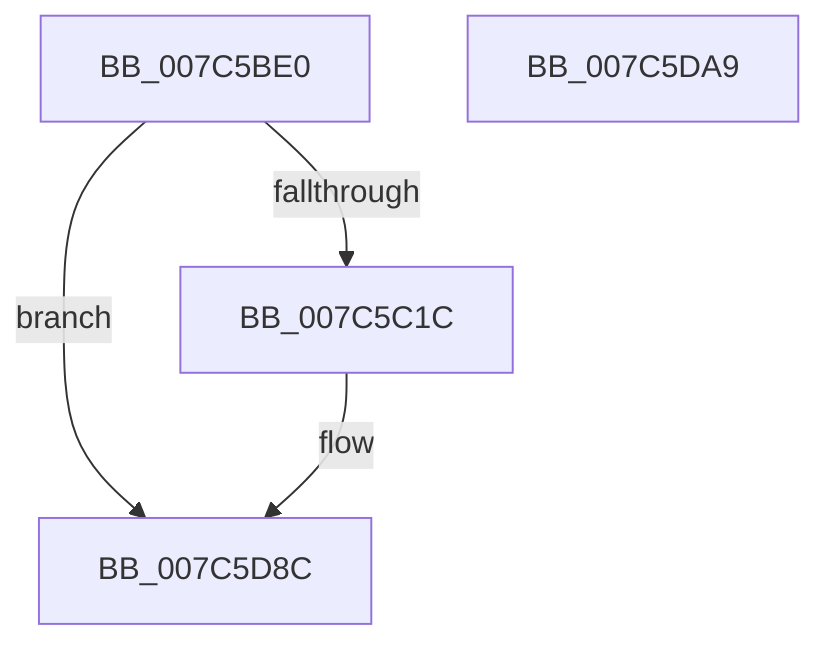

# ExpLogRefreshTimeZoneInformationCutoverFail

- RVA: `0x007C5BE0`–`0x007C5DAA` (길이 `458` bytes)
- VA: `0x00000001407C5BE0`
- 실행 섹션: `PAGE`
- PDB 이름 있음: `예`; PDB Function 태그: `아니요`
- unwind 정보 RVA: `0x000D4904`
- 디코드: `91`개 명령, `458/458` bytes 표시
- 미해석 바이트: `0` (있으면 어셈블리에 `.byte`로 보존)

> 이 문서는 커널 이미지의 기계어와 PDB 기호를 분석해 생성했습니다. 4번과 5번은 함수 원형과 자료형을 바이너리 사용 방식에서 추정한 C 해석이며 원본 소스 복구 결과는 아닙니다.

## 1. Dependencies

- 직접 호출 지점: **4**; 고유 호출 대상: **4**
- 직접 호출자로 확인된 함수: **1**
- RIP 상대 이미지 참조: **4**

### Outgoing calls
- `0x007C5C03` → [PsGetCurrentServerSiloGlobals](../../text/2F/PsGetCurrentServerSiloGlobals_function_002FE1F0.md) (function, `0x002FE1F0`)
- `0x007C5CD7` → [tlgCreate1Sz_wchar_t](../../text/42/tlgCreate1Sz_wchar_t_function_00426198.md) (function, `0x00426198`)
- `0x007C5D87` → [tlgWriteTransfer_EtwWriteTransfer](../../text/42/tlgWriteTransfer_EtwWriteTransfer_function_004260E0.md) (function, `0x004260E0`)
- `0x007C5D93` → [_security_check_cookie](../../text/6A/_security_check_cookie_function_006AC640.md) (function, `0x006AC640`)

### Direct callers
- [ExpRefreshTimeZoneInformation](../A6/ExpRefreshTimeZoneInformation_function_00A6B46C.md) at `0x00A6B766`
- [ExpRefreshTimeZoneInformation](../A6/ExpRefreshTimeZoneInformation_function_00A6B46C.md) at `0x00A6B7B9`

### Static image references
- `0x007C5BF2` → RVA `0x00E0A740` (`.data`; read)
- `0x007C5C08` → RVA `0x00E09388` (`.data`; read)
- `0x007C5C6D` → RVA `0x00E68570` (`.data`; read)
- `0x007C5CEC` → RVA `0x00055AF6` (`.rdata`; read)

## 2. Other-region calls and transfers

- 다른 실행 섹션으로 향하는 call: **4**
  - `0x007C5C03` → [PsGetCurrentServerSiloGlobals](../../text/2F/PsGetCurrentServerSiloGlobals_function_002FE1F0.md) (`PAGE` → `.text`)
  - `0x007C5CD7` → [tlgCreate1Sz_wchar_t](../../text/42/tlgCreate1Sz_wchar_t_function_00426198.md) (`PAGE` → `.text`)
  - `0x007C5D87` → [tlgWriteTransfer_EtwWriteTransfer](../../text/42/tlgWriteTransfer_EtwWriteTransfer_function_004260E0.md) (`PAGE` → `.text`)
  - `0x007C5D93` → [_security_check_cookie](../../text/6A/_security_check_cookie_function_006AC640.md) (`PAGE` → `.text`)
- 별도 외부 분기/꼬리 이동을 확인하지 못했습니다.

## 3. Assembly (complete function range)

```asm
007C5BE0  48 89 5C 24 10                  mov qword ptr [rsp + 0x10], rbx
007C5BE5  55                              push rbp
007C5BE6  48 8D 6C 24 90                  lea rbp, [rsp - 0x70]
007C5BEB  48 81 EC 70 01 00 00            sub rsp, 0x170
007C5BF2  48 8B 05 47 4B 64 00            mov rax, qword ptr [rip + 0x644b47]
007C5BF9  48 33 C4                        xor rax, rsp
007C5BFC  48 89 45 60                     mov qword ptr [rbp + 0x60], rax
007C5C00  4C 8B D1                        mov r10, rcx
007C5C03  E8 E8 85 B3 FF                  call 0x1402fe1f0
007C5C08  83 3D 79 37 64 00 05            cmp dword ptr [rip + 0x643779], 5
007C5C0F  48 8B 88 C8 04 00 00            mov rcx, qword ptr [rax + 0x4c8]
007C5C16  0F 86 70 01 00 00               jbe 0x1407c5d8c
007C5C1C  48 8D 44 24 30                  lea rax, [rsp + 0x30]
007C5C21  88 54 24 32                     mov byte ptr [rsp + 0x32], dl
007C5C25  48 89 45 80                     mov qword ptr [rbp - 0x80], rax
007C5C29  49 8D 92 AC 00 00 00            lea rdx, [r10 + 0xac]
007C5C30  8B 81 E8 03 00 00               mov eax, dword ptr [rcx + 0x3e8]
007C5C36  89 44 24 34                     mov dword ptr [rsp + 0x34], eax
007C5C3A  48 8D 44 24 34                  lea rax, [rsp + 0x34]
007C5C3F  48 89 45 90                     mov qword ptr [rbp - 0x70], rax
007C5C43  8B 81 B4 01 00 00               mov eax, dword ptr [rcx + 0x1b4]
007C5C49  89 44 24 38                     mov dword ptr [rsp + 0x38], eax
007C5C4D  48 8D 44 24 38                  lea rax, [rsp + 0x38]
007C5C52  48 89 45 A0                     mov qword ptr [rbp - 0x60], rax
007C5C56  8B 81 B0 01 00 00               mov eax, dword ptr [rcx + 0x1b0]
007C5C5C  48 8D 4D F0                     lea rcx, [rbp - 0x10]
007C5C60  89 44 24 3C                     mov dword ptr [rsp + 0x3c], eax
007C5C64  48 8D 44 24 3C                  lea rax, [rsp + 0x3c]
007C5C69  48 89 45 B0                     mov qword ptr [rbp - 0x50], rax
007C5C6D  8A 05 FD 28 6A 00               mov al, byte ptr [rip + 0x6a28fd]
007C5C73  88 44 24 31                     mov byte ptr [rsp + 0x31], al
007C5C77  48 8D 44 24 31                  lea rax, [rsp + 0x31]
007C5C7C  48 89 45 C0                     mov qword ptr [rbp - 0x40], rax
007C5C80  48 8D 44 24 32                  lea rax, [rsp + 0x32]
007C5C85  48 89 45 D0                     mov qword ptr [rbp - 0x30], rax
007C5C89  49 8B 00                        mov rax, qword ptr [r8]
007C5C8C  48 89 44 24 50                  mov qword ptr [rsp + 0x50], rax
007C5C91  48 8D 44 24 50                  lea rax, [rsp + 0x50]
007C5C96  48 89 45 E0                     mov qword ptr [rbp - 0x20], rax
007C5C9A  44 88 4C 24 30                  mov byte ptr [rsp + 0x30], r9b
007C5C9F  48 C7 45 88 01 00 00 00         mov qword ptr [rbp - 0x78], 1
007C5CA7  48 C7 45 98 04 00 00 00         mov qword ptr [rbp - 0x68], 4
007C5CAF  48 C7 45 A8 04 00 00 00         mov qword ptr [rbp - 0x58], 4
007C5CB7  48 C7 45 B8 04 00 00 00         mov qword ptr [rbp - 0x48], 4
007C5CBF  48 C7 45 C8 01 00 00 00         mov qword ptr [rbp - 0x38], 1
007C5CC7  48 C7 45 D8 01 00 00 00         mov qword ptr [rbp - 0x28], 1
007C5CCF  48 C7 45 E8 08 00 00 00         mov qword ptr [rbp - 0x18], 8
007C5CD7  E8 BC 04 C6 FF                  call 0x140426198
007C5CDC  41 8A 8A AC 01 00 00            mov cl, byte ptr [r10 + 0x1ac]
007C5CE3  48 8D 44 24 33                  lea rax, [rsp + 0x33]
007C5CE8  48 89 45 00                     mov qword ptr [rbp], rax
007C5CEC  48 8D 15 03 FE 88 FF            lea rdx, [rip - 0x7701fd]
007C5CF3  41 8B 02                        mov eax, dword ptr [r10]
007C5CF6  45 33 C9                        xor r9d, r9d
007C5CF9  89 44 24 40                     mov dword ptr [rsp + 0x40], eax
007C5CFD  45 33 C0                        xor r8d, r8d
007C5D00  48 8D 44 24 40                  lea rax, [rsp + 0x40]
007C5D05  88 4C 24 33                     mov byte ptr [rsp + 0x33], cl
007C5D09  48 89 45 10                     mov qword ptr [rbp + 0x10], rax
007C5D0D  B9 10 00 00 00                  mov ecx, 0x10
007C5D12  41 8B 42 54                     mov eax, dword ptr [r10 + 0x54]
007C5D16  89 44 24 44                     mov dword ptr [rsp + 0x44], eax
007C5D1A  48 8D 44 24 44                  lea rax, [rsp + 0x44]
007C5D1F  48 89 45 20                     mov qword ptr [rbp + 0x20], rax
007C5D23  41 8B 82 A8 00 00 00            mov eax, dword ptr [r10 + 0xa8]
007C5D2A  89 44 24 48                     mov dword ptr [rsp + 0x48], eax
007C5D2E  48 8D 44 24 48                  lea rax, [rsp + 0x48]
007C5D33  48 89 45 30                     mov qword ptr [rbp + 0x30], rax
007C5D37  49 8D 42 44                     lea rax, [r10 + 0x44]
007C5D3B  48 89 45 40                     mov qword ptr [rbp + 0x40], rax
007C5D3F  49 8D 82 98 00 00 00            lea rax, [r10 + 0x98]
007C5D46  48 89 45 50                     mov qword ptr [rbp + 0x50], rax
007C5D4A  48 8D 44 24 60                  lea rax, [rsp + 0x60]
007C5D4F  48 89 44 24 28                  mov qword ptr [rsp + 0x28], rax
007C5D54  89 4C 24 20                     mov dword ptr [rsp + 0x20], ecx
007C5D58  48 89 4D 48                     mov qword ptr [rbp + 0x48], rcx
007C5D5C  48 89 4D 58                     mov qword ptr [rbp + 0x58], rcx
007C5D60  48 8D 0D 21 36 64 00            lea rcx, [rip + 0x643621]
007C5D67  48 C7 45 08 01 00 00 00         mov qword ptr [rbp + 8], 1
007C5D6F  48 C7 45 18 04 00 00 00         mov qword ptr [rbp + 0x18], 4
007C5D77  48 C7 45 28 04 00 00 00         mov qword ptr [rbp + 0x28], 4
007C5D7F  48 C7 45 38 04 00 00 00         mov qword ptr [rbp + 0x38], 4
007C5D87  E8 54 03 C6 FF                  call 0x1404260e0
007C5D8C  48 8B 4D 60                     mov rcx, qword ptr [rbp + 0x60]
007C5D90  48 33 CC                        xor rcx, rsp
007C5D93  E8 A8 68 EE FF                  call 0x1406ac640
007C5D98  48 8B 9C 24 88 01 00 00         mov rbx, qword ptr [rsp + 0x188]
007C5DA0  48 81 C4 70 01 00 00            add rsp, 0x170
007C5DA7  5D                              pop rbp
007C5DA8  C3                              ret
007C5DA9  CC                              int3
```

## 4. C-style interpretation (structured pseudocode)

```c
__int64 __fastcall ExpLogRefreshTimeZoneInformationCutoverFail(__int64 a1, unsigned __int8 a2, __int64 a3, int a4)
{
    __int64 result;
    __int64 v_rsp;
    unsigned __int64 v_stack_m118;
    unsigned __int64 v_stack_m128;
    unsigned int v_stack_m130;
    unsigned int v_stack_m134;
    unsigned int v_stack_m138;
    unsigned int v_stack_m13C;
    unsigned int v_stack_m140;
    unsigned int v_stack_m144;
    unsigned __int64 v_stack_m145;
    unsigned __int8 v_stack_m146;
    unsigned __int8 v_stack_m147;
    unsigned __int64 v_stack_m148;
    unsigned __int64 v_stack_m150;
    unsigned int v_stack_m158;
    unsigned __int64 v_stack_m18;
    unsigned __int64 v_stack_m20;
    unsigned __int64 v_stack_m28;
    unsigned __int64 v_stack_m30;
    unsigned __int64 v_stack_m38;
    unsigned __int64 v_stack_m40;
    unsigned __int64 v_stack_m48;
    unsigned __int64 v_stack_m50;
    unsigned __int64 v_stack_m58;
    unsigned __int64 v_stack_m60;
    unsigned __int64 v_stack_m68;
    unsigned __int64 v_stack_m70;
    unsigned __int64 v_stack_m78;
    unsigned __int64 v_stack_m88;
    unsigned __int64 v_stack_m90;
    unsigned __int64 v_stack_m98;
    unsigned __int64 v_stack_mA0;
    unsigned __int64 v_stack_mA8;
    unsigned __int64 v_stack_mB0;
    unsigned __int64 v_stack_mB8;
    unsigned __int64 v_stack_mC0;
    unsigned __int64 v_stack_mC8;
    unsigned __int64 v_stack_mD0;
    unsigned __int64 v_stack_mD8;
    unsigned __int64 v_stack_mE0;
    unsigned __int64 v_stack_mE8;
    unsigned __int64 v_stack_mF0;
    unsigned __int64 v_stack_mF8;
    unsigned __int64 v_stack_p10;

    v_stack_p10 = v_rbx;
    v_rsp = (v_rsp) - (368);
    result = (*(unsigned __int64 *)(v_rip + 6572871)) ^ (v_rsp);
    v_stack_m18 = result;
    result = PsGetCurrentServerSiloGlobals(a1, a2, a3, a4);
    if ((*(unsigned int *)(v_rip + 6567801)) >= = 5) {
        result = v_stack_m148;
        v_stack_m146 = a2;
        v_stack_mF8 = result;
        a2 = a1 + 172;
        result = *(unsigned int *)(*(unsigned __int64 *)(result + 1224) + 1000);
        v_stack_m144 = (unsigned int)(result);
        result = v_stack_m144;
        v_stack_mE8 = result;
        result = *(unsigned int *)(*(unsigned __int64 *)(result + 1224) + 436);
        v_stack_m140 = (unsigned int)(result);
        result = v_stack_m140;
        v_stack_mD8 = result;
        result = *(unsigned int *)(*(unsigned __int64 *)(result + 1224) + 432);
        a1 = v_stack_m88;
        v_stack_m13C = (unsigned int)(result);
        result = v_stack_m13C;
        v_stack_mC8 = result;
        result = *(unsigned __int8 *)(v_rip + 6957309);
        v_stack_m147 = (unsigned __int8)(result);
        result = v_stack_m147;
        v_stack_mB8 = result;
        result = v_stack_m146;
        v_stack_mA8 = result;
        result = *(unsigned __int64 *)(a3);
        v_stack_m128 = result;
        result = v_stack_m128;
        v_stack_m98 = result;
        v_stack_m148 = (unsigned __int8)(a4);
        v_stack_mF0 = 1;
        v_stack_mE0 = 4;
        v_stack_mD0 = 4;
        v_stack_mC0 = 4;
        v_stack_mB0 = 1;
        v_stack_mA0 = 1;
        v_stack_m90 = 8;
        result = tlgCreate1Sz_wchar_t(a1, a2, a3, a4);
        a1 = *(unsigned __int8 *)(a1 + 428);
        result = v_stack_m145;
        v_stack_m78 = result;
        a2 = v_rip - 7799293;
        result = *(unsigned int *)(a1);
        a4 = 0;
        v_stack_m138 = (unsigned int)(result);
        a3 = 0;
        result = v_stack_m138;
        v_stack_m145 = (unsigned __int8)(a1);
        v_stack_m68 = result;
        a1 = 16;
        result = *(unsigned int *)(a1 + 84);
        v_stack_m134 = (unsigned int)(result);
        result = v_stack_m134;
        v_stack_m58 = result;
        result = *(unsigned int *)(a1 + 168);
        v_stack_m130 = (unsigned int)(result);
        result = v_stack_m130;
        v_stack_m48 = result;
        result = a1 + 68;
        v_stack_m38 = result;
        result = a1 + 152;
        v_stack_m28 = result;
        result = v_stack_m118;
        v_stack_m150 = result;
        v_stack_m158 = (unsigned int)(a1);
        v_stack_m30 = a1;
        v_stack_m20 = a1;
        a1 = v_rip + 6567457;
        v_stack_m70 = 1;
        v_stack_m60 = 4;
        v_stack_m50 = 4;
        v_stack_m40 = 4;
        result = tlgWriteTransfer_EtwWriteTransfer(a1, a2, a3, a4);
    }
    a1 = (v_stack_m18) ^ (v_rsp);
    result = _security_check_cookie(a1, a2, a3, a4);
    v_rsp = (v_rsp) + (368);
    return result;
}
```

## 5. (Beta) C Style

```c
int64_t ExpLogRefreshTimeZoneInformationCutoverFail(int64_t Arg1, uint8_t Arg2, int64_t Arg3, int32_t Arg4)
{
    int64_t result;
    int64_t local_rsp;
    uint64_t v_stack_m118;
    uint64_t v_stack_m128;
    uint32_t v_stack_m130;
    uint32_t v_stack_m134;
    uint32_t v_stack_m138;
    uint32_t v_stack_m13C;
    uint32_t v_stack_m140;
    uint32_t v_stack_m144;
    uint64_t v_stack_m145;
    uint8_t v_stack_m146;
    uint8_t v_stack_m147;
    uint64_t v_stack_m148;
    uint64_t v_stack_m150;
    uint32_t v_stack_m158;
    uint64_t v_stack_m18;
    uint64_t v_stack_m20;
    uint64_t v_stack_m28;
    uint64_t v_stack_m30;
    uint64_t v_stack_m38;
    uint64_t v_stack_m40;
    uint64_t v_stack_m48;
    uint64_t v_stack_m50;
    uint64_t v_stack_m58;
    uint64_t v_stack_m60;
    uint64_t v_stack_m68;
    uint64_t v_stack_m70;
    uint64_t v_stack_m78;
    uint64_t v_stack_m88;
    uint64_t v_stack_m90;
    uint64_t v_stack_m98;
    uint64_t v_stack_mA0;
    uint64_t v_stack_mA8;
    uint64_t v_stack_mB0;
    uint64_t v_stack_mB8;
    uint64_t v_stack_mC0;
    uint64_t v_stack_mC8;
    uint64_t v_stack_mD0;
    uint64_t v_stack_mD8;
    uint64_t v_stack_mE0;
    uint64_t v_stack_mE8;
    uint64_t v_stack_mF0;
    uint64_t v_stack_mF8;
    uint64_t v_stack_p10;

    v_stack_p10 = local_rbx;
    local_rsp = (local_rsp) - (368);
    result = (*(uint64_t *)(v_rip + 0x644B47)) ^ (local_rsp);
    v_stack_m18 = result;
    result = PsGetCurrentServerSiloGlobals(Arg1, Arg2, Arg3, Arg4);
    if ((*(uint32_t *)(v_rip + 0x643779)) >= = 5) {
        result = v_stack_m148;
        v_stack_m146 = Arg2;
        v_stack_mF8 = result;
        Arg2 = Arg1 + 172;
        result = *(uint32_t *)(*(uint64_t *)(result + 0x4C8) + 0x3E8);
        v_stack_m144 = (uint32_t)(result);
        result = v_stack_m144;
        v_stack_mE8 = result;
        result = *(uint32_t *)(*(uint64_t *)(result + 0x4C8) + 0x1B4);
        v_stack_m140 = (uint32_t)(result);
        result = v_stack_m140;
        v_stack_mD8 = result;
        result = *(uint32_t *)(*(uint64_t *)(result + 0x4C8) + 0x1B0);
        Arg1 = v_stack_m88;
        v_stack_m13C = (uint32_t)(result);
        result = v_stack_m13C;
        v_stack_mC8 = result;
        result = *(uint8_t *)(v_rip + 0x6A28FD);
        v_stack_m147 = (uint8_t)(result);
        result = v_stack_m147;
        v_stack_mB8 = result;
        result = v_stack_m146;
        v_stack_mA8 = result;
        result = *(uint64_t *)(Arg3);
        v_stack_m128 = result;
        result = v_stack_m128;
        v_stack_m98 = result;
        v_stack_m148 = (uint8_t)(Arg4);
        v_stack_mF0 = 1;
        v_stack_mE0 = 4;
        v_stack_mD0 = 4;
        v_stack_mC0 = 4;
        v_stack_mB0 = 1;
        v_stack_mA0 = 1;
        v_stack_m90 = 8;
        result = tlgCreate1Sz_wchar_t(Arg1, Arg2, Arg3, Arg4);
        Arg1 = *(uint8_t *)(Arg1 + 0x1AC);
        result = v_stack_m145;
        v_stack_m78 = result;
        Arg2 = v_rip - 7799293;
        result = *(uint32_t *)(Arg1);
        Arg4 = 0;
        v_stack_m138 = (uint32_t)(result);
        Arg3 = 0;
        result = v_stack_m138;
        v_stack_m145 = (uint8_t)(Arg1);
        v_stack_m68 = result;
        Arg1 = 16;
        result = *(uint32_t *)(Arg1 + 0x54);
        v_stack_m134 = (uint32_t)(result);
        result = v_stack_m134;
        v_stack_m58 = result;
        result = *(uint32_t *)(Arg1 + 0xA8);
        v_stack_m130 = (uint32_t)(result);
        result = v_stack_m130;
        v_stack_m48 = result;
        result = Arg1 + 68;
        v_stack_m38 = result;
        result = Arg1 + 152;
        v_stack_m28 = result;
        result = v_stack_m118;
        v_stack_m150 = result;
        v_stack_m158 = (uint32_t)(Arg1);
        v_stack_m30 = Arg1;
        v_stack_m20 = Arg1;
        Arg1 = v_rip + 6567457;
        v_stack_m70 = 1;
        v_stack_m60 = 4;
        v_stack_m50 = 4;
        v_stack_m40 = 4;
        result = tlgWriteTransfer_EtwWriteTransfer(Arg1, Arg2, Arg3, Arg4);
    }
    Arg1 = (v_stack_m18) ^ (local_rsp);
    result = _security_check_cookie(Arg1, Arg2, Arg3, Arg4);
    local_rsp = (local_rsp) + (368);
    return result;
}
```

## 6. Execution-region graph

[열기: 2D/3D 그래프와 함수 탐색 컨트롤 패널](../../../control-panel.html?section=page&rva=0x007C5BE0&view=graph)

- 2D 그래프는 위에서 아래로 흐르고, 3D 그래프는 빈 공간을 드래그해 회전합니다. Shift+드래그는 이동, 휠은 확대·축소, 함수 노드 선택은 대상 보고서 이동입니다.

### Static fallback


