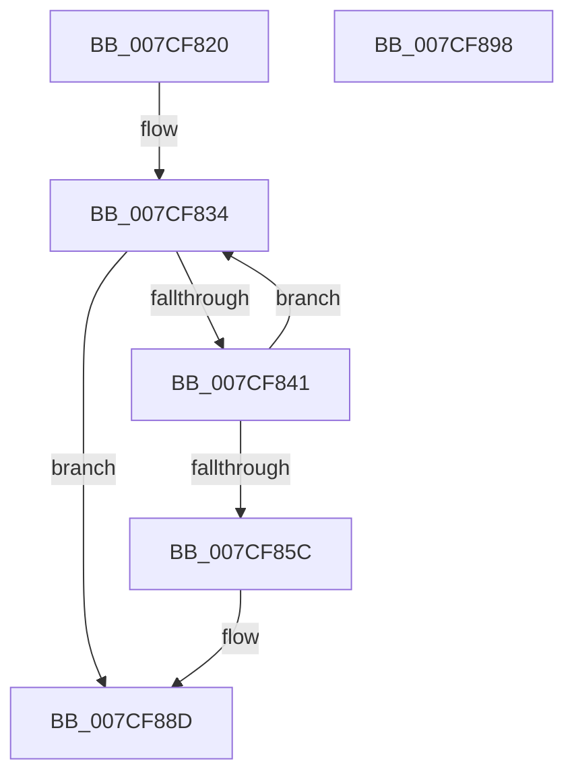

# ExpNodeHotAddProcessorWorker

- RVA: `0x007CF820`–`0x007CF899` (길이 `121` bytes)
- VA: `0x00000001407CF820`
- 실행 섹션: `PAGE`
- PDB 이름 있음: `예`; PDB Function 태그: `아니요`
- unwind 정보 RVA: `0x00068D5C`
- 디코드: `33`개 명령, `121/121` bytes 표시
- 미해석 바이트: `0` (있으면 어셈블리에 `.byte`로 보존)

> 이 문서는 커널 이미지의 기계어와 PDB 기호를 분석해 생성했습니다. 4번과 5번은 함수 원형과 자료형을 바이너리 사용 방식에서 추정한 C 해석이며 원본 소스 복구 결과는 아닙니다.

## 1. Dependencies

- 직접 호출 지점: **6**; 고유 호출 대상: **6**
- 직접 호출자로 확인된 함수: **0**
- RIP 상대 이미지 참조: **0**

### Outgoing calls
- `0x007CF82D` → [KeSynchronizeWithDynamicProcessors](../A1/KeSynchronizeWithDynamicProcessors_function_00A17094.md) (function, `0x00A17094`)
- `0x007CF834` → [PsGetNextPartition](../../text/3B/PsGetNextPartition_function_003B9D5C.md) (function, `0x003B9D5C`)
- `0x007CF850` → [ExpWorkQueueManagerStart](../7D/ExpWorkQueueManagerStart_function_007D02B0.md) (function, `0x007D02B0`)
- `0x007CF85C` → [PsQuitNextPartition](../../text/5E/PsQuitNextPartition_function_005E4AFC.md) (function, `0x005E4AFC`)
- `0x007CF873` → [KeDelayExecutionThread](../../text/20/KeDelayExecutionThread_function_00209550.md) (function, `0x00209550`)
- `0x007CF888` → [ExQueueWorkItem](../../text/2F/ExQueueWorkItem_function_002F9520.md) (function, `0x002F9520`)

### Direct callers
- 이 함수 시작 RVA로 연결되는 직접 call은 확인되지 않았습니다. 간접 호출은 완전히 역산할 수 없습니다.

### Static image references
- 디코드된 RIP-relative 메모리 참조가 없습니다.

## 2. Other-region calls and transfers

- 다른 실행 섹션으로 향하는 call: **4**
  - `0x007CF834` → [PsGetNextPartition](../../text/3B/PsGetNextPartition_function_003B9D5C.md) (`PAGE` → `.text`)
  - `0x007CF85C` → [PsQuitNextPartition](../../text/5E/PsQuitNextPartition_function_005E4AFC.md) (`PAGE` → `.text`)
  - `0x007CF873` → [KeDelayExecutionThread](../../text/20/KeDelayExecutionThread_function_00209550.md) (`PAGE` → `.text`)
  - `0x007CF888` → [ExQueueWorkItem](../../text/2F/ExQueueWorkItem_function_002F9520.md) (`PAGE` → `.text`)
- 별도 외부 분기/꼬리 이동을 확인하지 못했습니다.

## 3. Assembly (complete function range)

```asm
007CF820  48 89 5C 24 10                  mov qword ptr [rsp + 0x10], rbx
007CF825  57                              push rdi
007CF826  48 83 EC 20                     sub rsp, 0x20
007CF82A  48 8B F9                        mov rdi, rcx
007CF82D  E8 62 78 24 00                  call 0x140a17094
007CF832  33 C9                           xor ecx, ecx
007CF834  E8 23 A5 BE FF                  call 0x1403b9d5c
007CF839  48 8B D8                        mov rbx, rax
007CF83C  48 85 C0                        test rax, rax
007CF83F  74 4C                           je 0x1407cf88d
007CF841  48 8B 48 10                     mov rcx, qword ptr [rax + 0x10]
007CF845  0F B7 17                        movzx edx, word ptr [rdi]
007CF848  48 8B 49 10                     mov rcx, qword ptr [rcx + 0x10]
007CF84C  48 8B 0C D1                     mov rcx, qword ptr [rcx + rdx*8]
007CF850  E8 5B 0A 00 00                  call 0x1407d02b0
007CF855  48 8B CB                        mov rcx, rbx
007CF858  85 C0                           test eax, eax
007CF85A  79 D8                           jns 0x1407cf834
007CF85C  E8 9B 52 E1 FF                  call 0x1405e4afc
007CF861  4C 8D 44 24 30                  lea r8, [rsp + 0x30]
007CF866  48 C7 44 24 30 E0 5E F8 FF      mov qword ptr [rsp + 0x30], 0xfffffffffff85ee0
007CF86F  33 D2                           xor edx, edx
007CF871  33 C9                           xor ecx, ecx
007CF873  E8 D8 9C A3 FF                  call 0x140209550
007CF878  48 8D 8F 38 03 00 00            lea rcx, [rdi + 0x338]
007CF87F  BA 01 00 00 00                  mov edx, 1
007CF884  48 83 21 00                     and qword ptr [rcx], 0
007CF888  E8 93 9C B2 FF                  call 0x1402f9520
007CF88D  48 8B 5C 24 38                  mov rbx, qword ptr [rsp + 0x38]
007CF892  48 83 C4 20                     add rsp, 0x20
007CF896  5F                              pop rdi
007CF897  C3                              ret
007CF898  CC                              int3
```

## 4. C-style interpretation (structured pseudocode)

```c
__int64 __fastcall ExpNodeHotAddProcessorWorker(__int64 a1)
{
    __int64 result;
    __int64 v_rsp;
    unsigned __int64 v_stack_p10;
    unsigned __int64 v_stack_p8;

    v_stack_p10 = v_rbx;
    v_rsp = (v_rsp) - (32);
    result = KeSynchronizeWithDynamicProcessors(a1, a2, a3, a4);
    a1 = 0;
loc_007CF834:
    result = PsGetNextPartition(a1, a2, a3, a4);
    if (result == 0) goto loc_007CF88D;
    result = ExpWorkQueueManagerStart(*(unsigned __int64 *)(*(unsigned __int64 *)(*(unsigned __int64 *)(result + 16) + 16) + *(unsigned __int16 *)(a1) * 8), *(unsigned __int16 *)(a1), a3, a4);
    if (!sign_flag) goto loc_007CF834;
    result = PsQuitNextPartition(result, *(unsigned __int16 *)(a1), a3, a4);
    v_stack_p8 = 0xFFFFFFFFFFF85EE0ULL;
    a2 = 0;
    a1 = 0;
    result = KeDelayExecutionThread(a1, a2, v_stack_p8, a4);
    result = ExQueueWorkItem(a1 + 824, 1, v_stack_p8, a4);
loc_007CF88D:
    v_rsp = (v_rsp) + (32);
    return result;
}
```

## 5. (Beta) C Style

```c
int64_t ExpNodeHotAddProcessorWorker(void *Arg1)
{
    uint8_t *arg1 = (uint8_t *)Arg1;

    int64_t result;
    int64_t local_rsp;
    uint64_t v_stack_p10;
    uint64_t v_stack_p8;

    v_stack_p10 = local_rbx;
    local_rsp = (local_rsp) - (32);
    result = KeSynchronizeWithDynamicProcessors(Arg1, a2, a3, a4);
    Arg1 = 0;
loc_007CF834:
    result = PsGetNextPartition(Arg1, a2, a3, a4);
    if (result == 0) goto loc_007CF88D;
    result = ExpWorkQueueManagerStart(*(uint64_t *)(*(uint64_t *)(*(uint64_t *)(result + 0x10) + 0x10) + *(uint16_t *)(arg1) * 8), *(uint16_t *)(arg1), a3, a4);
    if (!sign_flag) goto loc_007CF834;
    result = PsQuitNextPartition(result, *(uint16_t *)(arg1), a3, a4);
    v_stack_p8 = 0xFFFFFFFFFFF85EE0ULL;
    a2 = 0;
    Arg1 = 0;
    result = KeDelayExecutionThread(Arg1, a2, v_stack_p8, a4);
    result = ExQueueWorkItem(Arg1 + 824, 1, v_stack_p8, a4);
loc_007CF88D:
    local_rsp = (local_rsp) + (32);
    return result;
}
```

### 관측된 메모리 오프셋

구조체 형식이 확인되지 않은 접근은 인자 기준의 오프셋으로만 기록했습니다.

| 기준 인자 | 오프셋 표현 | 폭 (bit) | 접근 |
|---|---:|---:|---|
| `Arg1` | `+ 0x0` | `16` | `R` |
| `Arg1` | `+ 0x0` | `64` | `R/W` |
| `Arg1` | `+ 0x338` | `64` | `R` |

## 6. Execution-region graph

[열기: 2D/3D 그래프와 함수 탐색 컨트롤 패널](../../../control-panel.html?section=page&rva=0x007CF820&view=graph)

- 2D 그래프는 위에서 아래로 흐르고, 3D 그래프는 빈 공간을 드래그해 회전합니다. Shift+드래그는 이동, 휠은 확대·축소, 함수 노드 선택은 대상 보고서 이동입니다.

### Static fallback


