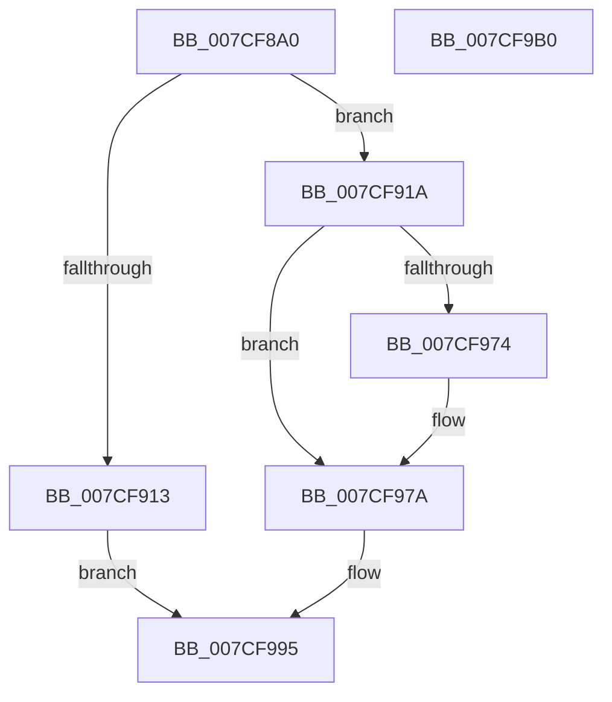

# ExpNodeInitialize

- RVA: `0x007CF8A0`–`0x007CF9B1` (길이 `273` bytes)
- VA: `0x00000001407CF8A0`
- 실행 섹션: `PAGE`
- PDB 이름 있음: `예`; PDB Function 태그: `아니요`
- unwind 정보 RVA: `0x0006B074`
- 디코드: `72`개 명령, `273/273` bytes 표시
- 미해석 바이트: `0` (있으면 어셈블리에 `.byte`로 보존)

> 이 문서는 커널 이미지의 기계어와 PDB 기호를 분석해 생성했습니다. 4번과 5번은 함수 원형과 자료형을 바이너리 사용 방식에서 추정한 C 해석이며 원본 소스 복구 결과는 아닙니다.

## 1. Dependencies

- 직접 호출 지점: **7**; 고유 호출 대상: **6**
- 직접 호출자로 확인된 함수: **1**
- RIP 상대 이미지 참조: **4**

### Outgoing calls
- `0x007CF8D0` → [memset](../../text/6C/memset_function_006C6C40.md) (function, `0x006C6C40`)
- `0x007CF8E7` → [KeQueryActiveGroupCount](../../text/48/KeQueryActiveGroupCount_function_0048C600.md) (function, `0x0048C600`)
- `0x007CF906` → [ExAllocatePool2](../../poolcode/B8/ExAllocatePool2_function_00B820F0.md) (function, `0x00B820F0`)
- `0x007CF934` → [memset](../../text/6C/memset_function_006C6C40.md) (function, `0x006C6C40`)
- `0x007CF944` → [KeQueryNodeActiveAffinityEx](../../text/25/KeQueryNodeActiveAffinityEx_function_00256740.md) (function, `0x00256740`)
- `0x007CF986` → [ExpNodeUpdateProcessorSubQueueIndex](../../text/65/ExpNodeUpdateProcessorSubQueueIndex_function_0065A728.md) (function, `0x0065A728`)
- `0x007CF990` → [ExFreePoolWithTag](../../poolcode/B8/ExFreePoolWithTag_function_00B82870.md) (function, `0x00B82870`)

### Direct callers
- [ExpWorkerInitialization](../../init/C5/ExpWorkerInitialization_function_00C539A4.md) at `0x00C53B42`

### Static image references
- `0x007CF8D5` → RVA `0x007CF820` (`ExpNodeHotAddProcessorWorker`; read)
- `0x007CF954` → RVA `0x00E0EBD4` (`.data`; read)
- `0x007CF966` → RVA `0x00EFAA0C` (`.data`; read)
- `0x007CF974` → RVA `0x00EFAA0C` (`.data`; write)

## 2. Other-region calls and transfers

- 다른 실행 섹션으로 향하는 call: **7**
  - `0x007CF8D0` → [memset](../../text/6C/memset_function_006C6C40.md) (`PAGE` → `.text`)
  - `0x007CF8E7` → [KeQueryActiveGroupCount](../../text/48/KeQueryActiveGroupCount_function_0048C600.md) (`PAGE` → `.text`)
  - `0x007CF906` → [ExAllocatePool2](../../poolcode/B8/ExAllocatePool2_function_00B820F0.md) (`PAGE` → `POOLCODE`)
  - `0x007CF934` → [memset](../../text/6C/memset_function_006C6C40.md) (`PAGE` → `.text`)
  - `0x007CF944` → [KeQueryNodeActiveAffinityEx](../../text/25/KeQueryNodeActiveAffinityEx_function_00256740.md) (`PAGE` → `.text`)
  - `0x007CF986` → [ExpNodeUpdateProcessorSubQueueIndex](../../text/65/ExpNodeUpdateProcessorSubQueueIndex_function_0065A728.md) (`PAGE` → `.text`)
  - `0x007CF990` → [ExFreePoolWithTag](../../poolcode/B8/ExFreePoolWithTag_function_00B82870.md) (`PAGE` → `POOLCODE`)
- 별도 외부 분기/꼬리 이동을 확인하지 못했습니다.

## 3. Assembly (complete function range)

```asm
007CF8A0  48 8B C4                        mov rax, rsp
007CF8A3  48 89 58 10                     mov qword ptr [rax + 0x10], rbx
007CF8A7  48 89 68 18                     mov qword ptr [rax + 0x18], rbp
007CF8AB  48 89 70 20                     mov qword ptr [rax + 0x20], rsi
007CF8AF  57                              push rdi
007CF8B0  41 56                           push r14
007CF8B2  41 57                           push r15
007CF8B4  48 83 EC 20                     sub rsp, 0x20
007CF8B8  33 FF                           xor edi, edi
007CF8BA  48 8D 99 38 03 00 00            lea rbx, [rcx + 0x338]
007CF8C1  48 8B F1                        mov rsi, rcx
007CF8C4  89 78 08                        mov dword ptr [rax + 8], edi
007CF8C7  33 D2                           xor edx, edx
007CF8C9  48 8B CB                        mov rcx, rbx
007CF8CC  44 8D 47 48                     lea r8d, [rdi + 0x48]
007CF8D0  E8 6B 73 EF FF                  call 0x1406c6c40
007CF8D5  48 8D 05 44 FF FF FF            lea rax, [rip - 0xbc]
007CF8DC  48 89 7B 18                     mov qword ptr [rbx + 0x18], rdi
007CF8E0  48 89 43 10                     mov qword ptr [rbx + 0x10], rax
007CF8E4  48 89 3B                        mov qword ptr [rbx], rdi
007CF8E7  E8 14 CD CB FF                  call 0x14048c600
007CF8EC  0F B7 E8                        movzx ebp, ax
007CF8EF  B9 00 01 00 00                  mov ecx, 0x100
007CF8F4  41 B8 45 78 57 6C               mov r8d, 0x6c577845
007CF8FA  4C 8D 34 ED 00 00 00 00         lea r14, [rbp*8]
007CF902  49 8D 56 08                     lea rdx, [r14 + 8]
007CF906  E8 E5 27 3B 00                  call 0x140b820f0
007CF90B  48 8B D8                        mov rbx, rax
007CF90E  48 85 C0                        test rax, rax
007CF911  75 07                           jne 0x1407cf91a
007CF913  BF 9A 00 00 C0                  mov edi, 0xc000009a
007CF918  EB 7B                           jmp 0x1407cf995
007CF91A  41 BF 01 00 00 00               mov r15d, 1
007CF920  66 89 68 02                     mov word ptr [rax + 2], bp
007CF924  48 8D 48 08                     lea rcx, [rax + 8]
007CF928  66 44 89 38                     mov word ptr [rax], r15w
007CF92C  4D 8B C6                        mov r8, r14
007CF92F  89 78 04                        mov dword ptr [rax + 4], edi
007CF932  33 D2                           xor edx, edx
007CF934  E8 07 73 EF FF                  call 0x1406c6c40
007CF939  0F B7 0E                        movzx ecx, word ptr [rsi]
007CF93C  4C 8D 44 24 40                  lea r8, [rsp + 0x40]
007CF941  48 8B D3                        mov rdx, rbx
007CF944  E8 F7 6D A8 FF                  call 0x140256740
007CF949  44 8B 44 24 40                  mov r8d, dword ptr [rsp + 0x40]
007CF94E  33 D2                           xor edx, edx
007CF950  41 8D 40 FF                     lea eax, [r8 - 1]
007CF954  03 05 7A F2 63 00               add eax, dword ptr [rip + 0x63f27a]
007CF95A  F7 35 74 F2 63 00               div dword ptr [rip + 0x63f274]
007CF960  85 C0                           test eax, eax
007CF962  41 0F 44 C7                     cmove eax, r15d
007CF966  3B 05 A0 B0 72 00               cmp eax, dword ptr [rip + 0x72b0a0]
007CF96C  89 86 58 03 00 00               mov dword ptr [rsi + 0x358], eax
007CF972  76 06                           jbe 0x1407cf97a
007CF974  89 05 92 B0 72 00               mov dword ptr [rip + 0x72b092], eax
007CF97A  48 8B D3                        mov rdx, rbx
007CF97D  89 BE 5C 03 00 00               mov dword ptr [rsi + 0x35c], edi
007CF983  48 8B CE                        mov rcx, rsi
007CF986  E8 9D AD E8 FF                  call 0x14065a728
007CF98B  33 D2                           xor edx, edx
007CF98D  48 8B CB                        mov rcx, rbx
007CF990  E8 DB 2E 3B 00                  call 0x140b82870
007CF995  48 8B 5C 24 48                  mov rbx, qword ptr [rsp + 0x48]
007CF99A  8B C7                           mov eax, edi
007CF99C  48 8B 6C 24 50                  mov rbp, qword ptr [rsp + 0x50]
007CF9A1  48 8B 74 24 58                  mov rsi, qword ptr [rsp + 0x58]
007CF9A6  48 83 C4 20                     add rsp, 0x20
007CF9AA  41 5F                           pop r15
007CF9AC  41 5E                           pop r14
007CF9AE  5F                              pop rdi
007CF9AF  C3                              ret
007CF9B0  CC                              int3
```

## 4. C-style interpretation (structured pseudocode)

```c
__int64 __fastcall ExpNodeInitialize(__int64 a1, int a2)
{
    __int64 result;
    __int64 v_rdi;
    __int64 v_rsp;
    unsigned __int64 v_stack_p10;
    unsigned __int64 v_stack_p18;
    unsigned __int64 v_stack_p20;
    unsigned __int64 v_stack_p8;

    *(unsigned __int64 *)(v_rsp + 16) = v_rbx;
    *(unsigned __int64 *)(v_rsp + 24) = v_rbp;
    *(unsigned __int64 *)(v_rsp + 32) = v_rsi;
    v_rsp = (v_rsp) - (32);
    v_rdi = 0;
    *(unsigned int *)(v_rsp + 8) = 0;
    a2 = 0;
    result = memset(a1 + 824, a2, v_rdi + 72, a4);
    *(unsigned __int64 *)(a1 + 824 + 24) = 0;
    *(unsigned __int64 *)(a1 + 824 + 16) = v_rip - 188;
    *(unsigned __int64 *)(a1 + 824) = 0;
    result = KeQueryActiveGroupCount(a1 + 824, a2, v_rdi + 72, a4);
    result = ExAllocatePool2(256, (unsigned __int16)(result) * 8 + 8, (unsigned int)(0x6C577845ULL), a4);
    if (result != 0) goto loc_007CF91A;
    goto loc_007CF995;
loc_007CF91A:
    *(unsigned __int16 *)(result + 2) = (unsigned __int16)((unsigned __int16)(result));
    *(unsigned __int16 *)(result) = 1;
    *(unsigned int *)(result + 4) = (unsigned int)((unsigned int)(0xC000009AULL));
    a2 = 0;
    result = memset(result + 8, a2, (unsigned __int16)(result) * 8, a4);
    result = KeQueryNodeActiveAffinityEx(*(unsigned __int16 *)(a1), result, v_stack_p8, a4);
    a2 = 0;
    result = (unsigned int)(((unsigned int)(v_stack_p8) - 1) + (*(unsigned int *)(v_rip + 6550138)));
    if ((unsigned int)(result) == 0) { result = 1; }
    *(unsigned int *)(a1 + 856) = (unsigned int)(result);
    if (((unsigned int)(result)) >= = (*(unsigned int *)(v_rip + 7516320))) {
        *(unsigned int *)(v_rip + 7516306) = (unsigned int)(result);
    }
    *(unsigned int *)(a1 + 860) = (unsigned int)((unsigned int)(0xC000009AULL));
    result = ExpNodeUpdateProcessorSubQueueIndex(a1, result, (unsigned int)(v_stack_p8), a4);
    a2 = 0;
    result = ExFreePoolWithTag(result, a2, (unsigned int)(v_stack_p8), a4);
loc_007CF995:
    v_rsp = (v_rsp) + (32);
    return (unsigned int)((unsigned int)((unsigned int)(0xC000009AULL)));
}
```

## 5. (Beta) C Style

```c
int64_t ExpNodeInitialize(void *Arg1, int32_t Arg2)
{
    uint8_t *arg1 = (uint8_t *)Arg1;

    int64_t result;
    int64_t local_rdi;
    int64_t local_rsp;
    uint64_t v_stack_p10;
    uint64_t v_stack_p18;
    uint64_t v_stack_p20;
    uint64_t v_stack_p8;

    *(uint64_t *)(local_rsp + 0x10) = local_rbx;
    *(uint64_t *)(local_rsp + 0x18) = local_rbp;
    *(uint64_t *)(local_rsp + 0x20) = local_rsi;
    local_rsp = (local_rsp) - (32);
    local_rdi = 0;
    *(uint32_t *)(local_rsp + 0x8) = 0;
    Arg2 = 0;
    result = memset(Arg1 + 824, Arg2, local_rdi + 72, a4);
    *(uint64_t *)(arg1 + 0x338 + 0x18) = 0;
    *(uint64_t *)(arg1 + 0x338 + 0x10) = v_rip - 188;
    *(uint64_t *)(arg1 + 0x338) = 0;
    result = KeQueryActiveGroupCount(Arg1 + 824, Arg2, local_rdi + 72, a4);
    result = ExAllocatePool2(256, (uint16_t)(result) * 8 + 8, (uint32_t)(0x6C577845ULL), a4);
    if (result != 0) goto loc_007CF91A;
    goto loc_007CF995;
loc_007CF91A:
    *(uint16_t *)(result + 0x2) = (uint16_t)((uint16_t)(result));
    *(uint16_t *)(result) = 1;
    *(uint32_t *)(result + 0x4) = (uint32_t)((uint32_t)(0xC000009AULL));
    Arg2 = 0;
    result = memset(result + 8, Arg2, (uint16_t)(result) * 8, a4);
    result = KeQueryNodeActiveAffinityEx(*(uint16_t *)(arg1), result, v_stack_p8, a4);
    Arg2 = 0;
    result = (uint32_t)(((uint32_t)(v_stack_p8) - 1) + (*(uint32_t *)(v_rip + 0x63F27A)));
    if ((uint32_t)(result) == 0) { result = 1; }
    *(uint32_t *)(arg1 + 0x358) = (uint32_t)(result);
    if (((uint32_t)(result)) >= = (*(uint32_t *)(v_rip + 0x72B0A0))) {
        *(uint32_t *)(v_rip + 0x72B092) = (uint32_t)(result);
    }
    *(uint32_t *)(arg1 + 0x35C) = (uint32_t)((uint32_t)(0xC000009AULL));
    result = ExpNodeUpdateProcessorSubQueueIndex(Arg1, result, (uint32_t)(v_stack_p8), a4);
    Arg2 = 0;
    result = ExFreePoolWithTag(result, Arg2, (uint32_t)(v_stack_p8), a4);
loc_007CF995:
    local_rsp = (local_rsp) + (32);
    return (uint32_t)((uint32_t)((uint32_t)(0xC000009AULL)));
}
```

### 관측된 메모리 오프셋

구조체 형식이 확인되지 않은 접근은 인자 기준의 오프셋으로만 기록했습니다.

| 기준 인자 | 오프셋 표현 | 폭 (bit) | 접근 |
|---|---:|---:|---|
| `Arg1` | `+ 0x0` | `16` | `R` |
| `Arg1` | `+ 0x0` | `64` | `W` |
| `Arg1` | `+ 0x10` | `64` | `W` |
| `Arg1` | `+ 0x18` | `64` | `W` |
| `Arg1` | `+ 0x338` | `64` | `R` |
| `Arg1` | `+ 0x358` | `32` | `W` |
| `Arg1` | `+ 0x35C` | `32` | `W` |

## 6. Execution-region graph

[열기: 2D/3D 그래프와 함수 탐색 컨트롤 패널](../../../control-panel.html?section=page&rva=0x007CF8A0&view=graph)

- 2D 그래프는 위에서 아래로 흐르고, 3D 그래프는 빈 공간을 드래그해 회전합니다. Shift+드래그는 이동, 휠은 확대·축소, 함수 노드 선택은 대상 보고서 이동입니다.

### Static fallback


