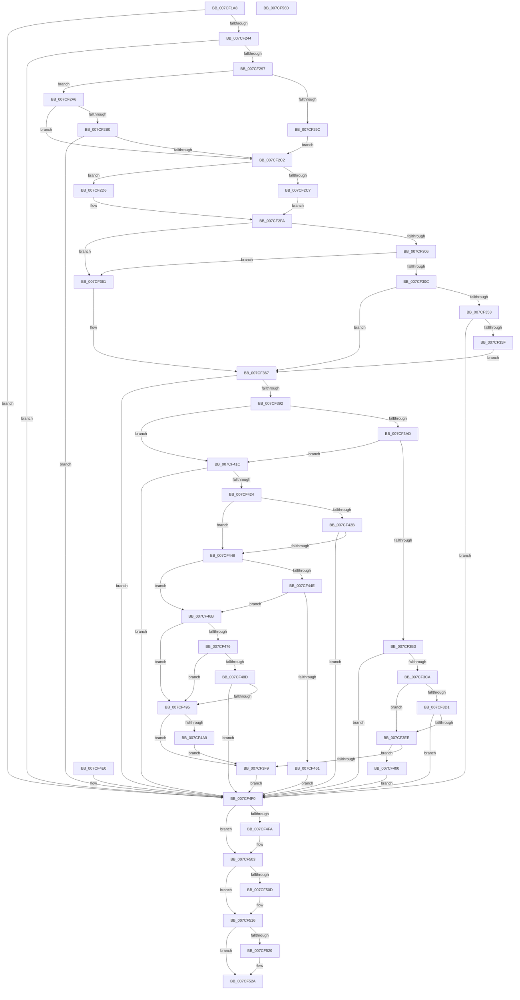

# ExpNtDeleteWnfStateData

- RVA: `0x007CF1A8`–`0x007CF56E` (길이 `966` bytes)
- VA: `0x00000001407CF1A8`
- 실행 섹션: `PAGE`
- PDB 이름 있음: `예`; PDB Function 태그: `아니요`
- unwind 정보 RVA: `0x000D5460`
- 디코드: `232`개 명령, `966/966` bytes 표시
- 미해석 바이트: `0` (있으면 어셈블리에 `.byte`로 보존)

> 이 문서는 커널 이미지의 기계어와 PDB 기호를 분석해 생성했습니다. 4번과 5번은 함수 원형과 자료형을 바이너리 사용 방식에서 추정한 C 해석이며 원본 소스 복구 결과는 아닙니다.

## 1. Dependencies

- 직접 호출 지점: **19**; 고유 호출 대상: **15**
- 직접 호출자로 확인된 함수: **2**
- RIP 상대 이미지 참조: **2**

### Outgoing calls
- `0x007CF231` → [ExpCaptureWnfStateName](../90/ExpCaptureWnfStateName_function_00909370.md) (function, `0x00909370`)
- `0x007CF284` → [ExpWnfCaptureScopeInstanceId](../9E/ExpWnfCaptureScopeInstanceId_function_009EC110.md) (function, `0x009EC110`)
- `0x007CF2B3` → [ExpWnfCheckCrossScopeAccess](../90/ExpWnfCheckCrossScopeAccess_function_0090CA94.md) (function, `0x0090CA94`)
- `0x007CF33E` → [ExpCrossVmWnfPush](../A8/ExpCrossVmWnfPush_function_00A85A14.md) (function, `0x00A85A14`)
- `0x007CF383` → [ExpWnfResolveScopeInstance](../90/ExpWnfResolveScopeInstance_function_0090B280.md) (function, `0x0090B280`)
- `0x007CF39F` → [ExpWnfLookupNameInstance](../90/ExpWnfLookupNameInstance_function_00908C70.md) (function, `0x00908C70`)
- `0x007CF3BB` → [ExpWnfLookupPermanentName](../8B/ExpWnfLookupPermanentName_function_008BD914.md) (function, `0x008BD914`)
- `0x007CF3DF` → [ExpWnfCheckCallerAccess](../9D/ExpWnfCheckCallerAccess_function_009D57C0.md) (function, `0x009D57C0`)
- `0x007CF408` → [ExpWnfDeletePermanentStateData](../7D/ExpWnfDeletePermanentStateData_function_007D6254.md) (function, `0x007D6254`)
- `0x007CF439` → [ExpWnfCheckCallerAccess](../9D/ExpWnfCheckCallerAccess_function_009D57C0.md) (function, `0x009D57C0`)
- `0x007CF47E` → [ExpWnfDeletePermanentStateData](../7D/ExpWnfDeletePermanentStateData_function_007D6254.md) (function, `0x007D6254`)
- `0x007CF49A` → [ExpWnfDeleteStateData](../A4/ExpWnfDeleteStateData_function_00A4AC3C.md) (function, `0x00A4AC3C`)
- `0x007CF4D6` → [ExpCrossVmWnfPush](../A8/ExpCrossVmWnfPush_function_00A85A14.md) (function, `0x00A85A14`)
- `0x007CF4FE` → [ExReleaseRundownProtection](../../text/34/ExReleaseRundownProtection_function_00349E80.md) (function, `0x00349E80`)
- `0x007CF511` → [ExReleaseRundownProtection](../../text/34/ExReleaseRundownProtection_function_00349E80.md) (function, `0x00349E80`)
- `0x007CF525` → [ExFreePoolWithTag](../../poolcode/B8/ExFreePoolWithTag_function_00B82870.md) (function, `0x00B82870`)
- `0x007CF52A` → [KeLeaveCriticalRegion](../../text/25/KeLeaveCriticalRegion_function_0025D8B0.md) (function, `0x0025D8B0`)
- `0x007CF53D` → [ExpWnfReleaseCapturedScopeInstanceId](../9E/ExpWnfReleaseCapturedScopeInstanceId_function_009EC0B4.md) (function, `0x009EC0B4`)
- `0x007CF54F` → [_security_check_cookie](../../text/6A/_security_check_cookie_function_006AC640.md) (function, `0x006AC640`)

### Direct callers
- [ExWnfCrossVmCallback](ExWnfCrossVmCallback_function_007CF150.md) at `0x007CF16E`
- [NtDeleteWnfStateData](NtDeleteWnfStateData_function_007CF580.md) at `0x007CF58A`

### Static image references
- `0x007CF1BF` → RVA `0x00E0A740` (`.data`; read)
- `0x007CF2CD` → RVA `0x00FC6AB0` (`ALMOSTRO`; read)

## 2. Other-region calls and transfers

- 다른 실행 섹션으로 향하는 call: **5**
  - `0x007CF4FE` → [ExReleaseRundownProtection](../../text/34/ExReleaseRundownProtection_function_00349E80.md) (`PAGE` → `.text`)
  - `0x007CF511` → [ExReleaseRundownProtection](../../text/34/ExReleaseRundownProtection_function_00349E80.md) (`PAGE` → `.text`)
  - `0x007CF525` → [ExFreePoolWithTag](../../poolcode/B8/ExFreePoolWithTag_function_00B82870.md) (`PAGE` → `POOLCODE`)
  - `0x007CF52A` → [KeLeaveCriticalRegion](../../text/25/KeLeaveCriticalRegion_function_0025D8B0.md) (`PAGE` → `.text`)
  - `0x007CF54F` → [_security_check_cookie](../../text/6A/_security_check_cookie_function_006AC640.md) (`PAGE` → `.text`)
- 별도 외부 분기/꼬리 이동을 확인하지 못했습니다.

## 3. Assembly (complete function range)

```asm
007CF1A8  4C 8B DC                        mov r11, rsp
007CF1AB  49 89 5B 18                     mov qword ptr [r11 + 0x18], rbx
007CF1AF  56                              push rsi
007CF1B0  41 54                           push r12
007CF1B2  41 55                           push r13
007CF1B4  41 56                           push r14
007CF1B6  41 57                           push r15
007CF1B8  48 81 EC B0 00 00 00            sub rsp, 0xb0
007CF1BF  48 8B 05 7A B5 63 00            mov rax, qword ptr [rip + 0x63b57a]
007CF1C6  48 33 C4                        xor rax, rsp
007CF1C9  48 89 84 24 A0 00 00 00         mov qword ptr [rsp + 0xa0], rax
007CF1D1  44 89 44 24 54                  mov dword ptr [rsp + 0x54], r8d
007CF1D6  4C 8B EA                        mov r13, rdx
007CF1D9  49 83 63 80 00                  and qword ptr [r11 - 0x80], 0
007CF1DE  49 83 63 98 00                  and qword ptr [r11 - 0x68], 0
007CF1E3  65 48 8B 04 25 88 01 00 00      mov rax, qword ptr gs:[0x188]
007CF1EC  66 FF 88 E4 01 00 00            dec word ptr [rax + 0x1e4]
007CF1F3  90                              nop
007CF1F4  65 48 8B 04 25 88 01 00 00      mov rax, qword ptr gs:[0x188]
007CF1FD  44 8A B8 32 02 00 00            mov r15b, byte ptr [rax + 0x232]
007CF204  44 88 7C 24 31                  mov byte ptr [rsp + 0x31], r15b
007CF209  49 83 63 90 00                  and qword ptr [r11 - 0x70], 0
007CF20E  48 83 64 24 48 00               and qword ptr [rsp + 0x48], 0
007CF214  48 83 64 24 40 00               and qword ptr [rsp + 0x40], 0
007CF21A  45 33 F6                        xor r14d, r14d
007CF21D  44 89 74 24 38                  mov dword ptr [rsp + 0x38], r14d
007CF222  0F 57 C0                        xorps xmm0, xmm0
007CF225  41 0F 11 43 B0                  movups xmmword ptr [r11 - 0x50], xmm0
007CF22A  45 8A C7                        mov r8b, r15b
007CF22D  49 8D 53 80                     lea rdx, [r11 - 0x80]
007CF231  E8 3A A1 13 00                  call 0x140909370
007CF236  8B F0                           mov esi, eax
007CF238  89 44 24 3C                     mov dword ptr [rsp + 0x3c], eax
007CF23C  85 C0                           test eax, eax
007CF23E  0F 88 AC 02 00 00               js 0x1407cf4f0
007CF244  48 8B 5C 24 58                  mov rbx, qword ptr [rsp + 0x58]
007CF249  4C 8B E3                        mov r12, rbx
007CF24C  49 C1 EC 04                     shr r12, 4
007CF250  41 83 E4 03                     and r12d, 3
007CF254  44 89 64 24 50                  mov dword ptr [rsp + 0x50], r12d
007CF259  4C 8B F3                        mov r14, rbx
007CF25C  49 C1 EE 06                     shr r14, 6
007CF260  41 83 E6 0F                     and r14d, 0xf
007CF264  44 89 74 24 38                  mov dword ptr [rsp + 0x38], r14d
007CF269  48 8D 84 24 88 00 00 00         lea rax, [rsp + 0x88]
007CF271  48 89 44 24 20                  mov qword ptr [rsp + 0x20], rax
007CF276  4C 8D 4C 24 70                  lea r9, [rsp + 0x70]
007CF27B  45 8A C7                        mov r8b, r15b
007CF27E  49 8B D5                        mov rdx, r13
007CF281  41 8B CE                        mov ecx, r14d
007CF284  E8 87 CE 21 00                  call 0x1409ec110
007CF289  8B F0                           mov esi, eax
007CF28B  89 44 24 3C                     mov dword ptr [rsp + 0x3c], eax
007CF28F  85 C0                           test eax, eax
007CF291  0F 88 59 02 00 00               js 0x1407cf4f0
007CF297  45 84 FF                        test r15b, r15b
007CF29A  75 0A                           jne 0x1407cf2a6
007CF29C  C7 44 24 34 01 00 00 00         mov dword ptr [rsp + 0x34], 1
007CF2A4  EB 1C                           jmp 0x1407cf2c2
007CF2A6  83 64 24 34 00                  and dword ptr [rsp + 0x34], 0
007CF2AB  4D 85 ED                        test r13, r13
007CF2AE  74 12                           je 0x1407cf2c2
007CF2B0  48 8B CB                        mov rcx, rbx
007CF2B3  E8 DC D7 13 00                  call 0x14090ca94
007CF2B8  8B F0                           mov esi, eax
007CF2BA  85 C0                           test eax, eax
007CF2BC  0F 88 2E 02 00 00               js 0x1407cf4f0
007CF2C2  45 84 FF                        test r15b, r15b
007CF2C5  75 0F                           jne 0x1407cf2d6
007CF2C7  48 83 64 24 78 00               and qword ptr [rsp + 0x78], 0
007CF2CD  48 8B 05 DC 77 7F 00            mov rax, qword ptr [rip + 0x7f77dc]
007CF2D4  EB 24                           jmp 0x1407cf2fa
007CF2D6  65 48 8B 04 25 88 01 00 00      mov rax, qword ptr gs:[0x188]
007CF2DF  48 89 44 24 78                  mov qword ptr [rsp + 0x78], rax
007CF2E4  48 8B 80 B8 00 00 00            mov rax, qword ptr [rax + 0xb8]
007CF2EB  48 8B 5C 24 58                  mov rbx, qword ptr [rsp + 0x58]
007CF2F0  44 8B 64 24 50                  mov r12d, dword ptr [rsp + 0x50]
007CF2F5  44 8B 74 24 38                  mov r14d, dword ptr [rsp + 0x38]
007CF2FA  48 89 44 24 60                  mov qword ptr [rsp + 0x60], rax
007CF2FF  83 7C 24 54 00                  cmp dword ptr [rsp + 0x54], 0
007CF304  74 5B                           je 0x1407cf361
007CF306  41 83 FE 05                     cmp r14d, 5
007CF30A  75 55                           jne 0x1407cf361
007CF30C  48 B9 74 00 BC A3 6D 4E C6 41   movabs rcx, 0x41c64e6da3bc0074
007CF316  48 8B C3                        mov rax, rbx
007CF319  48 33 C1                        xor rax, rcx
007CF31C  48 89 84 24 98 00 00 00         mov qword ptr [rsp + 0x98], rax
007CF324  83 64 24 28 00                  and dword ptr [rsp + 0x28], 0
007CF329  48 83 64 24 20 00               and qword ptr [rsp + 0x20], 0
007CF32F  45 33 C9                        xor r9d, r9d
007CF332  4C 8D 84 24 98 00 00 00         lea r8, [rsp + 0x98]
007CF33A  41 8D 56 FC                     lea edx, [r14 - 4]
007CF33E  E8 D1 66 2B 00                  call 0x140a85a14
007CF343  8B F0                           mov esi, eax
007CF345  41 BD 00 00 00 80               mov r13d, 0x80000000
007CF34B  41 03 C5                        add eax, r13d
007CF34E  41 85 C5                        test r13d, eax
007CF351  75 14                           jne 0x1407cf367
007CF353  81 FE 02 00 00 C0               cmp esi, 0xc0000002
007CF359  0F 85 91 01 00 00               jne 0x1407cf4f0
007CF35F  EB 06                           jmp 0x1407cf367
007CF361  41 BD 00 00 00 80               mov r13d, 0x80000000
007CF367  48 8B 44 24 70                  mov rax, qword ptr [rsp + 0x70]
007CF36C  48 89 44 24 20                  mov qword ptr [rsp + 0x20], rax
007CF371  45 8B CE                        mov r9d, r14d
007CF374  4C 8B 44 24 78                  mov r8, qword ptr [rsp + 0x78]
007CF379  48 8B 54 24 60                  mov rdx, qword ptr [rsp + 0x60]
007CF37E  48 8D 4C 24 48                  lea rcx, [rsp + 0x48]
007CF383  E8 F8 BE 13 00                  call 0x14090b280
007CF388  8B F0                           mov esi, eax
007CF38A  85 C0                           test eax, eax
007CF38C  0F 88 5E 01 00 00               js 0x1407cf4f0
007CF392  4C 8D 44 24 40                  lea r8, [rsp + 0x40]
007CF397  48 8B D3                        mov rdx, rbx
007CF39A  48 8B 4C 24 48                  mov rcx, qword ptr [rsp + 0x48]
007CF39F  E8 CC 98 13 00                  call 0x140908c70
007CF3A4  8B F0                           mov esi, eax
007CF3A6  3D 34 00 00 C0                  cmp eax, 0xc0000034
007CF3AB  75 6F                           jne 0x1407cf41c
007CF3AD  41 83 FC 03                     cmp r12d, 3
007CF3B1  74 69                           je 0x1407cf41c
007CF3B3  48 8D 54 24 68                  lea rdx, [rsp + 0x68]
007CF3B8  48 8B CB                        mov rcx, rbx
007CF3BB  E8 54 E5 0E 00                  call 0x1408bd914
007CF3C0  8B F0                           mov esi, eax
007CF3C2  85 C0                           test eax, eax
007CF3C4  0F 88 26 01 00 00               js 0x1407cf4f0
007CF3CA  83 7C 24 34 00                  cmp dword ptr [rsp + 0x34], 0
007CF3CF  75 1D                           jne 0x1407cf3ee
007CF3D1  BA 02 00 00 00                  mov edx, 2
007CF3D6  48 8B 4C 24 68                  mov rcx, qword ptr [rsp + 0x68]
007CF3DB  48 8B 49 10                     mov rcx, qword ptr [rcx + 0x10]
007CF3DF  E8 DC 63 20 00                  call 0x1409d57c0
007CF3E4  8B F0                           mov esi, eax
007CF3E6  85 C0                           test eax, eax
007CF3E8  0F 88 02 01 00 00               js 0x1407cf4f0
007CF3EE  48 8B C3                        mov rax, rbx
007CF3F1  48 C1 E8 0A                     shr rax, 0xa
007CF3F5  A8 01                           test al, 1
007CF3F7  75 07                           jne 0x1407cf400
007CF3F9  33 F6                           xor esi, esi
007CF3FB  E9 F0 00 00 00                  jmp 0x1407cf4f0
007CF400  48 8B D3                        mov rdx, rbx
007CF403  48 8B 4C 24 48                  mov rcx, qword ptr [rsp + 0x48]
007CF408  E8 47 6E 00 00                  call 0x1407d6254
007CF40D  33 F6                           xor esi, esi
007CF40F  3D 34 00 00 C0                  cmp eax, 0xc0000034
007CF414  0F 45 F0                        cmovne esi, eax
007CF417  E9 D4 00 00 00                  jmp 0x1407cf4f0
007CF41C  85 C0                           test eax, eax
007CF41E  0F 88 CC 00 00 00               js 0x1407cf4f0
007CF424  83 7C 24 34 00                  cmp dword ptr [rsp + 0x34], 0
007CF429  75 1D                           jne 0x1407cf448
007CF42B  BA 02 00 00 00                  mov edx, 2
007CF430  48 8B 4C 24 40                  mov rcx, qword ptr [rsp + 0x40]
007CF435  48 8B 49 48                     mov rcx, qword ptr [rcx + 0x48]
007CF439  E8 82 63 20 00                  call 0x1409d57c0
007CF43E  8B F0                           mov esi, eax
007CF440  85 C0                           test eax, eax
007CF442  0F 88 A8 00 00 00               js 0x1407cf4f0
007CF448  41 83 FC 03                     cmp r12d, 3
007CF44C  75 1D                           jne 0x1407cf46b
007CF44E  48 8B 44 24 40                  mov rax, qword ptr [rsp + 0x40]
007CF453  48 8B 4C 24 60                  mov rcx, qword ptr [rsp + 0x60]
007CF458  48 39 88 98 00 00 00            cmp qword ptr [rax + 0x98], rcx
007CF45F  74 0A                           je 0x1407cf46b
007CF461  BE 22 00 00 C0                  mov esi, 0xc0000022
007CF466  E9 85 00 00 00                  jmp 0x1407cf4f0
007CF46B  48 8B C3                        mov rax, rbx
007CF46E  48 C1 E8 0A                     shr rax, 0xa
007CF472  A8 01                           test al, 1
007CF474  74 1F                           je 0x1407cf495
007CF476  48 8B D3                        mov rdx, rbx
007CF479  48 8B 4C 24 48                  mov rcx, qword ptr [rsp + 0x48]
007CF47E  E8 D1 6D 00 00                  call 0x1407d6254
007CF483  8B F0                           mov esi, eax
007CF485  41 03 C5                        add eax, r13d
007CF488  41 85 C5                        test r13d, eax
007CF48B  75 08                           jne 0x1407cf495
007CF48D  81 FE 34 00 00 C0               cmp esi, 0xc0000034
007CF493  75 5B                           jne 0x1407cf4f0
007CF495  48 8B 4C 24 40                  mov rcx, qword ptr [rsp + 0x40]
007CF49A  E8 9D B7 27 00                  call 0x140a4ac3c
007CF49F  41 83 FE 05                     cmp r14d, 5
007CF4A3  0F 85 50 FF FF FF               jne 0x1407cf3f9
007CF4A9  48 B8 74 00 BC A3 6D 4E C6 41   movabs rax, 0x41c64e6da3bc0074
007CF4B3  48 33 D8                        xor rbx, rax
007CF4B6  48 89 9C 24 98 00 00 00         mov qword ptr [rsp + 0x98], rbx
007CF4BE  83 64 24 28 00                  and dword ptr [rsp + 0x28], 0
007CF4C3  48 83 64 24 20 00               and qword ptr [rsp + 0x20], 0
007CF4C9  45 33 C9                        xor r9d, r9d
007CF4CC  4C 8D 84 24 98 00 00 00         lea r8, [rsp + 0x98]
007CF4D4  33 D2                           xor edx, edx
007CF4D6  E8 39 65 2B 00                  call 0x140a85a14
007CF4DB  E9 19 FF FF FF                  jmp 0x1407cf3f9
007CF4E0  8B F0                           mov esi, eax
007CF4E2  89 44 24 3C                     mov dword ptr [rsp + 0x3c], eax
007CF4E6  44 8A 7C 24 31                  mov r15b, byte ptr [rsp + 0x31]
007CF4EB  44 8B 74 24 38                  mov r14d, dword ptr [rsp + 0x38]
007CF4F0  48 8B 4C 24 40                  mov rcx, qword ptr [rsp + 0x40]
007CF4F5  48 85 C9                        test rcx, rcx
007CF4F8  74 09                           je 0x1407cf503
007CF4FA  48 83 C1 08                     add rcx, 8
007CF4FE  E8 7D A9 B7 FF                  call 0x140349e80
007CF503  48 8B 4C 24 48                  mov rcx, qword ptr [rsp + 0x48]
007CF508  48 85 C9                        test rcx, rcx
007CF50B  74 09                           je 0x1407cf516
007CF50D  48 83 C1 08                     add rcx, 8
007CF511  E8 6A A9 B7 FF                  call 0x140349e80
007CF516  48 8B 4C 24 68                  mov rcx, qword ptr [rsp + 0x68]
007CF51B  48 85 C9                        test rcx, rcx
007CF51E  74 0A                           je 0x1407cf52a
007CF520  BA 57 6E 66 20                  mov edx, 0x20666e57
007CF525  E8 46 33 3B 00                  call 0x140b82870
007CF52A  E8 81 E3 A8 FF                  call 0x14025d8b0
007CF52F  45 8A C7                        mov r8b, r15b
007CF532  48 8D 94 24 88 00 00 00         lea rdx, [rsp + 0x88]
007CF53A  41 8B CE                        mov ecx, r14d
007CF53D  E8 72 CB 21 00                  call 0x1409ec0b4
007CF542  8B C6                           mov eax, esi
007CF544  48 8B 8C 24 A0 00 00 00         mov rcx, qword ptr [rsp + 0xa0]
007CF54C  48 33 CC                        xor rcx, rsp
007CF54F  E8 EC D0 ED FF                  call 0x1406ac640
007CF554  48 8B 9C 24 F0 00 00 00         mov rbx, qword ptr [rsp + 0xf0]
007CF55C  48 81 C4 B0 00 00 00            add rsp, 0xb0
007CF563  41 5F                           pop r15
007CF565  41 5E                           pop r14
007CF567  41 5D                           pop r13
007CF569  41 5C                           pop r12
007CF56B  5E                              pop rsi
007CF56C  C3                              ret
007CF56D  CC                              int3
```

## 4. C-style interpretation (structured pseudocode)

```c
__int64 __fastcall ExpNtDeleteWnfStateData(__int64 a1, __int64 a2, int a3)
{
    __int64 result;
    __int64 v_r12;
    __int64 v_r14;
    __int64 v_rbx;
    __int64 v_rsi;
    __int64 v_rsp;
    unsigned __int64 v_stack_m38;
    unsigned __int64 v_stack_m40;
    unsigned __int64 v_stack_m50;
    unsigned __int64 v_stack_m60;
    unsigned __int64 v_stack_m68;
    unsigned __int64 v_stack_m70;
    unsigned __int64 v_stack_m78;
    unsigned __int64 v_stack_m80;
    unsigned int v_stack_m84;
    unsigned int v_stack_m88;
    unsigned __int64 v_stack_m90;
    unsigned __int64 v_stack_m98;
    unsigned int v_stack_m9C;
    unsigned int v_stack_mA0;
    unsigned int v_stack_mA4;
    unsigned __int8 v_stack_mA7;
    unsigned int v_stack_mB0;
    unsigned __int64 v_stack_mB8;
    unsigned __int64 v_stack_p18;

    *(unsigned __int64 *)(v_rsp + 24) = v_rbx;
    v_rsp = (v_rsp) - (176);
    result = (*(unsigned __int64 *)(v_rip + 6534522)) ^ (v_rsp);
    v_stack_m38 = result;
    v_stack_m84 = a3;
    v_stack_mA7 = (unsigned __int8)(*(unsigned __int8 *)(*(unsigned __int64 *)(gs_base + (0 + 392)) + 562));
    v_r14 = 0;
    v_stack_mA0 = 0;
    *(unsigned __int64 *)(v_rsp - 80) = v_xmm0;
    result = ExpCaptureWnfStateName(a1, v_rsp - 128, (unsigned __int8)(*(unsigned __int8 *)(*(unsigned __int64 *)(gs_base + (0 + 392)) + 562)), a4);
    v_stack_m9C = (unsigned int)(result);
    if (sign_flag) goto loc_007CF4F0;
    v_r12 = (v_stack_m80) >> (4);
    v_r12 = (unsigned int)((v_r12) & (3));
    v_stack_m88 = (unsigned int)(v_r12);
    v_r14 = (v_stack_m80) >> (6);
    v_r14 = (unsigned int)((v_r14) & (15));
    v_stack_mA0 = (unsigned int)(v_r14);
    v_stack_mB8 = v_stack_m50;
    result = ExpWnfCaptureScopeInstanceId((unsigned int)((unsigned int)(v_r14)), a2, (unsigned __int8)(*(unsigned __int8 *)(*(unsigned __int64 *)(gs_base + (0 + 392)) + 562)), v_stack_m68);
    v_stack_m9C = (unsigned int)(result);
    if (sign_flag) goto loc_007CF4F0;
    if ((unsigned __int8)(*(unsigned __int8 *)(*(unsigned __int64 *)(gs_base + (0 + 392)) + 562)) != 0) goto loc_007CF2A6;
    v_stack_mA4 = 1;
    goto loc_007CF2C2;
loc_007CF2A6:
    if (a2 == 0) goto loc_007CF2C2;
    result = ExpWnfCheckCrossScopeAccess(v_stack_m80, a2, (unsigned __int8)(*(unsigned __int8 *)(*(unsigned __int64 *)(gs_base + (0 + 392)) + 562)), v_stack_m68);
    if (sign_flag) goto loc_007CF4F0;
loc_007CF2C2:
    if ((unsigned __int8)(*(unsigned __int8 *)(*(unsigned __int64 *)(gs_base + (0 + 392)) + 562)) != 0) goto loc_007CF2D6;
    goto loc_007CF2FA;
loc_007CF2D6:
    v_stack_m60 = *(unsigned __int64 *)(gs_base + (0 + 392));
loc_007CF2FA:
    v_stack_m78 = *(unsigned __int64 *)(*(unsigned __int64 *)(gs_base + (0 + 392)) + 184);
    if (v_stack_m84 == 0) goto loc_007CF361;
    if (((unsigned int)((unsigned int)(v_stack_mA0))) != 5) goto loc_007CF361;
    result = (v_stack_m80) ^ (v_stack_m80);
    v_stack_m40 = result;
    a4 = 0;
    result = ExpCrossVmWnfPush(v_stack_m80, (unsigned int)(v_stack_mA0) - 4, v_stack_m40, a4);
    result = (unsigned int)((result) + ((unsigned int)((unsigned int)(0x80000000ULL))));
    if ((((unsigned int)((unsigned int)(0x80000000ULL))) & ((unsigned int)(result))) != 0) goto loc_007CF367;
    if (((unsigned int)((unsigned int)((unsigned int)(result)))) != 0xC0000002ULL) goto loc_007CF4F0;
    goto loc_007CF367;
loc_007CF361:
loc_007CF367:
    v_stack_mB8 = v_stack_m68;
    result = ExpWnfResolveScopeInstance(v_stack_m90, v_stack_m78, v_stack_m60, (unsigned int)((unsigned int)((unsigned int)(v_stack_mA0))));
    if (sign_flag) goto loc_007CF4F0;
    result = ExpWnfLookupNameInstance(v_stack_m90, v_stack_m80, v_stack_m98, (unsigned int)((unsigned int)((unsigned int)(v_stack_mA0))));
    if (((unsigned int)(result)) != 0xC0000034ULL) goto loc_007CF41C;
    if (((unsigned int)((unsigned int)(v_stack_m88))) == 3) goto loc_007CF41C;
    result = ExpWnfLookupPermanentName(v_stack_m80, v_stack_m70, v_stack_m98, (unsigned int)((unsigned int)((unsigned int)(v_stack_mA0))));
    if (sign_flag) goto loc_007CF4F0;
    if (v_stack_mA4 != 0) goto loc_007CF3EE;
    result = ExpWnfCheckCallerAccess(*(unsigned __int64 *)(v_stack_m70 + 16), 2, v_stack_m98, (unsigned int)((unsigned int)((unsigned int)(v_stack_mA0))));
    if (sign_flag) goto loc_007CF4F0;
loc_007CF3EE:
    result = (v_stack_m80) >> (10);
    if ((((unsigned __int8)(result)) & (1)) != 0) goto loc_007CF400;
loc_007CF3F9:
    v_rsi = 0;
    goto loc_007CF4F0;
loc_007CF400:
    result = ExpWnfDeletePermanentStateData(v_stack_m90, v_stack_m80, v_stack_m98, (unsigned int)((unsigned int)((unsigned int)(v_stack_mA0))));
    v_rsi = 0;
    if (((unsigned int)(result)) != 0xC0000034ULL) { v_rsi = (unsigned int)(result); }
    goto loc_007CF4F0;
loc_007CF41C:
    if (sign_flag) goto loc_007CF4F0;
    if (v_stack_mA4 != 0) goto loc_007CF448;
    result = ExpWnfCheckCallerAccess(*(unsigned __int64 *)(v_stack_m98 + 72), 2, v_stack_m98, (unsigned int)((unsigned int)((unsigned int)(v_stack_mA0))));
    if (sign_flag) goto loc_007CF4F0;
loc_007CF448:
    if (((unsigned int)((unsigned int)(v_stack_m88))) != 3) goto loc_007CF46B;
    if ((*(unsigned __int64 *)(v_stack_m98 + 152)) == v_stack_m78) goto loc_007CF46B;
    goto loc_007CF4F0;
loc_007CF46B:
    result = (v_stack_m80) >> (10);
    if ((((unsigned __int8)(result)) & (1)) == 0) goto loc_007CF495;
    result = ExpWnfDeletePermanentStateData(v_stack_m90, v_stack_m80, v_stack_m98, (unsigned int)((unsigned int)((unsigned int)(v_stack_mA0))));
    result = (unsigned int)((result) + ((unsigned int)((unsigned int)(0x80000000ULL))));
    if ((((unsigned int)((unsigned int)(0x80000000ULL))) & ((unsigned int)(result))) != 0) goto loc_007CF495;
    if (((unsigned int)((unsigned int)((unsigned int)(result)))) != 0xC0000034ULL) goto loc_007CF4F0;
loc_007CF495:
    result = ExpWnfDeleteStateData(v_stack_m98, v_stack_m80, v_stack_m98, (unsigned int)((unsigned int)((unsigned int)(v_stack_mA0))));
    if (((unsigned int)((unsigned int)(v_stack_mA0))) != 5) goto loc_007CF3F9;
    v_rbx = (v_stack_m80) ^ (result);
    v_stack_m40 = v_rbx;
    a4 = 0;
    a2 = 0;
    result = ExpCrossVmWnfPush(v_stack_m98, a2, v_stack_m40, a4);
    goto loc_007CF3F9;
loc_007CF4F0:
    if (v_stack_m98 != 0) {
        a1 = (v_stack_m98) + (8);
        result = ExReleaseRundownProtection(a1, a2, v_stack_m40, a4);
    }
    if (v_stack_m90 != 0) {
        a1 = (v_stack_m90) + (8);
        result = ExReleaseRundownProtection(a1, a2, v_stack_m40, a4);
    }
    if (v_stack_m70 != 0) {
        a2 = 0x20666E57ULL;
        result = ExFreePoolWithTag(v_stack_m70, a2, v_stack_m40, a4);
    }
    result = KeLeaveCriticalRegion(v_stack_m70, a2, v_stack_m40, a4);
    result = ExpWnfReleaseCapturedScopeInstanceId((unsigned int)((unsigned int)((unsigned int)(v_stack_mA0))), v_stack_m50, (unsigned __int8)(*(unsigned __int8 *)(*(unsigned __int64 *)(gs_base + (0 + 392)) + 562)), a4);
    a1 = (v_stack_m38) ^ (v_rsp);
    result = _security_check_cookie(a1, v_stack_m50, (unsigned __int8)(*(unsigned __int8 *)(*(unsigned __int64 *)(gs_base + (0 + 392)) + 562)), a4);
    v_rsp = (v_rsp) + (176);
    return result;
}
```

## 5. (Beta) C Style

```c
int64_t ExpNtDeleteWnfStateData(int64_t Arg1, int64_t Arg2, int32_t Arg3)
{
    int64_t result;
    int64_t local_r12;
    int64_t local_r14;
    int64_t local_rbx;
    int64_t local_rsi;
    int64_t local_rsp;
    uint64_t v_stack_m38;
    uint64_t v_stack_m40;
    uint64_t v_stack_m50;
    uint64_t v_stack_m60;
    uint64_t v_stack_m68;
    uint64_t v_stack_m70;
    uint64_t v_stack_m78;
    uint64_t v_stack_m80;
    uint32_t v_stack_m84;
    uint32_t v_stack_m88;
    uint64_t v_stack_m90;
    uint64_t v_stack_m98;
    uint32_t v_stack_m9C;
    uint32_t v_stack_mA0;
    uint32_t v_stack_mA4;
    uint8_t v_stack_mA7;
    uint32_t v_stack_mB0;
    uint64_t v_stack_mB8;
    uint64_t v_stack_p18;

    *(uint64_t *)(local_rsp + 0x18) = local_rbx;
    local_rsp = (local_rsp) - (176);
    result = (*(uint64_t *)(v_rip + 0x63B57A)) ^ (local_rsp);
    v_stack_m38 = result;
    v_stack_m84 = Arg3;
    v_stack_mA7 = (uint8_t)(*(uint8_t *)(*(uint64_t *)(gs_base + (0 + 0x188)) + 0x232));
    local_r14 = 0;
    v_stack_mA0 = 0;
    *(uint64_t *)(local_rsp - 0x50) = v_xmm0;
    result = ExpCaptureWnfStateName(Arg1, local_rsp - 128, (uint8_t)(*(uint8_t *)(*(uint64_t *)(gs_base + (0 + 0x188)) + 0x232)), a4);
    v_stack_m9C = (uint32_t)(result);
    if (sign_flag) goto loc_007CF4F0;
    local_r12 = (v_stack_m80) >> (4);
    local_r12 = (uint32_t)((local_r12) & (3));
    v_stack_m88 = (uint32_t)(local_r12);
    local_r14 = (v_stack_m80) >> (6);
    local_r14 = (uint32_t)((local_r14) & (15));
    v_stack_mA0 = (uint32_t)(local_r14);
    v_stack_mB8 = v_stack_m50;
    result = ExpWnfCaptureScopeInstanceId((uint32_t)((uint32_t)(local_r14)), Arg2, (uint8_t)(*(uint8_t *)(*(uint64_t *)(gs_base + (0 + 0x188)) + 0x232)), v_stack_m68);
    v_stack_m9C = (uint32_t)(result);
    if (sign_flag) goto loc_007CF4F0;
    if ((uint8_t)(*(uint8_t *)(*(uint64_t *)(gs_base + (0 + 0x188)) + 0x232)) != 0) goto loc_007CF2A6;
    v_stack_mA4 = 1;
    goto loc_007CF2C2;
loc_007CF2A6:
    if (Arg2 == 0) goto loc_007CF2C2;
    result = ExpWnfCheckCrossScopeAccess(v_stack_m80, Arg2, (uint8_t)(*(uint8_t *)(*(uint64_t *)(gs_base + (0 + 0x188)) + 0x232)), v_stack_m68);
    if (sign_flag) goto loc_007CF4F0;
loc_007CF2C2:
    if ((uint8_t)(*(uint8_t *)(*(uint64_t *)(gs_base + (0 + 0x188)) + 0x232)) != 0) goto loc_007CF2D6;
    goto loc_007CF2FA;
loc_007CF2D6:
    v_stack_m60 = *(uint64_t *)(gs_base + (0 + 0x188));
loc_007CF2FA:
    v_stack_m78 = *(uint64_t *)(*(uint64_t *)(gs_base + (0 + 0x188)) + 0xB8);
    if (v_stack_m84 == 0) goto loc_007CF361;
    if (((uint32_t)((uint32_t)(v_stack_mA0))) != 5) goto loc_007CF361;
    result = (v_stack_m80) ^ (v_stack_m80);
    v_stack_m40 = result;
    a4 = 0;
    result = ExpCrossVmWnfPush(v_stack_m80, (uint32_t)(v_stack_mA0) - 4, v_stack_m40, a4);
    result = (uint32_t)((result) + ((uint32_t)((uint32_t)(0x80000000ULL))));
    if ((((uint32_t)((uint32_t)(0x80000000ULL))) & ((uint32_t)(result))) != 0) goto loc_007CF367;
    if (((uint32_t)((uint32_t)((uint32_t)(result)))) != 0xC0000002ULL) goto loc_007CF4F0;
    goto loc_007CF367;
loc_007CF361:
loc_007CF367:
    v_stack_mB8 = v_stack_m68;
    result = ExpWnfResolveScopeInstance(v_stack_m90, v_stack_m78, v_stack_m60, (uint32_t)((uint32_t)((uint32_t)(v_stack_mA0))));
    if (sign_flag) goto loc_007CF4F0;
    result = ExpWnfLookupNameInstance(v_stack_m90, v_stack_m80, v_stack_m98, (uint32_t)((uint32_t)((uint32_t)(v_stack_mA0))));
    if (((uint32_t)(result)) != 0xC0000034ULL) goto loc_007CF41C;
    if (((uint32_t)((uint32_t)(v_stack_m88))) == 3) goto loc_007CF41C;
    result = ExpWnfLookupPermanentName(v_stack_m80, v_stack_m70, v_stack_m98, (uint32_t)((uint32_t)((uint32_t)(v_stack_mA0))));
    if (sign_flag) goto loc_007CF4F0;
    if (v_stack_mA4 != 0) goto loc_007CF3EE;
    result = ExpWnfCheckCallerAccess(*(uint64_t *)(v_stack_m70 + 0x10), 2, v_stack_m98, (uint32_t)((uint32_t)((uint32_t)(v_stack_mA0))));
    if (sign_flag) goto loc_007CF4F0;
loc_007CF3EE:
    result = (v_stack_m80) >> (10);
    if ((((uint8_t)(result)) & (1)) != 0) goto loc_007CF400;
loc_007CF3F9:
    local_rsi = 0;
    goto loc_007CF4F0;
loc_007CF400:
    result = ExpWnfDeletePermanentStateData(v_stack_m90, v_stack_m80, v_stack_m98, (uint32_t)((uint32_t)((uint32_t)(v_stack_mA0))));
    local_rsi = 0;
    if (((uint32_t)(result)) != 0xC0000034ULL) { local_rsi = (uint32_t)(result); }
    goto loc_007CF4F0;
loc_007CF41C:
    if (sign_flag) goto loc_007CF4F0;
    if (v_stack_mA4 != 0) goto loc_007CF448;
    result = ExpWnfCheckCallerAccess(*(uint64_t *)(v_stack_m98 + 0x48), 2, v_stack_m98, (uint32_t)((uint32_t)((uint32_t)(v_stack_mA0))));
    if (sign_flag) goto loc_007CF4F0;
loc_007CF448:
    if (((uint32_t)((uint32_t)(v_stack_m88))) != 3) goto loc_007CF46B;
    if ((*(uint64_t *)(v_stack_m98 + 0x98)) == v_stack_m78) goto loc_007CF46B;
    goto loc_007CF4F0;
loc_007CF46B:
    result = (v_stack_m80) >> (10);
    if ((((uint8_t)(result)) & (1)) == 0) goto loc_007CF495;
    result = ExpWnfDeletePermanentStateData(v_stack_m90, v_stack_m80, v_stack_m98, (uint32_t)((uint32_t)((uint32_t)(v_stack_mA0))));
    result = (uint32_t)((result) + ((uint32_t)((uint32_t)(0x80000000ULL))));
    if ((((uint32_t)((uint32_t)(0x80000000ULL))) & ((uint32_t)(result))) != 0) goto loc_007CF495;
    if (((uint32_t)((uint32_t)((uint32_t)(result)))) != 0xC0000034ULL) goto loc_007CF4F0;
loc_007CF495:
    result = ExpWnfDeleteStateData(v_stack_m98, v_stack_m80, v_stack_m98, (uint32_t)((uint32_t)((uint32_t)(v_stack_mA0))));
    if (((uint32_t)((uint32_t)(v_stack_mA0))) != 5) goto loc_007CF3F9;
    local_rbx = (v_stack_m80) ^ (result);
    v_stack_m40 = local_rbx;
    a4 = 0;
    Arg2 = 0;
    result = ExpCrossVmWnfPush(v_stack_m98, Arg2, v_stack_m40, a4);
    goto loc_007CF3F9;
loc_007CF4F0:
    if (v_stack_m98 != 0) {
        Arg1 = (v_stack_m98) + (8);
        result = ExReleaseRundownProtection(Arg1, Arg2, v_stack_m40, a4);
    }
    if (v_stack_m90 != 0) {
        Arg1 = (v_stack_m90) + (8);
        result = ExReleaseRundownProtection(Arg1, Arg2, v_stack_m40, a4);
    }
    if (v_stack_m70 != 0) {
        Arg2 = 0x20666E57ULL;
        result = ExFreePoolWithTag(v_stack_m70, Arg2, v_stack_m40, a4);
    }
    result = KeLeaveCriticalRegion(v_stack_m70, Arg2, v_stack_m40, a4);
    result = ExpWnfReleaseCapturedScopeInstanceId((uint32_t)((uint32_t)((uint32_t)(v_stack_mA0))), v_stack_m50, (uint8_t)(*(uint8_t *)(*(uint64_t *)(gs_base + (0 + 0x188)) + 0x232)), a4);
    Arg1 = (v_stack_m38) ^ (local_rsp);
    result = _security_check_cookie(Arg1, v_stack_m50, (uint8_t)(*(uint8_t *)(*(uint64_t *)(gs_base + (0 + 0x188)) + 0x232)), a4);
    local_rsp = (local_rsp) + (176);
    return result;
}
```

## 6. Execution-region graph

[열기: 2D/3D 그래프와 함수 탐색 컨트롤 패널](../../../control-panel.html?section=page&rva=0x007CF1A8&view=graph)

- 2D 그래프는 위에서 아래로 흐르고, 3D 그래프는 빈 공간을 드래그해 회전합니다. Shift+드래그는 이동, 휠은 확대·축소, 함수 노드 선택은 대상 보고서 이동입니다.

### Static fallback


