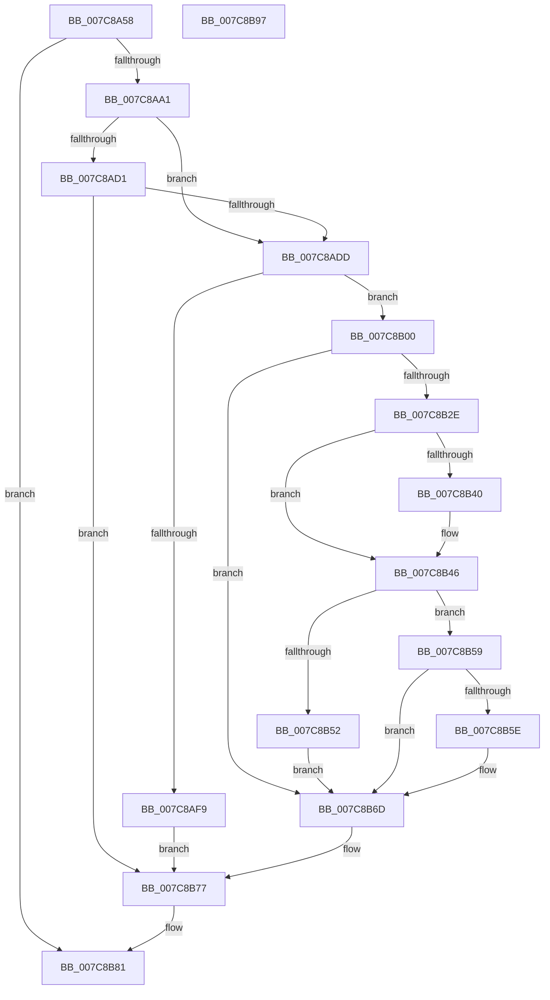

# ExpOsProductCacheProviderHelper

- RVA: `0x007C8A58`–`0x007C8B98` (길이 `320` bytes)
- VA: `0x00000001407C8A58`
- 실행 섹션: `PAGE`
- PDB 이름 있음: `예`; PDB Function 태그: `아니요`
- unwind 정보 RVA: `0x000D4E58`
- 디코드: `88`개 명령, `320/320` bytes 표시
- 미해석 바이트: `0` (있으면 어셈블리에 `.byte`로 보존)

> 이 문서는 커널 이미지의 기계어와 PDB 기호를 분석해 생성했습니다. 4번과 5번은 함수 원형과 자료형을 바이너리 사용 방식에서 추정한 C 해석이며 원본 소스 복구 결과는 아닙니다.

## 1. Dependencies

- 직접 호출 지점: **7**; 고유 호출 대상: **6**
- 직접 호출자로 확인된 함수: **5**
- RIP 상대 이미지 참조: **0**

### Outgoing calls
- `0x007C8A92` → [SpRegOpenRedirectedKey](SpRegOpenRedirectedKey_function_007CAB44.md) (function, `0x007CAB44`)
- `0x007C8ABF` → [ZwQueryValueKey](../../text/6A/ZwQueryValueKey_function_006AD3B0.md) (function, `0x006AD3B0`)
- `0x007C8AEC` → [ExAllocatePool2](../../poolcode/B8/ExAllocatePool2_function_00B820F0.md) (function, `0x00B820F0`)
- `0x007C8B23` → [ZwQueryValueKey](../../text/6A/ZwQueryValueKey_function_006AD3B0.md) (function, `0x006AD3B0`)
- `0x007C8B68` → [memcpy](../../text/6C/memcpy_function_006C6840.md) (function, `0x006C6840`)
- `0x007C8B72` → [ExFreePoolWithTag](../../poolcode/B8/ExFreePoolWithTag_function_00B82870.md) (function, `0x00B82870`)
- `0x007C8B7C` → [ZwClose](../../text/6A/ZwClose_function_006AD2B0.md) (function, `0x006AD2B0`)

### Direct callers
- [ExpCloudbookHardwareIDProvider](ExpCloudbookHardwareIDProvider_function_007C7D20.md) at `0x007C7D88`
- [ExpCloudbookHardwareLockedProvider](ExpCloudbookHardwareLockedProvider_function_007C7E20.md) at `0x007C7E8A`
- [ExpGenuinePolicyPostProcess](ExpGenuinePolicyPostProcess_function_007C8380.md) at `0x007C84B2`
- [ExpGenuinePolicyPostProcess](ExpGenuinePolicyPostProcess_function_007C8380.md) at `0x007C850A`
- [ExpOsProductContentIdCacheProvider](ExpOsProductContentIdCacheProvider_function_007C8BA0.md) at `0x007C8BCA`
- [ExpOsProductPfnCacheProvider](ExpOsProductPfnCacheProvider_function_007C8BE0.md) at `0x007C8C0A`

### Static image references
- 디코드된 RIP-relative 메모리 참조가 없습니다.

## 2. Other-region calls and transfers

- 다른 실행 섹션으로 향하는 call: **6**
  - `0x007C8ABF` → [ZwQueryValueKey](../../text/6A/ZwQueryValueKey_function_006AD3B0.md) (`PAGE` → `.text`)
  - `0x007C8AEC` → [ExAllocatePool2](../../poolcode/B8/ExAllocatePool2_function_00B820F0.md) (`PAGE` → `POOLCODE`)
  - `0x007C8B23` → [ZwQueryValueKey](../../text/6A/ZwQueryValueKey_function_006AD3B0.md) (`PAGE` → `.text`)
  - `0x007C8B68` → [memcpy](../../text/6C/memcpy_function_006C6840.md) (`PAGE` → `.text`)
  - `0x007C8B72` → [ExFreePoolWithTag](../../poolcode/B8/ExFreePoolWithTag_function_00B82870.md) (`PAGE` → `POOLCODE`)
  - `0x007C8B7C` → [ZwClose](../../text/6A/ZwClose_function_006AD2B0.md) (`PAGE` → `.text`)
- 별도 외부 분기/꼬리 이동을 확인하지 못했습니다.

## 3. Assembly (complete function range)

```asm
007C8A58  48 8B C4                        mov rax, rsp
007C8A5B  48 89 58 10                     mov qword ptr [rax + 0x10], rbx
007C8A5F  48 89 70 18                     mov qword ptr [rax + 0x18], rsi
007C8A63  48 89 48 08                     mov qword ptr [rax + 8], rcx
007C8A67  57                              push rdi
007C8A68  41 56                           push r14
007C8A6A  41 57                           push r15
007C8A6C  48 83 EC 40                     sub rsp, 0x40
007C8A70  48 83 60 D8 00                  and qword ptr [rax - 0x28], 0
007C8A75  4D 8B F0                        mov r14, r8
007C8A78  83 60 08 00                     and dword ptr [rax + 8], 0
007C8A7C  4C 8D 44 24 30                  lea r8, [rsp + 0x30]
007C8A81  48 8B 84 24 90 00 00 00         mov rax, qword ptr [rsp + 0x90]
007C8A89  49 8B F1                        mov rsi, r9
007C8A8C  4C 8B FA                        mov r15, rdx
007C8A8F  C6 00 01                        mov byte ptr [rax], 1
007C8A92  E8 AD 20 00 00                  call 0x1407cab44
007C8A97  8B D8                           mov ebx, eax
007C8A99  85 C0                           test eax, eax
007C8A9B  0F 88 E0 00 00 00               js 0x1407c8b81
007C8AA1  48 8B 4C 24 30                  mov rcx, qword ptr [rsp + 0x30]
007C8AA6  48 8D 44 24 60                  lea rax, [rsp + 0x60]
007C8AAB  45 33 C9                        xor r9d, r9d
007C8AAE  48 89 44 24 28                  mov qword ptr [rsp + 0x28], rax
007C8AB3  83 64 24 20 00                  and dword ptr [rsp + 0x20], 0
007C8AB8  49 8B D7                        mov rdx, r15
007C8ABB  45 8D 41 02                     lea r8d, [r9 + 2]
007C8ABF  E8 EC 48 EE FF                  call 0x1406ad3b0
007C8AC4  B9 00 00 00 80                  mov ecx, 0x80000000
007C8AC9  8B D8                           mov ebx, eax
007C8ACB  03 C1                           add eax, ecx
007C8ACD  85 C1                           test ecx, eax
007C8ACF  75 0C                           jne 0x1407c8add
007C8AD1  81 FB 23 00 00 C0               cmp ebx, 0xc0000023
007C8AD7  0F 85 9A 00 00 00               jne 0x1407c8b77
007C8ADD  8B 54 24 60                     mov edx, dword ptr [rsp + 0x60]
007C8AE1  B9 00 01 00 00                  mov ecx, 0x100
007C8AE6  41 B8 53 4C 53 20               mov r8d, 0x20534c53
007C8AEC  E8 FF 95 3B 00                  call 0x140b820f0
007C8AF1  48 8B F8                        mov rdi, rax
007C8AF4  48 85 C0                        test rax, rax
007C8AF7  75 07                           jne 0x1407c8b00
007C8AF9  BB 17 00 00 C0                  mov ebx, 0xc0000017
007C8AFE  EB 77                           jmp 0x1407c8b77
007C8B00  48 8B 4C 24 30                  mov rcx, qword ptr [rsp + 0x30]
007C8B05  48 8D 44 24 60                  lea rax, [rsp + 0x60]
007C8B0A  48 89 44 24 28                  mov qword ptr [rsp + 0x28], rax
007C8B0F  4C 8B CF                        mov r9, rdi
007C8B12  8B 44 24 60                     mov eax, dword ptr [rsp + 0x60]
007C8B16  41 B8 02 00 00 00               mov r8d, 2
007C8B1C  49 8B D7                        mov rdx, r15
007C8B1F  89 44 24 20                     mov dword ptr [rsp + 0x20], eax
007C8B23  E8 88 48 EE FF                  call 0x1406ad3b0
007C8B28  8B D8                           mov ebx, eax
007C8B2A  85 C0                           test eax, eax
007C8B2C  78 3F                           js 0x1407c8b6d
007C8B2E  48 8B 84 24 88 00 00 00         mov rax, qword ptr [rsp + 0x88]
007C8B36  8B 4F 08                        mov ecx, dword ptr [rdi + 8]
007C8B39  89 08                           mov dword ptr [rax], ecx
007C8B3B  4D 85 F6                        test r14, r14
007C8B3E  74 06                           je 0x1407c8b46
007C8B40  8B 47 04                        mov eax, dword ptr [rdi + 4]
007C8B43  41 89 06                        mov dword ptr [r14], eax
007C8B46  8B 47 08                        mov eax, dword ptr [rdi + 8]
007C8B49  39 84 24 80 00 00 00            cmp dword ptr [rsp + 0x80], eax
007C8B50  73 07                           jae 0x1407c8b59
007C8B52  BB 23 00 00 C0                  mov ebx, 0xc0000023
007C8B57  EB 14                           jmp 0x1407c8b6d
007C8B59  48 85 F6                        test rsi, rsi
007C8B5C  74 0F                           je 0x1407c8b6d
007C8B5E  4C 8B C0                        mov r8, rax
007C8B61  48 8D 57 0C                     lea rdx, [rdi + 0xc]
007C8B65  48 8B CE                        mov rcx, rsi
007C8B68  E8 D3 DC EF FF                  call 0x1406c6840
007C8B6D  33 D2                           xor edx, edx
007C8B6F  48 8B CF                        mov rcx, rdi
007C8B72  E8 F9 9C 3B 00                  call 0x140b82870
007C8B77  48 8B 4C 24 30                  mov rcx, qword ptr [rsp + 0x30]
007C8B7C  E8 2F 47 EE FF                  call 0x1406ad2b0
007C8B81  48 8B 74 24 70                  mov rsi, qword ptr [rsp + 0x70]
007C8B86  8B C3                           mov eax, ebx
007C8B88  48 8B 5C 24 68                  mov rbx, qword ptr [rsp + 0x68]
007C8B8D  48 83 C4 40                     add rsp, 0x40
007C8B91  41 5F                           pop r15
007C8B93  41 5E                           pop r14
007C8B95  5F                              pop rdi
007C8B96  C3                              ret
007C8B97  CC                              int3
```

## 4. C-style interpretation (structured pseudocode)

```c
__int64 __fastcall ExpOsProductCacheProviderHelper(__int64 a1, __int64 a2, __int64 a3, __int64 a4, unsigned int a5, __int64 a6, __int64 a7)
{
    __int64 result;
    __int64 v_rsp;
    unsigned __int64 v_stack_m28;
    unsigned __int64 v_stack_m30;
    unsigned int v_stack_m38;
    unsigned __int64 v_stack_p10;
    unsigned __int64 v_stack_p18;
    unsigned __int64 v_stack_p8;

    *(unsigned __int64 *)(v_rsp + 16) = v_rbx;
    *(unsigned __int64 *)(v_rsp + 24) = v_rsi;
    *(unsigned __int64 *)(v_rsp + 8) = a1;
    v_rsp = (v_rsp) - (64);
    *(unsigned __int8 *)(a7) = 1;
    result = SpRegOpenRedirectedKey(a1, a2, v_stack_m28, a4);
    if (sign_flag) goto loc_007C8B81;
    a4 = 0;
    v_stack_m30 = v_stack_p8;
    result = ZwQueryValueKey(v_stack_m28, a2, a4 + 2, a4);
    result = (unsigned int)((result) + ((unsigned int)((unsigned int)(0x80000000ULL))));
    if ((((unsigned int)((unsigned int)(0x80000000ULL))) & ((unsigned int)(result))) != 0) goto loc_007C8ADD;
    if (((unsigned int)((unsigned int)((unsigned int)(result)))) != 0xC0000023ULL) goto loc_007C8B77;
loc_007C8ADD:
    result = ExAllocatePool2(256, (unsigned int)(v_stack_p8), (unsigned int)(0x20534C53ULL), a4);
    if (result != 0) goto loc_007C8B00;
    goto loc_007C8B77;
loc_007C8B00:
    v_stack_m30 = v_stack_p8;
    v_stack_m38 = (unsigned int)((unsigned int)(v_stack_p8));
    result = ZwQueryValueKey(v_stack_m28, a2, 2, result);
    if (sign_flag) goto loc_007C8B6D;
    *(unsigned int *)(a6) = (unsigned int)((unsigned int)(*(unsigned int *)(result + 8)));
    result = a6;
    if (a3 != 0) {
        result = *(unsigned int *)(result + 4);
        *(unsigned int *)(a3) = (unsigned int)(result);
    }
    if (a5 >= ((unsigned int)((unsigned int)(*(unsigned int *)(result + 8))))) goto loc_007C8B59;
    goto loc_007C8B6D;
loc_007C8B59:
    result = (unsigned int)(*(unsigned int *)(result + 8));
    if (0 != 0) {
        a3 = (unsigned int)(*(unsigned int *)(result + 8));
        a2 = result + 12;
        a1 = 0;
        result = memcpy(a1, a2, a3, result);
    }
    a2 = 0;
    result = ExFreePoolWithTag(result, a2, a3, result);
loc_007C8B77:
    result = ZwClose(v_stack_m28, a2, a3, result);
loc_007C8B81:
    v_rsp = (v_rsp) + (64);
    return (unsigned int)((unsigned int)((unsigned int)(0xC0000023ULL)));
}
```

## 5. (Beta) C Style

```c
int64_t ExpOsProductCacheProviderHelper(int64_t Arg1, int64_t Arg2, int64_t Arg3, int64_t Arg4, uint32_t Arg5, void *Arg6, void *Arg7)
{
    uint8_t *arg6 = (uint8_t *)Arg6;
    uint8_t *arg7 = (uint8_t *)Arg7;

    int64_t result;
    int64_t local_rsp;
    uint64_t v_stack_m28;
    uint64_t v_stack_m30;
    uint32_t v_stack_m38;
    uint64_t v_stack_p10;
    uint64_t v_stack_p18;
    uint64_t v_stack_p8;

    *(uint64_t *)(local_rsp + 0x10) = local_rbx;
    *(uint64_t *)(local_rsp + 0x18) = local_rsi;
    *(uint64_t *)(local_rsp + 0x8) = Arg1;
    local_rsp = (local_rsp) - (64);
    *(uint8_t *)(arg7) = 1;
    result = SpRegOpenRedirectedKey(Arg1, Arg2, v_stack_m28, Arg4);
    if (sign_flag) goto loc_007C8B81;
    Arg4 = 0;
    v_stack_m30 = v_stack_p8;
    result = ZwQueryValueKey(v_stack_m28, Arg2, Arg4 + 2, Arg4);
    result = (uint32_t)((result) + ((uint32_t)((uint32_t)(0x80000000ULL))));
    if ((((uint32_t)((uint32_t)(0x80000000ULL))) & ((uint32_t)(result))) != 0) goto loc_007C8ADD;
    if (((uint32_t)((uint32_t)((uint32_t)(result)))) != 0xC0000023ULL) goto loc_007C8B77;
loc_007C8ADD:
    result = ExAllocatePool2(256, (uint32_t)(v_stack_p8), (uint32_t)(0x20534C53ULL), Arg4);
    if (result != 0) goto loc_007C8B00;
    goto loc_007C8B77;
loc_007C8B00:
    v_stack_m30 = v_stack_p8;
    v_stack_m38 = (uint32_t)((uint32_t)(v_stack_p8));
    result = ZwQueryValueKey(v_stack_m28, Arg2, 2, result);
    if (sign_flag) goto loc_007C8B6D;
    *(uint32_t *)(arg6) = (uint32_t)((uint32_t)(*(uint32_t *)(result + 0x8)));
    result = Arg6;
    if (Arg3 != 0) {
        result = *(uint32_t *)(result + 0x4);
        *(uint32_t *)(Arg3) = (uint32_t)(result);
    }
    if (Arg5 >= ((uint32_t)((uint32_t)(*(uint32_t *)(result + 0x8))))) goto loc_007C8B59;
    goto loc_007C8B6D;
loc_007C8B59:
    result = (uint32_t)(*(uint32_t *)(result + 0x8));
    if (0 != 0) {
        Arg3 = (uint32_t)(*(uint32_t *)(result + 0x8));
        Arg2 = result + 12;
        Arg1 = 0;
        result = memcpy(Arg1, Arg2, Arg3, result);
    }
    Arg2 = 0;
    result = ExFreePoolWithTag(result, Arg2, Arg3, result);
loc_007C8B77:
    result = ZwClose(v_stack_m28, Arg2, Arg3, result);
loc_007C8B81:
    local_rsp = (local_rsp) + (64);
    return (uint32_t)((uint32_t)((uint32_t)(0xC0000023ULL)));
}
```

### 관측된 메모리 오프셋

구조체 형식이 확인되지 않은 접근은 인자 기준의 오프셋으로만 기록했습니다.

| 기준 인자 | 오프셋 표현 | 폭 (bit) | 접근 |
|---|---:|---:|---|
| `Arg6` | `+ 0x0` | `32` | `W` |
| `Arg7` | `+ 0x0` | `8` | `W` |

## 6. Execution-region graph

[열기: 2D/3D 그래프와 함수 탐색 컨트롤 패널](../../../control-panel.html?section=page&rva=0x007C8A58&view=graph)

- 2D 그래프는 위에서 아래로 흐르고, 3D 그래프는 빈 공간을 드래그해 회전합니다. Shift+드래그는 이동, 휠은 확대·축소, 함수 노드 선택은 대상 보고서 이동입니다.

### Static fallback


