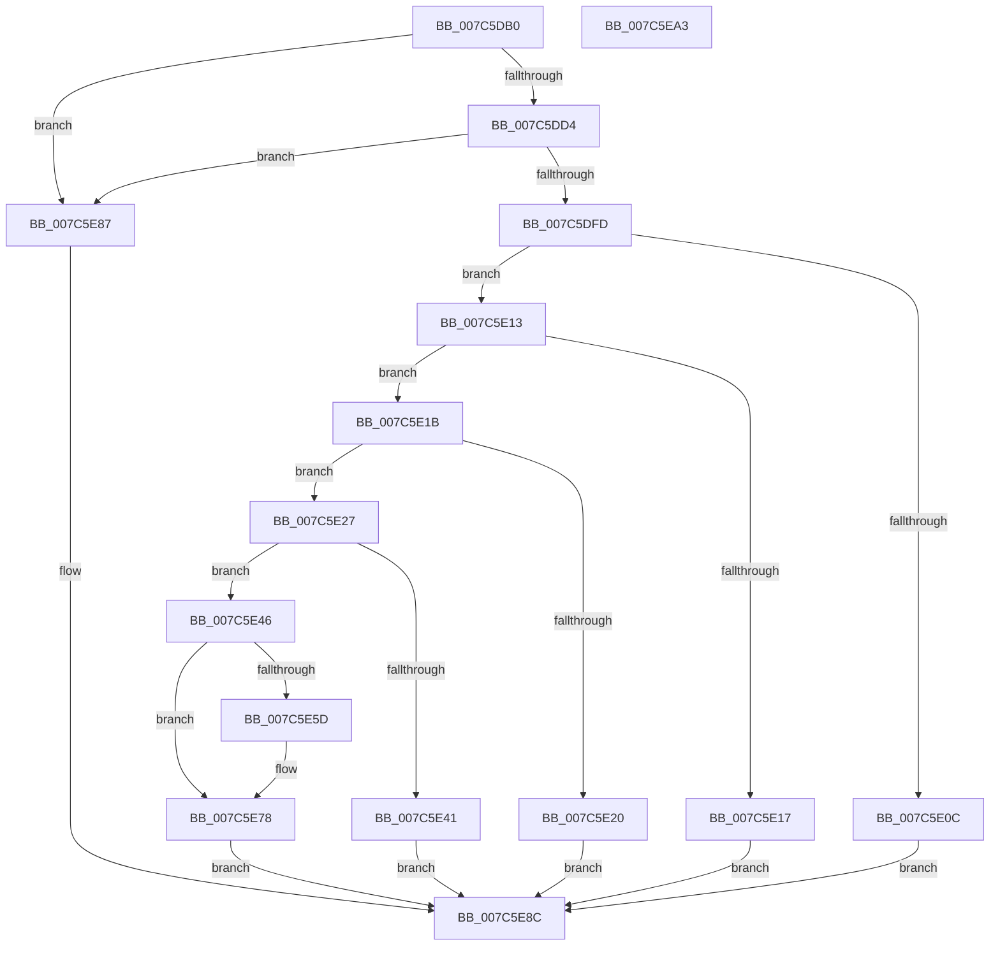

# ExpParseAndUpdateLeapSecondData

- RVA: `0x007C5DB0`–`0x007C5EA4` (길이 `244` bytes)
- VA: `0x00000001407C5DB0`
- 실행 섹션: `PAGE`
- PDB 이름 있음: `예`; PDB Function 태그: `아니요`
- unwind 정보 RVA: `0x0006C8E8`
- 디코드: `69`개 명령, `244/244` bytes 표시
- 미해석 바이트: `0` (있으면 어셈블리에 `.byte`로 보존)

> 이 문서는 커널 이미지의 기계어와 PDB 기호를 분석해 생성했습니다. 4번과 5번은 함수 원형과 자료형을 바이너리 사용 방식에서 추정한 C 해석이며 원본 소스 복구 결과는 아닙니다.

## 1. Dependencies

- 직접 호출 지점: **4**; 고유 호출 대상: **4**
- 직접 호출자로 확인된 함수: **1**
- RIP 상대 이미지 참조: **0**

### Outgoing calls
- `0x007C5E34` → [ExAllocatePool2](../../poolcode/B8/ExAllocatePool2_function_00B820F0.md) (function, `0x00B820F0`)
- `0x007C5E52` → [RtlParseLeapSecondData](../83/RtlParseLeapSecondData_function_0083D0A4.md) (function, `0x0083D0A4`)
- `0x007C5E6C` → [memcpy](../../text/6C/memcpy_function_006C6840.md) (function, `0x006C6840`)
- `0x007C5E80` → [ExFreePoolWithTag](../../poolcode/B8/ExFreePoolWithTag_function_00B82870.md) (function, `0x00B82870`)

### Direct callers
- [ExpReadLeapSecondData](ExpReadLeapSecondData_function_007C5EAC.md) at `0x007C60AA`

### Static image references
- 디코드된 RIP-relative 메모리 참조가 없습니다.

## 2. Other-region calls and transfers

- 다른 실행 섹션으로 향하는 call: **3**
  - `0x007C5E34` → [ExAllocatePool2](../../poolcode/B8/ExAllocatePool2_function_00B820F0.md) (`PAGE` → `POOLCODE`)
  - `0x007C5E6C` → [memcpy](../../text/6C/memcpy_function_006C6840.md) (`PAGE` → `.text`)
  - `0x007C5E80` → [ExFreePoolWithTag](../../poolcode/B8/ExFreePoolWithTag_function_00B82870.md) (`PAGE` → `POOLCODE`)
- 별도 외부 분기/꼬리 이동을 확인하지 못했습니다.

## 3. Assembly (complete function range)

```asm
007C5DB0  48 89 5C 24 10                  mov qword ptr [rsp + 0x10], rbx
007C5DB5  48 89 6C 24 18                  mov qword ptr [rsp + 0x18], rbp
007C5DBA  48 89 74 24 20                  mov qword ptr [rsp + 0x20], rsi
007C5DBF  57                              push rdi
007C5DC0  48 83 EC 20                     sub rsp, 0x20
007C5DC4  83 79 04 03                     cmp dword ptr [rcx + 4], 3
007C5DC8  48 8B EA                        mov rbp, rdx
007C5DCB  48 8B D9                        mov rbx, rcx
007C5DCE  0F 85 B3 00 00 00               jne 0x1407c5e87
007C5DD4  44 8B 41 08                     mov r8d, dword ptr [rcx + 8]
007C5DD8  48 B8 AB AA AA AA AA AA AA AA   movabs rax, 0xaaaaaaaaaaaaaaab
007C5DE2  49 F7 E0                        mul r8
007C5DE5  48 8B FA                        mov rdi, rdx
007C5DE8  48 C1 EF 03                     shr rdi, 3
007C5DEC  48 8D 04 7F                     lea rax, [rdi + rdi*2]
007C5DF0  48 C1 E0 02                     shl rax, 2
007C5DF4  4C 3B C0                        cmp r8, rax
007C5DF7  0F 85 8A 00 00 00               jne 0x1407c5e87
007C5DFD  8D 0C FD 08 00 00 00            lea ecx, [rdi*8 + 8]
007C5E04  81 F9 00 10 00 00               cmp ecx, 0x1000
007C5E0A  76 07                           jbe 0x1407c5e13
007C5E0C  BB 02 00 00 00                  mov ebx, 2
007C5E11  EB 79                           jmp 0x1407c5e8c
007C5E13  85 FF                           test edi, edi
007C5E15  75 04                           jne 0x1407c5e1b
007C5E17  33 DB                           xor ebx, ebx
007C5E19  EB 71                           jmp 0x1407c5e8c
007C5E1B  3B 7D 04                        cmp edi, dword ptr [rbp + 4]
007C5E1E  77 07                           ja 0x1407c5e27
007C5E20  1B DB                           sbb ebx, ebx
007C5E22  83 E3 03                        and ebx, 3
007C5E25  EB 65                           jmp 0x1407c5e8c
007C5E27  8B D1                           mov edx, ecx
007C5E29  41 B8 4C 70 53 64               mov r8d, 0x6453704c
007C5E2F  B9 00 01 00 00                  mov ecx, 0x100
007C5E34  E8 B7 C2 3B 00                  call 0x140b820f0
007C5E39  48 8B F0                        mov rsi, rax
007C5E3C  48 85 C0                        test rax, rax
007C5E3F  75 05                           jne 0x1407c5e46
007C5E41  8D 58 07                        lea ebx, [rax + 7]
007C5E44  EB 46                           jmp 0x1407c5e8c
007C5E46  48 8D 4B 0C                     lea rcx, [rbx + 0xc]
007C5E4A  4C 8B CE                        mov r9, rsi
007C5E4D  4C 8B C5                        mov r8, rbp
007C5E50  8B D7                           mov edx, edi
007C5E52  E8 4D 72 07 00                  call 0x14083d0a4
007C5E57  8B D8                           mov ebx, eax
007C5E59  85 C0                           test eax, eax
007C5E5B  75 1B                           jne 0x1407c5e78
007C5E5D  44 8B C7                        mov r8d, edi
007C5E60  48 8D 56 08                     lea rdx, [rsi + 8]
007C5E64  49 C1 E0 03                     shl r8, 3
007C5E68  48 8D 4D 08                     lea rcx, [rbp + 8]
007C5E6C  E8 CF 09 F0 FF                  call 0x1406c6840
007C5E71  F0 09 1C 24                     lock or dword ptr [rsp], ebx
007C5E75  89 7D 04                        mov dword ptr [rbp + 4], edi
007C5E78  BA 4C 70 53 64                  mov edx, 0x6453704c
007C5E7D  48 8B CE                        mov rcx, rsi
007C5E80  E8 EB C9 3B 00                  call 0x140b82870
007C5E85  EB 05                           jmp 0x1407c5e8c
007C5E87  BB 01 00 00 00                  mov ebx, 1
007C5E8C  48 8B 6C 24 40                  mov rbp, qword ptr [rsp + 0x40]
007C5E91  8B C3                           mov eax, ebx
007C5E93  48 8B 5C 24 38                  mov rbx, qword ptr [rsp + 0x38]
007C5E98  48 8B 74 24 48                  mov rsi, qword ptr [rsp + 0x48]
007C5E9D  48 83 C4 20                     add rsp, 0x20
007C5EA1  5F                              pop rdi
007C5EA2  C3                              ret
007C5EA3  CC                              int3
```

## 4. C-style interpretation (structured pseudocode)

```c
__int64 __fastcall ExpParseAndUpdateLeapSecondData(__int64 a1, __int64 a2)
{
    __int64 result;
    __int64 v_rbx;
    __int64 v_rdi;
    __int64 v_rsp;
    unsigned int v_stack_m28;
    unsigned __int64 v_stack_p10;
    unsigned __int64 v_stack_p18;
    unsigned __int64 v_stack_p20;

    v_stack_p10 = v_rbx;
    v_stack_p18 = v_rbp;
    v_stack_p20 = v_rsi;
    v_rsp = (v_rsp) - (32);
    if ((*(unsigned int *)(a1 + 4)) != 3) goto loc_007C5E87;
    v_rdi = (a2) >> (3);
    result = (v_rdi + v_rdi * 2) << (2);
    if (((unsigned int)(*(unsigned int *)(a1 + 8))) != result) goto loc_007C5E87;
    if (((unsigned int)(v_rdi * 8 + 8)) <= 0x1000ULL) goto loc_007C5E13;
    goto loc_007C5E8C;
loc_007C5E13:
    if ((unsigned int)(v_rdi) != 0) goto loc_007C5E1B;
    v_rbx = 0;
    goto loc_007C5E8C;
loc_007C5E1B:
    if (((unsigned int)(v_rdi)) > (*(unsigned int *)(a2 + 4))) goto loc_007C5E27;
    v_rbx = (unsigned int)((v_rbx) & (3));
    goto loc_007C5E8C;
loc_007C5E27:
    result = ExAllocatePool2(256, (unsigned int)((unsigned int)(v_rdi * 8 + 8)), (unsigned int)(0x6453704CULL), a4);
    if (result != 0) goto loc_007C5E46;
    goto loc_007C5E8C;
loc_007C5E46:
    result = RtlParseLeapSecondData(result + 7 + 12, (unsigned int)((unsigned int)(v_rdi)), a2, result);
    if ((unsigned int)(result) == 0) {
        a3 = (unsigned int)(v_rdi);
        a2 = result + 8;
        a3 = (a3) << (3);
        a1 = a2 + 8;
        result = memcpy(a1, a2, a3, result);
        *(unsigned int *)(a2 + 4) = (unsigned int)(v_rdi);
    }
    result = ExFreePoolWithTag(result, (unsigned int)(0x6453704CULL), a3, result);
    goto loc_007C5E8C;
loc_007C5E87:
loc_007C5E8C:
    v_rsp = (v_rsp) + (32);
    return 1;
}
```

## 5. (Beta) C Style

```c
int64_t ExpParseAndUpdateLeapSecondData(void *Arg1, void *Arg2)
{
    uint8_t *arg1 = (uint8_t *)Arg1;
    uint8_t *arg2 = (uint8_t *)Arg2;

    int64_t result;
    int64_t local_rbx;
    int64_t local_rdi;
    int64_t local_rsp;
    uint32_t v_stack_m28;
    uint64_t v_stack_p10;
    uint64_t v_stack_p18;
    uint64_t v_stack_p20;

    v_stack_p10 = local_rbx;
    v_stack_p18 = local_rbp;
    v_stack_p20 = local_rsi;
    local_rsp = (local_rsp) - (32);
    if ((*(uint32_t *)(arg1 + 0x4)) != 3) goto loc_007C5E87;
    local_rdi = (Arg2) >> (3);
    result = (local_rdi + local_rdi * 2) << (2);
    if (((uint32_t)(*(uint32_t *)(arg1 + 0x8))) != result) goto loc_007C5E87;
    if (((uint32_t)(local_rdi * 8 + 8)) <= 0x1000ULL) goto loc_007C5E13;
    goto loc_007C5E8C;
loc_007C5E13:
    if ((uint32_t)(local_rdi) != 0) goto loc_007C5E1B;
    local_rbx = 0;
    goto loc_007C5E8C;
loc_007C5E1B:
    if (((uint32_t)(local_rdi)) > (*(uint32_t *)(arg2 + 0x4))) goto loc_007C5E27;
    local_rbx = (uint32_t)((local_rbx) & (3));
    goto loc_007C5E8C;
loc_007C5E27:
    result = ExAllocatePool2(256, (uint32_t)((uint32_t)(local_rdi * 8 + 8)), (uint32_t)(0x6453704CULL), a4);
    if (result != 0) goto loc_007C5E46;
    goto loc_007C5E8C;
loc_007C5E46:
    result = RtlParseLeapSecondData(result + 7 + 12, (uint32_t)((uint32_t)(local_rdi)), Arg2, result);
    if ((uint32_t)(result) == 0) {
        a3 = (uint32_t)(local_rdi);
        Arg2 = result + 8;
        a3 = (a3) << (3);
        Arg1 = Arg2 + 8;
        result = memcpy(Arg1, Arg2, a3, result);
        *(uint32_t *)(arg2 + 0x4) = (uint32_t)(local_rdi);
    }
    result = ExFreePoolWithTag(result, (uint32_t)(0x6453704CULL), a3, result);
    goto loc_007C5E8C;
loc_007C5E87:
loc_007C5E8C:
    local_rsp = (local_rsp) + (32);
    return 1;
}
```

### 관측된 메모리 오프셋

구조체 형식이 확인되지 않은 접근은 인자 기준의 오프셋으로만 기록했습니다.

| 기준 인자 | 오프셋 표현 | 폭 (bit) | 접근 |
|---|---:|---:|---|
| `Arg1` | `+ 0x4` | `32` | `R` |
| `Arg1` | `+ 0x8` | `32` | `R` |
| `Arg1` | `+ 0xC` | `64` | `R` |
| `Arg2` | `+ 0x4` | `32` | `R` |
| `Arg2` | `+ 0x4` | `32` | `W` |
| `Arg2` | `+ 0x8` | `64` | `R` |

## 6. Execution-region graph

[열기: 2D/3D 그래프와 함수 탐색 컨트롤 패널](../../../control-panel.html?section=page&rva=0x007C5DB0&view=graph)

- 2D 그래프는 위에서 아래로 흐르고, 3D 그래프는 빈 공간을 드래그해 회전합니다. Shift+드래그는 이동, 휠은 확대·축소, 함수 노드 선택은 대상 보고서 이동입니다.

### Static fallback


