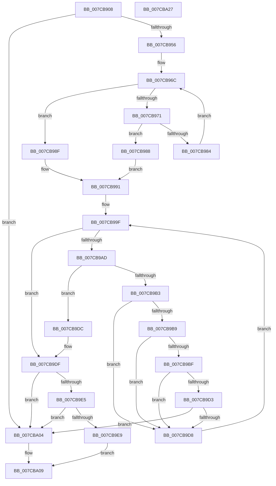

# ExpParseArcPathName

- RVA: `0x007CB908`–`0x007CBA28` (길이 `288` bytes)
- VA: `0x00000001407CB908`
- 실행 섹션: `PAGE`
- PDB 이름 있음: `예`; PDB Function 태그: `아니요`
- unwind 정보 RVA: `0x000C5BD0`
- 디코드: `95`개 명령, `288/288` bytes 표시
- 미해석 바이트: `0` (있으면 어셈블리에 `.byte`로 보존)

> 이 문서는 커널 이미지의 기계어와 PDB 기호를 분석해 생성했습니다. 4번과 5번은 함수 원형과 자료형을 바이너리 사용 방식에서 추정한 C 해석이며 원본 소스 복구 결과는 아닙니다.

## 1. Dependencies

- 직접 호출 지점: **3**; 고유 호출 대상: **3**
- 직접 호출자로 확인된 함수: **1**
- RIP 상대 이미지 참조: **2**

### Outgoing calls
- `0x007CB965` → [wcscpy_s](../../text/50/wcscpy_s_function_005064B0.md) (function, `0x005064B0`)
- `0x007CB978` → [towlower](../../text/50/towlower_function_005018E0.md) (function, `0x005018E0`)
- `0x007CBA11` → [_security_check_cookie](../../text/6A/_security_check_cookie_function_006AC640.md) (function, `0x006AC640`)

### Direct callers
- [ExpTranslateArcPath](ExpTranslateArcPath_function_007CCA6C.md) at `0x007CCAB8`

### Static image references
- `0x007CB919` → RVA `0x00E0A740` (`.data`; read)
- `0x007CB956` → RVA `0x00B08890` (` ?? ::NNGAKEGL::`string'`; read)

## 2. Other-region calls and transfers

- 다른 실행 섹션으로 향하는 call: **3**
  - `0x007CB965` → [wcscpy_s](../../text/50/wcscpy_s_function_005064B0.md) (`PAGE` → `.text`)
  - `0x007CB978` → [towlower](../../text/50/towlower_function_005018E0.md) (`PAGE` → `.text`)
  - `0x007CBA11` → [_security_check_cookie](../../text/6A/_security_check_cookie_function_006AC640.md) (`PAGE` → `.text`)
- 별도 외부 분기/꼬리 이동을 확인하지 못했습니다.

## 3. Assembly (complete function range)

```asm
007CB908  40 53                           push rbx
007CB90A  55                              push rbp
007CB90B  56                              push rsi
007CB90C  57                              push rdi
007CB90D  41 54                           push r12
007CB90F  41 55                           push r13
007CB911  41 56                           push r14
007CB913  41 57                           push r15
007CB915  48 83 EC 58                     sub rsp, 0x58
007CB919  48 8B 05 20 EE 63 00            mov rax, qword ptr [rip + 0x63ee20]
007CB920  48 33 C4                        xor rax, rsp
007CB923  48 89 44 24 48                  mov qword ptr [rsp + 0x48], rax
007CB928  48 8B 9C 24 C0 00 00 00         mov rbx, qword ptr [rsp + 0xc0]
007CB930  4D 8B E8                        mov r13, r8
007CB933  48 89 5C 24 28                  mov qword ptr [rsp + 0x28], rbx
007CB938  4C 8B E2                        mov r12, rdx
007CB93B  33 DB                           xor ebx, ebx
007CB93D  4C 89 4C 24 20                  mov qword ptr [rsp + 0x20], r9
007CB942  4C 8B F1                        mov r14, rcx
007CB945  8B EB                           mov ebp, ebx
007CB947  44 8A FB                        mov r15b, bl
007CB94A  40 B6 01                        mov sil, 1
007CB94D  48 85 C9                        test rcx, rcx
007CB950  0F 84 AE 00 00 00               je 0x1407cba04
007CB956  4C 8D 05 33 CF 33 00            lea r8, [rip + 0x33cf33]
007CB95D  8D 53 0B                        lea edx, [rbx + 0xb]
007CB960  48 8D 4C 24 30                  lea rcx, [rsp + 0x30]
007CB965  E8 46 AB D3 FF                  call 0x1405064b0
007CB96A  8B FB                           mov edi, ebx
007CB96C  83 FF 0A                        cmp edi, 0xa
007CB96F  73 1E                           jae 0x1407cb98f
007CB971  8B DF                           mov ebx, edi
007CB973  41 0F B7 0C 5E                  movzx ecx, word ptr [r14 + rbx*2]
007CB978  E8 63 5F D3 FF                  call 0x1405018e0
007CB97D  66 3B 44 5C 30                  cmp ax, word ptr [rsp + rbx*2 + 0x30]
007CB982  75 04                           jne 0x1407cb988
007CB984  FF C7                           inc edi
007CB986  EB E4                           jmp 0x1407cb96c
007CB988  33 DB                           xor ebx, ebx
007CB98A  40 8A F3                        mov sil, bl
007CB98D  EB 02                           jmp 0x1407cb991
007CB98F  33 DB                           xor ebx, ebx
007CB991  40 80 FE 01                     cmp sil, 1
007CB995  4D 8D 46 14                     lea r8, [r14 + 0x14]
007CB999  8B D3                           mov edx, ebx
007CB99B  4D 0F 45 C6                     cmovne r8, r14
007CB99F  8B C2                           mov eax, edx
007CB9A1  49 8D 0C 40                     lea rcx, [r8 + rax*2]
007CB9A5  0F B7 01                        movzx eax, word ptr [rcx]
007CB9A8  66 85 C0                        test ax, ax
007CB9AB  74 32                           je 0x1407cb9df
007CB9AD  66 83 F8 5C                     cmp ax, 0x5c
007CB9B1  74 29                           je 0x1407cb9dc
007CB9B3  40 80 FE 01                     cmp sil, 1
007CB9B7  75 1F                           jne 0x1407cb9d8
007CB9B9  66 83 F8 29                     cmp ax, 0x29
007CB9BD  75 19                           jne 0x1407cb9d8
007CB9BF  8D 42 01                        lea eax, [rdx + 1]
007CB9C2  44 8A FE                        mov r15b, sil
007CB9C5  41 0F B7 04 40                  movzx eax, word ptr [r8 + rax*2]
007CB9CA  40 8A F3                        mov sil, bl
007CB9CD  66 83 F8 5C                     cmp ax, 0x5c
007CB9D1  74 05                           je 0x1407cb9d8
007CB9D3  66 85 C0                        test ax, ax
007CB9D6  75 2C                           jne 0x1407cba04
007CB9D8  FF C2                           inc edx
007CB9DA  EB C3                           jmp 0x1407cb99f
007CB9DC  48 8B E9                        mov rbp, rcx
007CB9DF  40 80 FE 01                     cmp sil, 1
007CB9E3  74 1F                           je 0x1407cba04
007CB9E5  85 D2                           test edx, edx
007CB9E7  74 1B                           je 0x1407cba04
007CB9E9  48 8B 44 24 20                  mov rax, qword ptr [rsp + 0x20]
007CB9EE  4D 89 04 24                     mov qword ptr [r12], r8
007CB9F2  49 89 6D 00                     mov qword ptr [r13], rbp
007CB9F6  89 10                           mov dword ptr [rax], edx
007CB9F8  48 8B 44 24 28                  mov rax, qword ptr [rsp + 0x28]
007CB9FD  44 88 38                        mov byte ptr [rax], r15b
007CBA00  33 C0                           xor eax, eax
007CBA02  EB 05                           jmp 0x1407cba09
007CBA04  B8 0D 00 00 C0                  mov eax, 0xc000000d
007CBA09  48 8B 4C 24 48                  mov rcx, qword ptr [rsp + 0x48]
007CBA0E  48 33 CC                        xor rcx, rsp
007CBA11  E8 2A 0C EE FF                  call 0x1406ac640
007CBA16  48 83 C4 58                     add rsp, 0x58
007CBA1A  41 5F                           pop r15
007CBA1C  41 5E                           pop r14
007CBA1E  41 5D                           pop r13
007CBA20  41 5C                           pop r12
007CBA22  5F                              pop rdi
007CBA23  5E                              pop rsi
007CBA24  5D                              pop rbp
007CBA25  5B                              pop rbx
007CBA26  C3                              ret
007CBA27  CC                              int3
```

## 4. C-style interpretation (structured pseudocode)

```c
__int64 __fastcall ExpParseArcPathName(__int64 a1, __int64 a2, __int64 a3, __int64 a4, __int64 a5)
{
    __int64 result;
    __int64 v_rbx;
    __int64 v_rdi;
    __int64 v_rsp;
    unsigned __int64 v_stack_m50;
    unsigned __int64 v_stack_m68;
    unsigned __int64 v_stack_m70;
    unsigned __int64 v_stack_m78;

    v_rsp = (v_rsp) - (88);
    result = (*(unsigned __int64 *)(v_rip + 6549024)) ^ (v_rsp);
    v_stack_m50 = result;
    v_stack_m70 = a5;
    v_rbx = 0;
    v_stack_m78 = a4;
    if (a1 == 0) goto loc_007CBA04;
    result = wcscpy_s(v_stack_m68, v_rbx + 11, v_rip + 3395379, a4);
loc_007CB96C:
    if (0 >= 10) goto loc_007CB98F;
    result = towlower(*(unsigned __int16 *)(a1 + 0 * 2), v_rbx + 11, v_rip + 3395379, a4);
    if (((unsigned __int16)(result)) != (*(unsigned __int16 *)(v_rsp + 0 * 2 + 48))) goto loc_007CB988;
    v_rdi = (unsigned int)((0) + 1);
    goto loc_007CB96C;
loc_007CB988:
    v_rbx = 0;
    goto loc_007CB991;
loc_007CB98F:
    v_rbx = 0;
loc_007CB991:
    a3 = a1 + 20;
    if (0 != 1) { a3 = a1; }
loc_007CB99F:
    if ((unsigned __int16)(*(unsigned __int16 *)(a3 + 0 * 2)) == 0) goto loc_007CB9DF;
    if (((unsigned __int16)(*(unsigned __int16 *)(a3 + 0 * 2))) == 92) goto loc_007CB9DC;
    if (0 != 1) goto loc_007CB9D8;
    if (((unsigned __int16)(*(unsigned __int16 *)(a3 + 0 * 2))) != 41) goto loc_007CB9D8;
    if (((unsigned __int16)(*(unsigned __int16 *)(a3 + 0 + 1 * 2))) == 92) goto loc_007CB9D8;
    if ((unsigned __int16)(*(unsigned __int16 *)(a3 + 0 + 1 * 2)) != 0) goto loc_007CBA04;
loc_007CB9D8:
    a2 = (unsigned int)((0) + 1);
    goto loc_007CB99F;
loc_007CB9DC:
loc_007CB9DF:
    if (0 == 1) goto loc_007CBA04;
    if ((unsigned int)(a2) == 0) goto loc_007CBA04;
    *(unsigned __int64 *)(a2) = a3;
    *(unsigned __int64 *)(a3) = a3 + 0 * 2;
    *(unsigned int *)(v_stack_m78) = (unsigned int)(a2);
    *(unsigned __int8 *)(v_stack_m70) = 0;
    result = 0;
    goto loc_007CBA09;
loc_007CBA04:
loc_007CBA09:
    a1 = (v_stack_m50) ^ (v_rsp);
    result = _security_check_cookie(a1, a2, a3, a4);
    v_rsp = (v_rsp) + (88);
    return result;
}
```

## 5. (Beta) C Style

```c
int64_t ExpParseArcPathName(void *Arg1, void *Arg2, void *Arg3, int64_t Arg4, int64_t Arg5)
{
    uint8_t *arg1 = (uint8_t *)Arg1;
    uint8_t *arg2 = (uint8_t *)Arg2;
    uint8_t *arg3 = (uint8_t *)Arg3;

    int64_t result;
    int64_t local_rbx;
    int64_t local_rdi;
    int64_t local_rsp;
    uint64_t v_stack_m50;
    uint64_t v_stack_m68;
    uint64_t v_stack_m70;
    uint64_t v_stack_m78;

    local_rsp = (local_rsp) - (88);
    result = (*(uint64_t *)(v_rip + 0x63EE20)) ^ (local_rsp);
    v_stack_m50 = result;
    v_stack_m70 = Arg5;
    local_rbx = 0;
    v_stack_m78 = Arg4;
    if (Arg1 == NULL) goto loc_007CBA04;
    result = wcscpy_s(v_stack_m68, local_rbx + 11, v_rip + 3395379, Arg4);
loc_007CB96C:
    if (0 >= 10) goto loc_007CB98F;
    result = towlower(*(uint16_t *)(arg1 + 0x0 * 2), local_rbx + 11, v_rip + 3395379, Arg4);
    if (((uint16_t)(result)) != (*(uint16_t *)(local_rsp + 0x0 * 2 + 0x30))) goto loc_007CB988;
    local_rdi = (uint32_t)((0) + 1);
    goto loc_007CB96C;
loc_007CB988:
    local_rbx = 0;
    goto loc_007CB991;
loc_007CB98F:
    local_rbx = 0;
loc_007CB991:
    Arg3 = Arg1 + 20;
    if (0 != 1) { Arg3 = Arg1; }
loc_007CB99F:
    if ((uint16_t)(*(uint16_t *)(arg3 + 0x0 * 2)) == 0) goto loc_007CB9DF;
    if (((uint16_t)(*(uint16_t *)(arg3 + 0x0 * 2))) == 92) goto loc_007CB9DC;
    if (0 != 1) goto loc_007CB9D8;
    if (((uint16_t)(*(uint16_t *)(arg3 + 0x0 * 2))) != 41) goto loc_007CB9D8;
    if (((uint16_t)(*(uint16_t *)(arg3 + 0x0 + 0x1 * 2))) == 92) goto loc_007CB9D8;
    if ((uint16_t)(*(uint16_t *)(arg3 + 0x0 + 0x1 * 2)) != 0) goto loc_007CBA04;
loc_007CB9D8:
    Arg2 = (uint32_t)((0) + 1);
    goto loc_007CB99F;
loc_007CB9DC:
loc_007CB9DF:
    if (0 == 1) goto loc_007CBA04;
    if ((uint32_t)(Arg2) == 0) goto loc_007CBA04;
    *(void **)(arg2) = Arg3;
    *(void **)(arg3) = Arg3 + 0 * 2;
    *(uint32_t *)(v_stack_m78) = (uint32_t)(Arg2);
    *(uint8_t *)(v_stack_m70) = 0;
    result = 0;
    goto loc_007CBA09;
loc_007CBA04:
loc_007CBA09:
    Arg1 = (v_stack_m50) ^ (local_rsp);
    result = _security_check_cookie(Arg1, Arg2, Arg3, Arg4);
    local_rsp = (local_rsp) + (88);
    return result;
}
```

### 관측된 메모리 오프셋

구조체 형식이 확인되지 않은 접근은 인자 기준의 오프셋으로만 기록했습니다.

| 기준 인자 | 오프셋 표현 | 폭 (bit) | 접근 |
|---|---:|---:|---|
| `Arg1` | `+ 0x0 + rbx*2` | `16` | `R` |
| `Arg1` | `+ 0x14` | `64` | `R` |
| `Arg2` | `+ 0x0` | `64` | `W` |
| `Arg3` | `+ 0x0` | `64` | `W` |

## 6. Execution-region graph

[열기: 2D/3D 그래프와 함수 탐색 컨트롤 패널](../../../control-panel.html?section=page&rva=0x007CB908&view=graph)

- 2D 그래프는 위에서 아래로 흐르고, 3D 그래프는 빈 공간을 드래그해 회전합니다. Shift+드래그는 이동, 휠은 확대·축소, 함수 노드 선택은 대상 보고서 이동입니다.

### Static fallback


