# ExpParseSignatureName

- RVA: `0x007CBA30`–`0x007CBD26` (길이 `758` bytes)
- VA: `0x00000001407CBA30`
- 실행 섹션: `PAGE`
- PDB 이름 있음: `예`; PDB Function 태그: `아니요`
- unwind 정보 RVA: `0x000D5154`
- 디코드: `228`개 명령, `758/758` bytes 표시
- 미해석 바이트: `0` (있으면 어셈블리에 `.byte`로 보존)

> 이 문서는 커널 이미지의 기계어와 PDB 기호를 분석해 생성했습니다. 4번과 5번은 함수 원형과 자료형을 바이너리 사용 방식에서 추정한 C 해석이며 원본 소스 복구 결과는 아닙니다.

## 1. Dependencies

- 직접 호출 지점: **15**; 고유 호출 대상: **7**
- 직접 호출자로 확인된 함수: **1**
- RIP 상대 이미지 참조: **0**

### Outgoing calls
- `0x007CBADD` → [RtlGUIDFromString](../8F/RtlGUIDFromString_function_008F1EF0.md) (function, `0x008F1EF0`)
- `0x007CBB03` → [ExAllocatePool2](../../poolcode/B8/ExAllocatePool2_function_00B820F0.md) (function, `0x00B820F0`)
- `0x007CBB22` → [wcsncpy_s](../../text/50/wcsncpy_s_function_00506650.md) (function, `0x00506650`)
- `0x007CBB39` → [ExpTranslateHexStringToULONG](ExpTranslateHexStringToULONG_function_007CCDB4.md) (function, `0x007CCDB4`)
- `0x007CBB40` → [ExpTranslateHexStringToGUID](ExpTranslateHexStringToGUID_function_007CCC34.md) (function, `0x007CCC34`)
- `0x007CBB4C` → [ExFreePoolWithTag](../../poolcode/B8/ExFreePoolWithTag_function_00B82870.md) (function, `0x00B82870`)
- `0x007CBB92` → [ExAllocatePool2](../../poolcode/B8/ExAllocatePool2_function_00B820F0.md) (function, `0x00B820F0`)
- `0x007CBBD3` → [wcsncpy_s](../../text/50/wcsncpy_s_function_00506650.md) (function, `0x00506650`)
- `0x007CBBE8` → [ExpTranslateHexStringToULONG](ExpTranslateHexStringToULONG_function_007CCDB4.md) (function, `0x007CCDB4`)
- `0x007CBC31` → [wcsncpy_s](../../text/50/wcsncpy_s_function_00506650.md) (function, `0x00506650`)
- `0x007CBC46` → [ExpTranslateHexStringToULONGLONG](ExpTranslateHexStringToULONGLONG_function_007CCE50.md) (function, `0x007CCE50`)
- `0x007CBC8E` → [wcsncpy_s](../../text/50/wcsncpy_s_function_00506650.md) (function, `0x00506650`)
- `0x007CBCA3` → [ExpTranslateHexStringToULONGLONG](ExpTranslateHexStringToULONGLONG_function_007CCE50.md) (function, `0x007CCE50`)
- `0x007CBCAF` → [ExFreePoolWithTag](../../poolcode/B8/ExFreePoolWithTag_function_00B82870.md) (function, `0x00B82870`)
- `0x007CBCF7` → [ExFreePoolWithTag](../../poolcode/B8/ExFreePoolWithTag_function_00B82870.md) (function, `0x00B82870`)

### Direct callers
- [ExpConvertSignatureName](ExpConvertSignatureName_function_007CB0C8.md) at `0x007CB15D`

### Static image references
- 디코드된 RIP-relative 메모리 참조가 없습니다.

## 2. Other-region calls and transfers

- 다른 실행 섹션으로 향하는 call: **9**
  - `0x007CBB03` → [ExAllocatePool2](../../poolcode/B8/ExAllocatePool2_function_00B820F0.md) (`PAGE` → `POOLCODE`)
  - `0x007CBB22` → [wcsncpy_s](../../text/50/wcsncpy_s_function_00506650.md) (`PAGE` → `.text`)
  - `0x007CBB4C` → [ExFreePoolWithTag](../../poolcode/B8/ExFreePoolWithTag_function_00B82870.md) (`PAGE` → `POOLCODE`)
  - `0x007CBB92` → [ExAllocatePool2](../../poolcode/B8/ExAllocatePool2_function_00B820F0.md) (`PAGE` → `POOLCODE`)
  - `0x007CBBD3` → [wcsncpy_s](../../text/50/wcsncpy_s_function_00506650.md) (`PAGE` → `.text`)
  - `0x007CBC31` → [wcsncpy_s](../../text/50/wcsncpy_s_function_00506650.md) (`PAGE` → `.text`)
  - `0x007CBC8E` → [wcsncpy_s](../../text/50/wcsncpy_s_function_00506650.md) (`PAGE` → `.text`)
  - `0x007CBCAF` → [ExFreePoolWithTag](../../poolcode/B8/ExFreePoolWithTag_function_00B82870.md) (`PAGE` → `POOLCODE`)
  - `0x007CBCF7` → [ExFreePoolWithTag](../../poolcode/B8/ExFreePoolWithTag_function_00B82870.md) (`PAGE` → `POOLCODE`)
- 별도 외부 분기/꼬리 이동을 확인하지 못했습니다.

## 3. Assembly (complete function range)

```asm
007CBA30  48 89 5C 24 18                  mov qword ptr [rsp + 0x18], rbx
007CBA35  4C 89 4C 24 20                  mov qword ptr [rsp + 0x20], r9
007CBA3A  55                              push rbp
007CBA3B  56                              push rsi
007CBA3C  57                              push rdi
007CBA3D  41 54                           push r12
007CBA3F  41 55                           push r13
007CBA41  41 56                           push r14
007CBA43  41 57                           push r15
007CBA45  48 83 EC 30                     sub rsp, 0x30
007CBA49  33 DB                           xor ebx, ebx
007CBA4B  4D 8B E8                        mov r13, r8
007CBA4E  8B EA                           mov ebp, edx
007CBA50  66 41 B8 7B 00                  mov r8w, 0x7b
007CBA55  0F B7 11                        movzx edx, word ptr [rcx]
007CBA58  0F 57 C0                        xorps xmm0, xmm0
007CBA5B  66 41 3B D0                     cmp dx, r8w
007CBA5F  48 8B F1                        mov rsi, rcx
007CBA62  0F 11 44 24 20                  movups xmmword ptr [rsp + 0x20], xmm0
007CBA67  41 0F 94 C4                     sete r12b
007CBA6B  44 8A D3                        mov r10b, bl
007CBA6E  44 8A FB                        mov r15b, bl
007CBA71  8B FB                           mov edi, ebx
007CBA73  3B FD                           cmp edi, ebp
007CBA75  73 27                           jae 0x1407cba9e
007CBA77  8B C7                           mov eax, edi
007CBA79  0F B7 0C 46                     movzx ecx, word ptr [rsi + rax*2]
007CBA7D  66 83 F9 29                     cmp cx, 0x29
007CBA81  74 1B                           je 0x1407cba9e
007CBA83  66 41 3B D0                     cmp dx, r8w
007CBA87  75 0B                           jne 0x1407cba94
007CBA89  66 83 F9 7D                     cmp cx, 0x7d
007CBA8D  75 0B                           jne 0x1407cba9a
007CBA8F  41 B2 01                        mov r10b, 1
007CBA92  EB 14                           jmp 0x1407cbaa8
007CBA94  66 83 F9 2D                     cmp cx, 0x2d
007CBA98  74 0E                           je 0x1407cbaa8
007CBA9A  FF C7                           inc edi
007CBA9C  EB D5                           jmp 0x1407cba73
007CBA9E  66 41 3B D0                     cmp dx, r8w
007CBAA2  0F 84 60 02 00 00               je 0x1407cbd08
007CBAA8  83 FF 08                        cmp edi, 8
007CBAAB  76 05                           jbe 0x1407cbab2
007CBAAD  41 B4 01                        mov r12b, 1
007CBAB0  EB 06                           jmp 0x1407cbab8
007CBAB2  66 41 3B D0                     cmp dx, r8w
007CBAB6  75 36                           jne 0x1407cbaee
007CBAB8  41 80 FA 01                     cmp r10b, 1
007CBABC  75 30                           jne 0x1407cbaee
007CBABE  FF C7                           inc edi
007CBAC0  48 89 74 24 28                  mov qword ptr [rsp + 0x28], rsi
007CBAC5  0F B7 C7                        movzx eax, di
007CBAC8  48 8D 4C 24 20                  lea rcx, [rsp + 0x20]
007CBACD  66 03 C0                        add ax, ax
007CBAD0  49 8B D5                        mov rdx, r13
007CBAD3  66 89 44 24 20                  mov word ptr [rsp + 0x20], ax
007CBAD8  66 89 44 24 22                  mov word ptr [rsp + 0x22], ax
007CBADD  E8 0E 64 12 00                  call 0x1408f1ef0
007CBAE2  45 33 ED                        xor r13d, r13d
007CBAE5  85 C0                           test eax, eax
007CBAE7  79 79                           jns 0x1407cbb62
007CBAE9  E9 1F 02 00 00                  jmp 0x1407cbd0d
007CBAEE  8D 47 01                        lea eax, [rdi + 1]
007CBAF1  B9 40 00 00 00                  mov ecx, 0x40
007CBAF6  48 8D 14 00                     lea rdx, [rax + rax]
007CBAFA  44 8B F8                        mov r15d, eax
007CBAFD  41 B8 45 6E 76 72               mov r8d, 0x72766e45
007CBB03  E8 E8 65 3B 00                  call 0x140b820f0
007CBB08  4C 8B F0                        mov r14, rax
007CBB0B  48 85 C0                        test rax, rax
007CBB0E  0F 84 ED 01 00 00               je 0x1407cbd01
007CBB14  44 8B CF                        mov r9d, edi
007CBB17  4C 8B C6                        mov r8, rsi
007CBB1A  41 8B D7                        mov edx, r15d
007CBB1D  8B DF                           mov ebx, edi
007CBB1F  48 8B C8                        mov rcx, rax
007CBB22  E8 29 AB D3 FF                  call 0x140506650
007CBB27  33 C0                           xor eax, eax
007CBB29  49 8B D5                        mov rdx, r13
007CBB2C  66 41 89 04 5E                  mov word ptr [r14 + rbx*2], ax
007CBB31  49 8B CE                        mov rcx, r14
007CBB34  45 84 E4                        test r12b, r12b
007CBB37  75 07                           jne 0x1407cbb40
007CBB39  E8 76 12 00 00                  call 0x1407ccdb4
007CBB3E  EB 05                           jmp 0x1407cbb45
007CBB40  E8 EF 10 00 00                  call 0x1407ccc34
007CBB45  33 D2                           xor edx, edx
007CBB47  49 8B CE                        mov rcx, r14
007CBB4A  8B D8                           mov ebx, eax
007CBB4C  E8 1F 6D 3B 00                  call 0x140b82870
007CBB51  45 33 ED                        xor r13d, r13d
007CBB54  85 DB                           test ebx, ebx
007CBB56  79 07                           jns 0x1407cbb5f
007CBB58  8B C3                           mov eax, ebx
007CBB5A  E9 AE 01 00 00                  jmp 0x1407cbd0d
007CBB5F  45 8A FD                        mov r15b, r13b
007CBB62  3B FD                           cmp edi, ebp
007CBB64  0F 83 9E 01 00 00               jae 0x1407cbd08
007CBB6A  8B C7                           mov eax, edi
007CBB6C  66 83 3C 46 2D                  cmp word ptr [rsi + rax*2], 0x2d
007CBB71  0F 85 49 01 00 00               jne 0x1407cbcc0
007CBB77  FF C7                           inc edi
007CBB79  41 B7 01                        mov r15b, 1
007CBB7C  3B FD                           cmp edi, ebp
007CBB7E  0F 83 84 01 00 00               jae 0x1407cbd08
007CBB84  BA 22 00 00 00                  mov edx, 0x22
007CBB89  41 B8 45 6E 76 72               mov r8d, 0x72766e45
007CBB8F  8D 4A 1E                        lea ecx, [rdx + 0x1e]
007CBB92  E8 59 65 3B 00                  call 0x140b820f0
007CBB97  4C 8B F0                        mov r14, rax
007CBB9A  48 85 C0                        test rax, rax
007CBB9D  0F 84 5E 01 00 00               je 0x1407cbd01
007CBBA3  8B C7                           mov eax, edi
007CBBA5  4C 8D 04 7E                     lea r8, [rsi + rdi*2]
007CBBA9  66 83 3C 7E 2D                  cmp word ptr [rsi + rdi*2], 0x2d
007CBBAE  74 06                           je 0x1407cbbb6
007CBBB0  FF C7                           inc edi
007CBBB2  3B FD                           cmp edi, ebp
007CBBB4  72 F3                           jb 0x1407cbba9
007CBBB6  8B CF                           mov ecx, edi
007CBBB8  2B C8                           sub ecx, eax
007CBBBA  8D 41 FF                        lea eax, [rcx - 1]
007CBBBD  83 F8 07                        cmp eax, 7
007CBBC0  0F 87 27 01 00 00               ja 0x1407cbced
007CBBC6  8B D9                           mov ebx, ecx
007CBBC8  BA 11 00 00 00                  mov edx, 0x11
007CBBCD  44 8B C9                        mov r9d, ecx
007CBBD0  49 8B CE                        mov rcx, r14
007CBBD3  E8 78 AA D3 FF                  call 0x140506650
007CBBD8  48 8B 94 24 88 00 00 00         mov rdx, qword ptr [rsp + 0x88]
007CBBE0  49 8B CE                        mov rcx, r14
007CBBE3  66 45 89 2C 5E                  mov word ptr [r14 + rbx*2], r13w
007CBBE8  E8 C7 11 00 00                  call 0x1407ccdb4
007CBBED  8B D8                           mov ebx, eax
007CBBEF  85 C0                           test eax, eax
007CBBF1  0F 88 FB 00 00 00               js 0x1407cbcf2
007CBBF7  FF C7                           inc edi
007CBBF9  3B FD                           cmp edi, ebp
007CBBFB  0F 83 EC 00 00 00               jae 0x1407cbced
007CBC01  8B D7                           mov edx, edi
007CBC03  4C 8D 04 7E                     lea r8, [rsi + rdi*2]
007CBC07  66 83 3C 7E 2D                  cmp word ptr [rsi + rdi*2], 0x2d
007CBC0C  74 06                           je 0x1407cbc14
007CBC0E  FF C7                           inc edi
007CBC10  3B FD                           cmp edi, ebp
007CBC12  72 F3                           jb 0x1407cbc07
007CBC14  8B CF                           mov ecx, edi
007CBC16  2B CA                           sub ecx, edx
007CBC18  8D 41 FF                        lea eax, [rcx - 1]
007CBC1B  83 F8 0F                        cmp eax, 0xf
007CBC1E  0F 87 C9 00 00 00               ja 0x1407cbced
007CBC24  8B D9                           mov ebx, ecx
007CBC26  BA 11 00 00 00                  mov edx, 0x11
007CBC2B  44 8B C9                        mov r9d, ecx
007CBC2E  49 8B CE                        mov rcx, r14
007CBC31  E8 1A AA D3 FF                  call 0x140506650
007CBC36  48 8B 94 24 90 00 00 00         mov rdx, qword ptr [rsp + 0x90]
007CBC3E  49 8B CE                        mov rcx, r14
007CBC41  66 45 89 2C 5E                  mov word ptr [r14 + rbx*2], r13w
007CBC46  E8 05 12 00 00                  call 0x1407cce50
007CBC4B  85 C0                           test eax, eax
007CBC4D  79 07                           jns 0x1407cbc56
007CBC4F  8B D8                           mov ebx, eax
007CBC51  E9 9C 00 00 00                  jmp 0x1407cbcf2
007CBC56  FF C7                           inc edi
007CBC58  3B FD                           cmp edi, ebp
007CBC5A  0F 83 8D 00 00 00               jae 0x1407cbced
007CBC60  44 8B CF                        mov r9d, edi
007CBC63  4C 8D 04 7E                     lea r8, [rsi + rdi*2]
007CBC67  66 83 3C 7E 29                  cmp word ptr [rsi + rdi*2], 0x29
007CBC6C  74 06                           je 0x1407cbc74
007CBC6E  FF C7                           inc edi
007CBC70  3B FD                           cmp edi, ebp
007CBC72  72 F3                           jb 0x1407cbc67
007CBC74  8B CF                           mov ecx, edi
007CBC76  41 2B C9                        sub ecx, r9d
007CBC79  8D 41 FF                        lea eax, [rcx - 1]
007CBC7C  83 F8 0F                        cmp eax, 0xf
007CBC7F  77 6C                           ja 0x1407cbced
007CBC81  8B D9                           mov ebx, ecx
007CBC83  BA 11 00 00 00                  mov edx, 0x11
007CBC88  44 8B C9                        mov r9d, ecx
007CBC8B  49 8B CE                        mov rcx, r14
007CBC8E  E8 BD A9 D3 FF                  call 0x140506650
007CBC93  48 8B 94 24 98 00 00 00         mov rdx, qword ptr [rsp + 0x98]
007CBC9B  49 8B CE                        mov rcx, r14
007CBC9E  66 45 89 2C 5E                  mov word ptr [r14 + rbx*2], r13w
007CBCA3  E8 A8 11 00 00                  call 0x1407cce50
007CBCA8  33 D2                           xor edx, edx
007CBCAA  49 8B CE                        mov rcx, r14
007CBCAD  8B D8                           mov ebx, eax
007CBCAF  E8 BC 6B 3B 00                  call 0x140b82870
007CBCB4  85 DB                           test ebx, ebx
007CBCB6  0F 88 9C FE FF FF               js 0x1407cbb58
007CBCBC  3B FD                           cmp edi, ebp
007CBCBE  73 48                           jae 0x1407cbd08
007CBCC0  8B C7                           mov eax, edi
007CBCC2  66 83 3C 46 29                  cmp word ptr [rsi + rax*2], 0x29
007CBCC7  75 3F                           jne 0x1407cbd08
007CBCC9  45 84 E4                        test r12b, r12b
007CBCCC  75 05                           jne 0x1407cbcd3
007CBCCE  45 84 FF                        test r15b, r15b
007CBCD1  74 35                           je 0x1407cbd08
007CBCD3  48 8B 84 24 A0 00 00 00         mov rax, qword ptr [rsp + 0xa0]
007CBCDB  44 88 20                        mov byte ptr [rax], r12b
007CBCDE  48 8B 84 24 A8 00 00 00         mov rax, qword ptr [rsp + 0xa8]
007CBCE6  44 88 38                        mov byte ptr [rax], r15b
007CBCE9  33 C0                           xor eax, eax
007CBCEB  EB 20                           jmp 0x1407cbd0d
007CBCED  BB 0D 00 00 C0                  mov ebx, 0xc000000d
007CBCF2  33 D2                           xor edx, edx
007CBCF4  49 8B CE                        mov rcx, r14
007CBCF7  E8 74 6B 3B 00                  call 0x140b82870
007CBCFC  E9 57 FE FF FF                  jmp 0x1407cbb58
007CBD01  B8 9A 00 00 C0                  mov eax, 0xc000009a
007CBD06  EB 05                           jmp 0x1407cbd0d
007CBD08  B8 0D 00 00 C0                  mov eax, 0xc000000d
007CBD0D  48 8B 9C 24 80 00 00 00         mov rbx, qword ptr [rsp + 0x80]
007CBD15  48 83 C4 30                     add rsp, 0x30
007CBD19  41 5F                           pop r15
007CBD1B  41 5E                           pop r14
007CBD1D  41 5D                           pop r13
007CBD1F  41 5C                           pop r12
007CBD21  5F                              pop rdi
007CBD22  5E                              pop rsi
007CBD23  5D                              pop rbp
007CBD24  C3                              ret
007CBD25  CC                              int3
```

## 4. C-style interpretation (structured pseudocode)

```c
__int64 __fastcall ExpParseSignatureName(__int64 a1, int a2, __int64 a3, __int64 a4, __int64 a5, __int64 a6, __int64 a7, __int64 a8)
{
    __int64 result;
    __int64 v_r12;
    __int64 v_r13;
    __int64 v_rbx;
    __int64 v_rdi;
    __int64 v_rsp;
    unsigned __int64 v_stack_m40;
    unsigned __int16 v_stack_m46;
    unsigned __int64 v_stack_m48;
    unsigned __int64 v_stack_p18;
    unsigned __int64 v_stack_p20;

    v_stack_p18 = v_rbx;
    v_stack_p20 = a4;
    v_rsp = (v_rsp) - (48);
    v_rbx = 0;
    v_stack_m48 = v_xmm0;
    v_r12 = (((unsigned __int16)(*(unsigned __int16 *)(a1))) == 123) ? 1 : 0;
loc_007CBA73:
    if (0 >= ((unsigned int)((unsigned int)(a2)))) goto loc_007CBA9E;
    if (((unsigned __int16)(*(unsigned __int16 *)(a1 + 0 * 2))) == 41) goto loc_007CBA9E;
    if (((unsigned __int16)(*(unsigned __int16 *)(a1))) != 123) goto loc_007CBA94;
    if (((unsigned __int16)(*(unsigned __int16 *)(a1 + 0 * 2))) != 125) goto loc_007CBA9A;
    goto loc_007CBAA8;
loc_007CBA94:
    if (((unsigned __int16)(*(unsigned __int16 *)(a1 + 0 * 2))) == 45) goto loc_007CBAA8;
loc_007CBA9A:
    v_rdi = (unsigned int)((0) + 1);
    goto loc_007CBA73;
loc_007CBA9E:
    if (((unsigned __int16)(*(unsigned __int16 *)(a1))) == 123) goto loc_007CBD08;
loc_007CBAA8:
    if (((unsigned int)(v_rdi)) <= 8) goto loc_007CBAB2;
    goto loc_007CBAB8;
loc_007CBAB2:
    if (((unsigned __int16)(*(unsigned __int16 *)(a1))) != 123) goto loc_007CBAEE;
loc_007CBAB8:
    if (1 != 1) goto loc_007CBAEE;
    v_rdi = (unsigned int)((v_rdi) + 1);
    v_stack_m40 = a1;
    result = (unsigned __int16)(((unsigned __int16)(v_rdi)) + ((unsigned __int16)((unsigned __int16)(v_rdi))));
    v_stack_m48 = (unsigned __int16)(result);
    v_stack_m46 = (unsigned __int16)(result);
    result = RtlGUIDFromString(v_stack_m48, a3, 123, a4);
    v_r13 = 0;
    if (!sign_flag) goto loc_007CBB62;
    goto loc_007CBD0D;
loc_007CBAEE:
    result = ExAllocatePool2(64, v_rdi + 1 + v_rdi + 1 * 1, (unsigned int)(0x72766E45ULL), a4);
    if (result == 0) goto loc_007CBD01;
    result = wcsncpy_s(result, (unsigned int)((unsigned int)((unsigned int)((unsigned int)(v_rdi + 1)))), a1, (unsigned int)((unsigned int)(v_rdi)));
    result = 0;
    *(unsigned __int16 *)(result + (unsigned int)((unsigned int)(v_rdi)) * 2) = 0;
    if (1 != 0) goto loc_007CBB40;
    result = ExpTranslateHexStringToULONG(0, 0, a1, (unsigned int)((unsigned int)(v_rdi)));
    goto loc_007CBB45;
loc_007CBB40:
    result = ExpTranslateHexStringToGUID(0, 0, a1, (unsigned int)((unsigned int)(v_rdi)));
loc_007CBB45:
    a2 = 0;
    result = ExFreePoolWithTag(result, a2, a1, (unsigned int)((unsigned int)(v_rdi)));
    v_r13 = 0;
    if (!sign_flag) goto loc_007CBB5F;
loc_007CBB58:
    goto loc_007CBD0D;
loc_007CBB5F:
loc_007CBB62:
    if (((unsigned int)(v_rdi)) >= ((unsigned int)((unsigned int)(a2)))) goto loc_007CBD08;
    if ((*(unsigned __int16 *)(a1 + (unsigned int)((unsigned int)(v_rdi)) * 2)) != 45) goto loc_007CBCC0;
    v_rdi = (unsigned int)((v_rdi) + 1);
    if (((unsigned int)(v_rdi)) >= ((unsigned int)((unsigned int)(a2)))) goto loc_007CBD08;
    result = ExAllocatePool2(34 + 30, 34, (unsigned int)(0x72766E45ULL), (unsigned int)((unsigned int)(v_rdi)));
    if (result == 0) goto loc_007CBD01;
loc_007CBBA9:
    if ((*(unsigned __int16 *)(a1 + v_rdi * 2)) == 45) goto loc_007CBBB6;
    v_rdi = (unsigned int)((v_rdi) + 1);
    if (((unsigned int)(v_rdi)) < ((unsigned int)((unsigned int)(a2)))) goto loc_007CBBA9;
loc_007CBBB6:
    a1 = (unsigned int)(((unsigned int)((unsigned int)(v_rdi))) - ((unsigned int)((unsigned int)((unsigned int)(v_rdi)))));
    if (((unsigned int)(a1 - 1)) > 7) goto loc_007CBCED;
    result = wcsncpy_s(result, 17, a1 + v_rdi * 2, (unsigned int)((unsigned int)(a1)));
    *(unsigned __int16 *)(result + (unsigned int)((unsigned int)(a1)) * 2) = 0;
    result = ExpTranslateHexStringToULONG(result, v_stack_p20, a1 + v_rdi * 2, (unsigned int)((unsigned int)(a1)));
    if (sign_flag) goto loc_007CBCF2;
    v_rdi = (unsigned int)((v_rdi) + 1);
    if (((unsigned int)(v_rdi)) >= ((unsigned int)((unsigned int)(a2)))) goto loc_007CBCED;
loc_007CBC07:
    if ((*(unsigned __int16 *)(a1 + v_rdi * 2)) == 45) goto loc_007CBC14;
    v_rdi = (unsigned int)((v_rdi) + 1);
    if (((unsigned int)(v_rdi)) < ((unsigned int)((unsigned int)(a2)))) goto loc_007CBC07;
loc_007CBC14:
    a1 = (unsigned int)(((unsigned int)((unsigned int)(v_rdi))) - ((unsigned int)((unsigned int)((unsigned int)(v_rdi)))));
    if (((unsigned int)(a1 - 1)) > 15) goto loc_007CBCED;
    result = wcsncpy_s(result, 17, a1 + v_rdi * 2, (unsigned int)((unsigned int)(a1)));
    *(unsigned __int16 *)(result + (unsigned int)((unsigned int)(a1)) * 2) = 0;
    result = ExpTranslateHexStringToULONGLONG(result, a5, a1 + v_rdi * 2, (unsigned int)((unsigned int)(a1)));
    if (!sign_flag) goto loc_007CBC56;
    goto loc_007CBCF2;
loc_007CBC56:
    v_rdi = (unsigned int)((v_rdi) + 1);
    if (((unsigned int)(v_rdi)) >= ((unsigned int)((unsigned int)(a2)))) goto loc_007CBCED;
loc_007CBC67:
    if ((*(unsigned __int16 *)(a1 + v_rdi * 2)) == 41) goto loc_007CBC74;
    v_rdi = (unsigned int)((v_rdi) + 1);
    if (((unsigned int)(v_rdi)) < ((unsigned int)((unsigned int)(a2)))) goto loc_007CBC67;
loc_007CBC74:
    a1 = (unsigned int)(((unsigned int)((unsigned int)(v_rdi))) - ((unsigned int)((unsigned int)((unsigned int)(v_rdi)))));
    if (((unsigned int)(a1 - 1)) > 15) goto loc_007CBCED;
    result = wcsncpy_s(result, 17, a1 + v_rdi * 2, (unsigned int)((unsigned int)(a1)));
    *(unsigned __int16 *)(result + (unsigned int)((unsigned int)(a1)) * 2) = 0;
    result = ExpTranslateHexStringToULONGLONG(result, a6, a1 + v_rdi * 2, (unsigned int)((unsigned int)(a1)));
    a2 = 0;
    result = ExFreePoolWithTag(result, a2, a1 + v_rdi * 2, (unsigned int)((unsigned int)(a1)));
    if (sign_flag) goto loc_007CBB58;
    if (((unsigned int)(v_rdi)) >= ((unsigned int)((unsigned int)(a2)))) goto loc_007CBD08;
loc_007CBCC0:
    if ((*(unsigned __int16 *)(a1 + (unsigned int)((unsigned int)(v_rdi)) * 2)) != 41) goto loc_007CBD08;
    if (1 != 0) goto loc_007CBCD3;
    if (1 == 0) goto loc_007CBD08;
loc_007CBCD3:
    *(unsigned __int8 *)(a7) = 1;
    *(unsigned __int8 *)(a8) = 1;
    result = 0;
    goto loc_007CBD0D;
loc_007CBCED:
loc_007CBCF2:
    a2 = 0;
    result = ExFreePoolWithTag(0, a2, a1 + v_rdi * 2, (unsigned int)((unsigned int)(a1)));
    goto loc_007CBB58;
loc_007CBD01:
    goto loc_007CBD0D;
loc_007CBD08:
loc_007CBD0D:
    v_rsp = (v_rsp) + (48);
    return (unsigned int)(0xC000000DULL);
}
```

## 5. (Beta) C Style

```c
int64_t ExpParseSignatureName(void *Arg1, int32_t Arg2, int64_t Arg3, int64_t Arg4, int64_t Arg5, int64_t Arg6, void *Arg7, void *Arg8)
{
    uint8_t *arg1 = (uint8_t *)Arg1;
    uint8_t *arg7 = (uint8_t *)Arg7;
    uint8_t *arg8 = (uint8_t *)Arg8;

    int64_t result;
    int64_t local_r12;
    int64_t local_r13;
    int64_t local_rbx;
    int64_t local_rdi;
    int64_t local_rsp;
    uint64_t v_stack_m40;
    uint16_t v_stack_m46;
    uint64_t v_stack_m48;
    uint64_t v_stack_p18;
    uint64_t v_stack_p20;

    v_stack_p18 = local_rbx;
    v_stack_p20 = Arg4;
    local_rsp = (local_rsp) - (48);
    local_rbx = 0;
    v_stack_m48 = v_xmm0;
    local_r12 = (((uint16_t)(*(uint16_t *)(arg1))) == 123) ? 1 : 0;
loc_007CBA73:
    if (0 >= ((uint32_t)((uint32_t)(Arg2)))) goto loc_007CBA9E;
    if (((uint16_t)(*(uint16_t *)(arg1 + 0x0 * 2))) == 41) goto loc_007CBA9E;
    if (((uint16_t)(*(uint16_t *)(arg1))) != 123) goto loc_007CBA94;
    if (((uint16_t)(*(uint16_t *)(arg1 + 0x0 * 2))) != 125) goto loc_007CBA9A;
    goto loc_007CBAA8;
loc_007CBA94:
    if (((uint16_t)(*(uint16_t *)(arg1 + 0x0 * 2))) == 45) goto loc_007CBAA8;
loc_007CBA9A:
    local_rdi = (uint32_t)((0) + 1);
    goto loc_007CBA73;
loc_007CBA9E:
    if (((uint16_t)(*(uint16_t *)(arg1))) == 123) goto loc_007CBD08;
loc_007CBAA8:
    if (((uint32_t)(local_rdi)) <= 8) goto loc_007CBAB2;
    goto loc_007CBAB8;
loc_007CBAB2:
    if (((uint16_t)(*(uint16_t *)(arg1))) != 123) goto loc_007CBAEE;
loc_007CBAB8:
    if (1 != 1) goto loc_007CBAEE;
    local_rdi = (uint32_t)((local_rdi) + 1);
    v_stack_m40 = Arg1;
    result = (uint16_t)(((uint16_t)(local_rdi)) + ((uint16_t)((uint16_t)(local_rdi))));
    v_stack_m48 = (uint16_t)(result);
    v_stack_m46 = (uint16_t)(result);
    result = RtlGUIDFromString(v_stack_m48, Arg3, 123, Arg4);
    local_r13 = 0;
    if (!sign_flag) goto loc_007CBB62;
    goto loc_007CBD0D;
loc_007CBAEE:
    result = ExAllocatePool2(64, local_rdi + 1 + local_rdi + 1 * 1, (uint32_t)(0x72766E45ULL), Arg4);
    if (result == 0) goto loc_007CBD01;
    result = wcsncpy_s(result, (uint32_t)((uint32_t)((uint32_t)((uint32_t)(local_rdi + 1)))), Arg1, (uint32_t)((uint32_t)(local_rdi)));
    result = 0;
    *(uint16_t *)(result + (uint32_t)((uint32_t)(local_rdi)) * 2) = 0;
    if (1 != 0) goto loc_007CBB40;
    result = ExpTranslateHexStringToULONG(0, 0, Arg1, (uint32_t)((uint32_t)(local_rdi)));
    goto loc_007CBB45;
loc_007CBB40:
    result = ExpTranslateHexStringToGUID(0, 0, Arg1, (uint32_t)((uint32_t)(local_rdi)));
loc_007CBB45:
    Arg2 = 0;
    result = ExFreePoolWithTag(result, Arg2, Arg1, (uint32_t)((uint32_t)(local_rdi)));
    local_r13 = 0;
    if (!sign_flag) goto loc_007CBB5F;
loc_007CBB58:
    goto loc_007CBD0D;
loc_007CBB5F:
loc_007CBB62:
    if (((uint32_t)(local_rdi)) >= ((uint32_t)((uint32_t)(Arg2)))) goto loc_007CBD08;
    if ((*(uint16_t *)(arg1 + (uint32_t)((uint32_t)(local_rdi)) * 2)) != 45) goto loc_007CBCC0;
    local_rdi = (uint32_t)((local_rdi) + 1);
    if (((uint32_t)(local_rdi)) >= ((uint32_t)((uint32_t)(Arg2)))) goto loc_007CBD08;
    result = ExAllocatePool2(34 + 30, 34, (uint32_t)(0x72766E45ULL), (uint32_t)((uint32_t)(local_rdi)));
    if (result == 0) goto loc_007CBD01;
loc_007CBBA9:
    if ((*(uint16_t *)(arg1 + local_rdi * 2)) == 45) goto loc_007CBBB6;
    local_rdi = (uint32_t)((local_rdi) + 1);
    if (((uint32_t)(local_rdi)) < ((uint32_t)((uint32_t)(Arg2)))) goto loc_007CBBA9;
loc_007CBBB6:
    Arg1 = (uint32_t)(((uint32_t)((uint32_t)(local_rdi))) - ((uint32_t)((uint32_t)((uint32_t)(local_rdi)))));
    if (((uint32_t)(Arg1 - 1)) > 7) goto loc_007CBCED;
    result = wcsncpy_s(result, 17, Arg1 + local_rdi * 2, (uint32_t)((uint32_t)(Arg1)));
    *(uint16_t *)(result + (uint32_t)((uint32_t)(arg1)) * 2) = 0;
    result = ExpTranslateHexStringToULONG(result, v_stack_p20, Arg1 + local_rdi * 2, (uint32_t)((uint32_t)(Arg1)));
    if (sign_flag) goto loc_007CBCF2;
    local_rdi = (uint32_t)((local_rdi) + 1);
    if (((uint32_t)(local_rdi)) >= ((uint32_t)((uint32_t)(Arg2)))) goto loc_007CBCED;
loc_007CBC07:
    if ((*(uint16_t *)(arg1 + local_rdi * 2)) == 45) goto loc_007CBC14;
    local_rdi = (uint32_t)((local_rdi) + 1);
    if (((uint32_t)(local_rdi)) < ((uint32_t)((uint32_t)(Arg2)))) goto loc_007CBC07;
loc_007CBC14:
    Arg1 = (uint32_t)(((uint32_t)((uint32_t)(local_rdi))) - ((uint32_t)((uint32_t)((uint32_t)(local_rdi)))));
    if (((uint32_t)(Arg1 - 1)) > 15) goto loc_007CBCED;
    result = wcsncpy_s(result, 17, Arg1 + local_rdi * 2, (uint32_t)((uint32_t)(Arg1)));
    *(uint16_t *)(result + (uint32_t)((uint32_t)(arg1)) * 2) = 0;
    result = ExpTranslateHexStringToULONGLONG(result, Arg5, Arg1 + local_rdi * 2, (uint32_t)((uint32_t)(Arg1)));
    if (!sign_flag) goto loc_007CBC56;
    goto loc_007CBCF2;
loc_007CBC56:
    local_rdi = (uint32_t)((local_rdi) + 1);
    if (((uint32_t)(local_rdi)) >= ((uint32_t)((uint32_t)(Arg2)))) goto loc_007CBCED;
loc_007CBC67:
    if ((*(uint16_t *)(arg1 + local_rdi * 2)) == 41) goto loc_007CBC74;
    local_rdi = (uint32_t)((local_rdi) + 1);
    if (((uint32_t)(local_rdi)) < ((uint32_t)((uint32_t)(Arg2)))) goto loc_007CBC67;
loc_007CBC74:
    Arg1 = (uint32_t)(((uint32_t)((uint32_t)(local_rdi))) - ((uint32_t)((uint32_t)((uint32_t)(local_rdi)))));
    if (((uint32_t)(Arg1 - 1)) > 15) goto loc_007CBCED;
    result = wcsncpy_s(result, 17, Arg1 + local_rdi * 2, (uint32_t)((uint32_t)(Arg1)));
    *(uint16_t *)(result + (uint32_t)((uint32_t)(arg1)) * 2) = 0;
    result = ExpTranslateHexStringToULONGLONG(result, Arg6, Arg1 + local_rdi * 2, (uint32_t)((uint32_t)(Arg1)));
    Arg2 = 0;
    result = ExFreePoolWithTag(result, Arg2, Arg1 + local_rdi * 2, (uint32_t)((uint32_t)(Arg1)));
    if (sign_flag) goto loc_007CBB58;
    if (((uint32_t)(local_rdi)) >= ((uint32_t)((uint32_t)(Arg2)))) goto loc_007CBD08;
loc_007CBCC0:
    if ((*(uint16_t *)(arg1 + (uint32_t)((uint32_t)(local_rdi)) * 2)) != 41) goto loc_007CBD08;
    if (1 != 0) goto loc_007CBCD3;
    if (1 == 0) goto loc_007CBD08;
loc_007CBCD3:
    *(uint8_t *)(arg7) = 1;
    *(uint8_t *)(arg8) = 1;
    result = 0;
    goto loc_007CBD0D;
loc_007CBCED:
loc_007CBCF2:
    Arg2 = 0;
    result = ExFreePoolWithTag(0, Arg2, Arg1 + local_rdi * 2, (uint32_t)((uint32_t)(Arg1)));
    goto loc_007CBB58;
loc_007CBD01:
    goto loc_007CBD0D;
loc_007CBD08:
loc_007CBD0D:
    local_rsp = (local_rsp) + (48);
    return (uint32_t)(0xC000000DULL);
}
```

### 관측된 메모리 오프셋

구조체 형식이 확인되지 않은 접근은 인자 기준의 오프셋으로만 기록했습니다.

| 기준 인자 | 오프셋 표현 | 폭 (bit) | 접근 |
|---|---:|---:|---|
| `Arg1` | `+ 0x0` | `16` | `R` |
| `Arg1` | `+ 0x0 + rax*2` | `16` | `R` |
| `Arg1` | `+ 0x0 + rdi*2` | `16` | `R` |
| `Arg1` | `+ 0x0 + rdi*2` | `64` | `R` |
| `Arg7` | `+ 0x0` | `8` | `W` |
| `Arg8` | `+ 0x0` | `8` | `W` |

## 6. Execution-region graph

[열기: 2D/3D 그래프와 함수 탐색 컨트롤 패널](../../../control-panel.html?section=page&rva=0x007CBA30&view=graph)

- 2D 그래프는 위에서 아래로 흐르고, 3D 그래프는 빈 공간을 드래그해 회전합니다. Shift+드래그는 이동, 휠은 확대·축소, 함수 노드 선택은 대상 보고서 이동입니다.

### Static fallback

```mermaid
flowchart TD
  bb_007CBA30[BB_007CBA30]
  bb_007CBA73[BB_007CBA73]
  bb_007CBA77[BB_007CBA77]
  bb_007CBA83[BB_007CBA83]
  bb_007CBA89[BB_007CBA89]
  bb_007CBA8F[BB_007CBA8F]
  bb_007CBA94[BB_007CBA94]
  bb_007CBA9A[BB_007CBA9A]
  bb_007CBA9E[BB_007CBA9E]
  bb_007CBAA8[BB_007CBAA8]
  bb_007CBAAD[BB_007CBAAD]
  bb_007CBAB2[BB_007CBAB2]
  bb_007CBAB8[BB_007CBAB8]
  bb_007CBABE[BB_007CBABE]
  bb_007CBAE9[BB_007CBAE9]
  bb_007CBAEE[BB_007CBAEE]
  bb_007CBB14[BB_007CBB14]
  bb_007CBB39[BB_007CBB39]
  bb_007CBB40[BB_007CBB40]
  bb_007CBB45[BB_007CBB45]
  bb_007CBB58[BB_007CBB58]
  bb_007CBB5F[BB_007CBB5F]
  bb_007CBB62[BB_007CBB62]
  bb_007CBB6A[BB_007CBB6A]
  bb_007CBB77[BB_007CBB77]
  bb_007CBB84[BB_007CBB84]
  bb_007CBBA3[BB_007CBBA3]
  bb_007CBBA9[BB_007CBBA9]
  bb_007CBBB0[BB_007CBBB0]
  bb_007CBBB6[BB_007CBBB6]
  bb_007CBBC6[BB_007CBBC6]
  bb_007CBBF7[BB_007CBBF7]
  bb_007CBC01[BB_007CBC01]
  bb_007CBC07[BB_007CBC07]
  bb_007CBC0E[BB_007CBC0E]
  bb_007CBC14[BB_007CBC14]
  bb_007CBC24[BB_007CBC24]
  bb_007CBC4F[BB_007CBC4F]
  bb_007CBC56[BB_007CBC56]
  bb_007CBC60[BB_007CBC60]
  bb_007CBC67[BB_007CBC67]
  bb_007CBC6E[BB_007CBC6E]
  bb_007CBC74[BB_007CBC74]
  bb_007CBC81[BB_007CBC81]
  bb_007CBCBC[BB_007CBCBC]
  bb_007CBCC0[BB_007CBCC0]
  bb_007CBCC9[BB_007CBCC9]
  bb_007CBCCE[BB_007CBCCE]
  bb_007CBCD3[BB_007CBCD3]
  bb_007CBCED[BB_007CBCED]
  bb_007CBCF2[BB_007CBCF2]
  bb_007CBD01[BB_007CBD01]
  bb_007CBD08[BB_007CBD08]
  bb_007CBD0D[BB_007CBD0D]
  bb_007CBD25[BB_007CBD25]
  bb_007CBA30 -->|flow| bb_007CBA73
  bb_007CBA73 -->|branch| bb_007CBA9E
  bb_007CBA73 -->|fallthrough| bb_007CBA77
  bb_007CBA77 -->|branch| bb_007CBA9E
  bb_007CBA77 -->|fallthrough| bb_007CBA83
  bb_007CBA83 -->|branch| bb_007CBA94
  bb_007CBA83 -->|fallthrough| bb_007CBA89
  bb_007CBA89 -->|branch| bb_007CBA9A
  bb_007CBA89 -->|fallthrough| bb_007CBA8F
  bb_007CBA8F -->|branch| bb_007CBAA8
  bb_007CBA94 -->|branch| bb_007CBAA8
  bb_007CBA94 -->|fallthrough| bb_007CBA9A
  bb_007CBA9A -->|branch| bb_007CBA73
  bb_007CBA9E -->|branch| bb_007CBD08
  bb_007CBA9E -->|fallthrough| bb_007CBAA8
  bb_007CBAA8 -->|branch| bb_007CBAB2
  bb_007CBAA8 -->|fallthrough| bb_007CBAAD
  bb_007CBAAD -->|branch| bb_007CBAB8
  bb_007CBAB2 -->|branch| bb_007CBAEE
  bb_007CBAB2 -->|fallthrough| bb_007CBAB8
  bb_007CBAB8 -->|branch| bb_007CBAEE
  bb_007CBAB8 -->|fallthrough| bb_007CBABE
  bb_007CBABE -->|branch| bb_007CBB62
  bb_007CBABE -->|fallthrough| bb_007CBAE9
  bb_007CBAE9 -->|branch| bb_007CBD0D
  bb_007CBAEE -->|branch| bb_007CBD01
  bb_007CBAEE -->|fallthrough| bb_007CBB14
  bb_007CBB14 -->|branch| bb_007CBB40
  bb_007CBB14 -->|fallthrough| bb_007CBB39
  bb_007CBB39 -->|branch| bb_007CBB45
  bb_007CBB40 -->|flow| bb_007CBB45
  bb_007CBB45 -->|branch| bb_007CBB5F
  bb_007CBB45 -->|fallthrough| bb_007CBB58
  bb_007CBB58 -->|branch| bb_007CBD0D
  bb_007CBB5F -->|flow| bb_007CBB62
  bb_007CBB62 -->|branch| bb_007CBD08
  bb_007CBB62 -->|fallthrough| bb_007CBB6A
  bb_007CBB6A -->|branch| bb_007CBCC0
  bb_007CBB6A -->|fallthrough| bb_007CBB77
  bb_007CBB77 -->|branch| bb_007CBD08
  bb_007CBB77 -->|fallthrough| bb_007CBB84
  bb_007CBB84 -->|branch| bb_007CBD01
  bb_007CBB84 -->|fallthrough| bb_007CBBA3
  bb_007CBBA3 -->|flow| bb_007CBBA9
  bb_007CBBA9 -->|branch| bb_007CBBB6
  bb_007CBBA9 -->|fallthrough| bb_007CBBB0
  bb_007CBBB0 -->|branch| bb_007CBBA9
  bb_007CBBB0 -->|fallthrough| bb_007CBBB6
  bb_007CBBB6 -->|branch| bb_007CBCED
  bb_007CBBB6 -->|fallthrough| bb_007CBBC6
  bb_007CBBC6 -->|branch| bb_007CBCF2
  bb_007CBBC6 -->|fallthrough| bb_007CBBF7
  bb_007CBBF7 -->|branch| bb_007CBCED
  bb_007CBBF7 -->|fallthrough| bb_007CBC01
  bb_007CBC01 -->|flow| bb_007CBC07
  bb_007CBC07 -->|branch| bb_007CBC14
  bb_007CBC07 -->|fallthrough| bb_007CBC0E
  bb_007CBC0E -->|branch| bb_007CBC07
  bb_007CBC0E -->|fallthrough| bb_007CBC14
  bb_007CBC14 -->|branch| bb_007CBCED
  bb_007CBC14 -->|fallthrough| bb_007CBC24
  bb_007CBC24 -->|branch| bb_007CBC56
  bb_007CBC24 -->|fallthrough| bb_007CBC4F
  bb_007CBC4F -->|branch| bb_007CBCF2
  bb_007CBC56 -->|branch| bb_007CBCED
  bb_007CBC56 -->|fallthrough| bb_007CBC60
  bb_007CBC60 -->|flow| bb_007CBC67
  bb_007CBC67 -->|branch| bb_007CBC74
  bb_007CBC67 -->|fallthrough| bb_007CBC6E
  bb_007CBC6E -->|branch| bb_007CBC67
  bb_007CBC6E -->|fallthrough| bb_007CBC74
  bb_007CBC74 -->|branch| bb_007CBCED
  bb_007CBC74 -->|fallthrough| bb_007CBC81
  bb_007CBC81 -->|branch| bb_007CBB58
  bb_007CBC81 -->|fallthrough| bb_007CBCBC
  bb_007CBCBC -->|branch| bb_007CBD08
  bb_007CBCBC -->|fallthrough| bb_007CBCC0
  bb_007CBCC0 -->|branch| bb_007CBD08
  bb_007CBCC0 -->|fallthrough| bb_007CBCC9
  bb_007CBCC9 -->|branch| bb_007CBCD3
  bb_007CBCC9 -->|fallthrough| bb_007CBCCE
  bb_007CBCCE -->|branch| bb_007CBD08
  bb_007CBCCE -->|fallthrough| bb_007CBCD3
  bb_007CBCD3 -->|branch| bb_007CBD0D
  bb_007CBCED -->|flow| bb_007CBCF2
  bb_007CBCF2 -->|branch| bb_007CBB58
  bb_007CBD01 -->|branch| bb_007CBD0D
  bb_007CBD08 -->|flow| bb_007CBD0D
```


