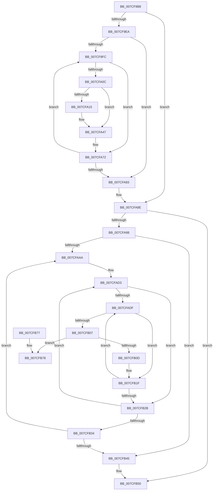

# ExpPartitionDestroy

- RVA: `0x007CF9B8`–`0x007CFB93` (길이 `475` bytes)
- VA: `0x00000001407CF9B8`
- 실행 섹션: `PAGE`
- PDB 이름 있음: `예`; PDB Function 태그: `아니요`
- unwind 정보 RVA: `0x000D5508`
- 디코드: `119`개 명령, `475/475` bytes 표시
- 미해석 바이트: `0` (있으면 어셈블리에 `.byte`로 보존)

> 이 문서는 커널 이미지의 기계어와 PDB 기호를 분석해 생성했습니다. 4번과 5번은 함수 원형과 자료형을 바이너리 사용 방식에서 추정한 C 해석이며 원본 소스 복구 결과는 아닙니다.

## 1. Dependencies

- 직접 호출 지점: **13**; 고유 호출 대상: **9**
- 직접 호출자로 확인된 함수: **2**
- RIP 상대 이미지 참조: **4**

### Outgoing calls
- `0x007CFA25` → [KeSetEvent](../../text/33/KeSetEvent_function_0033F310.md) (function, `0x0033F310`)
- `0x007CFA36` → [ZwWaitForSingleObject](../../text/6A/ZwWaitForSingleObject_function_006AD150.md) (function, `0x006AD150`)
- `0x007CFA42` → [ZwClose](../../text/6A/ZwClose_function_006AD2B0.md) (function, `0x006AD2B0`)
- `0x007CFA50` → [KeCancelTimer2](../../text/3A/KeCancelTimer2_function_003A01E0.md) (function, `0x003A01E0`)
- `0x007CFA59` → [KeCancelTimer](../../text/23/KeCancelTimer_function_002327E0.md) (function, `0x002327E0`)
- `0x007CFA5E` → [KeFlushQueuedDpcs](../../text/3C/KeFlushQueuedDpcs_function_003C0300.md) (function, `0x003C0300`)
- `0x007CFA6D` → [ExFreePoolWithTag](../../poolcode/B8/ExFreePoolWithTag_function_00B82870.md) (function, `0x00B82870`)
- `0x007CFA89` → [ExFreePoolWithTag](../../poolcode/B8/ExFreePoolWithTag_function_00B82870.md) (function, `0x00B82870`)
- `0x007CFB10` → [ExpWorkQueueDestroy](ExpWorkQueueDestroy_function_007CFE70.md) (function, `0x007CFE70`)
- `0x007CFB1A` → [ExFreePoolWithTag](../../poolcode/B8/ExFreePoolWithTag_function_00B82870.md) (function, `0x00B82870`)
- `0x007CFB4B` → [ExFreePoolWithTag](../../poolcode/B8/ExFreePoolWithTag_function_00B82870.md) (function, `0x00B82870`)
- `0x007CFB55` → [ExFreePoolWithTag](../../poolcode/B8/ExFreePoolWithTag_function_00B82870.md) (function, `0x00B82870`)
- `0x007CFB8D` → [KeBugCheckEx](../../text/4F/KeBugCheckEx_function_004FD660.md) (function, `0x004FD660`)

### Direct callers
- [PspTeardownPartition](../78/PspTeardownPartition_function_00788480.md) at `0x007884D9`
- [ExpPartitionInitialize](ExpPartitionInitialize_function_007CFB9C.md) at `0x007CFDBD`

### Static image references
- `0x007CF9EA` → RVA `0x00FC5000` (`ALMOSTRO`; read)
- `0x007CFAAD` → RVA `0x00FCF6C0` (`CACHEALI`; read)
- `0x007CFAC2` → RVA `0x00FDAEC0` (`PAGEDATA`; read)
- `0x007CFAEE` → RVA `0x00EFAA0C` (`.data`; read)

## 2. Other-region calls and transfers

- 다른 실행 섹션으로 향하는 call: **12**
  - `0x007CFA25` → [KeSetEvent](../../text/33/KeSetEvent_function_0033F310.md) (`PAGE` → `.text`)
  - `0x007CFA36` → [ZwWaitForSingleObject](../../text/6A/ZwWaitForSingleObject_function_006AD150.md) (`PAGE` → `.text`)
  - `0x007CFA42` → [ZwClose](../../text/6A/ZwClose_function_006AD2B0.md) (`PAGE` → `.text`)
  - `0x007CFA50` → [KeCancelTimer2](../../text/3A/KeCancelTimer2_function_003A01E0.md) (`PAGE` → `.text`)
  - `0x007CFA59` → [KeCancelTimer](../../text/23/KeCancelTimer_function_002327E0.md) (`PAGE` → `.text`)
  - `0x007CFA5E` → [KeFlushQueuedDpcs](../../text/3C/KeFlushQueuedDpcs_function_003C0300.md) (`PAGE` → `.text`)
  - `0x007CFA6D` → [ExFreePoolWithTag](../../poolcode/B8/ExFreePoolWithTag_function_00B82870.md) (`PAGE` → `POOLCODE`)
  - `0x007CFA89` → [ExFreePoolWithTag](../../poolcode/B8/ExFreePoolWithTag_function_00B82870.md) (`PAGE` → `POOLCODE`)
  - `0x007CFB1A` → [ExFreePoolWithTag](../../poolcode/B8/ExFreePoolWithTag_function_00B82870.md) (`PAGE` → `POOLCODE`)
  - `0x007CFB4B` → [ExFreePoolWithTag](../../poolcode/B8/ExFreePoolWithTag_function_00B82870.md) (`PAGE` → `POOLCODE`)
  - `0x007CFB55` → [ExFreePoolWithTag](../../poolcode/B8/ExFreePoolWithTag_function_00B82870.md) (`PAGE` → `POOLCODE`)
  - `0x007CFB8D` → [KeBugCheckEx](../../text/4F/KeBugCheckEx_function_004FD660.md) (`PAGE` → `.text`)
- 별도 외부 분기/꼬리 이동을 확인하지 못했습니다.

## 3. Assembly (complete function range)

```asm
007CF9B8  48 89 5C 24 08                  mov qword ptr [rsp + 8], rbx
007CF9BD  48 89 6C 24 10                  mov qword ptr [rsp + 0x10], rbp
007CF9C2  48 89 74 24 18                  mov qword ptr [rsp + 0x18], rsi
007CF9C7  57                              push rdi
007CF9C8  41 54                           push r12
007CF9CA  41 55                           push r13
007CF9CC  41 56                           push r14
007CF9CE  41 57                           push r15
007CF9D0  48 83 EC 30                     sub rsp, 0x30
007CF9D4  45 33 E4                        xor r12d, r12d
007CF9D7  48 8B D9                        mov rbx, rcx
007CF9DA  41 BD 01 00 00 00               mov r13d, 1
007CF9E0  4C 39 61 10                     cmp qword ptr [rcx + 0x10], r12
007CF9E4  0F 84 A4 00 00 00               je 0x1407cfa8e
007CF9EA  66 44 3B 25 0E 56 7F 00         cmp r12w, word ptr [rip + 0x7f560e]
007CF9F2  41 0F B7 F4                     movzx esi, r12w
007CF9F6  0F 83 87 00 00 00               jae 0x1407cfa83
007CF9FC  48 8B 43 10                     mov rax, qword ptr [rbx + 0x10]
007CFA00  0F B7 EE                        movzx ebp, si
007CFA03  48 8B 3C E8                     mov rdi, qword ptr [rax + rbp*8]
007CFA07  48 85 FF                        test rdi, rdi
007CFA0A  74 66                           je 0x1407cfa72
007CFA0C  4C 39 A7 08 01 00 00            cmp qword ptr [rdi + 0x108], r12
007CFA13  74 32                           je 0x1407cfa47
007CFA15  48 8D 4F 10                     lea rcx, [rdi + 0x10]
007CFA19  44 89 AF 10 01 00 00            mov dword ptr [rdi + 0x110], r13d
007CFA20  45 33 C0                        xor r8d, r8d
007CFA23  33 D2                           xor edx, edx
007CFA25  E8 E6 F8 B6 FF                  call 0x14033f310
007CFA2A  48 8B 8F 08 01 00 00            mov rcx, qword ptr [rdi + 0x108]
007CFA31  45 33 C0                        xor r8d, r8d
007CFA34  33 D2                           xor edx, edx
007CFA36  E8 15 D7 ED FF                  call 0x1406ad150
007CFA3B  48 8B 8F 08 01 00 00            mov rcx, qword ptr [rdi + 0x108]
007CFA42  E8 69 D8 ED FF                  call 0x1406ad2b0
007CFA47  48 8D 8F 80 00 00 00            lea rcx, [rdi + 0x80]
007CFA4E  33 D2                           xor edx, edx
007CFA50  E8 8B 07 BD FF                  call 0x1403a01e0
007CFA55  48 8D 4F 28                     lea rcx, [rdi + 0x28]
007CFA59  E8 82 2D A6 FF                  call 0x1402327e0
007CFA5E  E8 9D 08 BF FF                  call 0x1403c0300
007CFA63  48 8B 4B 10                     mov rcx, qword ptr [rbx + 0x10]
007CFA67  33 D2                           xor edx, edx
007CFA69  48 8B 0C E9                     mov rcx, qword ptr [rcx + rbp*8]
007CFA6D  E8 FE 2D 3B 00                  call 0x140b82870
007CFA72  66 41 03 F5                     add si, r13w
007CFA76  66 3B 35 83 55 7F 00            cmp si, word ptr [rip + 0x7f5583]
007CFA7D  0F 82 79 FF FF FF               jb 0x1407cf9fc
007CFA83  48 8B 4B 10                     mov rcx, qword ptr [rbx + 0x10]
007CFA87  33 D2                           xor edx, edx
007CFA89  E8 E2 2D 3B 00                  call 0x140b82870
007CFA8E  4C 39 63 08                     cmp qword ptr [rbx + 8], r12
007CFA92  0F 84 B8 00 00 00               je 0x1407cfb50
007CFA98  66 44 3B 25 60 55 7F 00         cmp r12w, word ptr [rip + 0x7f5560]
007CFAA0  41 0F B7 FC                     movzx edi, r12w
007CFAA4  0F 83 9B 00 00 00               jae 0x1407cfb45
007CFAAA  0F B7 C7                        movzx eax, di
007CFAAD  4C 8D 35 0C FC 7F 00            lea r14, [rip + 0x7ffc0c]
007CFAB4  48 69 C8 38 03 00 00            imul rcx, rax, 0x338
007CFABB  4D 8B 34 C6                     mov r14, qword ptr [r14 + rax*8]
007CFABF  45 8B FC                        mov r15d, r12d
007CFAC2  48 8D 05 F7 B3 80 00            lea rax, [rip + 0x80b3f7]
007CFAC9  48 03 C8                        add rcx, rax
007CFACC  4C 3B F1                        cmp r14, rcx
007CFACF  4D 0F 44 F4                     cmove r14, r12
007CFAD3  41 8B EC                        mov ebp, r12d
007CFAD6  45 39 A6 58 03 00 00            cmp dword ptr [r14 + 0x358], r12d
007CFADD  76 4C                           jbe 0x1407cfb2b
007CFADF  41 0F B7 06                     movzx eax, word ptr [r14]
007CFAE3  49 8B F4                        mov rsi, r12
007CFAE6  41 8D 0C C7                     lea ecx, [r15 + rax*8]
007CFAEA  48 8B 43 08                     mov rax, qword ptr [rbx + 8]
007CFAEE  0F AF 0D 17 AF 72 00            imul ecx, dword ptr [rip + 0x72af17]
007CFAF5  03 CD                           add ecx, ebp
007CFAF7  48 8B 14 C8                     mov rdx, qword ptr [rax + rcx*8]
007CFAFB  41 84 D5                        test r13b, dl
007CFAFE  48 0F 44 F2                     cmove rsi, rdx
007CFB02  48 85 F6                        test rsi, rsi
007CFB05  74 18                           je 0x1407cfb1f
007CFB07  44 39 66 04                     cmp dword ptr [rsi + 4], r12d
007CFB0B  75 6B                           jne 0x1407cfb78
007CFB0D  48 8B CE                        mov rcx, rsi
007CFB10  E8 5B 03 00 00                  call 0x1407cfe70
007CFB15  33 D2                           xor edx, edx
007CFB17  48 8B CE                        mov rcx, rsi
007CFB1A  E8 51 2D 3B 00                  call 0x140b82870
007CFB1F  41 03 ED                        add ebp, r13d
007CFB22  41 3B AE 58 03 00 00            cmp ebp, dword ptr [r14 + 0x358]
007CFB29  72 B4                           jb 0x1407cfadf
007CFB2B  45 03 FD                        add r15d, r13d
007CFB2E  41 83 FF 08                     cmp r15d, 8
007CFB32  7C 9F                           jl 0x1407cfad3
007CFB34  66 41 03 FD                     add di, r13w
007CFB38  66 3B 3D C1 54 7F 00            cmp di, word ptr [rip + 0x7f54c1]
007CFB3F  0F 82 65 FF FF FF               jb 0x1407cfaaa
007CFB45  48 8B 4B 08                     mov rcx, qword ptr [rbx + 8]
007CFB49  33 D2                           xor edx, edx
007CFB4B  E8 20 2D 3B 00                  call 0x140b82870
007CFB50  33 D2                           xor edx, edx
007CFB52  48 8B CB                        mov rcx, rbx
007CFB55  E8 16 2D 3B 00                  call 0x140b82870
007CFB5A  48 8B 5C 24 60                  mov rbx, qword ptr [rsp + 0x60]
007CFB5F  48 8B 6C 24 68                  mov rbp, qword ptr [rsp + 0x68]
007CFB64  48 8B 74 24 70                  mov rsi, qword ptr [rsp + 0x70]
007CFB69  48 83 C4 30                     add rsp, 0x30
007CFB6D  41 5F                           pop r15
007CFB6F  41 5E                           pop r14
007CFB71  41 5D                           pop r13
007CFB73  41 5C                           pop r12
007CFB75  5F                              pop rdi
007CFB76  C3                              ret
007CFB77  CC                              int3
007CFB78  4C 8B 03                        mov r8, qword ptr [rbx]
007CFB7B  4C 8B CE                        mov r9, rsi
007CFB7E  BA 02 00 00 00                  mov edx, 2
007CFB83  4C 89 64 24 20                  mov qword ptr [rsp + 0x20], r12
007CFB88  B9 8E 01 00 00                  mov ecx, 0x18e
007CFB8D  E8 CE DA D2 FF                  call 0x1404fd660
007CFB92  CC                              int3
```

## 4. C-style interpretation (structured pseudocode)

```c
__int64 __fastcall ExpPartitionDestroy(__int64 a1, int a2, int a3)
{
    __int64 result;
    __int64 v_r12;
    __int64 v_r14;
    __int64 v_r15;
    __int64 v_rbp;
    __int64 v_rdi;
    __int64 v_rsi;
    __int64 v_rsp;
    unsigned __int64 v_stack_p10;
    unsigned __int64 v_stack_p18;
    unsigned __int64 v_stack_p20;
    unsigned __int64 v_stack_p8;

    v_stack_p8 = v_rbx;
    v_stack_p10 = v_rbp;
    v_stack_p18 = v_rsi;
    v_rsp = (v_rsp) - (48);
    v_r12 = 0;
    if ((*(unsigned __int64 *)(a1 + 16)) == 0) goto loc_007CFA8E;
    if (0 >= (*(unsigned __int16 *)(v_rip + 8345102))) goto loc_007CFA83;
loc_007CF9FC:
    if (*(unsigned __int64 *)(*(unsigned __int64 *)(a1 + 16) + 0 * 8) == 0) goto loc_007CFA72;
    result = *(unsigned __int64 *)(a1 + 16);
    if ((*(unsigned __int64 *)(*(unsigned __int64 *)(*(unsigned __int64 *)(a1 + 16) + 0 * 8) + 264)) != 0) {
        a1 = *(unsigned __int64 *)(*(unsigned __int64 *)(a1 + 16) + 0 * 8) + 16;
        *(unsigned int *)(*(unsigned __int64 *)(*(unsigned __int64 *)(a1 + 16) + 0 * 8) + 272) = 1;
        a3 = 0;
        a2 = 0;
        result = KeSetEvent(a1, a2, a3, a4);
        a1 = *(unsigned __int64 *)(*(unsigned __int64 *)(*(unsigned __int64 *)(a1 + 16) + 0 * 8) + 264);
        a3 = 0;
        a2 = 0;
        result = ZwWaitForSingleObject(a1, a2, a3, a4);
        a1 = *(unsigned __int64 *)(*(unsigned __int64 *)(*(unsigned __int64 *)(a1 + 16) + 0 * 8) + 264);
        result = ZwClose(a1, a2, a3, a4);
    }
    a2 = 0;
    result = KeCancelTimer2(*(unsigned __int64 *)(*(unsigned __int64 *)(a1 + 16) + 0 * 8) + 128, a2, a3, a4);
    result = KeCancelTimer(*(unsigned __int64 *)(*(unsigned __int64 *)(a1 + 16) + 0 * 8) + 40, a2, a3, a4);
    result = KeFlushQueuedDpcs(*(unsigned __int64 *)(*(unsigned __int64 *)(a1 + 16) + 0 * 8) + 40, a2, a3, a4);
    a2 = 0;
    result = ExFreePoolWithTag(*(unsigned __int64 *)(*(unsigned __int64 *)(a1 + 16) + 0 * 8), a2, a3, a4);
loc_007CFA72:
    v_rsi = (unsigned __int16)((0) + (1));
    if (((unsigned __int16)(v_rsi)) < (*(unsigned __int16 *)(v_rip + 8344963))) goto loc_007CF9FC;
loc_007CFA83:
    a2 = 0;
    result = ExFreePoolWithTag(*(unsigned __int64 *)(a1 + 16), a2, a3, a4);
loc_007CFA8E:
    if ((*(unsigned __int64 *)(a1 + 8)) == 0) goto loc_007CFB50;
    if (0 >= (*(unsigned __int16 *)(v_rip + 8344928))) goto loc_007CFB45;
loc_007CFAAA:
    a1 = (*(unsigned __int64 *)(a1 + 16)) * (0);
    a1 = (a1) + (v_rip + 8434679);
    v_r14 = *(unsigned __int64 *)(v_rip + 8387596 + 0 * 8);
    if ((*(unsigned __int64 *)(v_rip + 8387596 + 0 * 8)) == a1) { v_r14 = 0; }
loc_007CFAD3:
    if ((*(unsigned int *)(v_r14 + 856)) <= 0) goto loc_007CFB2B;
loc_007CFADF:
    a1 = (unsigned int)((0 + *(unsigned __int16 *)(v_r14) * 8) * (*(unsigned int *)(v_rip + 7515927)));
    a1 = (unsigned int)((a1) + (0));
    v_rsi = 0;
    if (((1) & ((unsigned __int8)(*(unsigned __int64 *)(*(unsigned __int64 *)(a1 + 8) + a1 * 8)))) == 0) { v_rsi = *(unsigned __int64 *)(*(unsigned __int64 *)(a1 + 8) + a1 * 8); }
    if (v_rsi == 0) goto loc_007CFB1F;
    if ((*(unsigned int *)(v_rsi + 4)) != 0) goto loc_007CFB78;
    result = ExpWorkQueueDestroy(v_rsi, *(unsigned __int64 *)(*(unsigned __int64 *)(a1 + 8) + a1 * 8), a3, a4);
    a2 = 0;
    result = ExFreePoolWithTag(v_rsi, a2, a3, a4);
loc_007CFB1F:
    v_rbp = (unsigned int)((0) + (1));
    if (((unsigned int)(v_rbp)) < (*(unsigned int *)(v_r14 + 856))) goto loc_007CFADF;
loc_007CFB2B:
    v_r15 = (unsigned int)((0) + (1));
    if (((unsigned int)(v_r15)) < 8) goto loc_007CFAD3;
    v_rdi = (unsigned __int16)((0) + (1));
    if (((unsigned __int16)(v_rdi)) < (*(unsigned __int16 *)(v_rip + 8344769))) goto loc_007CFAAA;
loc_007CFB45:
    a2 = 0;
    result = ExFreePoolWithTag(*(unsigned __int64 *)(a1 + 8), a2, a3, a4);
loc_007CFB50:
    a2 = 0;
    result = ExFreePoolWithTag(a1, a2, a3, a4);
    v_rsp = (v_rsp) + (48);
    return result;
loc_007CFB78:
    v_stack_p20 = 0;
    result = KeBugCheckEx(398, 2, *(unsigned __int64 *)(v_stack_p8), v_stack_p18);
    return result;
}
```

## 5. (Beta) C Style

```c
int64_t ExpPartitionDestroy(void *Arg1, int32_t Arg2, int32_t Arg3)
{
    uint8_t *arg1 = (uint8_t *)Arg1;

    int64_t result;
    int64_t local_r12;
    int64_t local_r14;
    int64_t local_r15;
    int64_t local_rbp;
    int64_t local_rdi;
    int64_t local_rsi;
    int64_t local_rsp;
    uint64_t v_stack_p10;
    uint64_t v_stack_p18;
    uint64_t v_stack_p20;
    uint64_t v_stack_p8;

    v_stack_p8 = local_rbx;
    v_stack_p10 = local_rbp;
    v_stack_p18 = local_rsi;
    local_rsp = (local_rsp) - (48);
    local_r12 = 0;
    if ((*(uint64_t *)(arg1 + 0x10)) == 0) goto loc_007CFA8E;
    if (0 >= (*(uint16_t *)(v_rip + 0x7F560E))) goto loc_007CFA83;
loc_007CF9FC:
    if (*(uint64_t *)(*(uint64_t *)(arg1 + 0x10) + 0x0 * 8) == 0) goto loc_007CFA72;
    result = *(uint64_t *)(arg1 + 0x10);
    if ((*(uint64_t *)(*(uint64_t *)(*(uint64_t *)(arg1 + 0x10) + 0x0 * 8) + 0x108)) != 0) {
        Arg1 = *(uint64_t *)(*(uint64_t *)(arg1 + 0x10) + 0x0 * 8) + 16;
        *(uint32_t *)(*(uint64_t *)(*(uint64_t *)(arg1 + 0x10) + 0x0 * 8) + 0x110) = 1;
        Arg3 = 0;
        Arg2 = 0;
        result = KeSetEvent(Arg1, Arg2, Arg3, a4);
        Arg1 = *(uint64_t *)(*(uint64_t *)(*(uint64_t *)(arg1 + 0x10) + 0x0 * 8) + 0x108);
        Arg3 = 0;
        Arg2 = 0;
        result = ZwWaitForSingleObject(Arg1, Arg2, Arg3, a4);
        Arg1 = *(uint64_t *)(*(uint64_t *)(*(uint64_t *)(arg1 + 0x10) + 0x0 * 8) + 0x108);
        result = ZwClose(Arg1, Arg2, Arg3, a4);
    }
    Arg2 = 0;
    result = KeCancelTimer2(*(uint64_t *)(*(uint64_t *)(arg1 + 0x10) + 0x0 * 8) + 128, Arg2, Arg3, a4);
    result = KeCancelTimer(*(uint64_t *)(*(uint64_t *)(arg1 + 0x10) + 0x0 * 8) + 40, Arg2, Arg3, a4);
    result = KeFlushQueuedDpcs(*(uint64_t *)(*(uint64_t *)(arg1 + 0x10) + 0x0 * 8) + 40, Arg2, Arg3, a4);
    Arg2 = 0;
    result = ExFreePoolWithTag(*(uint64_t *)(*(uint64_t *)(arg1 + 0x10) + 0x0 * 8), Arg2, Arg3, a4);
loc_007CFA72:
    local_rsi = (uint16_t)((0) + (1));
    if (((uint16_t)(local_rsi)) < (*(uint16_t *)(v_rip + 0x7F5583))) goto loc_007CF9FC;
loc_007CFA83:
    Arg2 = 0;
    result = ExFreePoolWithTag(*(uint64_t *)(arg1 + 0x10), Arg2, Arg3, a4);
loc_007CFA8E:
    if ((*(uint64_t *)(arg1 + 0x8)) == 0) goto loc_007CFB50;
    if (0 >= (*(uint16_t *)(v_rip + 0x7F5560))) goto loc_007CFB45;
loc_007CFAAA:
    Arg1 = (*(uint64_t *)(arg1 + 0x10)) * (0);
    Arg1 = (Arg1) + (v_rip + 8434679);
    local_r14 = *(uint64_t *)(v_rip + 0x7FFC0C + 0x0 * 8);
    if ((*(uint64_t *)(v_rip + 0x7FFC0C + 0x0 * 8)) == Arg1) { local_r14 = 0; }
loc_007CFAD3:
    if ((*(uint32_t *)(local_r14 + 0x358)) <= 0) goto loc_007CFB2B;
loc_007CFADF:
    Arg1 = (uint32_t)((0 + *(uint16_t *)(local_r14) * 8) * (*(uint32_t *)(v_rip + 0x72AF17)));
    Arg1 = (uint32_t)((Arg1) + (0));
    local_rsi = 0;
    if (((1) & ((uint8_t)(*(uint64_t *)(*(uint64_t *)(arg1 + 0x8) + arg1 * 8)))) == 0) { local_rsi = *(uint64_t *)(*(uint64_t *)(arg1 + 0x8) + arg1 * 8); }
    if (local_rsi == 0) goto loc_007CFB1F;
    if ((*(uint32_t *)(local_rsi + 0x4)) != 0) goto loc_007CFB78;
    result = ExpWorkQueueDestroy(local_rsi, *(uint64_t *)(*(uint64_t *)(arg1 + 0x8) + arg1 * 8), Arg3, a4);
    Arg2 = 0;
    result = ExFreePoolWithTag(local_rsi, Arg2, Arg3, a4);
loc_007CFB1F:
    local_rbp = (uint32_t)((0) + (1));
    if (((uint32_t)(local_rbp)) < (*(uint32_t *)(local_r14 + 0x358))) goto loc_007CFADF;
loc_007CFB2B:
    local_r15 = (uint32_t)((0) + (1));
    if (((uint32_t)(local_r15)) < 8) goto loc_007CFAD3;
    local_rdi = (uint16_t)((0) + (1));
    if (((uint16_t)(local_rdi)) < (*(uint16_t *)(v_rip + 0x7F54C1))) goto loc_007CFAAA;
loc_007CFB45:
    Arg2 = 0;
    result = ExFreePoolWithTag(*(uint64_t *)(arg1 + 0x8), Arg2, Arg3, a4);
loc_007CFB50:
    Arg2 = 0;
    result = ExFreePoolWithTag(Arg1, Arg2, Arg3, a4);
    local_rsp = (local_rsp) + (48);
    return result;
loc_007CFB78:
    v_stack_p20 = 0;
    result = KeBugCheckEx(398, 2, *(uint64_t *)(v_stack_p8), v_stack_p18);
    return result;
}
```

### 관측된 메모리 오프셋

구조체 형식이 확인되지 않은 접근은 인자 기준의 오프셋으로만 기록했습니다.

| 기준 인자 | 오프셋 표현 | 폭 (bit) | 접근 |
|---|---:|---:|---|
| `Arg1` | `+ 0x0` | `64` | `R` |
| `Arg1` | `+ 0x8` | `64` | `R` |
| `Arg1` | `+ 0x10` | `64` | `R` |

## 6. Execution-region graph

[열기: 2D/3D 그래프와 함수 탐색 컨트롤 패널](../../../control-panel.html?section=page&rva=0x007CF9B8&view=graph)

- 2D 그래프는 위에서 아래로 흐르고, 3D 그래프는 빈 공간을 드래그해 회전합니다. Shift+드래그는 이동, 휠은 확대·축소, 함수 노드 선택은 대상 보고서 이동입니다.

### Static fallback


