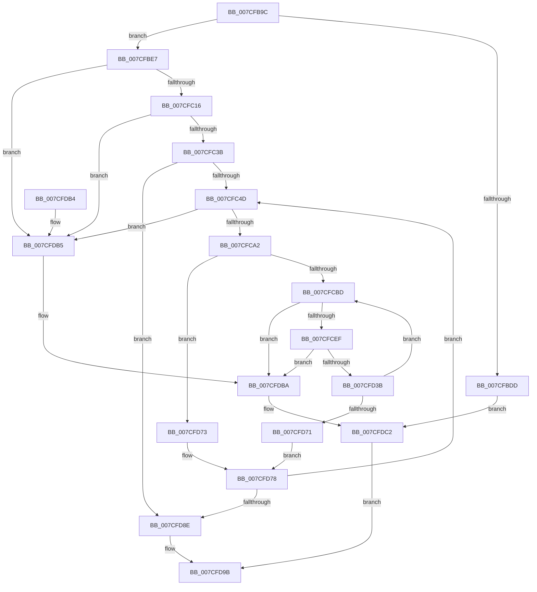

# ExpPartitionInitialize

- RVA: `0x007CFB9C`–`0x007CFDC6` (길이 `554` bytes)
- VA: `0x00000001407CFB9C`
- 실행 섹션: `PAGE`
- PDB 이름 있음: `예`; PDB Function 태그: `아니요`
- unwind 정보 RVA: `0x000D5528`
- 디코드: `133`개 명령, `554/554` bytes 표시
- 미해석 바이트: `0` (있으면 어셈블리에 `.byte`로 보존)

> 이 문서는 커널 이미지의 기계어와 PDB 기호를 분석해 생성했습니다. 4번과 5번은 함수 원형과 자료형을 바이너리 사용 방식에서 추정한 C 해석이며 원본 소스 복구 결과는 아닙니다.

## 1. Dependencies

- 직접 호출 지점: **8**; 고유 호출 대상: **4**
- 직접 호출자로 확인된 함수: **2**
- RIP 상대 이미지 참조: **5**

### Outgoing calls
- `0x007CFBD0` → [ExAllocatePool2](../../poolcode/B8/ExAllocatePool2_function_00B820F0.md) (function, `0x00B820F0`)
- `0x007CFC04` → [ExAllocatePool2](../../poolcode/B8/ExAllocatePool2_function_00B820F0.md) (function, `0x00B820F0`)
- `0x007CFC29` → [ExAllocatePool2](../../poolcode/B8/ExAllocatePool2_function_00B820F0.md) (function, `0x00B820F0`)
- `0x007CFC84` → [ExAllocatePool2](../../poolcode/B8/ExAllocatePool2_function_00B820F0.md) (function, `0x00B820F0`)
- `0x007CFCA8` → [ExpWorkQueueManagerInitialize](../7D/ExpWorkQueueManagerInitialize_function_007D01D4.md) (function, `0x007D01D4`)
- `0x007CFCE0` → [ExpPartitionCreatePoolInternal](../AF/ExpPartitionCreatePoolInternal_function_00AF6C08.md) (function, `0x00AF6C08`)
- `0x007CFD30` → [ExpPartitionCreatePoolInternal](../AF/ExpPartitionCreatePoolInternal_function_00AF6C08.md) (function, `0x00AF6C08`)
- `0x007CFDBD` → [ExpPartitionDestroy](ExpPartitionDestroy_function_007CF9B8.md) (function, `0x007CF9B8`)

### Direct callers
- [PspAllocatePartition](../78/PspAllocatePartition_function_0078802C.md) at `0x0078823A`
- [ExpWorkerInitialization](../../init/C5/ExpWorkerInitialization_function_00C539A4.md) at `0x00C53B70`

### Static image references
- `0x007CFBE7` → RVA `0x00FC5000` (`ALMOSTRO`; read)
- `0x007CFBF4` → RVA `0x00EFAA0C` (`.data`; read)
- `0x007CFC50` → RVA `0x00FDAEC0` (`PAGEDATA`; read)
- `0x007CFC5E` → RVA `0x00FCF6C0` (`CACHEALI`; read)
- `0x007CFCBD` → RVA `0x00E0EBD0` (`.data`; read)

## 2. Other-region calls and transfers

- 다른 실행 섹션으로 향하는 call: **4**
  - `0x007CFBD0` → [ExAllocatePool2](../../poolcode/B8/ExAllocatePool2_function_00B820F0.md) (`PAGE` → `POOLCODE`)
  - `0x007CFC04` → [ExAllocatePool2](../../poolcode/B8/ExAllocatePool2_function_00B820F0.md) (`PAGE` → `POOLCODE`)
  - `0x007CFC29` → [ExAllocatePool2](../../poolcode/B8/ExAllocatePool2_function_00B820F0.md) (`PAGE` → `POOLCODE`)
  - `0x007CFC84` → [ExAllocatePool2](../../poolcode/B8/ExAllocatePool2_function_00B820F0.md) (`PAGE` → `POOLCODE`)
- 별도 외부 분기/꼬리 이동을 확인하지 못했습니다.

## 3. Assembly (complete function range)

```asm
007CFB9C  48 89 5C 24 08                  mov qword ptr [rsp + 8], rbx
007CFBA1  48 89 6C 24 18                  mov qword ptr [rsp + 0x18], rbp
007CFBA6  56                              push rsi
007CFBA7  57                              push rdi
007CFBA8  41 54                           push r12
007CFBAA  41 56                           push r14
007CFBAC  41 57                           push r15
007CFBAE  48 83 EC 40                     sub rsp, 0x40
007CFBB2  45 33 E4                        xor r12d, r12d
007CFBB5  4C 8B F9                        mov r15, rcx
007CFBB8  41 B8 45 78 57 6C               mov r8d, 0x6c577845
007CFBBE  4C 89 64 24 78                  mov qword ptr [rsp + 0x78], r12
007CFBC3  45 8D 74 24 40                  lea r14d, [r12 + 0x40]
007CFBC8  41 8B CE                        mov ecx, r14d
007CFBCB  41 8D 54 24 20                  lea edx, [r12 + 0x20]
007CFBD0  E8 1B 25 3B 00                  call 0x140b820f0
007CFBD5  48 8B F8                        mov rdi, rax
007CFBD8  48 85 C0                        test rax, rax
007CFBDB  75 0A                           jne 0x1407cfbe7
007CFBDD  BB 17 00 00 C0                  mov ebx, 0xc0000017
007CFBE2  E9 DB 01 00 00                  jmp 0x1407cfdc2
007CFBE7  0F B7 15 12 54 7F 00            movzx edx, word ptr [rip + 0x7f5412]
007CFBEE  41 B8 45 78 57 6C               mov r8d, 0x6c577845
007CFBF4  0F AF 15 11 AE 72 00            imul edx, dword ptr [rip + 0x72ae11]
007CFBFB  49 8B CE                        mov rcx, r14
007CFBFE  4C 89 38                        mov qword ptr [rax], r15
007CFC01  C1 E2 06                        shl edx, 6
007CFC04  E8 E7 24 3B 00                  call 0x140b820f0
007CFC09  48 89 47 08                     mov qword ptr [rdi + 8], rax
007CFC0D  48 85 C0                        test rax, rax
007CFC10  0F 84 9F 01 00 00               je 0x1407cfdb5
007CFC16  0F B7 15 E3 53 7F 00            movzx edx, word ptr [rip + 0x7f53e3]
007CFC1D  41 B8 45 78 57 6C               mov r8d, 0x6c577845
007CFC23  C1 E2 03                        shl edx, 3
007CFC26  49 8B CE                        mov rcx, r14
007CFC29  E8 C2 24 3B 00                  call 0x140b820f0
007CFC2E  48 89 47 10                     mov qword ptr [rdi + 0x10], rax
007CFC32  48 85 C0                        test rax, rax
007CFC35  0F 84 7A 01 00 00               je 0x1407cfdb5
007CFC3B  66 44 3B 25 BD 53 7F 00         cmp r12w, word ptr [rip + 0x7f53bd]
007CFC43  41 0F B7 EC                     movzx ebp, r12w
007CFC47  0F 83 41 01 00 00               jae 0x1407cfd8e
007CFC4D  0F B7 DD                        movzx ebx, bp
007CFC50  48 8D 15 69 B2 80 00            lea rdx, [rip + 0x80b269]
007CFC57  48 69 C3 38 03 00 00            imul rax, rbx, 0x338
007CFC5E  48 8D 0D 5B FA 7F 00            lea rcx, [rip + 0x7ffa5b]
007CFC65  49 8B F4                        mov rsi, r12
007CFC68  48 8B 0C D9                     mov rcx, qword ptr [rcx + rbx*8]
007CFC6C  48 03 C2                        add rax, rdx
007CFC6F  48 3B C8                        cmp rcx, rax
007CFC72  BA 18 01 00 00                  mov edx, 0x118
007CFC77  41 B8 45 78 57 6C               mov r8d, 0x6c577845
007CFC7D  48 0F 45 F1                     cmovne rsi, rcx
007CFC81  49 8B CE                        mov rcx, r14
007CFC84  E8 67 24 3B 00                  call 0x140b820f0
007CFC89  48 8B 4F 10                     mov rcx, qword ptr [rdi + 0x10]
007CFC8D  48 89 04 D9                     mov qword ptr [rcx + rbx*8], rax
007CFC91  48 8B 47 10                     mov rax, qword ptr [rdi + 0x10]
007CFC95  48 8B 0C D8                     mov rcx, qword ptr [rax + rbx*8]
007CFC99  48 85 C9                        test rcx, rcx
007CFC9C  0F 84 13 01 00 00               je 0x1407cfdb5
007CFCA2  4C 8B C6                        mov r8, rsi
007CFCA5  48 8B D7                        mov rdx, rdi
007CFCA8  E8 27 05 00 00                  call 0x1407d01d4
007CFCAD  45 8B F4                        mov r14d, r12d
007CFCB0  44 39 A6 58 03 00 00            cmp dword ptr [rsi + 0x358], r12d
007CFCB7  0F 86 B6 00 00 00               jbe 0x1407cfd73
007CFCBD  44 8B 05 0C EF 63 00            mov r8d, dword ptr [rip + 0x63ef0c]
007CFCC4  48 8D 44 24 78                  lea rax, [rsp + 0x78]
007CFCC9  48 89 44 24 30                  mov qword ptr [rsp + 0x30], rax
007CFCCE  4C 8B CE                        mov r9, rsi
007CFCD1  44 89 74 24 28                  mov dword ptr [rsp + 0x28], r14d
007CFCD6  33 D2                           xor edx, edx
007CFCD8  48 8B CF                        mov rcx, rdi
007CFCDB  44 89 64 24 20                  mov dword ptr [rsp + 0x20], r12d
007CFCE0  E8 23 6F 32 00                  call 0x140af6c08
007CFCE5  8B D8                           mov ebx, eax
007CFCE7  85 C0                           test eax, eax
007CFCE9  0F 88 CB 00 00 00               js 0x1407cfdba
007CFCEF  0F B7 06                        movzx eax, word ptr [rsi]
007CFCF2  4C 8B CE                        mov r9, rsi
007CFCF5  0F AF 05 10 AD 72 00            imul eax, dword ptr [rip + 0x72ad10]
007CFCFC  48 8B 4F 08                     mov rcx, qword ptr [rdi + 8]
007CFD00  41 8D 14 C6                     lea edx, [r14 + rax*8]
007CFD04  48 8B 44 24 78                  mov rax, qword ptr [rsp + 0x78]
007CFD09  48 89 04 D1                     mov qword ptr [rcx + rdx*8], rax
007CFD0D  48 8D 44 24 78                  lea rax, [rsp + 0x78]
007CFD12  44 8B 05 B7 EE 63 00            mov r8d, dword ptr [rip + 0x63eeb7]
007CFD19  33 D2                           xor edx, edx
007CFD1B  48 89 44 24 30                  mov qword ptr [rsp + 0x30], rax
007CFD20  48 8B CF                        mov rcx, rdi
007CFD23  44 89 74 24 28                  mov dword ptr [rsp + 0x28], r14d
007CFD28  C7 44 24 20 01 00 00 00         mov dword ptr [rsp + 0x20], 1
007CFD30  E8 D3 6E 32 00                  call 0x140af6c08
007CFD35  8B D8                           mov ebx, eax
007CFD37  85 C0                           test eax, eax
007CFD39  78 7F                           js 0x1407cfdba
007CFD3B  0F B7 06                        movzx eax, word ptr [rsi]
007CFD3E  48 8B 4F 08                     mov rcx, qword ptr [rdi + 8]
007CFD42  8D 14 C5 01 00 00 00            lea edx, [rax*8 + 1]
007CFD49  48 8B 44 24 78                  mov rax, qword ptr [rsp + 0x78]
007CFD4E  0F AF 15 B7 AC 72 00            imul edx, dword ptr [rip + 0x72acb7]
007CFD55  41 03 D6                        add edx, r14d
007CFD58  48 89 04 D1                     mov qword ptr [rcx + rdx*8], rax
007CFD5C  B8 01 00 00 00                  mov eax, 1
007CFD61  44 03 F0                        add r14d, eax
007CFD64  44 3B B6 58 03 00 00            cmp r14d, dword ptr [rsi + 0x358]
007CFD6B  0F 82 4C FF FF FF               jb 0x1407cfcbd
007CFD71  EB 05                           jmp 0x1407cfd78
007CFD73  B8 01 00 00 00                  mov eax, 1
007CFD78  66 03 E8                        add bp, ax
007CFD7B  41 BE 40 00 00 00               mov r14d, 0x40
007CFD81  66 3B 2D 78 52 7F 00            cmp bp, word ptr [rip + 0x7f5278]
007CFD88  0F 82 BF FE FF FF               jb 0x1407cfc4d
007CFD8E  C7 47 18 FC 00 00 00            mov dword ptr [rdi + 0x18], 0xfc
007CFD95  33 C0                           xor eax, eax
007CFD97  49 89 7F 10                     mov qword ptr [r15 + 0x10], rdi
007CFD9B  4C 8D 5C 24 40                  lea r11, [rsp + 0x40]
007CFDA0  49 8B 5B 30                     mov rbx, qword ptr [r11 + 0x30]
007CFDA4  49 8B 6B 40                     mov rbp, qword ptr [r11 + 0x40]
007CFDA8  49 8B E3                        mov rsp, r11
007CFDAB  41 5F                           pop r15
007CFDAD  41 5E                           pop r14
007CFDAF  41 5C                           pop r12
007CFDB1  5F                              pop rdi
007CFDB2  5E                              pop rsi
007CFDB3  C3                              ret
007CFDB4  CC                              int3
007CFDB5  BB 17 00 00 C0                  mov ebx, 0xc0000017
007CFDBA  48 8B CF                        mov rcx, rdi
007CFDBD  E8 F6 FB FF FF                  call 0x1407cf9b8
007CFDC2  8B C3                           mov eax, ebx
007CFDC4  EB D5                           jmp 0x1407cfd9b
```

## 4. C-style interpretation (structured pseudocode)

```c
__int64 __fastcall ExpPartitionInitialize(__int64 a1)
{
    __int64 result;
    __int64 v_r12;
    __int64 v_r14;
    __int64 v_rbp;
    __int64 v_rsi;
    __int64 v_rsp;
    unsigned __int64 v_stack_m28;
    unsigned __int64 v_stack_m38;
    unsigned int v_stack_m40;
    unsigned int v_stack_m48;
    unsigned __int64 v_stack_p10;
    unsigned __int64 v_stack_p18;
    unsigned __int64 v_stack_p8;

    v_stack_p8 = v_rbx;
    v_stack_p18 = v_rbp;
    v_rsp = (v_rsp) - (64);
    v_r12 = 0;
    v_stack_p10 = 0;
    result = ExAllocatePool2((unsigned int)((unsigned int)(v_r12 + 64)), v_r12 + 32, (unsigned int)(0x6C577845ULL), a4);
    if (result != 0) goto loc_007CFBE7;
    goto loc_007CFDC2;
loc_007CFBE7:
    a2 = (unsigned int)((*(unsigned __int16 *)(v_rip + 8344594)) * (*(unsigned int *)(v_rip + 7515665)));
    *(unsigned __int64 *)(result) = a1;
    a2 = (unsigned int)((a2) << (6));
    result = ExAllocatePool2(v_r12 + 64, a2, (unsigned int)(0x6C577845ULL), a4);
    *(unsigned __int64 *)(result + 8) = result;
    if (result == 0) goto loc_007CFDB5;
    a2 = (unsigned int)((*(unsigned __int16 *)(v_rip + 8344547)) << (3));
    result = ExAllocatePool2(v_r12 + 64, a2, (unsigned int)(0x6C577845ULL), a4);
    *(unsigned __int64 *)(result + 16) = result;
    if (result == 0) goto loc_007CFDB5;
    if (0 >= (*(unsigned __int16 *)(v_rip + 8344509))) goto loc_007CFD8E;
loc_007CFC4D:
    result = (result) * (0);
    result = (result) + (v_rip + 8434281);
    v_rsi = 0;
    if ((*(unsigned __int64 *)(v_rip + 8387163 + 0 * 8)) != result) { v_rsi = *(unsigned __int64 *)(v_rip + 8387163 + 0 * 8); }
    result = ExAllocatePool2(v_r12 + 64, 280, (unsigned int)(0x6C577845ULL), a4);
    *(unsigned __int64 *)(*(unsigned __int64 *)(result + 16) + 0 * 8) = result;
    if (*(unsigned __int64 *)(*(unsigned __int64 *)(result + 16) + 0 * 8) == 0) goto loc_007CFDB5;
    result = ExpWorkQueueManagerInitialize(*(unsigned __int64 *)(*(unsigned __int64 *)(result + 16) + 0 * 8), result, v_rsi, a4);
    if ((*(unsigned int *)(v_rsi + 856)) <= 0) goto loc_007CFD73;
loc_007CFCBD:
    v_stack_m38 = v_stack_p10;
    v_stack_m40 = 0;
    a2 = 0;
    v_stack_m48 = 0;
    result = ExpPartitionCreatePoolInternal(result, a2, (unsigned int)(*(unsigned int *)(v_rip + 6549260)), v_rsi);
    if (sign_flag) goto loc_007CFDBA;
    result = (unsigned int)((*(unsigned __int16 *)(v_rsi)) * (*(unsigned int *)(v_rip + 7515408)));
    *(unsigned __int64 *)(*(unsigned __int64 *)(result + 8) + 0 + result * 8 * 8) = v_stack_p10;
    a2 = 0;
    v_stack_m38 = v_stack_p10;
    v_stack_m40 = 0;
    v_stack_m48 = 1;
    result = ExpPartitionCreatePoolInternal(result, a2, (unsigned int)(*(unsigned int *)(v_rip + 6549175)), v_rsi);
    if (sign_flag) goto loc_007CFDBA;
    a2 = (unsigned int)((*(unsigned __int16 *)(v_rsi) * 8 + 1) * (*(unsigned int *)(v_rip + 7515319)));
    a2 = (unsigned int)((a2) + (0));
    *(unsigned __int64 *)(*(unsigned __int64 *)(result + 8) + a2 * 8) = v_stack_p10;
    v_r14 = (unsigned int)((0) + (1));
    if (((unsigned int)(v_r14)) < (*(unsigned int *)(v_rsi + 856))) goto loc_007CFCBD;
    goto loc_007CFD78;
loc_007CFD73:
loc_007CFD78:
    v_rbp = (unsigned __int16)((0) + (1));
    if (((unsigned __int16)(v_rbp)) < (*(unsigned __int16 *)(v_rip + 8344184))) goto loc_007CFC4D;
loc_007CFD8E:
    *(unsigned int *)(result + 24) = 252;
    result = 0;
    *(unsigned __int64 *)(a1 + 16) = 0;
loc_007CFD9B:
    return result;
loc_007CFDB5:
loc_007CFDBA:
    result = ExpPartitionDestroy(0, a2, (unsigned int)(*(unsigned int *)(v_rip + 6549175)), v_rsi);
loc_007CFDC2:
    goto loc_007CFD9B;
}
```

## 5. (Beta) C Style

```c
int64_t ExpPartitionInitialize(void *Arg1)
{
    uint8_t *arg1 = (uint8_t *)Arg1;

    int64_t result;
    int64_t local_r12;
    int64_t local_r14;
    int64_t local_rbp;
    int64_t local_rsi;
    int64_t local_rsp;
    uint64_t v_stack_m28;
    uint64_t v_stack_m38;
    uint32_t v_stack_m40;
    uint32_t v_stack_m48;
    uint64_t v_stack_p10;
    uint64_t v_stack_p18;
    uint64_t v_stack_p8;

    v_stack_p8 = local_rbx;
    v_stack_p18 = local_rbp;
    local_rsp = (local_rsp) - (64);
    local_r12 = 0;
    v_stack_p10 = 0;
    result = ExAllocatePool2((uint32_t)((uint32_t)(local_r12 + 64)), local_r12 + 32, (uint32_t)(0x6C577845ULL), a4);
    if (result != 0) goto loc_007CFBE7;
    goto loc_007CFDC2;
loc_007CFBE7:
    a2 = (uint32_t)((*(uint16_t *)(v_rip + 0x7F5412)) * (*(uint32_t *)(v_rip + 0x72AE11)));
    *(void **)(result) = Arg1;
    a2 = (uint32_t)((a2) << (6));
    result = ExAllocatePool2(local_r12 + 64, a2, (uint32_t)(0x6C577845ULL), a4);
    *(uint64_t *)(result + 0x8) = result;
    if (result == 0) goto loc_007CFDB5;
    a2 = (uint32_t)((*(uint16_t *)(v_rip + 0x7F53E3)) << (3));
    result = ExAllocatePool2(local_r12 + 64, a2, (uint32_t)(0x6C577845ULL), a4);
    *(uint64_t *)(result + 0x10) = result;
    if (result == 0) goto loc_007CFDB5;
    if (0 >= (*(uint16_t *)(v_rip + 0x7F53BD))) goto loc_007CFD8E;
loc_007CFC4D:
    result = (result) * (0);
    result = (result) + (v_rip + 8434281);
    local_rsi = 0;
    if ((*(uint64_t *)(v_rip + 0x7FFA5B + 0x0 * 8)) != result) { local_rsi = *(uint64_t *)(v_rip + 0x7FFA5B + 0x0 * 8); }
    result = ExAllocatePool2(local_r12 + 64, 280, (uint32_t)(0x6C577845ULL), a4);
    *(uint64_t *)(*(uint64_t *)(result + 0x10) + 0x0 * 8) = result;
    if (*(uint64_t *)(*(uint64_t *)(result + 0x10) + 0x0 * 8) == 0) goto loc_007CFDB5;
    result = ExpWorkQueueManagerInitialize(*(uint64_t *)(*(uint64_t *)(result + 0x10) + 0x0 * 8), result, local_rsi, a4);
    if ((*(uint32_t *)(local_rsi + 0x358)) <= 0) goto loc_007CFD73;
loc_007CFCBD:
    v_stack_m38 = v_stack_p10;
    v_stack_m40 = 0;
    a2 = 0;
    v_stack_m48 = 0;
    result = ExpPartitionCreatePoolInternal(result, a2, (uint32_t)(*(uint32_t *)(v_rip + 0x63EF0C)), local_rsi);
    if (sign_flag) goto loc_007CFDBA;
    result = (uint32_t)((*(uint16_t *)(local_rsi)) * (*(uint32_t *)(v_rip + 0x72AD10)));
    *(uint64_t *)(*(uint64_t *)(result + 0x8) + 0x0 + result * 8 * 8) = v_stack_p10;
    a2 = 0;
    v_stack_m38 = v_stack_p10;
    v_stack_m40 = 0;
    v_stack_m48 = 1;
    result = ExpPartitionCreatePoolInternal(result, a2, (uint32_t)(*(uint32_t *)(v_rip + 0x63EEB7)), local_rsi);
    if (sign_flag) goto loc_007CFDBA;
    a2 = (uint32_t)((*(uint16_t *)(local_rsi) * 8 + 1) * (*(uint32_t *)(v_rip + 0x72ACB7)));
    a2 = (uint32_t)((a2) + (0));
    *(uint64_t *)(*(uint64_t *)(result + 0x8) + a2 * 8) = v_stack_p10;
    local_r14 = (uint32_t)((0) + (1));
    if (((uint32_t)(local_r14)) < (*(uint32_t *)(local_rsi + 0x358))) goto loc_007CFCBD;
    goto loc_007CFD78;
loc_007CFD73:
loc_007CFD78:
    local_rbp = (uint16_t)((0) + (1));
    if (((uint16_t)(local_rbp)) < (*(uint16_t *)(v_rip + 0x7F5278))) goto loc_007CFC4D;
loc_007CFD8E:
    *(uint32_t *)(result + 0x18) = 252;
    result = 0;
    *(uint64_t *)(arg1 + 0x10) = 0;
loc_007CFD9B:
    return result;
loc_007CFDB5:
loc_007CFDBA:
    result = ExpPartitionDestroy(0, a2, (uint32_t)(*(uint32_t *)(v_rip + 0x63EEB7)), local_rsi);
loc_007CFDC2:
    goto loc_007CFD9B;
}
```

### 관측된 메모리 오프셋

구조체 형식이 확인되지 않은 접근은 인자 기준의 오프셋으로만 기록했습니다.

| 기준 인자 | 오프셋 표현 | 폭 (bit) | 접근 |
|---|---:|---:|---|
| `Arg1` | `+ 0x10` | `64` | `W` |

## 6. Execution-region graph

[열기: 2D/3D 그래프와 함수 탐색 컨트롤 패널](../../../control-panel.html?section=page&rva=0x007CFB9C&view=graph)

- 2D 그래프는 위에서 아래로 흐르고, 3D 그래프는 빈 공간을 드래그해 회전합니다. Shift+드래그는 이동, 휠은 확대·축소, 함수 노드 선택은 대상 보고서 이동입니다.

### Static fallback


