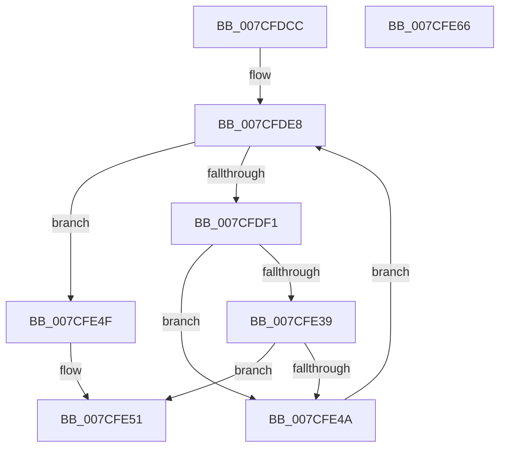

# ExpPartitionStart

- RVA: `0x007CFDCC`–`0x007CFE67` (길이 `155` bytes)
- VA: `0x00000001407CFDCC`
- 실행 섹션: `PAGE`
- PDB 이름 있음: `예`; PDB Function 태그: `아니요`
- unwind 정보 RVA: `0x00066400`
- 디코드: `42`개 명령, `155/155` bytes 표시
- 미해석 바이트: `0` (있으면 어셈블리에 `.byte`로 보존)

> 이 문서는 커널 이미지의 기계어와 PDB 기호를 분석해 생성했습니다. 4번과 5번은 함수 원형과 자료형을 바이너리 사용 방식에서 추정한 C 해석이며 원본 소스 복구 결과는 아닙니다.

## 1. Dependencies

- 직접 호출 지점: **2**; 고유 호출 대상: **2**
- 직접 호출자로 확인된 함수: **2**
- RIP 상대 이미지 참조: **3**

### Outgoing calls
- `0x007CFE2D` → [KeQueryNodeActiveAffinity](../../text/43/KeQueryNodeActiveAffinity_function_0043EF80.md) (function, `0x0043EF80`)
- `0x007CFE41` → [ExpWorkQueueManagerStart](../7D/ExpWorkQueueManagerStart_function_007D02B0.md) (function, `0x007D02B0`)

### Direct callers
- [PspAllocatePartition](../78/PspAllocatePartition_function_0078802C.md) at `0x0078815A`
- [ExpWorkerInitialization](../../init/C5/ExpWorkerInitialization_function_00C539A4.md) at `0x00C53B88`

### Static image references
- `0x007CFDE8` → RVA `0x00FC5000` (`ALMOSTRO`; read)
- `0x007CFDF4` → RVA `0x00FDAEC0` (`PAGEDATA`; read)
- `0x007CFE0A` → RVA `0x00FCF6C0` (`CACHEALI`; read)

## 2. Other-region calls and transfers

- 다른 실행 섹션으로 향하는 call: **1**
  - `0x007CFE2D` → [KeQueryNodeActiveAffinity](../../text/43/KeQueryNodeActiveAffinity_function_0043EF80.md) (`PAGE` → `.text`)
- 별도 외부 분기/꼬리 이동을 확인하지 못했습니다.

## 3. Assembly (complete function range)

```asm
007CFDCC  48 89 5C 24 08                  mov qword ptr [rsp + 8], rbx
007CFDD1  48 89 6C 24 10                  mov qword ptr [rsp + 0x10], rbp
007CFDD6  48 89 74 24 18                  mov qword ptr [rsp + 0x18], rsi
007CFDDB  57                              push rdi
007CFDDC  48 83 EC 30                     sub rsp, 0x30
007CFDE0  33 ED                           xor ebp, ebp
007CFDE2  48 8B F1                        mov rsi, rcx
007CFDE5  0F B7 DD                        movzx ebx, bp
007CFDE8  66 3B 1D 11 52 7F 00            cmp bx, word ptr [rip + 0x7f5211]
007CFDEF  73 5E                           jae 0x1407cfe4f
007CFDF1  0F B7 FB                        movzx edi, bx
007CFDF4  48 8D 0D C5 B0 80 00            lea rcx, [rip + 0x80b0c5]
007CFDFB  48 69 C7 38 03 00 00            imul rax, rdi, 0x338
007CFE02  0F 57 C0                        xorps xmm0, xmm0
007CFE05  0F 11 44 24 20                  movups xmmword ptr [rsp + 0x20], xmm0
007CFE0A  48 8D 15 AF F8 7F 00            lea rdx, [rip + 0x7ff8af]
007CFE11  48 8B 14 FA                     mov rdx, qword ptr [rdx + rdi*8]
007CFE15  48 03 C1                        add rax, rcx
007CFE18  48 3B D0                        cmp rdx, rax
007CFE1B  48 8B CD                        mov rcx, rbp
007CFE1E  48 0F 45 CA                     cmovne rcx, rdx
007CFE22  45 33 C0                        xor r8d, r8d
007CFE25  48 8D 54 24 20                  lea rdx, [rsp + 0x20]
007CFE2A  0F B7 09                        movzx ecx, word ptr [rcx]
007CFE2D  E8 4E F1 C6 FF                  call 0x14043ef80
007CFE32  48 39 6C 24 20                  cmp qword ptr [rsp + 0x20], rbp
007CFE37  74 11                           je 0x1407cfe4a
007CFE39  48 8B 4E 10                     mov rcx, qword ptr [rsi + 0x10]
007CFE3D  48 8B 0C F9                     mov rcx, qword ptr [rcx + rdi*8]
007CFE41  E8 6A 04 00 00                  call 0x1407d02b0
007CFE46  85 C0                           test eax, eax
007CFE48  78 07                           js 0x1407cfe51
007CFE4A  66 FF C3                        inc bx
007CFE4D  EB 99                           jmp 0x1407cfde8
007CFE4F  8B C5                           mov eax, ebp
007CFE51  48 8B 5C 24 40                  mov rbx, qword ptr [rsp + 0x40]
007CFE56  48 8B 6C 24 48                  mov rbp, qword ptr [rsp + 0x48]
007CFE5B  48 8B 74 24 50                  mov rsi, qword ptr [rsp + 0x50]
007CFE60  48 83 C4 30                     add rsp, 0x30
007CFE64  5F                              pop rdi
007CFE65  C3                              ret
007CFE66  CC                              int3
```

## 4. C-style interpretation (structured pseudocode)

```c
__int64 __fastcall ExpPartitionStart(__int64 a1, __int64 a2, int a3)
{
    __int64 result;
    __int64 v_rbp;
    __int64 v_rbx;
    __int64 v_rsp;
    unsigned __int64 v_stack_m18;
    unsigned __int64 v_stack_p10;
    unsigned __int64 v_stack_p18;
    unsigned __int64 v_stack_p8;

    v_stack_p8 = v_rbx;
    v_stack_p10 = v_rbp;
    v_stack_p18 = v_rsi;
    v_rsp = (v_rsp) - (48);
    v_rbp = 0;
loc_007CFDE8:
    if (0 >= (*(unsigned __int16 *)(v_rip + 8344081))) goto loc_007CFE4F;
    result = (result) * (0);
    v_stack_m18 = v_xmm0;
    result = (result) + (v_rip + 8433861);
    a1 = 0;
    if ((*(unsigned __int64 *)(v_rip + 8386735 + 0 * 8)) != result) { a1 = *(unsigned __int64 *)(v_rip + 8386735 + 0 * 8); }
    a3 = 0;
    result = KeQueryNodeActiveAffinity(*(unsigned __int16 *)(a1), v_stack_m18, a3, a4);
    if (v_stack_m18 == 0) goto loc_007CFE4A;
    result = ExpWorkQueueManagerStart(*(unsigned __int64 *)(*(unsigned __int64 *)(a1 + 16) + 0 * 8), v_stack_m18, a3, a4);
    if (sign_flag) goto loc_007CFE51;
loc_007CFE4A:
    v_rbx = (unsigned __int16)((0) + 1);
    goto loc_007CFDE8;
loc_007CFE4F:
loc_007CFE51:
    v_rsp = (v_rsp) + (48);
    return 0;
}
```

## 5. (Beta) C Style

```c
int64_t ExpPartitionStart(void *Arg1, int64_t Arg2, int32_t Arg3)
{
    uint8_t *arg1 = (uint8_t *)Arg1;

    int64_t result;
    int64_t local_rbp;
    int64_t local_rbx;
    int64_t local_rsp;
    uint64_t v_stack_m18;
    uint64_t v_stack_p10;
    uint64_t v_stack_p18;
    uint64_t v_stack_p8;

    v_stack_p8 = local_rbx;
    v_stack_p10 = local_rbp;
    v_stack_p18 = local_rsi;
    local_rsp = (local_rsp) - (48);
    local_rbp = 0;
loc_007CFDE8:
    if (0 >= (*(uint16_t *)(v_rip + 0x7F5211))) goto loc_007CFE4F;
    result = (result) * (0);
    v_stack_m18 = v_xmm0;
    result = (result) + (v_rip + 8433861);
    Arg1 = 0;
    if ((*(uint64_t *)(v_rip + 0x7FF8AF + 0x0 * 8)) != result) { Arg1 = *(uint64_t *)(v_rip + 0x7FF8AF + 0x0 * 8); }
    Arg3 = 0;
    result = KeQueryNodeActiveAffinity(*(uint16_t *)(arg1), v_stack_m18, Arg3, a4);
    if (v_stack_m18 == 0) goto loc_007CFE4A;
    result = ExpWorkQueueManagerStart(*(uint64_t *)(*(uint64_t *)(arg1 + 0x10) + 0x0 * 8), v_stack_m18, Arg3, a4);
    if (sign_flag) goto loc_007CFE51;
loc_007CFE4A:
    local_rbx = (uint16_t)((0) + 1);
    goto loc_007CFDE8;
loc_007CFE4F:
loc_007CFE51:
    local_rsp = (local_rsp) + (48);
    return 0;
}
```

### 관측된 메모리 오프셋

구조체 형식이 확인되지 않은 접근은 인자 기준의 오프셋으로만 기록했습니다.

| 기준 인자 | 오프셋 표현 | 폭 (bit) | 접근 |
|---|---:|---:|---|
| `Arg1` | `+ 0x10` | `64` | `R` |

## 6. Execution-region graph

[열기: 2D/3D 그래프와 함수 탐색 컨트롤 패널](../../../control-panel.html?section=page&rva=0x007CFDCC&view=graph)

- 2D 그래프는 위에서 아래로 흐르고, 3D 그래프는 빈 공간을 드래그해 회전합니다. Shift+드래그는 이동, 휠은 확대·축소, 함수 노드 선택은 대상 보고서 이동입니다.

### Static fallback


