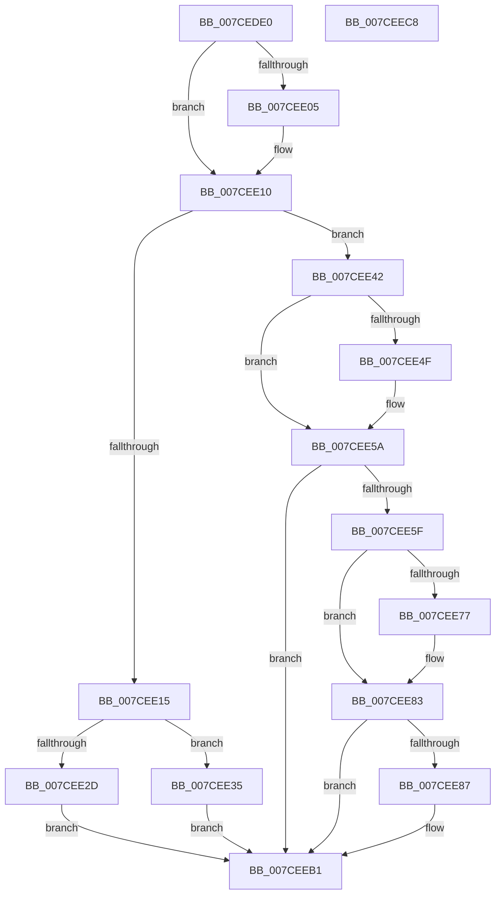

# ExpPrmNotifyInterfaceChange

- RVA: `0x007CEDE0`–`0x007CEEC9` (길이 `233` bytes)
- VA: `0x00000001407CEDE0`
- 실행 섹션: `PAGE`
- PDB 이름 있음: `예`; PDB Function 태그: `아니요`
- unwind 정보 RVA: `0x0005C954`
- 디코드: `59`개 명령, `233/233` bytes 표시
- 미해석 바이트: `0` (있으면 어셈블리에 `.byte`로 보존)

> 이 문서는 커널 이미지의 기계어와 PDB 기호를 분석해 생성했습니다. 4번과 5번은 함수 원형과 자료형을 바이너리 사용 방식에서 추정한 C 해석이며 원본 소스 복구 결과는 아닙니다.

## 1. Dependencies

- 직접 호출 지점: **5**; 고유 호출 대상: **5**
- 직접 호출자로 확인된 함수: **0**
- RIP 상대 이미지 참조: **11**

### Outgoing calls
- `0x007CEE22` → [ExpAcquirePrmInterface](ExpAcquirePrmInterface_function_007CECA8.md) (function, `0x007CECA8`)
- `0x007CEE7E` → [RtlFreeAnsiString](../9C/RtlFreeAnsiString_function_009C0800.md) (function, `0x009C0800`)
- `0x007CEE87` → [ExpPrmWaitForForZeroActiveCount](../../text/65/ExpPrmWaitForForZeroActiveCount_function_00659850.md) (function, `0x00659850`)
- `0x007CEE9A` → [guard_dispatch_icall](../../text/6B/guard_dispatch_icall_function_006BAAD0.md) (function, `0x006BAAD0`)
- `0x007CEEAC` → [memset](../../text/6C/memset_function_006C6C40.md) (function, `0x006C6C40`)

### Direct callers
- 이 함수 시작 RVA로 연결되는 직접 call은 확인되지 않았습니다. 간접 호출은 완전히 역산할 수 없습니다.

### Static image references
- `0x007CEDFA` → RVA `0x00013E30` (`.rdata`; read)
- `0x007CEE09` → RVA `0x00013E38` (`.rdata`; read)
- `0x007CEE19` → RVA `0x00EFAAD8` (`.data`; read)
- `0x007CEE2D` → RVA `0x00EFAAC0` (`.data`; read/write)
- `0x007CEE46` → RVA `0x000122D8` (`.rdata`; read)
- `0x007CEE53` → RVA `0x000122E0` (`.rdata`; read)
- `0x007CEE64` → RVA `0x00EFAAC0` (`.data`; read)
- `0x007CEE6C` → RVA `0x00EFAB20` (`.data`; read)
- `0x007CEE77` → RVA `0x00EFAB18` (`.data`; read)
- `0x007CEE8C` → RVA `0x00EFAAF0` (`.data`; read)
- `0x007CEE93` → RVA `0x00EFAAE0` (`.data`; read)

## 2. Other-region calls and transfers

- 다른 실행 섹션으로 향하는 call: **3**
  - `0x007CEE87` → [ExpPrmWaitForForZeroActiveCount](../../text/65/ExpPrmWaitForForZeroActiveCount_function_00659850.md) (`PAGE` → `.text`)
  - `0x007CEE9A` → [guard_dispatch_icall](../../text/6B/guard_dispatch_icall_function_006BAAD0.md) (`PAGE` → `.text`)
  - `0x007CEEAC` → [memset](../../text/6C/memset_function_006C6C40.md) (`PAGE` → `.text`)
- 별도 외부 분기/꼬리 이동을 확인하지 못했습니다.

## 3. Assembly (complete function range)

```asm
007CEDE0  48 89 5C 24 08                  mov qword ptr [rsp + 8], rbx
007CEDE5  48 89 6C 24 10                  mov qword ptr [rsp + 0x10], rbp
007CEDEA  48 89 74 24 18                  mov qword ptr [rsp + 0x18], rsi
007CEDEF  57                              push rdi
007CEDF0  48 83 EC 20                     sub rsp, 0x20
007CEDF4  48 8B 41 04                     mov rax, qword ptr [rcx + 4]
007CEDF8  33 DB                           xor ebx, ebx
007CEDFA  48 2B 05 2F 50 84 FF            sub rax, qword ptr [rip - 0x7bafd1]
007CEE01  8B F3                           mov esi, ebx
007CEE03  75 0B                           jne 0x1407cee10
007CEE05  48 8B 41 0C                     mov rax, qword ptr [rcx + 0xc]
007CEE09  48 2B 05 28 50 84 FF            sub rax, qword ptr [rip - 0x7bafd8]
007CEE10  48 85 C0                        test rax, rax
007CEE13  75 2D                           jne 0x1407cee42
007CEE15  48 8B 49 28                     mov rcx, qword ptr [rcx + 0x28]
007CEE19  4C 8D 05 B8 BC 72 00            lea r8, [rip + 0x72bcb8]
007CEE20  B2 01                           mov dl, 1
007CEE22  E8 81 FE FF FF                  call 0x1407ceca8
007CEE27  8B F0                           mov esi, eax
007CEE29  85 C0                           test eax, eax
007CEE2B  79 08                           jns 0x1407cee35
007CEE2D  87 1D 8D BC 72 00               xchg dword ptr [rip + 0x72bc8d], ebx
007CEE33  EB 7C                           jmp 0x1407ceeb1
007CEE35  BF 02 00 00 00                  mov edi, 2
007CEE3A  87 3D 80 BC 72 00               xchg dword ptr [rip + 0x72bc80], edi
007CEE40  EB 6F                           jmp 0x1407ceeb1
007CEE42  48 8B 41 04                     mov rax, qword ptr [rcx + 4]
007CEE46  48 2B 05 8B 34 84 FF            sub rax, qword ptr [rip - 0x7bcb75]
007CEE4D  75 0B                           jne 0x1407cee5a
007CEE4F  48 8B 41 0C                     mov rax, qword ptr [rcx + 0xc]
007CEE53  48 2B 05 86 34 84 FF            sub rax, qword ptr [rip - 0x7bcb7a]
007CEE5A  48 85 C0                        test rax, rax
007CEE5D  75 52                           jne 0x1407ceeb1
007CEE5F  8D 78 02                        lea edi, [rax + 2]
007CEE62  8B C7                           mov eax, edi
007CEE64  F0 0F B1 1D 54 BC 72 00         lock cmpxchg dword ptr [rip + 0x72bc54], ebx
007CEE6C  48 39 1D AD BC 72 00            cmp qword ptr [rip + 0x72bcad], rbx
007CEE73  8B E8                           mov ebp, eax
007CEE75  74 0C                           je 0x1407cee83
007CEE77  48 8D 0D 9A BC 72 00            lea rcx, [rip + 0x72bc9a]
007CEE7E  E8 7D 19 1F 00                  call 0x1409c0800
007CEE83  3B EF                           cmp ebp, edi
007CEE85  75 2A                           jne 0x1407ceeb1
007CEE87  E8 C4 A9 E8 FF                  call 0x140659850
007CEE8C  48 8B 05 5D BC 72 00            mov rax, qword ptr [rip + 0x72bc5d]
007CEE93  48 8B 0D 46 BC 72 00            mov rcx, qword ptr [rip + 0x72bc46]
007CEE9A  E8 31 BC EE FF                  call 0x1406baad0
007CEE9F  33 D2                           xor edx, edx
007CEEA1  48 8D 0D 30 BC 72 00            lea rcx, [rip + 0x72bc30]
007CEEA8  44 8D 42 40                     lea r8d, [rdx + 0x40]
007CEEAC  E8 8F 7D EF FF                  call 0x1406c6c40
007CEEB1  48 8B 5C 24 30                  mov rbx, qword ptr [rsp + 0x30]
007CEEB6  8B C6                           mov eax, esi
007CEEB8  48 8B 74 24 40                  mov rsi, qword ptr [rsp + 0x40]
007CEEBD  48 8B 6C 24 38                  mov rbp, qword ptr [rsp + 0x38]
007CEEC2  48 83 C4 20                     add rsp, 0x20
007CEEC6  5F                              pop rdi
007CEEC7  C3                              ret
007CEEC8  CC                              int3
```

## 4. C-style interpretation (structured pseudocode)

```c
__int64 __fastcall ExpPrmNotifyInterfaceChange(__int64 a1)
{
    __int64 result;
    __int64 v_rbx;
    __int64 v_rsp;
    unsigned __int64 v_stack_p10;
    unsigned __int64 v_stack_p18;
    unsigned __int64 v_stack_p8;

    v_stack_p8 = v_rbx;
    v_stack_p10 = v_rbp;
    v_stack_p18 = v_rsi;
    v_rsp = (v_rsp) - (32);
    v_rbx = 0;
    result = (*(unsigned __int64 *)(a1 + 4)) - (*(unsigned __int64 *)(v_rip - 8105937));
    if (!(condition_is_not_equal)) {
        result = *(unsigned __int64 *)(a1 + 12);
        result = (result) - (*(unsigned __int64 *)(v_rip - 8105944));
    }
    if (result != 0) goto loc_007CEE42;
    result = ExpAcquirePrmInterface(*(unsigned __int64 *)(a1 + 40), 1, v_rip + 7519416, a4);
    if (!sign_flag) goto loc_007CEE35;
    goto loc_007CEEB1;
loc_007CEE35:
    goto loc_007CEEB1;
loc_007CEE42:
    result = (*(unsigned __int64 *)(*(unsigned __int64 *)(a1 + 40) + 4)) - (*(unsigned __int64 *)(v_rip - 8113013));
    if (!(condition_is_not_equal)) {
        result = *(unsigned __int64 *)(*(unsigned __int64 *)(a1 + 40) + 12);
        result = (result) - (*(unsigned __int64 *)(v_rip - 8113018));
    }
    if (result != 0) goto loc_007CEEB1;
    result = (unsigned int)((unsigned int)(result + 2));
    if ((*(unsigned __int64 *)(v_rip + 7519405)) != 0) {
        a1 = v_rip + 7519386;
        result = RtlFreeAnsiString(a1, 1, v_rip + 7519416, a4);
    }
    if (((unsigned int)((unsigned int)((unsigned int)((unsigned int)((unsigned int)(result + 2)))))) == ((unsigned int)(result + 2))) {
        result = ExpPrmWaitForForZeroActiveCount(a1, 1, v_rip + 7519416, a4);
        result = *(unsigned __int64 *)(v_rip + 7519325);
        a1 = *(unsigned __int64 *)(v_rip + 7519302);
        result = guard_dispatch_icall(a1, 1, v_rip + 7519416, a4);
        a2 = 0;
        a1 = v_rip + 7519280;
        a3 = a2 + 64;
        result = memset(a1, a2, a3, a4);
    }
    v_rsp = (v_rsp) + (32);
    return (unsigned int)((unsigned int)((unsigned int)((unsigned int)(result))));
}
```

## 5. (Beta) C Style

```c
int64_t ExpPrmNotifyInterfaceChange(void *Arg1)
{
    uint8_t *arg1 = (uint8_t *)Arg1;

    int64_t result;
    int64_t local_rbx;
    int64_t local_rsp;
    uint64_t v_stack_p10;
    uint64_t v_stack_p18;
    uint64_t v_stack_p8;

    v_stack_p8 = local_rbx;
    v_stack_p10 = local_rbp;
    v_stack_p18 = local_rsi;
    local_rsp = (local_rsp) - (32);
    local_rbx = 0;
    result = (*(uint64_t *)(arg1 + 0x4)) - (*(uint64_t *)(v_rip - 0x7BAFD1));
    if (!(condition_is_not_equal)) {
        result = *(uint64_t *)(arg1 + 0xC);
        result = (result) - (*(uint64_t *)(v_rip - 0x7BAFD8));
    }
    if (result != 0) goto loc_007CEE42;
    result = ExpAcquirePrmInterface(*(uint64_t *)(arg1 + 0x28), 1, v_rip + 7519416, a4);
    if (!sign_flag) goto loc_007CEE35;
    goto loc_007CEEB1;
loc_007CEE35:
    goto loc_007CEEB1;
loc_007CEE42:
    result = (*(uint64_t *)(*(uint64_t *)(arg1 + 0x28) + 0x4)) - (*(uint64_t *)(v_rip - 0x7BCB75));
    if (!(condition_is_not_equal)) {
        result = *(uint64_t *)(*(uint64_t *)(arg1 + 0x28) + 0xC);
        result = (result) - (*(uint64_t *)(v_rip - 0x7BCB7A));
    }
    if (result != 0) goto loc_007CEEB1;
    result = (uint32_t)((uint32_t)(result + 2));
    if ((*(uint64_t *)(v_rip + 0x72BCAD)) != 0) {
        Arg1 = v_rip + 7519386;
        result = RtlFreeAnsiString(Arg1, 1, v_rip + 7519416, a4);
    }
    if (((uint32_t)((uint32_t)((uint32_t)((uint32_t)((uint32_t)(result + 2)))))) == ((uint32_t)(result + 2))) {
        result = ExpPrmWaitForForZeroActiveCount(Arg1, 1, v_rip + 7519416, a4);
        result = *(uint64_t *)(v_rip + 0x72BC5D);
        Arg1 = *(uint64_t *)(v_rip + 0x72BC46);
        result = guard_dispatch_icall(Arg1, 1, v_rip + 7519416, a4);
        a2 = 0;
        Arg1 = v_rip + 7519280;
        a3 = a2 + 64;
        result = memset(Arg1, a2, a3, a4);
    }
    local_rsp = (local_rsp) + (32);
    return (uint32_t)((uint32_t)((uint32_t)((uint32_t)(result))));
}
```

### 관측된 메모리 오프셋

구조체 형식이 확인되지 않은 접근은 인자 기준의 오프셋으로만 기록했습니다.

| 기준 인자 | 오프셋 표현 | 폭 (bit) | 접근 |
|---|---:|---:|---|
| `Arg1` | `+ 0x4` | `64` | `R` |
| `Arg1` | `+ 0xC` | `64` | `R` |
| `Arg1` | `+ 0x28` | `64` | `R` |

## 6. Execution-region graph

[열기: 2D/3D 그래프와 함수 탐색 컨트롤 패널](../../../control-panel.html?section=page&rva=0x007CEDE0&view=graph)

- 2D 그래프는 위에서 아래로 흐르고, 3D 그래프는 빈 공간을 드래그해 회전합니다. Shift+드래그는 이동, 휠은 확대·축소, 함수 노드 선택은 대상 보고서 이동입니다.

### Static fallback


