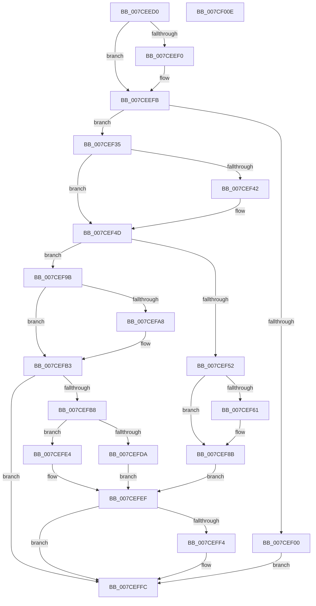

# ExpPrmTargetDeviceChangeCallback

- RVA: `0x007CEED0`–`0x007CF00F` (길이 `319` bytes)
- VA: `0x00000001407CEED0`
- 실행 섹션: `PAGE`
- PDB 이름 있음: `예`; PDB Function 태그: `아니요`
- unwind 정보 RVA: `0x0005FD94`
- 디코드: `75`개 명령, `319/319` bytes 표시
- 미해석 바이트: `0` (있으면 어셈블리에 `.byte`로 보존)

> 이 문서는 커널 이미지의 기계어와 PDB 기호를 분석해 생성했습니다. 4번과 5번은 함수 원형과 자료형을 바이너리 사용 방식에서 추정한 C 해석이며 원본 소스 복구 결과는 아닙니다.

## 1. Dependencies

- 직접 호출 지점: **8**; 고유 호출 대상: **5**
- 직접 호출자로 확인된 함수: **0**
- RIP 상대 이미지 참조: **14**

### Outgoing calls
- `0x007CEF06` → [ExpPrmWaitForForZeroActiveCount](../../text/65/ExpPrmWaitForForZeroActiveCount_function_00659850.md) (function, `0x00659850`)
- `0x007CEF19` → [guard_dispatch_icall](../../text/6B/guard_dispatch_icall_function_006BAAD0.md) (function, `0x006BAAD0`)
- `0x007CEF2B` → [memset](../../text/6C/memset_function_006C6C40.md) (function, `0x006C6C40`)
- `0x007CEF61` → [ExpPrmWaitForForZeroActiveCount](../../text/65/ExpPrmWaitForForZeroActiveCount_function_00659850.md) (function, `0x00659850`)
- `0x007CEF74` → [guard_dispatch_icall](../../text/6B/guard_dispatch_icall_function_006BAAD0.md) (function, `0x006BAAD0`)
- `0x007CEF86` → [memset](../../text/6C/memset_function_006C6C40.md) (function, `0x006C6C40`)
- `0x007CEFCF` → [ExpAcquirePrmInterface](ExpAcquirePrmInterface_function_007CECA8.md) (function, `0x007CECA8`)
- `0x007CEFF7` → [IoUnregisterPlugPlayNotification](../AA/IoUnregisterPlugPlayNotification_function_00AA5CC0.md) (function, `0x00AA5CC0`)

### Direct callers
- 이 함수 시작 RVA로 연결되는 직접 call은 확인되지 않았습니다. 간접 호출은 완전히 역산할 수 없습니다.

### Static image references
- `0x007CEEE5` → RVA `0x0001A210` (`.rdata`; read)
- `0x007CEEF4` → RVA `0x0001A218` (`.rdata`; read)
- `0x007CEF00` → RVA `0x00EFAAC0` (`.data`; read/write)
- `0x007CEF0B` → RVA `0x00EFAAF0` (`.data`; read)
- `0x007CEF12` → RVA `0x00EFAAE0` (`.data`; read)
- `0x007CEF20` → RVA `0x00EFAAD8` (`.data`; read)
- `0x007CEF39` → RVA `0x0001A220` (`.rdata`; read)
- `0x007CEF46` → RVA `0x0001A228` (`.rdata`; read)
- `0x007CEF57` → RVA `0x00EFAAC0` (`.data`; read)
- `0x007CEF8B` → RVA `0x00EFAAC8` (`.data`; read)
- `0x007CEF92` → RVA `0x00EFAAC8` (`.data`; write)
- `0x007CEF9F` → RVA `0x00012320` (`.rdata`; read)
- `0x007CEFAC` → RVA `0x00012328` (`.rdata`; read)
- `0x007CEFC8` → RVA `0x00EFAB18` (`.data`; read)

## 2. Other-region calls and transfers

- 다른 실행 섹션으로 향하는 call: **6**
  - `0x007CEF06` → [ExpPrmWaitForForZeroActiveCount](../../text/65/ExpPrmWaitForForZeroActiveCount_function_00659850.md) (`PAGE` → `.text`)
  - `0x007CEF19` → [guard_dispatch_icall](../../text/6B/guard_dispatch_icall_function_006BAAD0.md) (`PAGE` → `.text`)
  - `0x007CEF2B` → [memset](../../text/6C/memset_function_006C6C40.md) (`PAGE` → `.text`)
  - `0x007CEF61` → [ExpPrmWaitForForZeroActiveCount](../../text/65/ExpPrmWaitForForZeroActiveCount_function_00659850.md) (`PAGE` → `.text`)
  - `0x007CEF74` → [guard_dispatch_icall](../../text/6B/guard_dispatch_icall_function_006BAAD0.md) (`PAGE` → `.text`)
  - `0x007CEF86` → [memset](../../text/6C/memset_function_006C6C40.md) (`PAGE` → `.text`)
- 별도 외부 분기/꼬리 이동을 확인하지 못했습니다.

## 3. Assembly (complete function range)

```asm
007CEED0  48 89 5C 24 10                  mov qword ptr [rsp + 0x10], rbx
007CEED5  48 89 74 24 18                  mov qword ptr [rsp + 0x18], rsi
007CEEDA  57                              push rdi
007CEEDB  48 83 EC 20                     sub rsp, 0x20
007CEEDF  48 8B 41 04                     mov rax, qword ptr [rcx + 4]
007CEEE3  33 DB                           xor ebx, ebx
007CEEE5  48 2B 05 24 B3 84 FF            sub rax, qword ptr [rip - 0x7b4cdc]
007CEEEC  8B F3                           mov esi, ebx
007CEEEE  75 0B                           jne 0x1407ceefb
007CEEF0  48 8B 41 0C                     mov rax, qword ptr [rcx + 0xc]
007CEEF4  48 2B 05 1D B3 84 FF            sub rax, qword ptr [rip - 0x7b4ce3]
007CEEFB  48 85 C0                        test rax, rax
007CEEFE  75 35                           jne 0x1407cef35
007CEF00  87 1D BA BB 72 00               xchg dword ptr [rip + 0x72bbba], ebx
007CEF06  E8 45 A9 E8 FF                  call 0x140659850
007CEF0B  48 8B 05 DE BB 72 00            mov rax, qword ptr [rip + 0x72bbde]
007CEF12  48 8B 0D C7 BB 72 00            mov rcx, qword ptr [rip + 0x72bbc7]
007CEF19  E8 B2 BB EE FF                  call 0x1406baad0
007CEF1E  33 D2                           xor edx, edx
007CEF20  48 8D 0D B1 BB 72 00            lea rcx, [rip + 0x72bbb1]
007CEF27  44 8D 42 40                     lea r8d, [rdx + 0x40]
007CEF2B  E8 10 7D EF FF                  call 0x1406c6c40
007CEF30  E9 C7 00 00 00                  jmp 0x1407ceffc
007CEF35  48 8B 41 04                     mov rax, qword ptr [rcx + 4]
007CEF39  48 2B 05 E0 B2 84 FF            sub rax, qword ptr [rip - 0x7b4d20]
007CEF40  75 0B                           jne 0x1407cef4d
007CEF42  48 8B 41 0C                     mov rax, qword ptr [rcx + 0xc]
007CEF46  48 2B 05 DB B2 84 FF            sub rax, qword ptr [rip - 0x7b4d25]
007CEF4D  48 85 C0                        test rax, rax
007CEF50  75 49                           jne 0x1407cef9b
007CEF52  B8 02 00 00 00                  mov eax, 2
007CEF57  F0 0F B1 1D 61 BB 72 00         lock cmpxchg dword ptr [rip + 0x72bb61], ebx
007CEF5F  75 2A                           jne 0x1407cef8b
007CEF61  E8 EA A8 E8 FF                  call 0x140659850
007CEF66  48 8B 05 83 BB 72 00            mov rax, qword ptr [rip + 0x72bb83]
007CEF6D  48 8B 0D 6C BB 72 00            mov rcx, qword ptr [rip + 0x72bb6c]
007CEF74  E8 57 BB EE FF                  call 0x1406baad0
007CEF79  33 D2                           xor edx, edx
007CEF7B  48 8D 0D 56 BB 72 00            lea rcx, [rip + 0x72bb56]
007CEF82  44 8D 42 40                     lea r8d, [rdx + 0x40]
007CEF86  E8 B5 7C EF FF                  call 0x1406c6c40
007CEF8B  48 8B 3D 36 BB 72 00            mov rdi, qword ptr [rip + 0x72bb36]
007CEF92  48 89 1D 2F BB 72 00            mov qword ptr [rip + 0x72bb2f], rbx
007CEF99  EB 54                           jmp 0x1407cefef
007CEF9B  48 8B 41 04                     mov rax, qword ptr [rcx + 4]
007CEF9F  48 2B 05 7A 33 84 FF            sub rax, qword ptr [rip - 0x7bcc86]
007CEFA6  75 0B                           jne 0x1407cefb3
007CEFA8  48 8B 41 0C                     mov rax, qword ptr [rcx + 0xc]
007CEFAC  48 2B 05 75 33 84 FF            sub rax, qword ptr [rip - 0x7bcc8b]
007CEFB3  48 85 C0                        test rax, rax
007CEFB6  75 44                           jne 0x1407ceffc
007CEFB8  48 8B 3D 09 BB 72 00            mov rdi, qword ptr [rip + 0x72bb09]
007CEFBF  4C 8D 05 12 BB 72 00            lea r8, [rip + 0x72bb12]
007CEFC6  33 D2                           xor edx, edx
007CEFC8  48 8D 0D 49 BB 72 00            lea rcx, [rip + 0x72bb49]
007CEFCF  E8 D4 FC FF FF                  call 0x1407ceca8
007CEFD4  8B F0                           mov esi, eax
007CEFD6  85 C0                           test eax, eax
007CEFD8  79 0A                           jns 0x1407cefe4
007CEFDA  8B CB                           mov ecx, ebx
007CEFDC  87 0D DE BA 72 00               xchg dword ptr [rip + 0x72bade], ecx
007CEFE2  EB 0B                           jmp 0x1407cefef
007CEFE4  B8 02 00 00 00                  mov eax, 2
007CEFE9  87 05 D1 BA 72 00               xchg dword ptr [rip + 0x72bad1], eax
007CEFEF  48 85 FF                        test rdi, rdi
007CEFF2  74 08                           je 0x1407ceffc
007CEFF4  48 8B CF                        mov rcx, rdi
007CEFF7  E8 C4 6C 2D 00                  call 0x140aa5cc0
007CEFFC  48 8B 5C 24 38                  mov rbx, qword ptr [rsp + 0x38]
007CF001  8B C6                           mov eax, esi
007CF003  48 8B 74 24 40                  mov rsi, qword ptr [rsp + 0x40]
007CF008  48 83 C4 20                     add rsp, 0x20
007CF00C  5F                              pop rdi
007CF00D  C3                              ret
007CF00E  CC                              int3
```

## 4. C-style interpretation (structured pseudocode)

```c
__int64 __fastcall ExpPrmTargetDeviceChangeCallback(__int64 a1, int a2)
{
    __int64 result;
    __int64 v_rbx;
    __int64 v_rsp;
    unsigned __int64 v_stack_p10;
    unsigned __int64 v_stack_p18;

    v_stack_p10 = v_rbx;
    v_stack_p18 = v_rsi;
    v_rsp = (v_rsp) - (32);
    v_rbx = 0;
    result = (*(unsigned __int64 *)(a1 + 4)) - (*(unsigned __int64 *)(v_rip - 8080604));
    if (!(condition_is_not_equal)) {
        result = *(unsigned __int64 *)(a1 + 12);
        result = (result) - (*(unsigned __int64 *)(v_rip - 8080611));
    }
    if (result != 0) goto loc_007CEF35;
    result = ExpPrmWaitForForZeroActiveCount(a1, a2, a3, a4);
    result = guard_dispatch_icall(*(unsigned __int64 *)(v_rip + 7519175), a2, a3, a4);
    a2 = 0;
    result = memset(v_rip + 7519153, a2, a2 + 64, a4);
    goto loc_007CEFFC;
loc_007CEF35:
    result = (*(unsigned __int64 *)(v_rip + 7519153 + 4)) - (*(unsigned __int64 *)(v_rip - 8080672));
    if (!(condition_is_not_equal)) {
        result = *(unsigned __int64 *)(v_rip + 7519153 + 12);
        result = (result) - (*(unsigned __int64 *)(v_rip - 8080677));
    }
    if (result != 0) goto loc_007CEF9B;
    result = 2;
    if (result == 0) {
        result = ExpPrmWaitForForZeroActiveCount(v_rip + 7519153, a2, a2 + 64, a4);
        result = *(unsigned __int64 *)(v_rip + 7519107);
        a1 = *(unsigned __int64 *)(v_rip + 7519084);
        result = guard_dispatch_icall(a1, a2, a2 + 64, a4);
        a2 = 0;
        a1 = v_rip + 7519062;
        a3 = a2 + 64;
        result = memset(a1, a2, a3, a4);
    }
    *(unsigned __int64 *)(v_rip + 7519023) = 0;
    goto loc_007CEFEF;
loc_007CEF9B:
    result = (*(unsigned __int64 *)(a1 + 4)) - (*(unsigned __int64 *)(v_rip - 8113286));
    if (!(condition_is_not_equal)) {
        result = *(unsigned __int64 *)(a1 + 12);
        result = (result) - (*(unsigned __int64 *)(v_rip - 8113291));
    }
    if (result != 0) goto loc_007CEFFC;
    a2 = 0;
    result = ExpAcquirePrmInterface(v_rip + 7519049, a2, v_rip + 7518994, a4);
    if (!sign_flag) goto loc_007CEFE4;
    goto loc_007CEFEF;
loc_007CEFE4:
loc_007CEFEF:
    result = 2;
    if (*(unsigned __int64 *)(v_rip + 7518985) != 0) {
        a1 = *(unsigned __int64 *)(v_rip + 7518985);
        result = IoUnregisterPlugPlayNotification(a1, a2, v_rip + 7518994, a4);
    }
    v_rsp = (v_rsp) + (32);
    return (unsigned int)((unsigned int)((unsigned int)((unsigned int)(result))));
}
```

## 5. (Beta) C Style

```c
int64_t ExpPrmTargetDeviceChangeCallback(void *Arg1, int32_t Arg2)
{
    uint8_t *arg1 = (uint8_t *)Arg1;

    int64_t result;
    int64_t local_rbx;
    int64_t local_rsp;
    uint64_t v_stack_p10;
    uint64_t v_stack_p18;

    v_stack_p10 = local_rbx;
    v_stack_p18 = local_rsi;
    local_rsp = (local_rsp) - (32);
    local_rbx = 0;
    result = (*(uint64_t *)(arg1 + 0x4)) - (*(uint64_t *)(v_rip - 0x7B4CDC));
    if (!(condition_is_not_equal)) {
        result = *(uint64_t *)(arg1 + 0xC);
        result = (result) - (*(uint64_t *)(v_rip - 0x7B4CE3));
    }
    if (result != 0) goto loc_007CEF35;
    result = ExpPrmWaitForForZeroActiveCount(Arg1, Arg2, a3, a4);
    result = guard_dispatch_icall(*(uint64_t *)(v_rip + 0x72BBC7), Arg2, a3, a4);
    Arg2 = 0;
    result = memset(v_rip + 7519153, Arg2, Arg2 + 64, a4);
    goto loc_007CEFFC;
loc_007CEF35:
    result = (*(uint64_t *)(v_rip + 0x72BBB1 + 0x4)) - (*(uint64_t *)(v_rip - 0x7B4D20));
    if (!(condition_is_not_equal)) {
        result = *(uint64_t *)(v_rip + 0x72BBB1 + 0xC);
        result = (result) - (*(uint64_t *)(v_rip - 0x7B4D25));
    }
    if (result != 0) goto loc_007CEF9B;
    result = 2;
    if (result == 0) {
        result = ExpPrmWaitForForZeroActiveCount(v_rip + 7519153, Arg2, Arg2 + 64, a4);
        result = *(uint64_t *)(v_rip + 0x72BB83);
        Arg1 = *(uint64_t *)(v_rip + 0x72BB6C);
        result = guard_dispatch_icall(Arg1, Arg2, Arg2 + 64, a4);
        Arg2 = 0;
        Arg1 = v_rip + 7519062;
        a3 = Arg2 + 64;
        result = memset(Arg1, Arg2, a3, a4);
    }
    *(uint64_t *)(v_rip + 0x72BB2F) = 0;
    goto loc_007CEFEF;
loc_007CEF9B:
    result = (*(uint64_t *)(arg1 + 0x4)) - (*(uint64_t *)(v_rip - 0x7BCC86));
    if (!(condition_is_not_equal)) {
        result = *(uint64_t *)(arg1 + 0xC);
        result = (result) - (*(uint64_t *)(v_rip - 0x7BCC8B));
    }
    if (result != 0) goto loc_007CEFFC;
    Arg2 = 0;
    result = ExpAcquirePrmInterface(v_rip + 7519049, Arg2, v_rip + 7518994, a4);
    if (!sign_flag) goto loc_007CEFE4;
    goto loc_007CEFEF;
loc_007CEFE4:
loc_007CEFEF:
    result = 2;
    if (*(uint64_t *)(v_rip + 0x72BB09) != 0) {
        Arg1 = *(uint64_t *)(v_rip + 0x72BB09);
        result = IoUnregisterPlugPlayNotification(Arg1, Arg2, v_rip + 7518994, a4);
    }
    local_rsp = (local_rsp) + (32);
    return (uint32_t)((uint32_t)((uint32_t)((uint32_t)(result))));
}
```

### 관측된 메모리 오프셋

구조체 형식이 확인되지 않은 접근은 인자 기준의 오프셋으로만 기록했습니다.

| 기준 인자 | 오프셋 표현 | 폭 (bit) | 접근 |
|---|---:|---:|---|
| `Arg1` | `+ 0x4` | `64` | `R` |
| `Arg1` | `+ 0xC` | `64` | `R` |

## 6. Execution-region graph

[열기: 2D/3D 그래프와 함수 탐색 컨트롤 패널](../../../control-panel.html?section=page&rva=0x007CEED0&view=graph)

- 2D 그래프는 위에서 아래로 흐르고, 3D 그래프는 빈 공간을 드래그해 회전합니다. Shift+드래그는 이동, 휠은 확대·축소, 함수 노드 선택은 대상 보고서 이동입니다.

### Static fallback


