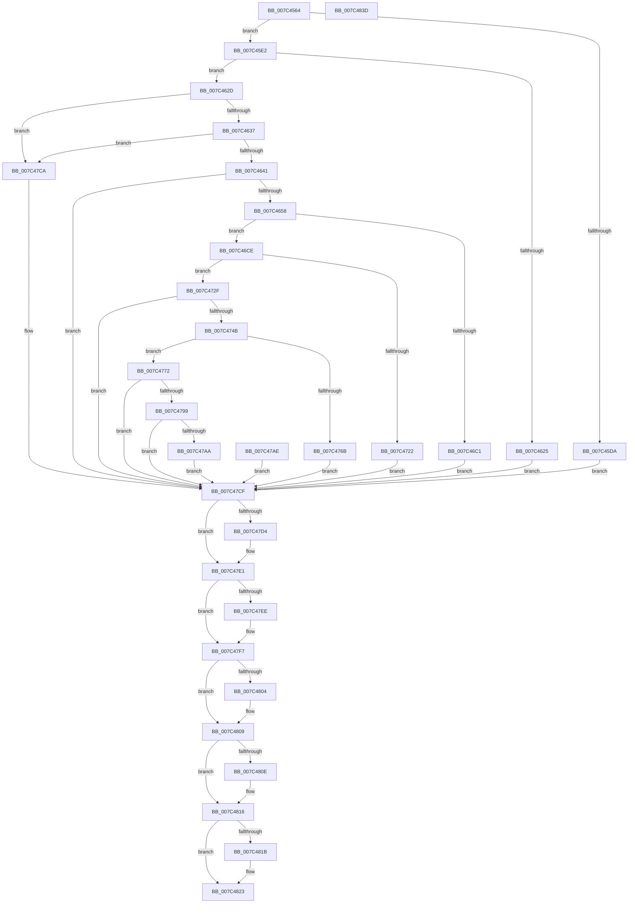

# ExpQueryElamCertInfo

- RVA: `0x007C4564`–`0x007C483E` (길이 `730` bytes)
- VA: `0x00000001407C4564`
- 실행 섹션: `PAGE`
- PDB 이름 있음: `예`; PDB Function 태그: `아니요`
- unwind 정보 RVA: `0x000D40C0`
- 디코드: `175`개 명령, `730/730` bytes 표시
- 미해석 바이트: `0` (있으면 어셈블리에 `.byte`로 보존)

> 이 문서는 커널 이미지의 기계어와 PDB 기호를 분석해 생성했습니다. 4번과 5번은 함수 원형과 자료형을 바이너리 사용 방식에서 추정한 C 해석이며 원본 소스 복구 결과는 아닙니다.

## 1. Dependencies

- 직접 호출 지점: **15**; 고유 호출 대상: **13**
- 직접 호출자로 확인된 함수: **1**
- RIP 상대 이미지 참조: **1**

### Outgoing calls
- `0x007C45CF` → [IoConvertFileHandleToKernelHandle](../A8/IoConvertFileHandleToKernelHandle_function_00A85680.md) (function, `0x00A85680`)
- `0x007C460D` → [ObReferenceObjectByHandle](../86/ObReferenceObjectByHandle_function_00868DB0.md) (function, `0x00868DB0`)
- `0x007C4649` → [FsRtlGetFileSize](../98/FsRtlGetFileSize_function_00985150.md) (function, `0x00985150`)
- `0x007C46B6` → [ZwCreateSection](../../text/6A/ZwCreateSection_function_006ADA10.md) (function, `0x006ADA10`)
- `0x007C4717` → [ZwMapViewOfSection](../../text/6A/ZwMapViewOfSection_function_006AD5D0.md) (function, `0x006AD5D0`)
- `0x007C473C` → [SeValidateFileAsImageType](../79/SeValidateFileAsImageType_function_0079BA0C.md) (function, `0x0079BA0C`)
- `0x007C4759` → [ExAllocatePool2](../../poolcode/B8/ExAllocatePool2_function_00B820F0.md) (function, `0x00B820F0`)
- `0x007C4780` → [memcpy](../../text/6C/memcpy_function_006C6840.md) (function, `0x006C6840`)
- `0x007C478E` → [SeValidateFileAsImageType](../79/SeValidateFileAsImageType_function_0079BA0C.md) (function, `0x0079BA0C`)
- `0x007C479F` → [SeRegisterElamCertResources](../79/SeRegisterElamCertResources_function_0079B8C8.md) (function, `0x0079B8C8`)
- `0x007C47DC` → [ExFreePoolWithTag](../../poolcode/B8/ExFreePoolWithTag_function_00B82870.md) (function, `0x00B82870`)
- `0x007C47F2` → [ZwUnmapViewOfSection](../../text/6A/ZwUnmapViewOfSection_function_006AD610.md) (function, `0x006AD610`)
- `0x007C4804` → [ZwClose](../../text/6A/ZwClose_function_006AD2B0.md) (function, `0x006AD2B0`)
- `0x007C4811` → [ObfDereferenceObject](../../text/2F/ObfDereferenceObject_function_002F9350.md) (function, `0x002F9350`)
- `0x007C481E` → [ZwClose](../../text/6A/ZwClose_function_006AD2B0.md) (function, `0x006AD2B0`)

### Direct callers
- [NtSetSystemInformation](../AF/NtSetSystemInformation_function_00AF4A60.md) at `0x00AF5DE1`

### Static image references
- `0x007C45E2` → RVA `0x00FC6AE0` (`ALMOSTRO`; read)

## 2. Other-region calls and transfers

- 다른 실행 섹션으로 향하는 call: **9**
  - `0x007C46B6` → [ZwCreateSection](../../text/6A/ZwCreateSection_function_006ADA10.md) (`PAGE` → `.text`)
  - `0x007C4717` → [ZwMapViewOfSection](../../text/6A/ZwMapViewOfSection_function_006AD5D0.md) (`PAGE` → `.text`)
  - `0x007C4759` → [ExAllocatePool2](../../poolcode/B8/ExAllocatePool2_function_00B820F0.md) (`PAGE` → `POOLCODE`)
  - `0x007C4780` → [memcpy](../../text/6C/memcpy_function_006C6840.md) (`PAGE` → `.text`)
  - `0x007C47DC` → [ExFreePoolWithTag](../../poolcode/B8/ExFreePoolWithTag_function_00B82870.md) (`PAGE` → `POOLCODE`)
  - `0x007C47F2` → [ZwUnmapViewOfSection](../../text/6A/ZwUnmapViewOfSection_function_006AD610.md) (`PAGE` → `.text`)
  - `0x007C4804` → [ZwClose](../../text/6A/ZwClose_function_006AD2B0.md) (`PAGE` → `.text`)
  - `0x007C4811` → [ObfDereferenceObject](../../text/2F/ObfDereferenceObject_function_002F9350.md) (`PAGE` → `.text`)
  - `0x007C481E` → [ZwClose](../../text/6A/ZwClose_function_006AD2B0.md) (`PAGE` → `.text`)
- 별도 외부 분기/꼬리 이동을 확인하지 못했습니다.

## 3. Assembly (complete function range)

```asm
007C4564  4C 8B DC                        mov r11, rsp
007C4567  49 89 5B 08                     mov qword ptr [r11 + 8], rbx
007C456B  56                              push rsi
007C456C  57                              push rdi
007C456D  41 54                           push r12
007C456F  41 56                           push r14
007C4571  41 57                           push r15
007C4573  48 81 EC C0 00 00 00            sub rsp, 0xc0
007C457A  33 FF                           xor edi, edi
007C457C  49 89 7B 20                     mov qword ptr [r11 + 0x20], rdi
007C4580  33 C0                           xor eax, eax
007C4582  0F 57 C0                        xorps xmm0, xmm0
007C4585  41 0F 11 43 A0                  movups xmmword ptr [r11 - 0x60], xmm0
007C458A  41 0F 11 43 B0                  movups xmmword ptr [r11 - 0x50], xmm0
007C458F  49 89 43 C0                     mov qword ptr [r11 - 0x40], rax
007C4593  41 89 43 C8                     mov dword ptr [r11 - 0x38], eax
007C4597  48 89 7C 24 60                  mov qword ptr [rsp + 0x60], rdi
007C459C  49 89 7B 80                     mov qword ptr [r11 - 0x80], rdi
007C45A0  44 8B F7                        mov r14d, edi
007C45A3  49 89 7B 18                     mov qword ptr [r11 + 0x18], rdi
007C45A7  44 8B FF                        mov r15d, edi
007C45AA  49 89 7B 10                     mov qword ptr [r11 + 0x10], rdi
007C45AE  65 48 8B 04 25 88 01 00 00      mov rax, qword ptr gs:[0x188]
007C45B7  8A 90 32 02 00 00               mov dl, byte ptr [rax + 0x232]
007C45BD  49 8D 43 20                     lea rax, [r11 + 0x20]
007C45C1  48 89 44 24 20                  mov qword ptr [rsp + 0x20], rax
007C45C6  45 33 C9                        xor r9d, r9d
007C45C9  8D 5F 01                        lea ebx, [rdi + 1]
007C45CC  44 8B C3                        mov r8d, ebx
007C45CF  E8 AC 10 2C 00                  call 0x140a85680
007C45D4  8B F0                           mov esi, eax
007C45D6  85 C0                           test eax, eax
007C45D8  79 08                           jns 0x1407c45e2
007C45DA  44 8B E7                        mov r12d, edi
007C45DD  E9 ED 01 00 00                  jmp 0x1407c47cf
007C45E2  4C 8B 05 F7 24 80 00            mov r8, qword ptr [rip + 0x8024f7]
007C45E9  48 89 7C 24 58                  mov qword ptr [rsp + 0x58], rdi
007C45EE  48 89 7C 24 28                  mov qword ptr [rsp + 0x28], rdi
007C45F3  48 8D 44 24 58                  lea rax, [rsp + 0x58]
007C45F8  48 89 44 24 20                  mov qword ptr [rsp + 0x20], rax
007C45FD  45 33 C9                        xor r9d, r9d
007C4600  8B D3                           mov edx, ebx
007C4602  4C 8B A4 24 08 01 00 00         mov r12, qword ptr [rsp + 0x108]
007C460A  49 8B CC                        mov rcx, r12
007C460D  E8 9E 47 0A 00                  call 0x140868db0
007C4612  8B F0                           mov esi, eax
007C4614  4C 8B 74 24 58                  mov r14, qword ptr [rsp + 0x58]
007C4619  4C 89 B4 24 80 00 00 00         mov qword ptr [rsp + 0x80], r14
007C4621  85 C0                           test eax, eax
007C4623  79 08                           jns 0x1407c462d
007C4625  4C 8B F7                        mov r14, rdi
007C4628  E9 A2 01 00 00                  jmp 0x1407c47cf
007C462D  41 38 7E 4E                     cmp byte ptr [r14 + 0x4e], dil
007C4631  0F 85 93 01 00 00               jne 0x1407c47ca
007C4637  41 38 7E 4B                     cmp byte ptr [r14 + 0x4b], dil
007C463B  0F 85 89 01 00 00               jne 0x1407c47ca
007C4641  48 8D 54 24 60                  lea rdx, [rsp + 0x60]
007C4646  49 8B CE                        mov rcx, r14
007C4649  E8 02 0B 1C 00                  call 0x140985150
007C464E  8B F0                           mov esi, eax
007C4650  85 C0                           test eax, eax
007C4652  0F 88 77 01 00 00               js 0x1407c47cf
007C4658  C7 84 24 88 00 00 00 30 00 00 00  mov dword ptr [rsp + 0x88], 0x30
007C4663  48 89 BC 24 90 00 00 00         mov qword ptr [rsp + 0x90], rdi
007C466B  C7 84 24 A0 00 00 00 40 02 00 00  mov dword ptr [rsp + 0xa0], 0x240
007C4676  48 89 BC 24 98 00 00 00         mov qword ptr [rsp + 0x98], rdi
007C467E  0F 57 C0                        xorps xmm0, xmm0
007C4681  F3 0F 7F 84 24 A8 00 00 00      movdqu xmmword ptr [rsp + 0xa8], xmm0
007C468A  4C 89 64 24 30                  mov qword ptr [rsp + 0x30], r12
007C468F  C7 44 24 28 00 00 00 08         mov dword ptr [rsp + 0x28], 0x8000000
007C4697  C7 44 24 20 02 00 00 00         mov dword ptr [rsp + 0x20], 2
007C469F  45 33 C9                        xor r9d, r9d
007C46A2  4C 8D 84 24 88 00 00 00         lea r8, [rsp + 0x88]
007C46AA  41 8D 51 04                     lea edx, [r9 + 4]
007C46AE  48 8D 8C 24 00 01 00 00         lea rcx, [rsp + 0x100]
007C46B6  E8 55 93 EE FF                  call 0x1406ada10
007C46BB  8B F0                           mov esi, eax
007C46BD  85 C0                           test eax, eax
007C46BF  79 0D                           jns 0x1407c46ce
007C46C1  48 89 BC 24 00 01 00 00         mov qword ptr [rsp + 0x100], rdi
007C46C9  E9 01 01 00 00                  jmp 0x1407c47cf
007C46CE  48 8B 5C 24 60                  mov rbx, qword ptr [rsp + 0x60]
007C46D3  48 89 5C 24 68                  mov qword ptr [rsp + 0x68], rbx
007C46D8  C7 44 24 48 02 00 00 00         mov dword ptr [rsp + 0x48], 2
007C46E0  89 7C 24 40                     mov dword ptr [rsp + 0x40], edi
007C46E4  C7 44 24 38 01 00 00 00         mov dword ptr [rsp + 0x38], 1
007C46EC  48 8D 44 24 68                  lea rax, [rsp + 0x68]
007C46F1  48 89 44 24 30                  mov qword ptr [rsp + 0x30], rax
007C46F6  48 89 7C 24 28                  mov qword ptr [rsp + 0x28], rdi
007C46FB  48 89 7C 24 20                  mov qword ptr [rsp + 0x20], rdi
007C4700  45 33 C9                        xor r9d, r9d
007C4703  4C 8D 84 24 F8 00 00 00         lea r8, [rsp + 0xf8]
007C470B  48 83 CA FF                     or rdx, 0xffffffffffffffff
007C470F  48 8B 8C 24 00 01 00 00         mov rcx, qword ptr [rsp + 0x100]
007C4717  E8 B4 8E EE FF                  call 0x1406ad5d0
007C471C  8B F0                           mov esi, eax
007C471E  85 C0                           test eax, eax
007C4720  79 0D                           jns 0x1407c472f
007C4722  48 89 BC 24 F8 00 00 00         mov qword ptr [rsp + 0xf8], rdi
007C472A  E9 A0 00 00 00                  jmp 0x1407c47cf
007C472F  4C 8B C3                        mov r8, rbx
007C4732  48 8B 94 24 F8 00 00 00         mov rdx, qword ptr [rsp + 0xf8]
007C473A  33 C9                           xor ecx, ecx
007C473C  E8 CB 72 FD FF                  call 0x14079ba0c
007C4741  8B F0                           mov esi, eax
007C4743  85 C0                           test eax, eax
007C4745  0F 88 84 00 00 00               js 0x1407c47cf
007C474B  41 B8 45 4C 41 4D               mov r8d, 0x4d414c45
007C4751  48 8B D3                        mov rdx, rbx
007C4754  B9 01 01 00 00                  mov ecx, 0x101
007C4759  E8 92 D9 3B 00                  call 0x140b820f0
007C475E  4C 8B F8                        mov r15, rax
007C4761  48 89 44 24 78                  mov qword ptr [rsp + 0x78], rax
007C4766  48 85 C0                        test rax, rax
007C4769  75 07                           jne 0x1407c4772
007C476B  BE 9A 00 00 C0                  mov esi, 0xc000009a
007C4770  EB 5D                           jmp 0x1407c47cf
007C4772  4C 8B C3                        mov r8, rbx
007C4775  48 8B 94 24 F8 00 00 00         mov rdx, qword ptr [rsp + 0xf8]
007C477D  49 8B CF                        mov rcx, r15
007C4780  E8 BB 20 F0 FF                  call 0x1406c6840
007C4785  90                              nop
007C4786  4C 8B C3                        mov r8, rbx
007C4789  49 8B D7                        mov rdx, r15
007C478C  33 C9                           xor ecx, ecx
007C478E  E8 79 72 FD FF                  call 0x14079ba0c
007C4793  8B F0                           mov esi, eax
007C4795  85 C0                           test eax, eax
007C4797  78 36                           js 0x1407c47cf
007C4799  41 B0 01                        mov r8b, 1
007C479C  49 8B CF                        mov rcx, r15
007C479F  E8 24 71 FD FF                  call 0x14079b8c8
007C47A4  8B F0                           mov esi, eax
007C47A6  85 C0                           test eax, eax
007C47A8  78 25                           js 0x1407c47cf
007C47AA  8B F7                           mov esi, edi
007C47AC  EB 21                           jmp 0x1407c47cf
007C47AE  BE 0D 00 00 C0                  mov esi, 0xc000000d
007C47B3  4C 8B 7C 24 78                  mov r15, qword ptr [rsp + 0x78]
007C47B8  4C 8B A4 24 08 01 00 00         mov r12, qword ptr [rsp + 0x108]
007C47C0  4C 8B B4 24 80 00 00 00         mov r14, qword ptr [rsp + 0x80]
007C47C8  EB 05                           jmp 0x1407c47cf
007C47CA  BE 43 00 00 C0                  mov esi, 0xc0000043
007C47CF  4D 85 FF                        test r15, r15
007C47D2  74 0D                           je 0x1407c47e1
007C47D4  BA 45 4C 41 4D                  mov edx, 0x4d414c45
007C47D9  49 8B CF                        mov rcx, r15
007C47DC  E8 8F E0 3B 00                  call 0x140b82870
007C47E1  48 8B 94 24 F8 00 00 00         mov rdx, qword ptr [rsp + 0xf8]
007C47E9  48 85 D2                        test rdx, rdx
007C47EC  74 09                           je 0x1407c47f7
007C47EE  48 83 C9 FF                     or rcx, 0xffffffffffffffff
007C47F2  E8 19 8E EE FF                  call 0x1406ad610
007C47F7  48 8B 8C 24 00 01 00 00         mov rcx, qword ptr [rsp + 0x100]
007C47FF  48 85 C9                        test rcx, rcx
007C4802  74 05                           je 0x1407c4809
007C4804  E8 A7 8A EE FF                  call 0x1406ad2b0
007C4809  4D 85 F6                        test r14, r14
007C480C  74 08                           je 0x1407c4816
007C480E  49 8B CE                        mov rcx, r14
007C4811  E8 3A 4B B3 FF                  call 0x1402f9350
007C4816  4D 85 E4                        test r12, r12
007C4819  74 08                           je 0x1407c4823
007C481B  49 8B CC                        mov rcx, r12
007C481E  E8 8D 8A EE FF                  call 0x1406ad2b0
007C4823  8B C6                           mov eax, esi
007C4825  48 8B 9C 24 F0 00 00 00         mov rbx, qword ptr [rsp + 0xf0]
007C482D  48 81 C4 C0 00 00 00            add rsp, 0xc0
007C4834  41 5F                           pop r15
007C4836  41 5E                           pop r14
007C4838  41 5C                           pop r12
007C483A  5F                              pop rdi
007C483B  5E                              pop rsi
007C483C  C3                              ret
007C483D  CC                              int3
```

## 4. C-style interpretation (structured pseudocode)

```c
__int64 __fastcall ExpQueryElamCertInfo(__int64 a1, __int64 a2, __int64 a3, int a4)
{
    __int64 result;
    __int64 v_rdi;
    __int64 v_rsp;
    unsigned __int64 v_stack_m40;
    unsigned int v_stack_m48;
    unsigned __int64 v_stack_m50;
    unsigned __int64 v_stack_m58;
    unsigned int v_stack_m60;
    unsigned __int64 v_stack_m68;
    unsigned __int64 v_stack_m70;
    unsigned __int64 v_stack_m80;
    unsigned __int64 v_stack_m88;
    unsigned __int64 v_stack_m90;
    unsigned int v_stack_mA0;
    unsigned int v_stack_mA8;
    unsigned int v_stack_mB0;
    unsigned __int64 v_stack_mB8;
    unsigned __int64 v_stack_mC0;
    unsigned __int64 v_stack_mC8;
    unsigned __int64 v_stack_p10;
    unsigned __int64 v_stack_p18;
    unsigned __int64 v_stack_p20;
    unsigned __int64 v_stack_p8;

    *(unsigned __int64 *)(v_rsp + 8) = v_rbx;
    v_rsp = (v_rsp) - (192);
    v_rdi = 0;
    *(unsigned __int64 *)(v_rsp + 32) = 0;
    result = 0;
    *(unsigned __int64 *)(v_rsp - 96) = v_xmm0;
    *(unsigned __int64 *)(v_rsp - 80) = v_xmm0;
    *(unsigned __int64 *)(v_rsp - 64) = 0;
    *(unsigned int *)(v_rsp - 56) = 0;
    v_stack_m88 = 0;
    *(unsigned __int64 *)(v_rsp - 128) = 0;
    *(unsigned __int64 *)(v_rsp + 24) = 0;
    *(unsigned __int64 *)(v_rsp + 16) = 0;
    v_stack_mC8 = v_rsp + 32;
    a4 = 0;
    result = IoConvertFileHandleToKernelHandle(a1, *(unsigned __int8 *)(*(unsigned __int64 *)(gs_base + (0 + 392)) + 562), (unsigned int)((unsigned int)(v_rdi + 1)), a4);
    if (!sign_flag) goto loc_007C45E2;
    goto loc_007C47CF;
loc_007C45E2:
    v_stack_m90 = 0;
    v_stack_mC0 = 0;
    v_stack_mC8 = v_stack_m90;
    a4 = 0;
    result = ObReferenceObjectByHandle(v_stack_p20, (unsigned int)((unsigned int)(v_rdi + 1)), *(unsigned __int64 *)(v_rip + 8398071), a4);
    v_stack_m68 = v_stack_m90;
    if (!sign_flag) goto loc_007C462D;
    goto loc_007C47CF;
loc_007C462D:
    if ((*(unsigned __int8 *)(0 + 78)) != 0) goto loc_007C47CA;
    if ((*(unsigned __int8 *)(0 + 75)) != 0) goto loc_007C47CA;
    result = FsRtlGetFileSize(0, v_stack_m88, *(unsigned __int64 *)(v_rip + 8398071), a4);
    if (sign_flag) goto loc_007C47CF;
    v_stack_m60 = 48;
    v_stack_m58 = 0;
    v_stack_m48 = 576;
    v_stack_m50 = 0;
    v_stack_m40 = v_xmm0;
    v_stack_mB8 = v_stack_p20;
    v_stack_mC0 = 0x8000000ULL;
    v_stack_mC8 = 2;
    a4 = 0;
    result = ZwCreateSection(v_stack_p18, a4 + 4, v_stack_m60, a4);
    if (!sign_flag) goto loc_007C46CE;
    v_stack_p18 = 0;
    goto loc_007C47CF;
loc_007C46CE:
    v_stack_m80 = v_stack_m88;
    v_stack_mA0 = 2;
    v_stack_mA8 = 0;
    v_stack_mB0 = 1;
    v_stack_mB8 = v_stack_m80;
    v_stack_mC0 = 0;
    v_stack_mC8 = 0;
    a4 = 0;
    a2 = (a4 + 4) | (-1);
    result = ZwMapViewOfSection(v_stack_p18, a2, v_stack_p10, a4);
    if (!sign_flag) goto loc_007C472F;
    v_stack_p10 = 0;
    goto loc_007C47CF;
loc_007C472F:
    a1 = 0;
    result = SeValidateFileAsImageType(a1, v_stack_p10, v_stack_m88, a4);
    if (sign_flag) goto loc_007C47CF;
    result = ExAllocatePool2(257, v_stack_m88, (unsigned int)(0x4D414C45ULL), a4);
    v_stack_m70 = result;
    if (result != 0) goto loc_007C4772;
    goto loc_007C47CF;
loc_007C4772:
    result = memcpy(result, v_stack_p10, v_stack_m88, a4);
    a1 = 0;
    result = SeValidateFileAsImageType(a1, result, v_stack_m88, a4);
    if (sign_flag) goto loc_007C47CF;
    result = SeRegisterElamCertResources(result, result, 1, a4);
    if (sign_flag) goto loc_007C47CF;
    goto loc_007C47CF;
loc_007C47CA:
loc_007C47CF:
    if (result != 0) {
        a2 = 0x4D414C45ULL;
        a1 = result;
        result = ExFreePoolWithTag(a1, a2, 1, a4);
    }
    if (v_stack_p10 != 0) {
        a1 = (a1) | (-1);
        result = ZwUnmapViewOfSection(a1, v_stack_p10, 1, a4);
    }
    if (v_stack_p18 != 0) {
        result = ZwClose(v_stack_p18, v_stack_p10, 1, a4);
    }
    if (0 != 0) {
        a1 = 0;
        result = ObfDereferenceObject(a1, v_stack_p10, 1, a4);
    }
    if (v_stack_p20 != 0) {
        a1 = v_stack_p20;
        result = ZwClose(a1, v_stack_p10, 1, a4);
    }
    v_rsp = (v_rsp) + (192);
    return (unsigned int)((unsigned int)((unsigned int)(0xC0000043ULL)));
}
```

## 5. (Beta) C Style

```c
int64_t ExpQueryElamCertInfo(int64_t Arg1, int64_t Arg2, int64_t Arg3, int32_t Arg4)
{
    int64_t result;
    int64_t local_rdi;
    int64_t local_rsp;
    uint64_t v_stack_m40;
    uint32_t v_stack_m48;
    uint64_t v_stack_m50;
    uint64_t v_stack_m58;
    uint32_t v_stack_m60;
    uint64_t v_stack_m68;
    uint64_t v_stack_m70;
    uint64_t v_stack_m80;
    uint64_t v_stack_m88;
    uint64_t v_stack_m90;
    uint32_t v_stack_mA0;
    uint32_t v_stack_mA8;
    uint32_t v_stack_mB0;
    uint64_t v_stack_mB8;
    uint64_t v_stack_mC0;
    uint64_t v_stack_mC8;
    uint64_t v_stack_p10;
    uint64_t v_stack_p18;
    uint64_t v_stack_p20;
    uint64_t v_stack_p8;

    *(uint64_t *)(local_rsp + 0x8) = local_rbx;
    local_rsp = (local_rsp) - (192);
    local_rdi = 0;
    *(uint64_t *)(local_rsp + 0x20) = 0;
    result = 0;
    *(uint64_t *)(local_rsp - 0x60) = v_xmm0;
    *(uint64_t *)(local_rsp - 0x50) = v_xmm0;
    *(uint64_t *)(local_rsp - 0x40) = 0;
    *(uint32_t *)(local_rsp - 0x38) = 0;
    v_stack_m88 = 0;
    *(uint64_t *)(local_rsp - 0x80) = 0;
    *(uint64_t *)(local_rsp + 0x18) = 0;
    *(uint64_t *)(local_rsp + 0x10) = 0;
    v_stack_mC8 = local_rsp + 32;
    Arg4 = 0;
    result = IoConvertFileHandleToKernelHandle(Arg1, *(uint8_t *)(*(uint64_t *)(gs_base + (0 + 0x188)) + 0x232), (uint32_t)((uint32_t)(local_rdi + 1)), Arg4);
    if (!sign_flag) goto loc_007C45E2;
    goto loc_007C47CF;
loc_007C45E2:
    v_stack_m90 = 0;
    v_stack_mC0 = 0;
    v_stack_mC8 = v_stack_m90;
    Arg4 = 0;
    result = ObReferenceObjectByHandle(v_stack_p20, (uint32_t)((uint32_t)(local_rdi + 1)), *(uint64_t *)(v_rip + 0x8024F7), Arg4);
    v_stack_m68 = v_stack_m90;
    if (!sign_flag) goto loc_007C462D;
    goto loc_007C47CF;
loc_007C462D:
    if ((*(uint8_t *)(0 + 0x4E)) != 0) goto loc_007C47CA;
    if ((*(uint8_t *)(0 + 0x4B)) != 0) goto loc_007C47CA;
    result = FsRtlGetFileSize(0, v_stack_m88, *(uint64_t *)(v_rip + 0x8024F7), Arg4);
    if (sign_flag) goto loc_007C47CF;
    v_stack_m60 = 48;
    v_stack_m58 = 0;
    v_stack_m48 = 576;
    v_stack_m50 = 0;
    v_stack_m40 = v_xmm0;
    v_stack_mB8 = v_stack_p20;
    v_stack_mC0 = 0x8000000ULL;
    v_stack_mC8 = 2;
    Arg4 = 0;
    result = ZwCreateSection(v_stack_p18, Arg4 + 4, v_stack_m60, Arg4);
    if (!sign_flag) goto loc_007C46CE;
    v_stack_p18 = 0;
    goto loc_007C47CF;
loc_007C46CE:
    v_stack_m80 = v_stack_m88;
    v_stack_mA0 = 2;
    v_stack_mA8 = 0;
    v_stack_mB0 = 1;
    v_stack_mB8 = v_stack_m80;
    v_stack_mC0 = 0;
    v_stack_mC8 = 0;
    Arg4 = 0;
    Arg2 = (Arg4 + 4) | (-1);
    result = ZwMapViewOfSection(v_stack_p18, Arg2, v_stack_p10, Arg4);
    if (!sign_flag) goto loc_007C472F;
    v_stack_p10 = 0;
    goto loc_007C47CF;
loc_007C472F:
    Arg1 = 0;
    result = SeValidateFileAsImageType(Arg1, v_stack_p10, v_stack_m88, Arg4);
    if (sign_flag) goto loc_007C47CF;
    result = ExAllocatePool2(257, v_stack_m88, (uint32_t)(0x4D414C45ULL), Arg4);
    v_stack_m70 = result;
    if (result != 0) goto loc_007C4772;
    goto loc_007C47CF;
loc_007C4772:
    result = memcpy(result, v_stack_p10, v_stack_m88, Arg4);
    Arg1 = 0;
    result = SeValidateFileAsImageType(Arg1, result, v_stack_m88, Arg4);
    if (sign_flag) goto loc_007C47CF;
    result = SeRegisterElamCertResources(result, result, 1, Arg4);
    if (sign_flag) goto loc_007C47CF;
    goto loc_007C47CF;
loc_007C47CA:
loc_007C47CF:
    if (result != 0) {
        Arg2 = 0x4D414C45ULL;
        Arg1 = result;
        result = ExFreePoolWithTag(Arg1, Arg2, 1, Arg4);
    }
    if (v_stack_p10 != 0) {
        Arg1 = (Arg1) | (-1);
        result = ZwUnmapViewOfSection(Arg1, v_stack_p10, 1, Arg4);
    }
    if (v_stack_p18 != 0) {
        result = ZwClose(v_stack_p18, v_stack_p10, 1, Arg4);
    }
    if (0 != 0) {
        Arg1 = 0;
        result = ObfDereferenceObject(Arg1, v_stack_p10, 1, Arg4);
    }
    if (v_stack_p20 != 0) {
        Arg1 = v_stack_p20;
        result = ZwClose(Arg1, v_stack_p10, 1, Arg4);
    }
    local_rsp = (local_rsp) + (192);
    return (uint32_t)((uint32_t)((uint32_t)(0xC0000043ULL)));
}
```

## 6. Execution-region graph

[열기: 2D/3D 그래프와 함수 탐색 컨트롤 패널](../../../control-panel.html?section=page&rva=0x007C4564&view=graph)

- 2D 그래프는 위에서 아래로 흐르고, 3D 그래프는 빈 공간을 드래그해 회전합니다. Shift+드래그는 이동, 휠은 확대·축소, 함수 노드 선택은 대상 보고서 이동입니다.

### Static fallback


