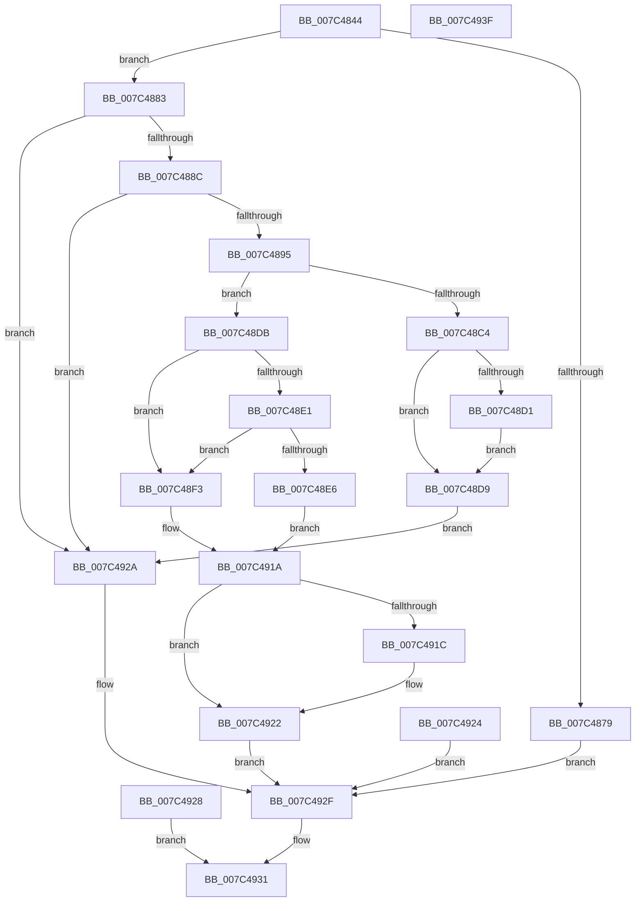

# ExpQueryInterruptSteeringInformation

- RVA: `0x007C4844`–`0x007C4940` (길이 `252` bytes)
- VA: `0x00000001407C4844`
- 실행 섹션: `PAGE`
- PDB 이름 있음: `예`; PDB Function 태그: `아니요`
- unwind 정보 RVA: `0x000D4078`
- 디코드: `71`개 명령, `252/252` bytes 표시
- 미해석 바이트: `0` (있으면 어셈블리에 `.byte`로 보존)

> 이 문서는 커널 이미지의 기계어와 PDB 기호를 분석해 생성했습니다. 4번과 5번은 함수 원형과 자료형을 바이너리 사용 방식에서 추정한 C 해석이며 원본 소스 복구 결과는 아닙니다.

## 1. Dependencies

- 직접 호출 지점: **2**; 고유 호출 대상: **2**
- 직접 호출자로 확인된 함수: **1**
- RIP 상대 이미지 참조: **0**

### Outgoing calls
- `0x007C48E6` → [KeIntSteerIsSteeringEnabled](../../text/4F/KeIntSteerIsSteeringEnabled_function_004FC2C8.md) (function, `0x004FC2C8`)
- `0x007C490F` → [KeIntSteerGetSteeringMode](../../text/2D/KeIntSteerGetSteeringMode_function_002D4CA4.md) (function, `0x002D4CA4`)

### Direct callers
- [ExpQuerySystemInformation](../A5/ExpQuerySystemInformation_function_00A57858.md) at `0x00A5A828`

### Static image references
- 디코드된 RIP-relative 메모리 참조가 없습니다.

## 2. Other-region calls and transfers

- 다른 실행 섹션으로 향하는 call: **2**
  - `0x007C48E6` → [KeIntSteerIsSteeringEnabled](../../text/4F/KeIntSteerIsSteeringEnabled_function_004FC2C8.md) (`PAGE` → `.text`)
  - `0x007C490F` → [KeIntSteerGetSteeringMode](../../text/2D/KeIntSteerGetSteeringMode_function_002D4CA4.md) (`PAGE` → `.text`)
- 별도 외부 분기/꼬리 이동을 확인하지 못했습니다.

## 3. Assembly (complete function range)

```asm
007C4844  48 8B C4                        mov rax, rsp
007C4847  48 89 58 08                     mov qword ptr [rax + 8], rbx
007C484B  57                              push rdi
007C484C  48 83 EC 70                     sub rsp, 0x70
007C4850  49 8B F8                        mov rdi, r8
007C4853  33 DB                           xor ebx, ebx
007C4855  88 58 B8                        mov byte ptr [rax - 0x48], bl
007C4858  88 58 B9                        mov byte ptr [rax - 0x47], bl
007C485B  0F 57 C0                        xorps xmm0, xmm0
007C485E  0F 11 40 E8                     movups xmmword ptr [rax - 0x18], xmm0
007C4862  89 58 C0                        mov dword ptr [rax - 0x40], ebx
007C4865  88 58 BA                        mov byte ptr [rax - 0x46], bl
007C4868  65 48 8B 04 25 88 01 00 00      mov rax, qword ptr gs:[0x188]
007C4871  38 98 32 02 00 00               cmp byte ptr [rax + 0x232], bl
007C4877  74 0A                           je 0x1407c4883
007C4879  BB 22 00 00 C0                  mov ebx, 0xc0000022
007C487E  E9 AC 00 00 00                  jmp 0x1407c492f
007C4883  48 85 C9                        test rcx, rcx
007C4886  0F 84 9E 00 00 00               je 0x1407c492a
007C488C  83 FA 18                        cmp edx, 0x18
007C488F  0F 85 95 00 00 00               jne 0x1407c492a
007C4895  8B 01                           mov eax, dword ptr [rcx]
007C4897  89 44 24 38                     mov dword ptr [rsp + 0x38], eax
007C489B  8A 51 04                        mov dl, byte ptr [rcx + 4]
007C489E  88 54 24 30                     mov byte ptr [rsp + 0x30], dl
007C48A2  44 8A 41 05                     mov r8b, byte ptr [rcx + 5]
007C48A6  44 88 44 24 31                  mov byte ptr [rsp + 0x31], r8b
007C48AB  44 8A 51 06                     mov r10b, byte ptr [rcx + 6]
007C48AF  44 88 54 24 32                  mov byte ptr [rsp + 0x32], r10b
007C48B4  0F 10 41 08                     movups xmm0, xmmword ptr [rcx + 8]
007C48B8  F3 0F 7F 44 24 60               movdqu xmmword ptr [rsp + 0x60], xmm0
007C48BE  41 83 F9 04                     cmp r9d, 4
007C48C2  73 17                           jae 0x1407c48db
007C48C4  48 8B 84 24 A0 00 00 00         mov rax, qword ptr [rsp + 0xa0]
007C48CC  48 85 C0                        test rax, rax
007C48CF  74 08                           je 0x1407c48d9
007C48D1  C7 00 04 00 00 00               mov dword ptr [rax], 4
007C48D7  EB 00                           jmp 0x1407c48d9
007C48D9  EB 4F                           jmp 0x1407c492a
007C48DB  89 1F                           mov dword ptr [rdi], ebx
007C48DD  84 D2                           test dl, dl
007C48DF  74 12                           je 0x1407c48f3
007C48E1  83 F8 FF                        cmp eax, -1
007C48E4  75 0D                           jne 0x1407c48f3
007C48E6  E8 DD 79 D3 FF                  call 0x1404fc2c8
007C48EB  88 44 24 36                     mov byte ptr [rsp + 0x36], al
007C48EF  84 C0                           test al, al
007C48F1  EB 27                           jmp 0x1407c491a
007C48F3  44 8B CB                        mov r9d, ebx
007C48F6  45 84 C0                        test r8b, r8b
007C48F9  41 0F 95 C1                     setne r9b
007C48FD  44 89 4C 24 40                  mov dword ptr [rsp + 0x40], r9d
007C4902  48 8D 44 24 60                  lea rax, [rsp + 0x60]
007C4907  48 89 44 24 20                  mov qword ptr [rsp + 0x20], rax
007C490C  45 8A C2                        mov r8b, r10b
007C490F  E8 90 03 B1 FF                  call 0x1402d4ca4
007C4914  89 44 24 44                     mov dword ptr [rsp + 0x44], eax
007C4918  85 C0                           test eax, eax
007C491A  74 06                           je 0x1407c4922
007C491C  C7 07 01 00 00 00               mov dword ptr [rdi], 1
007C4922  EB 0B                           jmp 0x1407c492f
007C4924  8B D8                           mov ebx, eax
007C4926  EB 07                           jmp 0x1407c492f
007C4928  EB 07                           jmp 0x1407c4931
007C492A  BB 04 00 00 C0                  mov ebx, 0xc0000004
007C492F  8B C3                           mov eax, ebx
007C4931  48 8B 9C 24 80 00 00 00         mov rbx, qword ptr [rsp + 0x80]
007C4939  48 83 C4 70                     add rsp, 0x70
007C493D  5F                              pop rdi
007C493E  C3                              ret
007C493F  CC                              int3
```

## 4. C-style interpretation (structured pseudocode)

```c
__int64 __fastcall ExpQueryInterruptSteeringInformation(__int64 a1, int a2, __int64 a3, int a4, __int64 a5)
{
    __int64 result;
    __int64 v_rbx;
    __int64 v_rsp;
    unsigned __int64 v_stack_m18;
    unsigned int v_stack_m34;
    unsigned int v_stack_m38;
    unsigned int v_stack_m40;
    unsigned __int8 v_stack_m42;
    unsigned __int8 v_stack_m46;
    unsigned __int8 v_stack_m47;
    unsigned __int8 v_stack_m48;
    unsigned __int64 v_stack_m58;
    unsigned __int64 v_stack_p8;

    *(unsigned __int64 *)(v_rsp + 8) = v_rbx;
    v_rsp = (v_rsp) - (112);
    v_rbx = 0;
    *(unsigned __int8 *)(v_rsp - 72) = 0;
    *(unsigned __int8 *)(v_rsp - 71) = 0;
    *(unsigned __int64 *)(v_rsp - 24) = v_xmm0;
    *(unsigned int *)(v_rsp - 64) = 0;
    *(unsigned __int8 *)(v_rsp - 70) = 0;
    if ((*(unsigned __int8 *)(*(unsigned __int64 *)(gs_base + (0 + 392)) + 562)) == 0) goto loc_007C4883;
    goto loc_007C492F;
loc_007C4883:
    if (a1 == 0) goto loc_007C492A;
    if (a2 != 24) goto loc_007C492A;
    v_stack_m40 = (unsigned int)((unsigned int)(*(unsigned int *)(a1)));
    v_stack_m48 = (unsigned __int8)(*(unsigned __int8 *)(a1 + 4));
    v_stack_m47 = (unsigned __int8)(*(unsigned __int8 *)(a1 + 5));
    v_stack_m46 = (unsigned __int8)(*(unsigned __int8 *)(a1 + 6));
    v_stack_m18 = v_xmm0;
    if (a4 >= 4) goto loc_007C48DB;
    if (a5 == 0) goto loc_007C48D9;
    *(unsigned int *)(a5) = 4;
    goto loc_007C48D9;
loc_007C48D9:
    goto loc_007C492A;
loc_007C48DB:
    *(unsigned int *)(a3) = (unsigned int)((unsigned int)(0xC0000022ULL));
    if ((unsigned __int8)(*(unsigned __int8 *)(a1 + 4)) == 0) goto loc_007C48F3;
    if (((unsigned int)(a5)) != -1) goto loc_007C48F3;
    result = KeIntSteerIsSteeringEnabled(a1, *(unsigned __int8 *)(a1 + 4), *(unsigned __int8 *)(a1 + 5), a4);
    v_stack_m42 = (unsigned __int8)(result);
    goto loc_007C491A;
loc_007C48F3:
    a4 = ((unsigned __int8)(*(unsigned __int8 *)(a1 + 5)) != 0) ? 1 : 0;
    v_stack_m38 = a4;
    v_stack_m58 = v_stack_m18;
    result = KeIntSteerGetSteeringMode(a1, *(unsigned __int8 *)(a1 + 4), (unsigned __int8)(*(unsigned __int8 *)(a1 + 6)), a4);
    v_stack_m34 = (unsigned int)(result);
loc_007C491A:
    if ((unsigned int)(result) != 0) {
        *(unsigned int *)(a3) = 1;
    }
    goto loc_007C492F;
loc_007C492A:
loc_007C492F:
loc_007C4931:
    v_rsp = (v_rsp) + (112);
    return (unsigned int)((unsigned int)((unsigned int)(0xC0000004ULL)));
}
```

## 5. (Beta) C Style

```c
int64_t ExpQueryInterruptSteeringInformation(int64_t Arg1, int32_t Arg2, void *Arg3, int32_t Arg4, int64_t Arg5)
{
    uint8_t *arg3 = (uint8_t *)Arg3;

    int64_t result;
    int64_t local_rbx;
    int64_t local_rsp;
    uint64_t v_stack_m18;
    uint32_t v_stack_m34;
    uint32_t v_stack_m38;
    uint32_t v_stack_m40;
    uint8_t v_stack_m42;
    uint8_t v_stack_m46;
    uint8_t v_stack_m47;
    uint8_t v_stack_m48;
    uint64_t v_stack_m58;
    uint64_t v_stack_p8;

    *(uint64_t *)(local_rsp + 0x8) = local_rbx;
    local_rsp = (local_rsp) - (112);
    local_rbx = 0;
    *(uint8_t *)(local_rsp - 0x48) = 0;
    *(uint8_t *)(local_rsp - 0x47) = 0;
    *(uint64_t *)(local_rsp - 0x18) = v_xmm0;
    *(uint32_t *)(local_rsp - 0x40) = 0;
    *(uint8_t *)(local_rsp - 0x46) = 0;
    if ((*(uint8_t *)(*(uint64_t *)(gs_base + (0 + 0x188)) + 0x232)) == 0) goto loc_007C4883;
    goto loc_007C492F;
loc_007C4883:
    if (Arg1 == 0) goto loc_007C492A;
    if (Arg2 != 24) goto loc_007C492A;
    v_stack_m40 = (uint32_t)((uint32_t)(*(uint32_t *)(Arg1)));
    v_stack_m48 = (uint8_t)(*(uint8_t *)(Arg1 + 0x4));
    v_stack_m47 = (uint8_t)(*(uint8_t *)(Arg1 + 0x5));
    v_stack_m46 = (uint8_t)(*(uint8_t *)(Arg1 + 0x6));
    v_stack_m18 = v_xmm0;
    if (Arg4 >= 4) goto loc_007C48DB;
    if (Arg5 == 0) goto loc_007C48D9;
    *(uint32_t *)(Arg5) = 4;
    goto loc_007C48D9;
loc_007C48D9:
    goto loc_007C492A;
loc_007C48DB:
    *(uint32_t *)(arg3) = (uint32_t)((uint32_t)(0xC0000022ULL));
    if ((uint8_t)(*(uint8_t *)(Arg1 + 0x4)) == 0) goto loc_007C48F3;
    if (((uint32_t)(Arg5)) != -1) goto loc_007C48F3;
    result = KeIntSteerIsSteeringEnabled(Arg1, *(uint8_t *)(Arg1 + 0x4), *(uint8_t *)(Arg1 + 0x5), Arg4);
    v_stack_m42 = (uint8_t)(result);
    goto loc_007C491A;
loc_007C48F3:
    Arg4 = ((uint8_t)(*(uint8_t *)(Arg1 + 0x5)) != 0) ? 1 : 0;
    v_stack_m38 = Arg4;
    v_stack_m58 = v_stack_m18;
    result = KeIntSteerGetSteeringMode(Arg1, *(uint8_t *)(Arg1 + 0x4), (uint8_t)(*(uint8_t *)(Arg1 + 0x6)), Arg4);
    v_stack_m34 = (uint32_t)(result);
loc_007C491A:
    if ((uint32_t)(result) != 0) {
        *(uint32_t *)(arg3) = 1;
    }
    goto loc_007C492F;
loc_007C492A:
loc_007C492F:
loc_007C4931:
    local_rsp = (local_rsp) + (112);
    return (uint32_t)((uint32_t)((uint32_t)(0xC0000004ULL)));
}
```

### 관측된 메모리 오프셋

구조체 형식이 확인되지 않은 접근은 인자 기준의 오프셋으로만 기록했습니다.

| 기준 인자 | 오프셋 표현 | 폭 (bit) | 접근 |
|---|---:|---:|---|
| `Arg3` | `+ 0x0` | `32` | `W` |

## 6. Execution-region graph

[열기: 2D/3D 그래프와 함수 탐색 컨트롤 패널](../../../control-panel.html?section=page&rva=0x007C4844&view=graph)

- 2D 그래프는 위에서 아래로 흐르고, 3D 그래프는 빈 공간을 드래그해 회전합니다. Shift+드래그는 이동, 휠은 확대·축소, 함수 노드 선택은 대상 보고서 이동입니다.

### Static fallback


