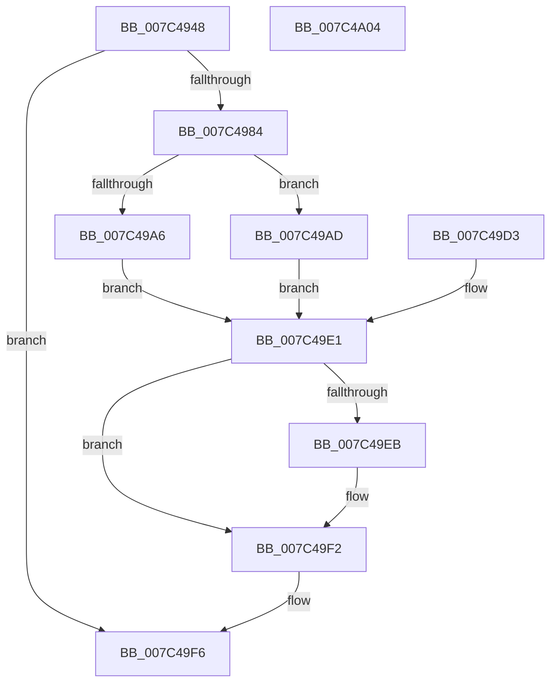

# ExpQueryLegacyDriverInformation

- RVA: `0x007C4948`–`0x007C4A05` (길이 `189` bytes)
- VA: `0x00000001407C4948`
- 실행 섹션: `PAGE`
- PDB 이름 있음: `예`; PDB Function 태그: `아니요`
- unwind 정보 RVA: `0x000D41A4`
- 디코드: `55`개 명령, `189/189` bytes 표시
- 미해석 바이트: `0` (있으면 어셈블리에 `.byte`로 보존)

> 이 문서는 커널 이미지의 기계어와 PDB 기호를 분석해 생성했습니다. 4번과 5번은 함수 원형과 자료형을 바이너리 사용 방식에서 추정한 C 해석이며 원본 소스 복구 결과는 아닙니다.

## 1. Dependencies

- 직접 호출 지점: **4**; 고유 호출 대상: **4**
- 직접 호출자로 확인된 함수: **1**
- RIP 상대 이미지 참조: **0**

### Outgoing calls
- `0x007C4979` → [IoGetLegacyVetoList](../91/IoGetLegacyVetoList_function_00911300.md) (function, `0x00911300`)
- `0x007C498E` → [RtlInitUnicodeString](../../text/42/RtlInitUnicodeString_function_0042A780.md) (function, `0x0042A780`)
- `0x007C49CC` → [memcpy](../../text/6C/memcpy_function_006C6840.md) (function, `0x006C6840`)
- `0x007C49ED` → [ExFreePoolWithTag](../../poolcode/B8/ExFreePoolWithTag_function_00B82870.md) (function, `0x00B82870`)

### Direct callers
- [ExpQuerySystemInformation](../A5/ExpQuerySystemInformation_function_00A57858.md) at `0x00A586D9`

### Static image references
- 디코드된 RIP-relative 메모리 참조가 없습니다.

## 2. Other-region calls and transfers

- 다른 실행 섹션으로 향하는 call: **3**
  - `0x007C498E` → [RtlInitUnicodeString](../../text/42/RtlInitUnicodeString_function_0042A780.md) (`PAGE` → `.text`)
  - `0x007C49CC` → [memcpy](../../text/6C/memcpy_function_006C6840.md) (`PAGE` → `.text`)
  - `0x007C49ED` → [ExFreePoolWithTag](../../poolcode/B8/ExFreePoolWithTag_function_00B82870.md) (`PAGE` → `POOLCODE`)
- 별도 외부 분기/꼬리 이동을 확인하지 못했습니다.

## 3. Assembly (complete function range)

```asm
007C4948  48 8B C4                        mov rax, rsp
007C494B  48 89 58 08                     mov qword ptr [rax + 8], rbx
007C494F  48 89 50 10                     mov qword ptr [rax + 0x10], rdx
007C4953  56                              push rsi
007C4954  57                              push rdi
007C4955  41 56                           push r14
007C4957  48 83 EC 50                     sub rsp, 0x50
007C495B  48 8B F2                        mov rsi, rdx
007C495E  4C 8B F1                        mov r14, rcx
007C4961  83 60 18 00                     and dword ptr [rax + 0x18], 0
007C4965  48 83 60 C0 00                  and qword ptr [rax - 0x40], 0
007C496A  0F 57 C0                        xorps xmm0, xmm0
007C496D  0F 11 40 D0                     movups xmmword ptr [rax - 0x30], xmm0
007C4971  48 8D 50 18                     lea rdx, [rax + 0x18]
007C4975  48 8D 48 C0                     lea rcx, [rax - 0x40]
007C4979  E8 82 C9 14 00                  call 0x140911300
007C497E  8B D8                           mov ebx, eax
007C4980  85 C0                           test eax, eax
007C4982  78 72                           js 0x1407c49f6
007C4984  48 8B 54 24 28                  mov rdx, qword ptr [rsp + 0x28]
007C4989  48 8D 4C 24 38                  lea rcx, [rsp + 0x38]
007C498E  E8 ED 5D C6 FF                  call 0x14042a780
007C4993  0F B7 54 24 38                  movzx edx, word ptr [rsp + 0x38]
007C4998  8D 7A 18                        lea edi, [rdx + 0x18]
007C499B  89 BC 24 88 00 00 00            mov dword ptr [rsp + 0x88], edi
007C49A2  3B 3E                           cmp edi, dword ptr [rsi]
007C49A4  76 07                           jbe 0x1407c49ad
007C49A6  BB 05 00 00 80                  mov ebx, 0x80000005
007C49AB  EB 34                           jmp 0x1407c49e1
007C49AD  8B 84 24 80 00 00 00            mov eax, dword ptr [rsp + 0x80]
007C49B4  41 89 06                        mov dword ptr [r14], eax
007C49B7  66 41 89 56 08                  mov word ptr [r14 + 8], dx
007C49BC  49 8D 4E 18                     lea rcx, [r14 + 0x18]
007C49C0  49 89 4E 10                     mov qword ptr [r14 + 0x10], rcx
007C49C4  4C 8B C2                        mov r8, rdx
007C49C7  48 8B 54 24 40                  mov rdx, qword ptr [rsp + 0x40]
007C49CC  E8 6F 1E F0 FF                  call 0x1406c6840
007C49D1  EB 0E                           jmp 0x1407c49e1
007C49D3  8B D8                           mov ebx, eax
007C49D5  48 8B 74 24 78                  mov rsi, qword ptr [rsp + 0x78]
007C49DA  8B BC 24 88 00 00 00            mov edi, dword ptr [rsp + 0x88]
007C49E1  48 8B 4C 24 28                  mov rcx, qword ptr [rsp + 0x28]
007C49E6  48 85 C9                        test rcx, rcx
007C49E9  74 07                           je 0x1407c49f2
007C49EB  33 D2                           xor edx, edx
007C49ED  E8 7E DE 3B 00                  call 0x140b82870
007C49F2  89 3E                           mov dword ptr [rsi], edi
007C49F4  8B C3                           mov eax, ebx
007C49F6  48 8B 5C 24 70                  mov rbx, qword ptr [rsp + 0x70]
007C49FB  48 83 C4 50                     add rsp, 0x50
007C49FF  41 5E                           pop r14
007C4A01  5F                              pop rdi
007C4A02  5E                              pop rsi
007C4A03  C3                              ret
007C4A04  CC                              int3
```

## 4. C-style interpretation (structured pseudocode)

```c
__int64 __fastcall ExpQueryLegacyDriverInformation(__int64 a1, __int64 a2)
{
    __int64 result;
    __int64 v_rsp;
    unsigned __int64 v_stack_m28;
    unsigned __int64 v_stack_m30;
    unsigned __int64 v_stack_m40;
    unsigned __int64 v_stack_p10;
    unsigned int v_stack_p18;
    unsigned int v_stack_p20;
    unsigned __int64 v_stack_p8;

    *(unsigned __int64 *)(v_rsp + 8) = v_rbx;
    *(unsigned __int64 *)(v_rsp + 16) = a2;
    v_rsp = (v_rsp) - (80);
    *(unsigned __int64 *)(v_rsp - 48) = v_xmm0;
    result = IoGetLegacyVetoList(v_rsp - 64, v_rsp + 24, a3, a4);
    if (sign_flag) goto loc_007C49F6;
    result = RtlInitUnicodeString(v_stack_m30, v_stack_m40, a3, a4);
    v_stack_p20 = (unsigned int)(v_stack_m30 + 24);
    if (((unsigned int)(v_stack_m30 + 24)) <= (*(unsigned int *)(a2))) goto loc_007C49AD;
    goto loc_007C49E1;
loc_007C49AD:
    *(unsigned int *)(a1) = (unsigned int)((unsigned int)(v_stack_p18));
    *(unsigned __int16 *)(a1 + 8) = (unsigned __int16)(v_stack_m30);
    *(unsigned __int64 *)(a1 + 16) = a1 + 24;
    result = memcpy(a1 + 24, v_stack_m28, v_stack_m30, a4);
    goto loc_007C49E1;
loc_007C49E1:
    if (v_stack_m40 != 0) {
        a2 = 0;
        result = ExFreePoolWithTag(v_stack_m40, a2, v_stack_m30, a4);
    }
    *(unsigned int *)(a2) = (unsigned int)(v_stack_m30 + 24);
loc_007C49F6:
    v_rsp = (v_rsp) + (80);
    return (unsigned int)((unsigned int)((unsigned int)(0x80000005ULL)));
}
```

## 5. (Beta) C Style

```c
int64_t ExpQueryLegacyDriverInformation(void *Arg1, void *Arg2)
{
    uint8_t *arg1 = (uint8_t *)Arg1;
    uint8_t *arg2 = (uint8_t *)Arg2;

    int64_t result;
    int64_t local_rsp;
    uint64_t v_stack_m28;
    uint64_t v_stack_m30;
    uint64_t v_stack_m40;
    uint64_t v_stack_p10;
    uint32_t v_stack_p18;
    uint32_t v_stack_p20;
    uint64_t v_stack_p8;

    *(uint64_t *)(local_rsp + 0x8) = local_rbx;
    *(void **)(local_rsp + 0x10) = Arg2;
    local_rsp = (local_rsp) - (80);
    *(uint64_t *)(local_rsp - 0x30) = v_xmm0;
    result = IoGetLegacyVetoList(local_rsp - 64, local_rsp + 24, a3, a4);
    if (sign_flag) goto loc_007C49F6;
    result = RtlInitUnicodeString(v_stack_m30, v_stack_m40, a3, a4);
    v_stack_p20 = (uint32_t)(v_stack_m30 + 24);
    if (((uint32_t)(v_stack_m30 + 24)) <= (*(uint32_t *)(arg2))) goto loc_007C49AD;
    goto loc_007C49E1;
loc_007C49AD:
    *(uint32_t *)(arg1) = (uint32_t)((uint32_t)(v_stack_p18));
    *(uint16_t *)(arg1 + 0x8) = (uint16_t)(v_stack_m30);
    *(void **)(arg1 + 0x10) = Arg1 + 24;
    result = memcpy(Arg1 + 24, v_stack_m28, v_stack_m30, a4);
    goto loc_007C49E1;
loc_007C49E1:
    if (v_stack_m40 != 0) {
        Arg2 = 0;
        result = ExFreePoolWithTag(v_stack_m40, Arg2, v_stack_m30, a4);
    }
    *(uint32_t *)(arg2) = (uint32_t)(v_stack_m30 + 24);
loc_007C49F6:
    local_rsp = (local_rsp) + (80);
    return (uint32_t)((uint32_t)((uint32_t)(0x80000005ULL)));
}
```

### 관측된 메모리 오프셋

구조체 형식이 확인되지 않은 접근은 인자 기준의 오프셋으로만 기록했습니다.

| 기준 인자 | 오프셋 표현 | 폭 (bit) | 접근 |
|---|---:|---:|---|
| `Arg1` | `+ 0x0` | `32` | `W` |
| `Arg1` | `+ 0x8` | `16` | `W` |
| `Arg1` | `+ 0x10` | `64` | `W` |
| `Arg1` | `+ 0x18` | `64` | `R` |
| `Arg2` | `+ 0x0` | `32` | `R` |
| `Arg2` | `+ 0x0` | `32` | `W` |

## 6. Execution-region graph

[열기: 2D/3D 그래프와 함수 탐색 컨트롤 패널](../../../control-panel.html?section=page&rva=0x007C4948&view=graph)

- 2D 그래프는 위에서 아래로 흐르고, 3D 그래프는 빈 공간을 드래그해 회전합니다. Shift+드래그는 이동, 휠은 확대·축소, 함수 노드 선택은 대상 보고서 이동입니다.

### Static fallback


