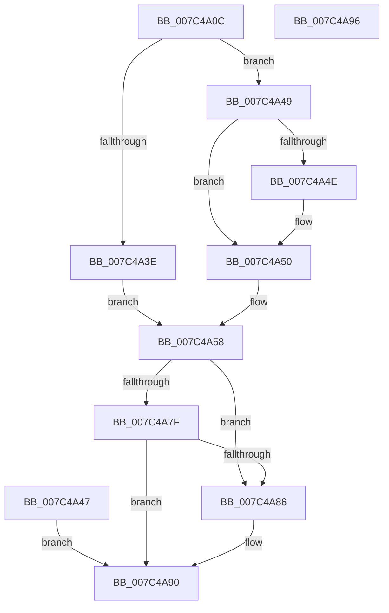

# ExpQueryModuleInformationEx

- RVA: `0x007C4A0C`–`0x007C4A97` (길이 `139` bytes)
- VA: `0x00000001407C4A0C`
- 실행 섹션: `PAGE`
- PDB 이름 있음: `예`; PDB Function 태그: `아니요`
- unwind 정보 RVA: `0x000D41D0`
- 디코드: `39`개 명령, `139/139` bytes 표시
- 미해석 바이트: `0` (있으면 어셈블리에 `.byte`로 보존)

> 이 문서는 커널 이미지의 기계어와 PDB 기호를 분석해 생성했습니다. 4번과 5번은 함수 원형과 자료형을 바이너리 사용 방식에서 추정한 C 해석이며 원본 소스 복구 결과는 아닙니다.

## 1. Dependencies

- 직접 호출 지점: **1**; 고유 호출 대상: **1**
- 직접 호출자로 확인된 함수: **1**
- RIP 상대 이미지 참조: **1**

### Outgoing calls
- `0x007C4A6E` → [MmEnumerateSystemImagesShared](../../text/4B/MmEnumerateSystemImagesShared_function_004BFFA0.md) (function, `0x004BFFA0`)

### Direct callers
- [ExpQuerySystemInformation](../A5/ExpQuerySystemInformation_function_00A57858.md) at `0x00A58D6A`

### Static image references
- `0x007C4A67` → RVA `0x00AAA0D0` (`ExpQueryModuleInformationImageEx`; read)

## 2. Other-region calls and transfers

- 다른 실행 섹션으로 향하는 call: **1**
  - `0x007C4A6E` → [MmEnumerateSystemImagesShared](../../text/4B/MmEnumerateSystemImagesShared_function_004BFFA0.md) (`PAGE` → `.text`)
- 별도 외부 분기/꼬리 이동을 확인하지 못했습니다.

## 3. Assembly (complete function range)

```asm
007C4A0C  40 53                           push rbx
007C4A0E  48 83 EC 60                     sub rsp, 0x60
007C4A12  33 C0                           xor eax, eax
007C4A14  89 44 24 34                     mov dword ptr [rsp + 0x34], eax
007C4A18  89 4C 24 50                     mov dword ptr [rsp + 0x50], ecx
007C4A1C  44 89 4C 24 58                  mov dword ptr [rsp + 0x58], r9d
007C4A21  89 44 24 54                     mov dword ptr [rsp + 0x54], eax
007C4A25  48 8B 9C 24 90 00 00 00         mov rbx, qword ptr [rsp + 0x90]
007C4A2D  48 89 5C 24 48                  mov qword ptr [rsp + 0x48], rbx
007C4A32  8D 48 02                        lea ecx, [rax + 2]
007C4A35  89 4C 24 44                     mov dword ptr [rsp + 0x44], ecx
007C4A39  44 3B C1                        cmp r8d, ecx
007C4A3C  72 0B                           jb 0x1407c4a49
007C4A3E  66 89 02                        mov word ptr [rdx], ax
007C4A41  89 44 24 30                     mov dword ptr [rsp + 0x30], eax
007C4A45  EB 11                           jmp 0x1407c4a58
007C4A47  EB 47                           jmp 0x1407c4a90
007C4A49  48 85 DB                        test rbx, rbx
007C4A4C  74 02                           je 0x1407c4a50
007C4A4E  89 0B                           mov dword ptr [rbx], ecx
007C4A50  C7 44 24 30 04 00 00 C0         mov dword ptr [rsp + 0x30], 0xc0000004
007C4A58  48 89 54 24 38                  mov qword ptr [rsp + 0x38], rdx
007C4A5D  44 89 44 24 40                  mov dword ptr [rsp + 0x40], r8d
007C4A62  48 8D 54 24 30                  lea rdx, [rsp + 0x30]
007C4A67  48 8D 0D 62 56 2E 00            lea rcx, [rip + 0x2e5662]
007C4A6E  E8 2D B5 CF FF                  call 0x1404bffa0
007C4A73  BA 00 00 00 80                  mov edx, 0x80000000
007C4A78  8D 0C 10                        lea ecx, [rax + rdx]
007C4A7B  85 CA                           test edx, ecx
007C4A7D  75 07                           jne 0x1407c4a86
007C4A7F  3D 04 00 00 C0                  cmp eax, 0xc0000004
007C4A84  75 0A                           jne 0x1407c4a90
007C4A86  8B 44 24 44                     mov eax, dword ptr [rsp + 0x44]
007C4A8A  89 03                           mov dword ptr [rbx], eax
007C4A8C  8B 44 24 30                     mov eax, dword ptr [rsp + 0x30]
007C4A90  48 83 C4 60                     add rsp, 0x60
007C4A94  5B                              pop rbx
007C4A95  C3                              ret
007C4A96  CC                              int3
```

## 4. C-style interpretation (structured pseudocode)

```c
__int64 __fastcall ExpQueryModuleInformationEx(int a1, __int64 a2, int a3, int a4, __int64 a5)
{
    __int64 result;
    __int64 v_rsp;
    unsigned int v_stack_m10;
    unsigned int v_stack_m14;
    unsigned int v_stack_m18;
    unsigned __int64 v_stack_m20;
    unsigned int v_stack_m24;
    unsigned int v_stack_m28;
    unsigned __int64 v_stack_m30;
    unsigned int v_stack_m34;
    unsigned int v_stack_m38;

    v_rsp = (v_rsp) - (96);
    result = 0;
    v_stack_m34 = 0;
    v_stack_m18 = a1;
    v_stack_m10 = a4;
    v_stack_m14 = 0;
    v_stack_m20 = a5;
    v_stack_m24 = (unsigned int)(result + 2);
    if (a3 < ((unsigned int)(result + 2))) goto loc_007C4A49;
    *(unsigned __int16 *)(a2) = 0;
    v_stack_m38 = 0;
    goto loc_007C4A58;
loc_007C4A49:
    if (a5 != 0) {
        *(unsigned int *)(a5) = (unsigned int)(result + 2);
    }
    v_stack_m38 = 0xC0000004ULL;
loc_007C4A58:
    v_stack_m30 = a2;
    v_stack_m28 = a3;
    result = MmEnumerateSystemImagesShared(v_rip + 3036770, v_stack_m38, a3, a4);
    if ((((unsigned int)((unsigned int)(0x80000000ULL))) & ((unsigned int)(result + (unsigned int)(0x80000000ULL) * 1))) != 0) goto loc_007C4A86;
    if (((unsigned int)(result)) == 0xC0000004ULL) {
        result = v_stack_m24;
        *(unsigned int *)(a5) = (unsigned int)(result);
        result = v_stack_m38;
    }
    v_rsp = (v_rsp) + (96);
    return result;
}
```

## 5. (Beta) C Style

```c
int64_t ExpQueryModuleInformationEx(int32_t Arg1, void *Arg2, int32_t Arg3, int32_t Arg4, int64_t Arg5)
{
    uint8_t *arg2 = (uint8_t *)Arg2;

    int64_t result;
    int64_t local_rsp;
    uint32_t v_stack_m10;
    uint32_t v_stack_m14;
    uint32_t v_stack_m18;
    uint64_t v_stack_m20;
    uint32_t v_stack_m24;
    uint32_t v_stack_m28;
    uint64_t v_stack_m30;
    uint32_t v_stack_m34;
    uint32_t v_stack_m38;

    local_rsp = (local_rsp) - (96);
    result = 0;
    v_stack_m34 = 0;
    v_stack_m18 = Arg1;
    v_stack_m10 = Arg4;
    v_stack_m14 = 0;
    v_stack_m20 = Arg5;
    v_stack_m24 = (uint32_t)(result + 2);
    if (Arg3 < ((uint32_t)(result + 2))) goto loc_007C4A49;
    *(uint16_t *)(arg2) = 0;
    v_stack_m38 = 0;
    goto loc_007C4A58;
loc_007C4A49:
    if (Arg5 != 0) {
        *(uint32_t *)(Arg5) = (uint32_t)(result + 2);
    }
    v_stack_m38 = 0xC0000004ULL;
loc_007C4A58:
    v_stack_m30 = Arg2;
    v_stack_m28 = Arg3;
    result = MmEnumerateSystemImagesShared(v_rip + 3036770, v_stack_m38, Arg3, Arg4);
    if ((((uint32_t)((uint32_t)(0x80000000ULL))) & ((uint32_t)(result + (uint32_t)(0x80000000ULL) * 1))) != 0) goto loc_007C4A86;
    if (((uint32_t)(result)) == 0xC0000004ULL) {
        result = v_stack_m24;
        *(uint32_t *)(Arg5) = (uint32_t)(result);
        result = v_stack_m38;
    }
    local_rsp = (local_rsp) + (96);
    return result;
}
```

### 관측된 메모리 오프셋

구조체 형식이 확인되지 않은 접근은 인자 기준의 오프셋으로만 기록했습니다.

| 기준 인자 | 오프셋 표현 | 폭 (bit) | 접근 |
|---|---:|---:|---|
| `Arg2` | `+ 0x0` | `16` | `W` |

## 6. Execution-region graph

[열기: 2D/3D 그래프와 함수 탐색 컨트롤 패널](../../../control-panel.html?section=page&rva=0x007C4A0C&view=graph)

- 2D 그래프는 위에서 아래로 흐르고, 3D 그래프는 빈 공간을 드래그해 회전합니다. Shift+드래그는 이동, 휠은 확대·축소, 함수 노드 선택은 대상 보고서 이동입니다.

### Static fallback


