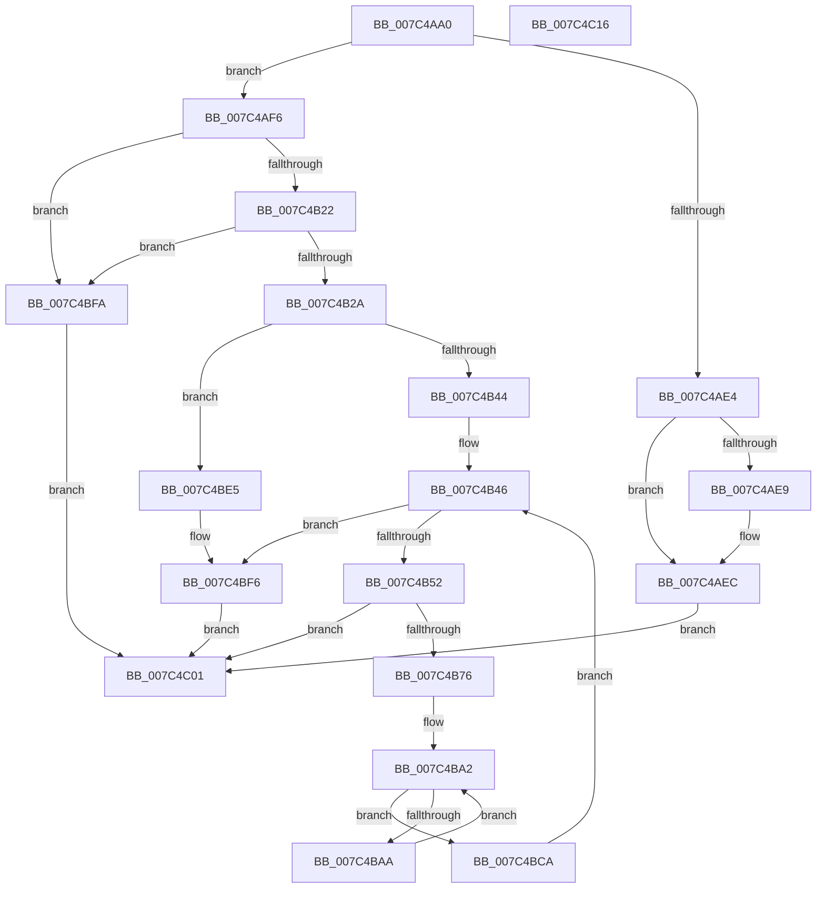

# ExpQueryNumaAvailableMemory

- RVA: `0x007C4AA0`–`0x007C4C17` (길이 `375` bytes)
- VA: `0x00000001407C4AA0`
- 실행 섹션: `PAGE`
- PDB 이름 있음: `예`; PDB Function 태그: `아니요`
- unwind 정보 RVA: `0x000D4284`
- 디코드: `96`개 명령, `375/375` bytes 표시
- 미해석 바이트: `0` (있으면 어셈블리에 `.byte`로 보존)

> 이 문서는 커널 이미지의 기계어와 PDB 기호를 분석해 생성했습니다. 4번과 5번은 함수 원형과 자료형을 바이너리 사용 방식에서 추정한 C 해석이며 원본 소스 복구 결과는 아닙니다.

## 1. Dependencies

- 직접 호출 지점: **4**; 고유 호출 대상: **4**
- 직접 호출자로 확인된 함수: **1**
- RIP 상대 이미지 참조: **1**

### Outgoing calls
- `0x007C4AD0` → [MmGetProcessPartitionId](../../text/47/MmGetProcessPartitionId_function_0047BB44.md) (function, `0x0047BB44`)
- `0x007C4B62` → [MmGetChannelInformation](../A7/MmGetChannelInformation_function_00A71000.md) (function, `0x00A71000`)
- `0x007C4BCF` → [ExFreePoolWithTag](../../poolcode/B8/ExFreePoolWithTag_function_00B82870.md) (function, `0x00B82870`)
- `0x007C4BE9` → [MmGetAvailablePages](../../text/46/MmGetAvailablePages_function_0046A4C0.md) (function, `0x0046A4C0`)

### Direct callers
- [ExpQuerySystemInformation](../A5/ExpQuerySystemInformation_function_00A57858.md) at `0x00A58ADE`

### Static image references
- `0x007C4AF6` → RVA `0x00FC5000` (`ALMOSTRO`; read)

## 2. Other-region calls and transfers

- 다른 실행 섹션으로 향하는 call: **3**
  - `0x007C4AD0` → [MmGetProcessPartitionId](../../text/47/MmGetProcessPartitionId_function_0047BB44.md) (`PAGE` → `.text`)
  - `0x007C4BCF` → [ExFreePoolWithTag](../../poolcode/B8/ExFreePoolWithTag_function_00B82870.md) (`PAGE` → `POOLCODE`)
  - `0x007C4BE9` → [MmGetAvailablePages](../../text/46/MmGetAvailablePages_function_0046A4C0.md) (`PAGE` → `.text`)
- 별도 외부 분기/꼬리 이동을 확인하지 못했습니다.

## 3. Assembly (complete function range)

```asm
007C4AA0  48 89 5C 24 10                  mov qword ptr [rsp + 0x10], rbx
007C4AA5  56                              push rsi
007C4AA6  57                              push rdi
007C4AA7  41 54                           push r12
007C4AA9  41 56                           push r14
007C4AAB  41 57                           push r15
007C4AAD  48 83 EC 60                     sub rsp, 0x60
007C4AB1  4C 8B F1                        mov r14, rcx
007C4AB4  48 83 64 24 38 00               and qword ptr [rsp + 0x38], 0
007C4ABA  48 83 64 24 30 00               and qword ptr [rsp + 0x30], 0
007C4AC0  65 48 8B 04 25 88 01 00 00      mov rax, qword ptr gs:[0x188]
007C4AC9  48 8B 88 B8 00 00 00            mov rcx, qword ptr [rax + 0xb8]
007C4AD0  E8 6F 70 CB FF                  call 0x14047bb44
007C4AD5  44 0F B7 F8                     movzx r15d, ax
007C4AD9  41 BA 04 00 00 00               mov r10d, 4
007C4ADF  41 3B D2                        cmp edx, r10d
007C4AE2  73 12                           jae 0x1407c4af6
007C4AE4  4D 85 C0                        test r8, r8
007C4AE7  74 03                           je 0x1407c4aec
007C4AE9  45 89 10                        mov dword ptr [r8], r10d
007C4AEC  B8 04 00 00 C0                  mov eax, 0xc0000004
007C4AF1  E9 0B 01 00 00                  jmp 0x1407c4c01
007C4AF6  44 0F B7 0D 02 05 80 00         movzx r9d, word ptr [rip + 0x800502]
007C4AFE  41 8D 41 FF                     lea eax, [r9 - 1]
007C4B02  41 89 06                        mov dword ptr [r14], eax
007C4B05  8D 7A F8                        lea edi, [rdx - 8]
007C4B08  C1 EF 03                        shr edi, 3
007C4B0B  41 3B F9                        cmp edi, r9d
007C4B0E  41 0F 47 F9                     cmova edi, r9d
007C4B12  89 BC 24 90 00 00 00            mov dword ptr [rsp + 0x90], edi
007C4B19  83 FA 08                        cmp edx, 8
007C4B1C  0F 82 D8 00 00 00               jb 0x1407c4bfa
007C4B22  85 FF                           test edi, edi
007C4B24  0F 84 D0 00 00 00               je 0x1407c4bfa
007C4B2A  8D 04 FD 08 00 00 00            lea eax, [rdi*8 + 8]
007C4B31  41 89 00                        mov dword ptr [r8], eax
007C4B34  41 BC 01 00 00 00               mov r12d, 1
007C4B3A  66 45 3B CC                     cmp r9w, r12w
007C4B3E  0F 86 A1 00 00 00               jbe 0x1407c4be5
007C4B44  33 DB                           xor ebx, ebx
007C4B46  89 5C 24 28                     mov dword ptr [rsp + 0x28], ebx
007C4B4A  3B DF                           cmp ebx, edi
007C4B4C  0F 83 A4 00 00 00               jae 0x1407c4bf6
007C4B52  4C 8D 4C 24 30                  lea r9, [rsp + 0x30]
007C4B57  4C 8D 44 24 38                  lea r8, [rsp + 0x38]
007C4B5C  8B D3                           mov edx, ebx
007C4B5E  41 0F B7 CF                     movzx ecx, r15w
007C4B62  E8 99 C4 2A 00                  call 0x140a71000
007C4B67  89 84 24 A8 00 00 00            mov dword ptr [rsp + 0xa8], eax
007C4B6E  85 C0                           test eax, eax
007C4B70  0F 88 8B 00 00 00               js 0x1407c4c01
007C4B76  33 F6                           xor esi, esi
007C4B78  48 89 74 24 40                  mov qword ptr [rsp + 0x40], rsi
007C4B7D  48 B8 CD CC CC CC CC CC CC CC   movabs rax, 0xcccccccccccccccd
007C4B87  48 F7 64 24 30                  mul qword ptr [rsp + 0x30]
007C4B8C  48 C1 EA 05                     shr rdx, 5
007C4B90  48 89 54 24 50                  mov qword ptr [rsp + 0x50], rdx
007C4B95  45 33 C0                        xor r8d, r8d
007C4B98  44 89 44 24 24                  mov dword ptr [rsp + 0x24], r8d
007C4B9D  4C 8B 4C 24 38                  mov r9, qword ptr [rsp + 0x38]
007C4BA2  41 8B C0                        mov eax, r8d
007C4BA5  48 3B C2                        cmp rax, rdx
007C4BA8  73 20                           jae 0x1407c4bca
007C4BAA  4B 8D 0C 80                     lea rcx, [r8 + r8*4]
007C4BAE  49 8B 44 C9 18                  mov rax, qword ptr [r9 + rcx*8 + 0x18]
007C4BB3  49 03 44 C9 10                  add rax, qword ptr [r9 + rcx*8 + 0x10]
007C4BB8  48 03 F0                        add rsi, rax
007C4BBB  48 89 74 24 40                  mov qword ptr [rsp + 0x40], rsi
007C4BC0  45 03 C4                        add r8d, r12d
007C4BC3  44 89 44 24 24                  mov dword ptr [rsp + 0x24], r8d
007C4BC8  EB D8                           jmp 0x1407c4ba2
007C4BCA  33 D2                           xor edx, edx
007C4BCC  49 8B C9                        mov rcx, r9
007C4BCF  E8 9C DC 3B 00                  call 0x140b82870
007C4BD4  48 C1 E6 0C                     shl rsi, 0xc
007C4BD8  49 89 74 DE 08                  mov qword ptr [r14 + rbx*8 + 8], rsi
007C4BDD  41 03 DC                        add ebx, r12d
007C4BE0  E9 61 FF FF FF                  jmp 0x1407c4b46
007C4BE5  41 0F B7 CF                     movzx ecx, r15w
007C4BE9  E8 D2 58 CA FF                  call 0x14046a4c0
007C4BEE  48 C1 E0 0C                     shl rax, 0xc
007C4BF2  49 89 46 08                     mov qword ptr [r14 + 8], rax
007C4BF6  33 C0                           xor eax, eax
007C4BF8  EB 07                           jmp 0x1407c4c01
007C4BFA  45 89 10                        mov dword ptr [r8], r10d
007C4BFD  33 C0                           xor eax, eax
007C4BFF  EB 00                           jmp 0x1407c4c01
007C4C01  48 8B 9C 24 98 00 00 00         mov rbx, qword ptr [rsp + 0x98]
007C4C09  48 83 C4 60                     add rsp, 0x60
007C4C0D  41 5F                           pop r15
007C4C0F  41 5E                           pop r14
007C4C11  41 5C                           pop r12
007C4C13  5F                              pop rdi
007C4C14  5E                              pop rsi
007C4C15  C3                              ret
007C4C16  CC                              int3
```

## 4. C-style interpretation (structured pseudocode)

```c
__int64 __fastcall ExpQueryNumaAvailableMemory(__int64 a1, __int64 a2, __int64 a3)
{
    __int64 result;
    __int64 v_rbx;
    __int64 v_rdi;
    __int64 v_rsi;
    __int64 v_rsp;
    unsigned __int64 v_stack_m38;
    unsigned __int64 v_stack_m48;
    unsigned __int64 v_stack_m50;
    unsigned __int64 v_stack_m58;
    unsigned int v_stack_m60;
    unsigned int v_stack_m64;
    unsigned __int64 v_stack_p10;
    unsigned int v_stack_p20;
    unsigned int v_stack_p8;

    v_stack_p10 = v_rbx;
    v_rsp = (v_rsp) - (96);
    result = MmGetProcessPartitionId(*(unsigned __int64 *)(*(unsigned __int64 *)(gs_base + (0 + 392)) + 184), a2, a3, a4);
    if (((unsigned int)(a2)) >= 4) goto loc_007C4AF6;
    if (a3 != 0) {
        *(unsigned int *)(a3) = 4;
    }
    goto loc_007C4C01;
loc_007C4AF6:
    *(unsigned int *)(a1) = (unsigned int)(*(unsigned __int16 *)(v_rip + 8389890) - 1);
    v_rdi = (unsigned int)((a2 - 8) >> (3));
    if (((unsigned int)(v_rdi)) > ((unsigned int)(*(unsigned __int16 *)(v_rip + 8389890)))) { v_rdi = (unsigned int)(*(unsigned __int16 *)(v_rip + 8389890)); }
    v_stack_p8 = (unsigned int)(v_rdi);
    if (((unsigned int)(a2)) < 8) goto loc_007C4BFA;
    if ((unsigned int)(v_rdi) == 0) goto loc_007C4BFA;
    *(unsigned int *)(a3) = (unsigned int)(v_rdi * 8 + 8);
    if (((unsigned __int16)(*(unsigned __int16 *)(v_rip + 8389890))) <= 1) goto loc_007C4BE5;
    v_rbx = 0;
loc_007C4B46:
    v_stack_m60 = 0;
    if (0 >= ((unsigned int)(v_rdi))) goto loc_007C4BF6;
    result = MmGetChannelInformation((unsigned __int16)((unsigned __int16)(result)), 0, v_stack_m50, v_stack_m58);
    v_stack_p20 = (unsigned int)(result);
    if (sign_flag) goto loc_007C4C01;
    v_rsi = 0;
    v_stack_m48 = 0;
    a2 = (0) >> (5);
    v_stack_m38 = a2;
    a3 = 0;
    v_stack_m64 = 0;
loc_007C4BA2:
    if (0 >= a2) goto loc_007C4BCA;
    result = (*(unsigned __int64 *)(v_stack_m50 + a3 + a3 * 4 * 8 + 24)) + (*(unsigned __int64 *)(v_stack_m50 + a3 + a3 * 4 * 8 + 16));
    v_rsi = (v_rsi) + (result);
    v_stack_m48 = v_rsi;
    a3 = (unsigned int)((a3) + (1));
    v_stack_m64 = (unsigned int)(a3);
    goto loc_007C4BA2;
loc_007C4BCA:
    a2 = 0;
    result = ExFreePoolWithTag(v_stack_m50, a2, a3, v_stack_m50);
    v_rsi = (v_rsi) << (12);
    *(unsigned __int64 *)(a1 + v_rbx * 8 + 8) = v_rsi;
    v_rbx = (unsigned int)((v_rbx) + (1));
    goto loc_007C4B46;
loc_007C4BE5:
    result = MmGetAvailablePages((unsigned __int16)((unsigned __int16)(result)), a2, a3, v_stack_m50);
    result = (result) << (12);
    *(unsigned __int64 *)(a1 + 8) = result;
loc_007C4BF6:
    result = 0;
    goto loc_007C4C01;
loc_007C4BFA:
    *(unsigned int *)(a3) = 4;
    result = 0;
    goto loc_007C4C01;
loc_007C4C01:
    v_rsp = (v_rsp) + (96);
    return result;
}
```

## 5. (Beta) C Style

```c
int64_t ExpQueryNumaAvailableMemory(void *Arg1, int64_t Arg2, int64_t Arg3)
{
    uint8_t *arg1 = (uint8_t *)Arg1;

    int64_t result;
    int64_t local_rbx;
    int64_t local_rdi;
    int64_t local_rsi;
    int64_t local_rsp;
    uint64_t v_stack_m38;
    uint64_t v_stack_m48;
    uint64_t v_stack_m50;
    uint64_t v_stack_m58;
    uint32_t v_stack_m60;
    uint32_t v_stack_m64;
    uint64_t v_stack_p10;
    uint32_t v_stack_p20;
    uint32_t v_stack_p8;

    v_stack_p10 = local_rbx;
    local_rsp = (local_rsp) - (96);
    result = MmGetProcessPartitionId(*(uint64_t *)(*(uint64_t *)(gs_base + (0 + 0x188)) + 0xB8), Arg2, Arg3, a4);
    if (((uint32_t)(Arg2)) >= 4) goto loc_007C4AF6;
    if (Arg3 != 0) {
        *(uint32_t *)(Arg3) = 4;
    }
    goto loc_007C4C01;
loc_007C4AF6:
    *(uint32_t *)(arg1) = (uint32_t)(*(uint16_t *)(v_rip + 0x800502) - 1);
    local_rdi = (uint32_t)((Arg2 - 8) >> (3));
    if (((uint32_t)(local_rdi)) > ((uint32_t)(*(uint16_t *)(v_rip + 0x800502)))) { local_rdi = (uint32_t)(*(uint16_t *)(v_rip + 0x800502)); }
    v_stack_p8 = (uint32_t)(local_rdi);
    if (((uint32_t)(Arg2)) < 8) goto loc_007C4BFA;
    if ((uint32_t)(local_rdi) == 0) goto loc_007C4BFA;
    *(uint32_t *)(Arg3) = (uint32_t)(local_rdi * 8 + 8);
    if (((uint16_t)(*(uint16_t *)(v_rip + 0x800502))) <= 1) goto loc_007C4BE5;
    local_rbx = 0;
loc_007C4B46:
    v_stack_m60 = 0;
    if (0 >= ((uint32_t)(local_rdi))) goto loc_007C4BF6;
    result = MmGetChannelInformation((uint16_t)((uint16_t)(result)), 0, v_stack_m50, v_stack_m58);
    v_stack_p20 = (uint32_t)(result);
    if (sign_flag) goto loc_007C4C01;
    local_rsi = 0;
    v_stack_m48 = 0;
    Arg2 = (0) >> (5);
    v_stack_m38 = Arg2;
    Arg3 = 0;
    v_stack_m64 = 0;
loc_007C4BA2:
    if (0 >= Arg2) goto loc_007C4BCA;
    result = (*(uint64_t *)(v_stack_m50 + Arg3 + Arg3 * 4 * 8 + 0x18)) + (*(uint64_t *)(v_stack_m50 + Arg3 + Arg3 * 4 * 8 + 0x10));
    local_rsi = (local_rsi) + (result);
    v_stack_m48 = local_rsi;
    Arg3 = (uint32_t)((Arg3) + (1));
    v_stack_m64 = (uint32_t)(Arg3);
    goto loc_007C4BA2;
loc_007C4BCA:
    Arg2 = 0;
    result = ExFreePoolWithTag(v_stack_m50, Arg2, Arg3, v_stack_m50);
    local_rsi = (local_rsi) << (12);
    *(uint64_t *)(arg1 + local_rbx * 8 + 0x8) = local_rsi;
    local_rbx = (uint32_t)((local_rbx) + (1));
    goto loc_007C4B46;
loc_007C4BE5:
    result = MmGetAvailablePages((uint16_t)((uint16_t)(result)), Arg2, Arg3, v_stack_m50);
    result = (result) << (12);
    *(uint64_t *)(arg1 + 0x8) = result;
loc_007C4BF6:
    result = 0;
    goto loc_007C4C01;
loc_007C4BFA:
    *(uint32_t *)(Arg3) = 4;
    result = 0;
    goto loc_007C4C01;
loc_007C4C01:
    local_rsp = (local_rsp) + (96);
    return result;
}
```

### 관측된 메모리 오프셋

구조체 형식이 확인되지 않은 접근은 인자 기준의 오프셋으로만 기록했습니다.

| 기준 인자 | 오프셋 표현 | 폭 (bit) | 접근 |
|---|---:|---:|---|
| `Arg1` | `+ 0x0` | `32` | `W` |
| `Arg1` | `+ 0x8` | `64` | `W` |
| `Arg1` | `+ 0x8 + rbx*8` | `64` | `W` |

## 6. Execution-region graph

[열기: 2D/3D 그래프와 함수 탐색 컨트롤 패널](../../../control-panel.html?section=page&rva=0x007C4AA0&view=graph)

- 2D 그래프는 위에서 아래로 흐르고, 3D 그래프는 빈 공간을 드래그해 회전합니다. Shift+드래그는 이동, 휠은 확대·축소, 함수 노드 선택은 대상 보고서 이동입니다.

### Static fallback


