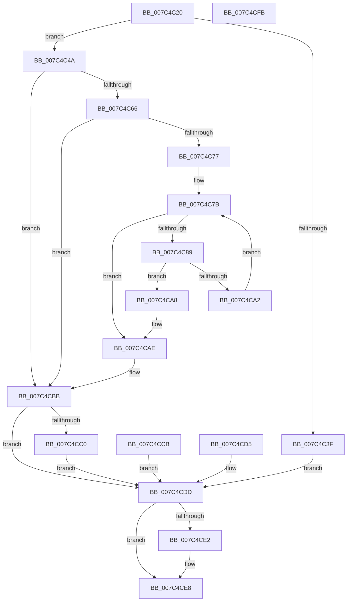

# ExpQueryNumaProximityNode

- RVA: `0x007C4C20`–`0x007C4CFC` (길이 `220` bytes)
- VA: `0x00000001407C4C20`
- 실행 섹션: `PAGE`
- PDB 이름 있음: `예`; PDB Function 태그: `아니요`
- unwind 정보 RVA: `0x000D42C4`
- 디코드: `60`개 명령, `220/220` bytes 표시
- 미해석 바이트: `0` (있으면 어셈블리에 `.byte`로 보존)

> 이 문서는 커널 이미지의 기계어와 PDB 기호를 분석해 생성했습니다. 4번과 5번은 함수 원형과 자료형을 바이너리 사용 방식에서 추정한 C 해석이며 원본 소스 복구 결과는 아닙니다.

## 1. Dependencies

- 직접 호출 지점: **1**; 고유 호출 대상: **1**
- 직접 호출자로 확인된 함수: **1**
- RIP 상대 이미지 참조: **3**

### Outgoing calls
- `0x007C4C6B` → [guard_dispatch_icall](../../text/6B/guard_dispatch_icall_function_006BAAD0.md) (function, `0x006BAAD0`)

### Direct callers
- [ExpQuerySystemInformation](../A5/ExpQuerySystemInformation_function_00A57858.md) at `0x00A59464`

### Static image references
- `0x007C4C5A` → RVA `0x00E66320` (`.data`; read)
- `0x007C4C7B` → RVA `0x00FC5000` (`ALMOSTRO`; read)
- `0x007C4C8D` → RVA `0x00FCF6C0` (`CACHEALI`; read)

## 2. Other-region calls and transfers

- 다른 실행 섹션으로 향하는 call: **1**
  - `0x007C4C6B` → [guard_dispatch_icall](../../text/6B/guard_dispatch_icall_function_006BAAD0.md) (`PAGE` → `.text`)
- 별도 외부 분기/꼬리 이동을 확인하지 못했습니다.

## 3. Assembly (complete function range)

```asm
007C4C20  48 89 5C 24 08                  mov qword ptr [rsp + 8], rbx
007C4C25  48 89 74 24 20                  mov qword ptr [rsp + 0x20], rsi
007C4C2A  4C 89 44 24 18                  mov qword ptr [rsp + 0x18], r8
007C4C2F  57                              push rdi
007C4C30  48 83 EC 40                     sub rsp, 0x40
007C4C34  49 8B F8                        mov rdi, r8
007C4C37  48 8B F1                        mov rsi, rcx
007C4C3A  83 FA 08                        cmp edx, 8
007C4C3D  73 0B                           jae 0x1407c4c4a
007C4C3F  41 B9 04 00 00 C0               mov r9d, 0xc0000004
007C4C45  E9 93 00 00 00                  jmp 0x1407c4cdd
007C4C4A  8B 09                           mov ecx, dword ptr [rcx]
007C4C4C  89 4C 24 24                     mov dword ptr [rsp + 0x24], ecx
007C4C50  33 DB                           xor ebx, ebx
007C4C52  44 8B CB                        mov r9d, ebx
007C4C55  66 89 5C 24 58                  mov word ptr [rsp + 0x58], bx
007C4C5A  48 8B 05 BF 16 6A 00            mov rax, qword ptr [rip + 0x6a16bf]
007C4C61  48 85 C0                        test rax, rax
007C4C64  74 55                           je 0x1407c4cbb
007C4C66  48 8D 54 24 58                  lea rdx, [rsp + 0x58]
007C4C6B  E8 60 5E EF FF                  call 0x1406baad0
007C4C70  44 8B C8                        mov r9d, eax
007C4C73  85 C0                           test eax, eax
007C4C75  78 44                           js 0x1407c4cbb
007C4C77  44 0F B7 C3                     movzx r8d, bx
007C4C7B  44 0F B7 15 7D 03 80 00         movzx r10d, word ptr [rip + 0x80037d]
007C4C83  66 45 3B C2                     cmp r8w, r10w
007C4C87  73 25                           jae 0x1407c4cae
007C4C89  41 0F B7 C8                     movzx ecx, r8w
007C4C8D  48 8D 15 2C AA 80 00            lea rdx, [rip + 0x80aa2c]
007C4C94  48 8B 14 CA                     mov rdx, qword ptr [rdx + rcx*8]
007C4C98  0F B7 44 24 58                  movzx eax, word ptr [rsp + 0x58]
007C4C9D  66 39 02                        cmp word ptr [rdx], ax
007C4CA0  74 06                           je 0x1407c4ca8
007C4CA2  66 41 FF C0                     inc r8w
007C4CA6  EB D3                           jmp 0x1407c4c7b
007C4CA8  66 44 89 44 24 58               mov word ptr [rsp + 0x58], r8w
007C4CAE  B8 E5 00 00 C0                  mov eax, 0xc00000e5
007C4CB3  66 45 3B C2                     cmp r8w, r10w
007C4CB7  44 0F 43 C8                     cmovae r9d, eax
007C4CBB  45 85 C9                        test r9d, r9d
007C4CBE  78 1D                           js 0x1407c4cdd
007C4CC0  0F B7 44 24 58                  movzx eax, word ptr [rsp + 0x58]
007C4CC5  66 89 46 04                     mov word ptr [rsi + 4], ax
007C4CC9  EB 12                           jmp 0x1407c4cdd
007C4CCB  44 8B C8                        mov r9d, eax
007C4CCE  48 8B 7C 24 60                  mov rdi, qword ptr [rsp + 0x60]
007C4CD3  EB 08                           jmp 0x1407c4cdd
007C4CD5  44 8B C8                        mov r9d, eax
007C4CD8  48 8B 7C 24 60                  mov rdi, qword ptr [rsp + 0x60]
007C4CDD  48 85 FF                        test rdi, rdi
007C4CE0  74 06                           je 0x1407c4ce8
007C4CE2  C7 07 08 00 00 00               mov dword ptr [rdi], 8
007C4CE8  41 8B C1                        mov eax, r9d
007C4CEB  48 8B 5C 24 50                  mov rbx, qword ptr [rsp + 0x50]
007C4CF0  48 8B 74 24 68                  mov rsi, qword ptr [rsp + 0x68]
007C4CF5  48 83 C4 40                     add rsp, 0x40
007C4CF9  5F                              pop rdi
007C4CFA  C3                              ret
007C4CFB  CC                              int3
```

## 4. C-style interpretation (structured pseudocode)

```c
__int64 __fastcall ExpQueryNumaProximityNode(__int64 a1, int a2, __int64 a3)
{
    __int64 result;
    __int64 v_rbx;
    __int64 v_rsp;
    unsigned int v_stack_m24;
    unsigned __int16 v_stack_p10;
    unsigned __int64 v_stack_p18;
    unsigned __int64 v_stack_p20;
    unsigned __int64 v_stack_p8;

    v_stack_p8 = v_rbx;
    v_stack_p20 = v_rsi;
    v_stack_p18 = a3;
    v_rsp = (v_rsp) - (64);
    if (a2 >= 8) goto loc_007C4C4A;
    goto loc_007C4CDD;
loc_007C4C4A:
    v_stack_m24 = (unsigned int)((unsigned int)(*(unsigned int *)(a1)));
    v_rbx = 0;
    v_stack_p10 = 0;
    if (*(unsigned __int64 *)(v_rip + 6952639) == 0) goto loc_007C4CBB;
    result = guard_dispatch_icall((unsigned int)(*(unsigned int *)(a1)), v_stack_p10, a3, 0);
    if (sign_flag) goto loc_007C4CBB;
loc_007C4C7B:
    if (0 >= ((unsigned __int16)(*(unsigned __int16 *)(v_rip + 8389501)))) goto loc_007C4CAE;
    if ((*(unsigned __int16 *)(*(unsigned __int64 *)(v_rip + 8432172 + 0 * 8))) == ((unsigned __int16)(v_stack_p10))) goto loc_007C4CA8;
    a3 = (unsigned __int16)((0) + 1);
    goto loc_007C4C7B;
loc_007C4CA8:
    v_stack_p10 = (unsigned __int16)(a3);
loc_007C4CAE:
    a4 = (unsigned int)((unsigned int)(result));
    if (((unsigned __int16)(a3)) >= ((unsigned __int16)(*(unsigned __int16 *)(v_rip + 8389501)))) { a4 = (unsigned int)((unsigned int)(0xC00000E5ULL)); }
loc_007C4CBB:
    if (sign_flag) goto loc_007C4CDD;
    *(unsigned __int16 *)(a1 + 4) = (unsigned __int16)(v_stack_p10);
    goto loc_007C4CDD;
loc_007C4CDD:
    if (a3 != 0) {
        *(unsigned int *)(a3) = 8;
    }
    v_rsp = (v_rsp) + (64);
    return (unsigned int)((unsigned int)(a4));
}
```

## 5. (Beta) C Style

```c
int64_t ExpQueryNumaProximityNode(void *Arg1, int32_t Arg2, int64_t Arg3)
{
    uint8_t *arg1 = (uint8_t *)Arg1;

    int64_t result;
    int64_t local_rbx;
    int64_t local_rsp;
    uint32_t v_stack_m24;
    uint16_t v_stack_p10;
    uint64_t v_stack_p18;
    uint64_t v_stack_p20;
    uint64_t v_stack_p8;

    v_stack_p8 = local_rbx;
    v_stack_p20 = local_rsi;
    v_stack_p18 = Arg3;
    local_rsp = (local_rsp) - (64);
    if (Arg2 >= 8) goto loc_007C4C4A;
    goto loc_007C4CDD;
loc_007C4C4A:
    v_stack_m24 = (uint32_t)((uint32_t)(*(uint32_t *)(arg1)));
    local_rbx = 0;
    v_stack_p10 = 0;
    if (*(uint64_t *)(v_rip + 0x6A16BF) == 0) goto loc_007C4CBB;
    result = guard_dispatch_icall((uint32_t)(*(uint32_t *)(arg1)), v_stack_p10, Arg3, 0);
    if (sign_flag) goto loc_007C4CBB;
loc_007C4C7B:
    if (0 >= ((uint16_t)(*(uint16_t *)(v_rip + 0x80037D)))) goto loc_007C4CAE;
    if ((*(uint16_t *)(*(uint64_t *)(v_rip + 0x80AA2C + 0x0 * 8))) == ((uint16_t)(v_stack_p10))) goto loc_007C4CA8;
    Arg3 = (uint16_t)((0) + 1);
    goto loc_007C4C7B;
loc_007C4CA8:
    v_stack_p10 = (uint16_t)(Arg3);
loc_007C4CAE:
    a4 = (uint32_t)((uint32_t)(result));
    if (((uint16_t)(Arg3)) >= ((uint16_t)(*(uint16_t *)(v_rip + 0x80037D)))) { a4 = (uint32_t)((uint32_t)(0xC00000E5ULL)); }
loc_007C4CBB:
    if (sign_flag) goto loc_007C4CDD;
    *(uint16_t *)(arg1 + 0x4) = (uint16_t)(v_stack_p10);
    goto loc_007C4CDD;
loc_007C4CDD:
    if (Arg3 != 0) {
        *(uint32_t *)(Arg3) = 8;
    }
    local_rsp = (local_rsp) + (64);
    return (uint32_t)((uint32_t)(a4));
}
```

### 관측된 메모리 오프셋

구조체 형식이 확인되지 않은 접근은 인자 기준의 오프셋으로만 기록했습니다.

| 기준 인자 | 오프셋 표현 | 폭 (bit) | 접근 |
|---|---:|---:|---|
| `Arg1` | `+ 0x0` | `32` | `R` |
| `Arg1` | `+ 0x4` | `16` | `W` |

## 6. Execution-region graph

[열기: 2D/3D 그래프와 함수 탐색 컨트롤 패널](../../../control-panel.html?section=page&rva=0x007C4C20&view=graph)

- 2D 그래프는 위에서 아래로 흐르고, 3D 그래프는 빈 공간을 드래그해 회전합니다. Shift+드래그는 이동, 휠은 확대·축소, 함수 노드 선택은 대상 보고서 이동입니다.

### Static fallback


