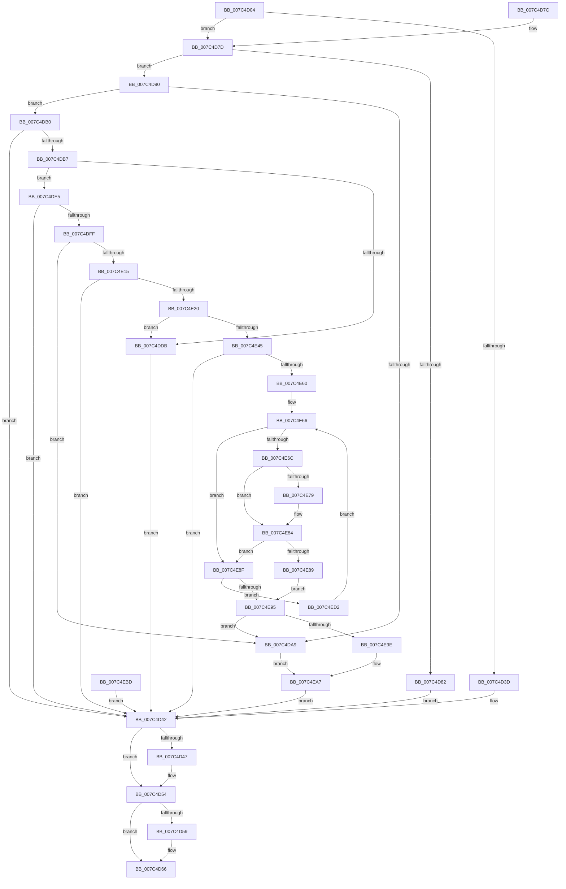

# ExpQueryPortableWorkspaceEfiLauncherInformation

- RVA: `0x007C4D04`–`0x007C4ED7` (길이 `467` bytes)
- VA: `0x00000001407C4D04`
- 실행 섹션: `PAGE`
- PDB 이름 있음: `예`; PDB Function 태그: `아니요`
- unwind 정보 RVA: `0x000D40F4`
- 디코드: `128`개 명령, `467/467` bytes 표시
- 미해석 바이트: `0` (있으면 어셈블리에 `.byte`로 보존)

> 이 문서는 커널 이미지의 기계어와 PDB 기호를 분석해 생성했습니다. 4번과 5번은 함수 원형과 자료형을 바이너리 사용 방식에서 추정한 C 해석이며 원본 소스 복구 결과는 아닙니다.

## 1. Dependencies

- 직접 호출 지점: **8**; 고유 호출 대상: **4**
- 직접 호출자로 확인된 함수: **1**
- RIP 상대 이미지 참조: **3**

### Outgoing calls
- `0x007C4D4F` → [ExFreePoolWithTag](../../poolcode/B8/ExFreePoolWithTag_function_00B82870.md) (function, `0x00B82870`)
- `0x007C4D61` → [ExFreePoolWithTag](../../poolcode/B8/ExFreePoolWithTag_function_00B82870.md) (function, `0x00B82870`)
- `0x007C4D9A` → [ZwEnumerateBootEntries](../../text/6A/ZwEnumerateBootEntries_function_006AEDB0.md) (function, `0x006AEDB0`)
- `0x007C4DC9` → [ExAllocatePool2](../../poolcode/B8/ExAllocatePool2_function_00B820F0.md) (function, `0x00B820F0`)
- `0x007C4DF0` → [ZwEnumerateBootEntries](../../text/6A/ZwEnumerateBootEntries_function_006AEDB0.md) (function, `0x006AEDB0`)
- `0x007C4E06` → [ZwQueryBootEntryOrder](../../text/6A/ZwQueryBootEntryOrder_function_006AFA30.md) (function, `0x006AFA30`)
- `0x007C4E33` → [ExAllocatePool2](../../poolcode/B8/ExAllocatePool2_function_00B820F0.md) (function, `0x00B820F0`)
- `0x007C4E4D` → [ZwQueryBootEntryOrder](../../text/6A/ZwQueryBootEntryOrder_function_006AFA30.md) (function, `0x006AFA30`)

### Direct callers
- [ExpQuerySystemInformation](../A5/ExpQuerySystemInformation_function_00A57858.md) at `0x00A5A0D7`

### Static image references
- `0x007C4D34` → RVA `0x00EFF050` (`.data`; read)
- `0x007C4E70` → RVA `0x00B55B58` (`PORTABLE_WORKSPACE_LAUNCHER_EFI_ENTRY_ID`; read)
- `0x007C4E7D` → RVA `0x00B55B60` (`PAGE`; read)

## 2. Other-region calls and transfers

- 다른 실행 섹션으로 향하는 call: **8**
  - `0x007C4D4F` → [ExFreePoolWithTag](../../poolcode/B8/ExFreePoolWithTag_function_00B82870.md) (`PAGE` → `POOLCODE`)
  - `0x007C4D61` → [ExFreePoolWithTag](../../poolcode/B8/ExFreePoolWithTag_function_00B82870.md) (`PAGE` → `POOLCODE`)
  - `0x007C4D9A` → [ZwEnumerateBootEntries](../../text/6A/ZwEnumerateBootEntries_function_006AEDB0.md) (`PAGE` → `.text`)
  - `0x007C4DC9` → [ExAllocatePool2](../../poolcode/B8/ExAllocatePool2_function_00B820F0.md) (`PAGE` → `POOLCODE`)
  - `0x007C4DF0` → [ZwEnumerateBootEntries](../../text/6A/ZwEnumerateBootEntries_function_006AEDB0.md) (`PAGE` → `.text`)
  - `0x007C4E06` → [ZwQueryBootEntryOrder](../../text/6A/ZwQueryBootEntryOrder_function_006AFA30.md) (`PAGE` → `.text`)
  - `0x007C4E33` → [ExAllocatePool2](../../poolcode/B8/ExAllocatePool2_function_00B820F0.md) (`PAGE` → `POOLCODE`)
  - `0x007C4E4D` → [ZwQueryBootEntryOrder](../../text/6A/ZwQueryBootEntryOrder_function_006AFA30.md) (`PAGE` → `.text`)
- 별도 외부 분기/꼬리 이동을 확인하지 못했습니다.

## 3. Assembly (complete function range)

```asm
007C4D04  48 8B C4                        mov rax, rsp
007C4D07  48 89 58 08                     mov qword ptr [rax + 8], rbx
007C4D0B  48 89 70 10                     mov qword ptr [rax + 0x10], rsi
007C4D0F  57                              push rdi
007C4D10  41 56                           push r14
007C4D12  41 57                           push r15
007C4D14  48 83 EC 50                     sub rsp, 0x50
007C4D18  4D 8B F0                        mov r14, r8
007C4D1B  4C 8B F9                        mov r15, rcx
007C4D1E  83 60 20 00                     and dword ptr [rax + 0x20], 0
007C4D22  83 60 C0 00                     and dword ptr [rax - 0x40], 0
007C4D26  33 F6                           xor esi, esi
007C4D28  48 89 74 24 30                  mov qword ptr [rsp + 0x30], rsi
007C4D2D  33 FF                           xor edi, edi
007C4D2F  48 89 7C 24 38                  mov qword ptr [rsp + 0x38], rdi
007C4D34  83 3D 15 A3 73 00 02            cmp dword ptr [rip + 0x73a315], 2
007C4D3B  74 40                           je 0x1407c4d7d
007C4D3D  BB 03 00 00 C0                  mov ebx, 0xc0000003
007C4D42  48 85 F6                        test rsi, rsi
007C4D45  74 0D                           je 0x1407c4d54
007C4D47  BA 49 6E 66 6F                  mov edx, 0x6f666e49
007C4D4C  48 8B CE                        mov rcx, rsi
007C4D4F  E8 1C DB 3B 00                  call 0x140b82870
007C4D54  48 85 FF                        test rdi, rdi
007C4D57  74 0D                           je 0x1407c4d66
007C4D59  BA 49 6E 66 6F                  mov edx, 0x6f666e49
007C4D5E  48 8B CF                        mov rcx, rdi
007C4D61  E8 0A DB 3B 00                  call 0x140b82870
007C4D66  8B C3                           mov eax, ebx
007C4D68  48 8B 5C 24 70                  mov rbx, qword ptr [rsp + 0x70]
007C4D6D  48 8B 74 24 78                  mov rsi, qword ptr [rsp + 0x78]
007C4D72  48 83 C4 50                     add rsp, 0x50
007C4D76  41 5F                           pop r15
007C4D78  41 5E                           pop r14
007C4D7A  5F                              pop rdi
007C4D7B  C3                              ret
007C4D7C  CC                              int3
007C4D7D  83 FA 01                        cmp edx, 1
007C4D80  74 0E                           je 0x1407c4d90
007C4D82  41 C7 00 01 00 00 00            mov dword ptr [r8], 1
007C4D89  BB 04 00 00 C0                  mov ebx, 0xc0000004
007C4D8E  EB B2                           jmp 0x1407c4d42
007C4D90  48 8D 94 24 88 00 00 00         lea rdx, [rsp + 0x88]
007C4D98  33 C9                           xor ecx, ecx
007C4D9A  E8 11 A0 EE FF                  call 0x1406aedb0
007C4D9F  8B D8                           mov ebx, eax
007C4DA1  89 44 24 24                     mov dword ptr [rsp + 0x24], eax
007C4DA5  85 C0                           test eax, eax
007C4DA7  78 07                           js 0x1407c4db0
007C4DA9  32 C0                           xor al, al
007C4DAB  E9 F7 00 00 00                  jmp 0x1407c4ea7
007C4DB0  3D 23 00 00 C0                  cmp eax, 0xc0000023
007C4DB5  75 8B                           jne 0x1407c4d42
007C4DB7  8B 94 24 88 00 00 00            mov edx, dword ptr [rsp + 0x88]
007C4DBE  B9 01 01 00 00                  mov ecx, 0x101
007C4DC3  41 B8 49 6E 66 6F               mov r8d, 0x6f666e49
007C4DC9  E8 22 D3 3B 00                  call 0x140b820f0
007C4DCE  48 8B F0                        mov rsi, rax
007C4DD1  48 89 44 24 30                  mov qword ptr [rsp + 0x30], rax
007C4DD6  48 85 C0                        test rax, rax
007C4DD9  75 0A                           jne 0x1407c4de5
007C4DDB  BB 9A 00 00 C0                  mov ebx, 0xc000009a
007C4DE0  E9 5D FF FF FF                  jmp 0x1407c4d42
007C4DE5  48 8D 94 24 88 00 00 00         lea rdx, [rsp + 0x88]
007C4DED  48 8B CE                        mov rcx, rsi
007C4DF0  E8 BB 9F EE FF                  call 0x1406aedb0
007C4DF5  8B D8                           mov ebx, eax
007C4DF7  85 C0                           test eax, eax
007C4DF9  0F 88 43 FF FF FF               js 0x1407c4d42
007C4DFF  48 8D 54 24 28                  lea rdx, [rsp + 0x28]
007C4E04  33 C9                           xor ecx, ecx
007C4E06  E8 25 AC EE FF                  call 0x1406afa30
007C4E0B  8B D8                           mov ebx, eax
007C4E0D  89 44 24 24                     mov dword ptr [rsp + 0x24], eax
007C4E11  85 C0                           test eax, eax
007C4E13  79 94                           jns 0x1407c4da9
007C4E15  3D 23 00 00 C0                  cmp eax, 0xc0000023
007C4E1A  0F 85 22 FF FF FF               jne 0x1407c4d42
007C4E20  8B 54 24 28                     mov edx, dword ptr [rsp + 0x28]
007C4E24  48 C1 E2 02                     shl rdx, 2
007C4E28  B9 01 01 00 00                  mov ecx, 0x101
007C4E2D  41 B8 49 6E 66 6F               mov r8d, 0x6f666e49
007C4E33  E8 B8 D2 3B 00                  call 0x140b820f0
007C4E38  48 8B F8                        mov rdi, rax
007C4E3B  48 89 44 24 38                  mov qword ptr [rsp + 0x38], rax
007C4E40  48 85 C0                        test rax, rax
007C4E43  74 96                           je 0x1407c4ddb
007C4E45  48 8D 54 24 28                  lea rdx, [rsp + 0x28]
007C4E4A  48 8B C8                        mov rcx, rax
007C4E4D  E8 DE AB EE FF                  call 0x1406afa30
007C4E52  8B D8                           mov ebx, eax
007C4E54  89 44 24 24                     mov dword ptr [rsp + 0x24], eax
007C4E58  85 C0                           test eax, eax
007C4E5A  0F 88 E2 FE FF FF               js 0x1407c4d42
007C4E60  45 33 C0                        xor r8d, r8d
007C4E63  48 8B CE                        mov rcx, rsi
007C4E66  83 79 1C 10                     cmp dword ptr [rcx + 0x1c], 0x10
007C4E6A  75 23                           jne 0x1407c4e8f
007C4E6C  48 8B 51 20                     mov rdx, qword ptr [rcx + 0x20]
007C4E70  48 2B 15 E1 0C 39 00            sub rdx, qword ptr [rip + 0x390ce1]
007C4E77  75 0B                           jne 0x1407c4e84
007C4E79  48 8B 51 28                     mov rdx, qword ptr [rcx + 0x28]
007C4E7D  48 2B 15 DC 0C 39 00            sub rdx, qword ptr [rip + 0x390cdc]
007C4E84  48 85 D2                        test rdx, rdx
007C4E87  75 06                           jne 0x1407c4e8f
007C4E89  4C 8D 41 04                     lea r8, [rcx + 4]
007C4E8D  EB 06                           jmp 0x1407c4e95
007C4E8F  8B 01                           mov eax, dword ptr [rcx]
007C4E91  85 C0                           test eax, eax
007C4E93  75 3D                           jne 0x1407c4ed2
007C4E95  4D 85 C0                        test r8, r8
007C4E98  0F 84 0B FF FF FF               je 0x1407c4da9
007C4E9E  8B 07                           mov eax, dword ptr [rdi]
007C4EA0  41 39 40 08                     cmp dword ptr [r8 + 8], eax
007C4EA4  0F 94 C0                        sete al
007C4EA7  90                              nop
007C4EA8  41 88 07                        mov byte ptr [r15], al
007C4EAB  41 C7 06 01 00 00 00            mov dword ptr [r14], 1
007C4EB2  33 DB                           xor ebx, ebx
007C4EB4  89 5C 24 24                     mov dword ptr [rsp + 0x24], ebx
007C4EB8  E9 85 FE FF FF                  jmp 0x1407c4d42
007C4EBD  8B D8                           mov ebx, eax
007C4EBF  89 44 24 24                     mov dword ptr [rsp + 0x24], eax
007C4EC3  48 8B 74 24 30                  mov rsi, qword ptr [rsp + 0x30]
007C4EC8  48 8B 7C 24 38                  mov rdi, qword ptr [rsp + 0x38]
007C4ECD  E9 70 FE FF FF                  jmp 0x1407c4d42
007C4ED2  48 03 C8                        add rcx, rax
007C4ED5  EB 8F                           jmp 0x1407c4e66
```

## 4. C-style interpretation (structured pseudocode)

```c
__int64 __fastcall ExpQueryPortableWorkspaceEfiLauncherInformation(__int64 a1, __int64 a2, __int64 a3)
{
    __int64 result;
    __int64 v_rbx;
    __int64 v_rdi;
    __int64 v_rsi;
    __int64 v_rsp;
    unsigned __int64 v_stack_m30;
    unsigned __int64 v_stack_m38;
    unsigned __int64 v_stack_p10;
    unsigned int v_stack_p24;
    unsigned __int64 v_stack_p28;
    unsigned __int64 v_stack_p30;
    unsigned __int64 v_stack_p38;
    unsigned __int64 v_stack_p8;
    unsigned __int64 v_stack_p88;

    *(unsigned __int64 *)(v_rsp + 8) = v_rbx;
    *(unsigned __int64 *)(v_rsp + 16) = v_rsi;
    v_rsp = (v_rsp) - (80);
    v_rsi = 0;
    v_stack_m38 = 0;
    v_rdi = 0;
    v_stack_m30 = 0;
    if ((*(unsigned int *)(v_rip + 7578389)) == 2) goto loc_007C4D7D;
loc_007C4D42:
    result = v_rsp;
    if (0 != 0) {
        a2 = 0x6F666E49ULL;
        a1 = 0;
        result = ExFreePoolWithTag(a1, a2, a3, a4);
    }
    if (0 != 0) {
        a2 = 0x6F666E49ULL;
        a1 = 0;
        result = ExFreePoolWithTag(a1, a2, a3, a4);
    }
    v_rsp = (v_rsp) + (80);
    return (unsigned int)((unsigned int)((unsigned int)(0xC0000003ULL)));
loc_007C4D7D:
    if (((unsigned int)(a2)) == 1) goto loc_007C4D90;
    *(unsigned int *)(a3) = 1;
    goto loc_007C4D42;
loc_007C4D90:
    a1 = 0;
    result = ZwEnumerateBootEntries(a1, v_stack_p88, a3, a4);
    v_stack_p24 = (unsigned int)(result);
    if (sign_flag) goto loc_007C4DB0;
loc_007C4DA9:
    result = 0;
    goto loc_007C4EA7;
loc_007C4DB0:
    if (0 != 0xC0000023ULL) goto loc_007C4D42;
    result = ExAllocatePool2(257, (unsigned int)(v_stack_p88), (unsigned int)(0x6F666E49ULL), a4);
    v_stack_p30 = result;
    if (result != 0) goto loc_007C4DE5;
loc_007C4DDB:
    goto loc_007C4D42;
loc_007C4DE5:
    result = ZwEnumerateBootEntries(result, v_stack_p88, (unsigned int)(0x6F666E49ULL), a4);
    if (sign_flag) goto loc_007C4D42;
    a1 = 0;
    result = ZwQueryBootEntryOrder(a1, v_stack_p28, (unsigned int)(0x6F666E49ULL), a4);
    v_stack_p24 = (unsigned int)(result);
    if (!sign_flag) goto loc_007C4DA9;
    if (((unsigned int)(result)) != 0xC0000023ULL) goto loc_007C4D42;
    a2 = ((unsigned int)(v_stack_p28)) << (2);
    result = ExAllocatePool2(257, a2, (unsigned int)(0x6F666E49ULL), a4);
    v_stack_p38 = result;
    if (result == 0) goto loc_007C4DDB;
    result = ZwQueryBootEntryOrder(result, v_stack_p28, (unsigned int)(0x6F666E49ULL), a4);
    v_stack_p24 = (unsigned int)(result);
    if (sign_flag) goto loc_007C4D42;
    a3 = 0;
loc_007C4E66:
    if ((*(unsigned int *)(result + 28)) != 16) goto loc_007C4E8F;
    a2 = (*(unsigned __int64 *)(result + 32)) - (*(unsigned __int64 *)(v_rip + 3738849));
    if (!(condition_is_not_equal)) {
        a2 = *(unsigned __int64 *)(result + 40);
        a2 = (a2) - (*(unsigned __int64 *)(v_rip + 3738844));
    }
    if (a2 != 0) goto loc_007C4E8F;
    goto loc_007C4E95;
loc_007C4E8F:
    if ((unsigned int)((unsigned int)(*(unsigned int *)(result))) != 0) goto loc_007C4ED2;
loc_007C4E95:
    if (result + 4 == 0) goto loc_007C4DA9;
    result = ((*(unsigned int *)(result + 4 + 8)) == ((unsigned int)((unsigned int)(*(unsigned int *)(result))))) ? 1 : 0;
loc_007C4EA7:
    *(unsigned __int8 *)(a1) = (unsigned __int8)(result);
    *(unsigned int *)(a3) = 1;
    v_rbx = 0;
    v_stack_p24 = 0;
    goto loc_007C4D42;
loc_007C4ED2:
    a1 = (result) + (result);
    goto loc_007C4E66;
}
```

## 5. (Beta) C Style

```c
int64_t ExpQueryPortableWorkspaceEfiLauncherInformation(void *Arg1, int64_t Arg2, void *Arg3)
{
    uint8_t *arg1 = (uint8_t *)Arg1;
    uint8_t *arg3 = (uint8_t *)Arg3;

    int64_t result;
    int64_t local_rbx;
    int64_t local_rdi;
    int64_t local_rsi;
    int64_t local_rsp;
    uint64_t v_stack_m30;
    uint64_t v_stack_m38;
    uint64_t v_stack_p10;
    uint32_t v_stack_p24;
    uint64_t v_stack_p28;
    uint64_t v_stack_p30;
    uint64_t v_stack_p38;
    uint64_t v_stack_p8;
    uint64_t v_stack_p88;

    *(uint64_t *)(local_rsp + 0x8) = local_rbx;
    *(uint64_t *)(local_rsp + 0x10) = local_rsi;
    local_rsp = (local_rsp) - (80);
    local_rsi = 0;
    v_stack_m38 = 0;
    local_rdi = 0;
    v_stack_m30 = 0;
    if ((*(uint32_t *)(v_rip + 0x73A315)) == 2) goto loc_007C4D7D;
loc_007C4D42:
    result = local_rsp;
    if (0 != 0) {
        Arg2 = 0x6F666E49ULL;
        Arg1 = 0;
        result = ExFreePoolWithTag(Arg1, Arg2, Arg3, a4);
    }
    if (0 != 0) {
        Arg2 = 0x6F666E49ULL;
        Arg1 = 0;
        result = ExFreePoolWithTag(Arg1, Arg2, Arg3, a4);
    }
    local_rsp = (local_rsp) + (80);
    return (uint32_t)((uint32_t)((uint32_t)(0xC0000003ULL)));
loc_007C4D7D:
    if (((uint32_t)(Arg2)) == 1) goto loc_007C4D90;
    *(uint32_t *)(arg3) = 1;
    goto loc_007C4D42;
loc_007C4D90:
    Arg1 = 0;
    result = ZwEnumerateBootEntries(Arg1, v_stack_p88, Arg3, a4);
    v_stack_p24 = (uint32_t)(result);
    if (sign_flag) goto loc_007C4DB0;
loc_007C4DA9:
    result = 0;
    goto loc_007C4EA7;
loc_007C4DB0:
    if (0 != 0xC0000023ULL) goto loc_007C4D42;
    result = ExAllocatePool2(257, (uint32_t)(v_stack_p88), (uint32_t)(0x6F666E49ULL), a4);
    v_stack_p30 = result;
    if (result != 0) goto loc_007C4DE5;
loc_007C4DDB:
    goto loc_007C4D42;
loc_007C4DE5:
    result = ZwEnumerateBootEntries(result, v_stack_p88, (uint32_t)(0x6F666E49ULL), a4);
    if (sign_flag) goto loc_007C4D42;
    Arg1 = 0;
    result = ZwQueryBootEntryOrder(Arg1, v_stack_p28, (uint32_t)(0x6F666E49ULL), a4);
    v_stack_p24 = (uint32_t)(result);
    if (!sign_flag) goto loc_007C4DA9;
    if (((uint32_t)(result)) != 0xC0000023ULL) goto loc_007C4D42;
    Arg2 = ((uint32_t)(v_stack_p28)) << (2);
    result = ExAllocatePool2(257, Arg2, (uint32_t)(0x6F666E49ULL), a4);
    v_stack_p38 = result;
    if (result == 0) goto loc_007C4DDB;
    result = ZwQueryBootEntryOrder(result, v_stack_p28, (uint32_t)(0x6F666E49ULL), a4);
    v_stack_p24 = (uint32_t)(result);
    if (sign_flag) goto loc_007C4D42;
    Arg3 = 0;
loc_007C4E66:
    if ((*(uint32_t *)(result + 0x1C)) != 16) goto loc_007C4E8F;
    Arg2 = (*(uint64_t *)(result + 0x20)) - (*(uint64_t *)(v_rip + 0x390CE1));
    if (!(condition_is_not_equal)) {
        Arg2 = *(uint64_t *)(result + 0x28);
        Arg2 = (Arg2) - (*(uint64_t *)(v_rip + 0x390CDC));
    }
    if (Arg2 != 0) goto loc_007C4E8F;
    goto loc_007C4E95;
loc_007C4E8F:
    if ((uint32_t)((uint32_t)(*(uint32_t *)(result))) != 0) goto loc_007C4ED2;
loc_007C4E95:
    if (result + 4 == 0) goto loc_007C4DA9;
    result = ((*(uint32_t *)(result + 0x4 + 0x8)) == ((uint32_t)((uint32_t)(*(uint32_t *)(result))))) ? 1 : 0;
loc_007C4EA7:
    *(uint8_t *)(arg1) = (uint8_t)(result);
    *(uint32_t *)(arg3) = 1;
    local_rbx = 0;
    v_stack_p24 = 0;
    goto loc_007C4D42;
loc_007C4ED2:
    Arg1 = (result) + (result);
    goto loc_007C4E66;
}
```

### 관측된 메모리 오프셋

구조체 형식이 확인되지 않은 접근은 인자 기준의 오프셋으로만 기록했습니다.

| 기준 인자 | 오프셋 표현 | 폭 (bit) | 접근 |
|---|---:|---:|---|
| `Arg1` | `+ 0x0` | `8` | `W` |
| `Arg3` | `+ 0x0` | `32` | `W` |

## 6. Execution-region graph

[열기: 2D/3D 그래프와 함수 탐색 컨트롤 패널](../../../control-panel.html?section=page&rva=0x007C4D04&view=graph)

- 2D 그래프는 위에서 아래로 흐르고, 3D 그래프는 빈 공간을 드래그해 회전합니다. Shift+드래그는 이동, 휠은 확대·축소, 함수 노드 선택은 대상 보고서 이동입니다.

### Static fallback


