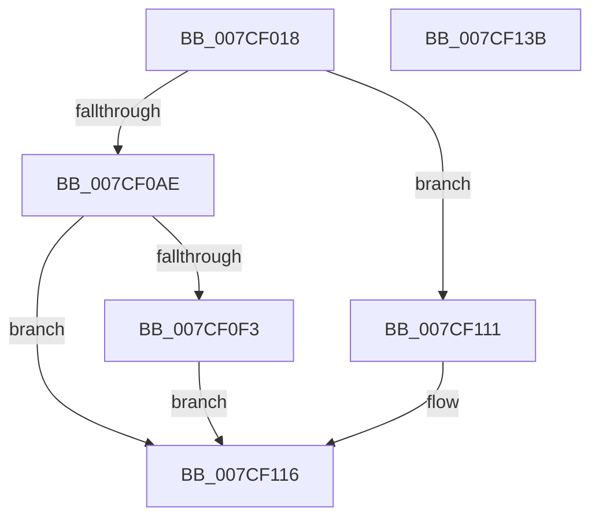

# ExpQueryPrmInterface

- RVA: `0x007CF018`–`0x007CF13C` (길이 `292` bytes)
- VA: `0x00000001407CF018`
- 실행 섹션: `PAGE`
- PDB 이름 있음: `예`; PDB Function 태그: `아니요`
- unwind 정보 RVA: `0x000C4F78`
- 디코드: `74`개 명령, `292/292` bytes 표시
- 미해석 바이트: `0` (있으면 어셈블리에 `.byte`로 보존)

> 이 문서는 커널 이미지의 기계어와 PDB 기호를 분석해 생성했습니다. 4번과 5번은 함수 원형과 자료형을 바이너리 사용 방식에서 추정한 C 해석이며 원본 소스 복구 결과는 아닙니다.

## 1. Dependencies

- 직접 호출 지점: **7**; 고유 호출 대상: **7**
- 직접 호출자로 확인된 함수: **1**
- RIP 상대 이미지 참조: **1**

### Outgoing calls
- `0x007CF058` → [memset](../../text/6C/memset_function_006C6C40.md) (function, `0x006C6C40`)
- `0x007CF06D` → [KeInitializeEvent](../../text/40/KeInitializeEvent_function_0040DD10.md) (function, `0x0040DD10`)
- `0x007CF075` → [IoGetAttachedDeviceReference](../../text/41/IoGetAttachedDeviceReference_function_0041D940.md) (function, `0x0041D940`)
- `0x007CF0A4` → [IoBuildSynchronousFsdRequest](../A4/IoBuildSynchronousFsdRequest_function_00A49880.md) (function, `0x00A49880`)
- `0x007CF0E5` → [IofCallDriver](../../text/29/IofCallDriver_function_0029B4B0.md) (function, `0x0029B4B0`)
- `0x007CF106` → [KeWaitForSingleObject](../../text/20/KeWaitForSingleObject_function_0020E6B0.md) (function, `0x0020E6B0`)
- `0x007CF119` → [ObfDereferenceObject](../../text/2F/ObfDereferenceObject_function_002F9350.md) (function, `0x002F9350`)

### Direct callers
- [ExpAcquirePrmInterface](ExpAcquirePrmInterface_function_007CECA8.md) at `0x007CED83`

### Static image references
- `0x007CF0B5` → RVA `0x00038FD8` (`.rdata`; read)

## 2. Other-region calls and transfers

- 다른 실행 섹션으로 향하는 call: **6**
  - `0x007CF058` → [memset](../../text/6C/memset_function_006C6C40.md) (`PAGE` → `.text`)
  - `0x007CF06D` → [KeInitializeEvent](../../text/40/KeInitializeEvent_function_0040DD10.md) (`PAGE` → `.text`)
  - `0x007CF075` → [IoGetAttachedDeviceReference](../../text/41/IoGetAttachedDeviceReference_function_0041D940.md) (`PAGE` → `.text`)
  - `0x007CF0E5` → [IofCallDriver](../../text/29/IofCallDriver_function_0029B4B0.md) (`PAGE` → `.text`)
  - `0x007CF106` → [KeWaitForSingleObject](../../text/20/KeWaitForSingleObject_function_0020E6B0.md) (`PAGE` → `.text`)
  - `0x007CF119` → [ObfDereferenceObject](../../text/2F/ObfDereferenceObject_function_002F9350.md) (`PAGE` → `.text`)
- 별도 외부 분기/꼬리 이동을 확인하지 못했습니다.

## 3. Assembly (complete function range)

```asm
007CF018  4C 8B DC                        mov r11, rsp
007CF01B  49 89 5B 08                     mov qword ptr [r11 + 8], rbx
007CF01F  49 89 73 10                     mov qword ptr [r11 + 0x10], rsi
007CF023  49 89 7B 18                     mov qword ptr [r11 + 0x18], rdi
007CF027  4D 89 73 20                     mov qword ptr [r11 + 0x20], r14
007CF02B  41 57                           push r15
007CF02D  48 83 EC 70                     sub rsp, 0x70
007CF031  48 8B B4 24 A0 00 00 00         mov rsi, qword ptr [rsp + 0xa0]
007CF039  33 C0                           xor eax, eax
007CF03B  0F 57 C0                        xorps xmm0, xmm0
007CF03E  48 8B D9                        mov rbx, rcx
007CF041  0F 11 44 24 50                  movups xmmword ptr [rsp + 0x50], xmm0
007CF046  33 D2                           xor edx, edx
007CF048  49 89 43 E8                     mov qword ptr [r11 - 0x18], rax
007CF04C  44 8D 40 40                     lea r8d, [rax + 0x40]
007CF050  48 8B CE                        mov rcx, rsi
007CF053  0F 11 44 24 40                  movups xmmword ptr [rsp + 0x40], xmm0
007CF058  E8 E3 7B EF FF                  call 0x1406c6c40
007CF05D  45 33 C0                        xor r8d, r8d
007CF060  C7 06 40 00 01 00               mov dword ptr [rsi], 0x10040
007CF066  33 D2                           xor edx, edx
007CF068  48 8D 4C 24 50                  lea rcx, [rsp + 0x50]
007CF06D  E8 9E EC C3 FF                  call 0x14040dd10
007CF072  48 8B CB                        mov rcx, rbx
007CF075  E8 C6 E8 C4 FF                  call 0x14041d940
007CF07A  48 8B F8                        mov rdi, rax
007CF07D  45 33 C9                        xor r9d, r9d
007CF080  48 8D 44 24 40                  lea rax, [rsp + 0x40]
007CF085  45 33 C0                        xor r8d, r8d
007CF088  48 89 44 24 30                  mov qword ptr [rsp + 0x30], rax
007CF08D  48 8B D7                        mov rdx, rdi
007CF090  48 8D 44 24 50                  lea rax, [rsp + 0x50]
007CF095  48 89 44 24 28                  mov qword ptr [rsp + 0x28], rax
007CF09A  41 8D 49 1B                     lea ecx, [r9 + 0x1b]
007CF09E  48 83 64 24 20 00               and qword ptr [rsp + 0x20], 0
007CF0A4  E8 D7 A7 27 00                  call 0x140a49880
007CF0A9  48 85 C0                        test rax, rax
007CF0AC  74 63                           je 0x1407cf111
007CF0AE  48 8B 88 B8 00 00 00            mov rcx, qword ptr [rax + 0xb8]
007CF0B5  48 8D 15 1C 9F 86 FF            lea rdx, [rip - 0x7960e4]
007CF0BC  C6 40 40 00                     mov byte ptr [rax + 0x40], 0
007CF0C0  C7 40 30 BB 00 00 C0            mov dword ptr [rax + 0x30], 0xc00000bb
007CF0C7  48 83 61 D8 00                  and qword ptr [rcx - 0x28], 0
007CF0CC  48 89 51 C0                     mov qword ptr [rcx - 0x40], rdx
007CF0D0  48 8B D0                        mov rdx, rax
007CF0D3  C6 41 B9 08                     mov byte ptr [rcx - 0x47], 8
007CF0D7  C7 41 C8 40 00 01 00            mov dword ptr [rcx - 0x38], 0x10040
007CF0DE  48 89 71 D0                     mov qword ptr [rcx - 0x30], rsi
007CF0E2  48 8B CF                        mov rcx, rdi
007CF0E5  E8 C6 C3 AC FF                  call 0x14029b4b0
007CF0EA  8B D8                           mov ebx, eax
007CF0EC  3D 03 01 00 00                  cmp eax, 0x103
007CF0F1  75 23                           jne 0x1407cf116
007CF0F3  48 83 64 24 20 00               and qword ptr [rsp + 0x20], 0
007CF0F9  48 8D 4C 24 50                  lea rcx, [rsp + 0x50]
007CF0FE  45 33 C9                        xor r9d, r9d
007CF101  45 33 C0                        xor r8d, r8d
007CF104  33 D2                           xor edx, edx
007CF106  E8 A5 F5 A3 FF                  call 0x14020e6b0
007CF10B  8B 5C 24 40                     mov ebx, dword ptr [rsp + 0x40]
007CF10F  EB 05                           jmp 0x1407cf116
007CF111  BB 9A 00 00 C0                  mov ebx, 0xc000009a
007CF116  48 8B CF                        mov rcx, rdi
007CF119  E8 32 A2 B2 FF                  call 0x1402f9350
007CF11E  4C 8D 5C 24 70                  lea r11, [rsp + 0x70]
007CF123  8B C3                           mov eax, ebx
007CF125  49 8B 5B 10                     mov rbx, qword ptr [r11 + 0x10]
007CF129  49 8B 73 18                     mov rsi, qword ptr [r11 + 0x18]
007CF12D  49 8B 7B 20                     mov rdi, qword ptr [r11 + 0x20]
007CF131  4D 8B 73 28                     mov r14, qword ptr [r11 + 0x28]
007CF135  49 8B E3                        mov rsp, r11
007CF138  41 5F                           pop r15
007CF13A  C3                              ret
007CF13B  CC                              int3
```

## 4. C-style interpretation (structured pseudocode)

```c
__int64 __fastcall ExpQueryPrmInterface(__int64 a1, int a2, __int64 a3, int a4, __int64 a5)
{
    __int64 result;
    __int64 v_rsp;
    unsigned __int64 v_stack_m28;
    unsigned __int64 v_stack_m38;
    unsigned __int64 v_stack_m48;
    unsigned __int64 v_stack_m50;
    unsigned __int64 v_stack_m58;
    unsigned __int64 v_stack_m8;

    *(unsigned __int64 *)(v_rsp + 8) = v_rbx;
    *(unsigned __int64 *)(v_rsp + 16) = v_rsi;
    *(unsigned __int64 *)(v_rsp + 24) = v_rdi;
    *(unsigned __int64 *)(v_rsp + 32) = v_r14;
    v_rsp = (v_rsp) - (112);
    result = 0;
    v_stack_m28 = v_xmm0;
    a2 = 0;
    *(unsigned __int64 *)(v_rsp - 24) = 0;
    v_stack_m38 = v_xmm0;
    result = memset(a5, a2, result + 64, a4);
    a3 = 0;
    *(unsigned int *)(a5) = 0x10040ULL;
    a2 = 0;
    result = KeInitializeEvent(v_stack_m28, a2, a3, a4);
    result = IoGetAttachedDeviceReference(a1, a2, a3, a4);
    a4 = 0;
    a3 = 0;
    v_stack_m48 = v_stack_m38;
    v_stack_m50 = v_stack_m28;
    result = IoBuildSynchronousFsdRequest(a4 + 27, result, a3, a4);
    if (result == 0) goto loc_007CF111;
    *(unsigned __int8 *)(result + 64) = 0;
    *(unsigned int *)(result + 48) = 0xC00000BBULL;
    *(unsigned __int64 *)(*(unsigned __int64 *)(result + 184) - 64) = v_rip - 7954660;
    *(unsigned __int8 *)(*(unsigned __int64 *)(result + 184) - 71) = 8;
    *(unsigned int *)(*(unsigned __int64 *)(result + 184) - 56) = 0x10040ULL;
    *(unsigned __int64 *)(*(unsigned __int64 *)(result + 184) - 48) = a5;
    result = IofCallDriver(result, result, a3, a4);
    if (((unsigned int)(result)) != 259) goto loc_007CF116;
    a4 = 0;
    a3 = 0;
    a2 = 0;
    result = KeWaitForSingleObject(v_stack_m28, a2, a3, a4);
    goto loc_007CF116;
loc_007CF111:
loc_007CF116:
    result = ObfDereferenceObject(result, a2, a3, a4);
    return (unsigned int)((unsigned int)((unsigned int)(0xC000009AULL)));
}
```

## 5. (Beta) C Style

```c
int64_t ExpQueryPrmInterface(int64_t Arg1, int32_t Arg2, int64_t Arg3, int32_t Arg4, void *Arg5)
{
    uint8_t *arg5 = (uint8_t *)Arg5;

    int64_t result;
    int64_t local_rsp;
    uint64_t v_stack_m28;
    uint64_t v_stack_m38;
    uint64_t v_stack_m48;
    uint64_t v_stack_m50;
    uint64_t v_stack_m58;
    uint64_t v_stack_m8;

    *(uint64_t *)(local_rsp + 0x8) = local_rbx;
    *(uint64_t *)(local_rsp + 0x10) = local_rsi;
    *(uint64_t *)(local_rsp + 0x18) = local_rdi;
    *(uint64_t *)(local_rsp + 0x20) = local_r14;
    local_rsp = (local_rsp) - (112);
    result = 0;
    v_stack_m28 = v_xmm0;
    Arg2 = 0;
    *(uint64_t *)(local_rsp - 0x18) = 0;
    v_stack_m38 = v_xmm0;
    result = memset(Arg5, Arg2, result + 64, Arg4);
    Arg3 = 0;
    *(uint32_t *)(arg5) = 0x10040ULL;
    Arg2 = 0;
    result = KeInitializeEvent(v_stack_m28, Arg2, Arg3, Arg4);
    result = IoGetAttachedDeviceReference(Arg1, Arg2, Arg3, Arg4);
    Arg4 = 0;
    Arg3 = 0;
    v_stack_m48 = v_stack_m38;
    v_stack_m50 = v_stack_m28;
    result = IoBuildSynchronousFsdRequest(Arg4 + 27, result, Arg3, Arg4);
    if (result == 0) goto loc_007CF111;
    *(uint8_t *)(result + 0x40) = 0;
    *(uint32_t *)(result + 0x30) = 0xC00000BBULL;
    *(uint64_t *)(*(uint64_t *)(result + 0xB8) - 0x40) = v_rip - 7954660;
    *(uint8_t *)(*(uint64_t *)(result + 0xB8) - 0x47) = 8;
    *(uint32_t *)(*(uint64_t *)(result + 0xB8) - 0x38) = 0x10040ULL;
    *(void **)(*(uint64_t *)(result + 0xB8) - 0x30) = Arg5;
    result = IofCallDriver(result, result, Arg3, Arg4);
    if (((uint32_t)(result)) != 259) goto loc_007CF116;
    Arg4 = 0;
    Arg3 = 0;
    Arg2 = 0;
    result = KeWaitForSingleObject(v_stack_m28, Arg2, Arg3, Arg4);
    goto loc_007CF116;
loc_007CF111:
loc_007CF116:
    result = ObfDereferenceObject(result, Arg2, Arg3, Arg4);
    return (uint32_t)((uint32_t)((uint32_t)(0xC000009AULL)));
}
```

### 관측된 메모리 오프셋

구조체 형식이 확인되지 않은 접근은 인자 기준의 오프셋으로만 기록했습니다.

| 기준 인자 | 오프셋 표현 | 폭 (bit) | 접근 |
|---|---:|---:|---|
| `Arg5` | `+ 0x0` | `32` | `W` |

## 6. Execution-region graph

[열기: 2D/3D 그래프와 함수 탐색 컨트롤 패널](../../../control-panel.html?section=page&rva=0x007CF018&view=graph)

- 2D 그래프는 위에서 아래로 흐르고, 3D 그래프는 빈 공간을 드래그해 회전합니다. Shift+드래그는 이동, 휠은 확대·축소, 함수 노드 선택은 대상 보고서 이동입니다.

### Static fallback


