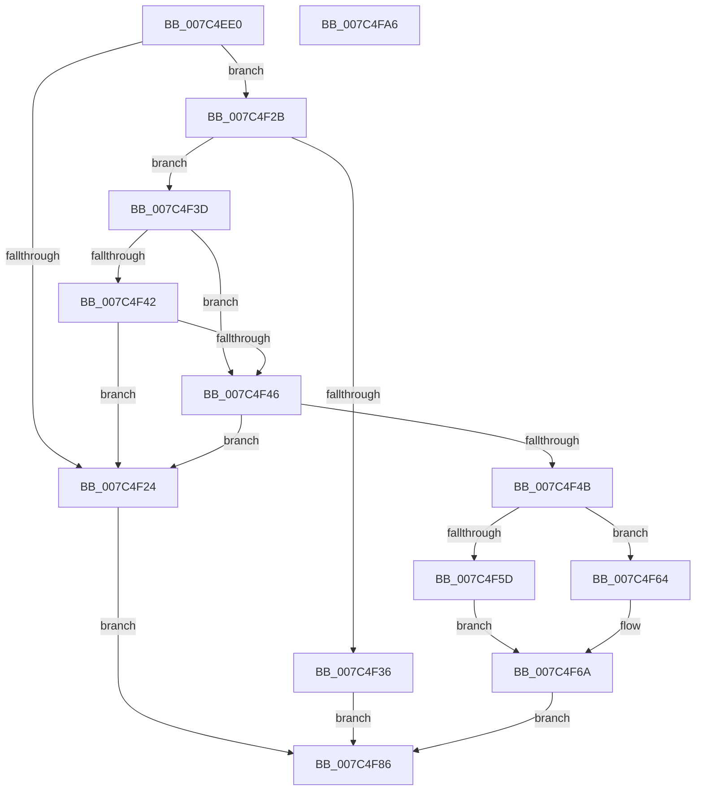

# ExpQueryRuntimeAttestationReport

- RVA: `0x007C4EE0`–`0x007C4FA7` (길이 `199` bytes)
- VA: `0x00000001407C4EE0`
- 실행 섹션: `PAGE`
- PDB 이름 있음: `예`; PDB Function 태그: `아니요`
- unwind 정보 RVA: `0x000D401C`
- 디코드: `54`개 명령, `199/199` bytes 표시
- 미해석 바이트: `0` (있으면 어셈블리에 `.byte`로 보존)

> 이 문서는 커널 이미지의 기계어와 PDB 기호를 분석해 생성했습니다. 4번과 5번은 함수 원형과 자료형을 바이너리 사용 방식에서 추정한 C 해석이며 원본 소스 복구 결과는 아닙니다.

## 1. Dependencies

- 직접 호출 지점: **4**; 고유 호출 대상: **4**
- 직접 호출자로 확인된 함수: **1**
- RIP 상대 이미지 참조: **1**

### Outgoing calls
- `0x007C4F5D` → [RtlCopyFromUser](../../text/4F/RtlCopyFromUser_function_004FDAE8.md) (function, `0x004FDAE8`)
- `0x007C4F64` → [RtlCopyVolatileMemory](../../text/6B/RtlCopyVolatileMemory_function_006BC9D0.md) (function, `0x006BC9D0`)
- `0x007C4F7F` → [VslQueryRuntimeAttestationReport](../71/VslQueryRuntimeAttestationReport_function_00719100.md) (function, `0x00719100`)
- `0x007C4F8E` → [_security_check_cookie](../../text/6A/_security_check_cookie_function_006AC640.md) (function, `0x006AC640`)

### Direct callers
- [ExpQuerySystemInformation](../A5/ExpQuerySystemInformation_function_00A57858.md) at `0x00A5B730`

### Static image references
- `0x007C4EF0` → RVA `0x00E0A740` (`.data`; read)

## 2. Other-region calls and transfers

- 다른 실행 섹션으로 향하는 call: **3**
  - `0x007C4F5D` → [RtlCopyFromUser](../../text/4F/RtlCopyFromUser_function_004FDAE8.md) (`PAGE` → `.text`)
  - `0x007C4F64` → [RtlCopyVolatileMemory](../../text/6B/RtlCopyVolatileMemory_function_006BC9D0.md) (`PAGE` → `.text`)
  - `0x007C4F8E` → [_security_check_cookie](../../text/6A/_security_check_cookie_function_006AC640.md) (`PAGE` → `.text`)
- 별도 외부 분기/꼬리 이동을 확인하지 못했습니다.

## 3. Assembly (complete function range)

```asm
007C4EE0  48 89 74 24 10                  mov qword ptr [rsp + 0x10], rsi
007C4EE5  48 89 7C 24 20                  mov qword ptr [rsp + 0x20], rdi
007C4EEA  41 56                           push r14
007C4EEC  48 83 EC 60                     sub rsp, 0x60
007C4EF0  48 8B 05 49 58 64 00            mov rax, qword ptr [rip + 0x645849]
007C4EF7  48 33 C4                        xor rax, rsp
007C4EFA  48 89 44 24 50                  mov qword ptr [rsp + 0x50], rax
007C4EFF  41 8B F1                        mov esi, r9d
007C4F02  4D 8B F0                        mov r14, r8
007C4F05  48 8B BC 24 90 00 00 00         mov rdi, qword ptr [rsp + 0x90]
007C4F0D  0F 57 C0                        xorps xmm0, xmm0
007C4F10  0F 11 44 24 20                  movups xmmword ptr [rsp + 0x20], xmm0
007C4F15  0F 11 44 24 30                  movups xmmword ptr [rsp + 0x30], xmm0
007C4F1A  0F 11 44 24 40                  movups xmmword ptr [rsp + 0x40], xmm0
007C4F1F  48 85 C9                        test rcx, rcx
007C4F22  75 07                           jne 0x1407c4f2b
007C4F24  B8 0D 00 00 C0                  mov eax, 0xc000000d
007C4F29  EB 5B                           jmp 0x1407c4f86
007C4F2B  41 B8 30 00 00 00               mov r8d, 0x30
007C4F31  41 3B D0                        cmp edx, r8d
007C4F34  74 07                           je 0x1407c4f3d
007C4F36  B8 04 00 00 C0                  mov eax, 0xc0000004
007C4F3B  EB 49                           jmp 0x1407c4f86
007C4F3D  4D 85 F6                        test r14, r14
007C4F40  75 04                           jne 0x1407c4f46
007C4F42  85 F6                           test esi, esi
007C4F44  75 DE                           jne 0x1407c4f24
007C4F46  48 85 FF                        test rdi, rdi
007C4F49  74 D9                           je 0x1407c4f24
007C4F4B  48 8B D1                        mov rdx, rcx
007C4F4E  48 8D 4C 24 20                  lea rcx, [rsp + 0x20]
007C4F53  80 BC 24 98 00 00 00 00         cmp byte ptr [rsp + 0x98], 0
007C4F5B  74 07                           je 0x1407c4f64
007C4F5D  E8 86 8B D3 FF                  call 0x1404fdae8
007C4F62  EB 06                           jmp 0x1407c4f6a
007C4F64  E8 67 7A EF FF                  call 0x1406bc9d0
007C4F69  90                              nop
007C4F6A  89 37                           mov dword ptr [rdi], esi
007C4F6C  44 8A 8C 24 98 00 00 00         mov r9b, byte ptr [rsp + 0x98]
007C4F74  4C 8B C7                        mov r8, rdi
007C4F77  49 8B D6                        mov rdx, r14
007C4F7A  48 8D 4C 24 20                  lea rcx, [rsp + 0x20]
007C4F7F  E8 7C 41 F5 FF                  call 0x140719100
007C4F84  EB 00                           jmp 0x1407c4f86
007C4F86  48 8B 4C 24 50                  mov rcx, qword ptr [rsp + 0x50]
007C4F8B  48 33 CC                        xor rcx, rsp
007C4F8E  E8 AD 76 EE FF                  call 0x1406ac640
007C4F93  4C 8D 5C 24 60                  lea r11, [rsp + 0x60]
007C4F98  49 8B 73 18                     mov rsi, qword ptr [r11 + 0x18]
007C4F9C  49 8B 7B 28                     mov rdi, qword ptr [r11 + 0x28]
007C4FA0  49 8B E3                        mov rsp, r11
007C4FA3  41 5E                           pop r14
007C4FA5  C3                              ret
007C4FA6  CC                              int3
```

## 4. C-style interpretation (structured pseudocode)

```c
__int64 __fastcall ExpQueryRuntimeAttestationReport(__int64 a1, int a2, __int64 a3, int a4, __int64 a5, unsigned __int8 a6)
{
    __int64 result;
    __int64 v_rsp;
    unsigned __int64 v_stack_m18;
    unsigned __int64 v_stack_m28;
    unsigned __int64 v_stack_m38;
    unsigned __int64 v_stack_m48;
    unsigned __int64 v_stack_m8;
    unsigned __int64 v_stack_p10;
    unsigned __int64 v_stack_p20;

    v_stack_p10 = v_rsi;
    v_stack_p20 = v_rdi;
    v_rsp = (v_rsp) - (96);
    result = (*(unsigned __int64 *)(v_rip + 6576201)) ^ (v_rsp);
    v_stack_m18 = result;
    v_stack_m48 = v_xmm0;
    v_stack_m38 = v_xmm0;
    v_stack_m28 = v_xmm0;
    if (a1 != 0) goto loc_007C4F2B;
loc_007C4F24:
    goto loc_007C4F86;
loc_007C4F2B:
    if (a2 == 48) goto loc_007C4F3D;
    goto loc_007C4F86;
loc_007C4F3D:
    if (a3 != 0) goto loc_007C4F46;
    if ((unsigned int)((unsigned int)(a4)) != 0) goto loc_007C4F24;
loc_007C4F46:
    if (a5 == 0) goto loc_007C4F24;
    if (a6 == 0) goto loc_007C4F64;
    result = RtlCopyFromUser(v_stack_m48, a1, 48, a4);
    goto loc_007C4F6A;
loc_007C4F64:
    result = RtlCopyVolatileMemory(v_stack_m48, a1, 48, a4);
loc_007C4F6A:
    *(unsigned int *)(a5) = (unsigned int)((unsigned int)(a4));
    result = VslQueryRuntimeAttestationReport(v_stack_m48, a3, a5, a6);
    goto loc_007C4F86;
loc_007C4F86:
    a1 = (v_stack_m18) ^ (v_rsp);
    result = _security_check_cookie(a1, a3, a5, a6);
    return result;
}
```

## 5. (Beta) C Style

```c
int64_t ExpQueryRuntimeAttestationReport(int64_t Arg1, int32_t Arg2, int64_t Arg3, int32_t Arg4, int64_t Arg5, uint8_t Arg6)
{
    int64_t result;
    int64_t local_rsp;
    uint64_t v_stack_m18;
    uint64_t v_stack_m28;
    uint64_t v_stack_m38;
    uint64_t v_stack_m48;
    uint64_t v_stack_m8;
    uint64_t v_stack_p10;
    uint64_t v_stack_p20;

    v_stack_p10 = local_rsi;
    v_stack_p20 = local_rdi;
    local_rsp = (local_rsp) - (96);
    result = (*(uint64_t *)(v_rip + 0x645849)) ^ (local_rsp);
    v_stack_m18 = result;
    v_stack_m48 = v_xmm0;
    v_stack_m38 = v_xmm0;
    v_stack_m28 = v_xmm0;
    if (Arg1 != 0) goto loc_007C4F2B;
loc_007C4F24:
    goto loc_007C4F86;
loc_007C4F2B:
    if (Arg2 == 48) goto loc_007C4F3D;
    goto loc_007C4F86;
loc_007C4F3D:
    if (Arg3 != 0) goto loc_007C4F46;
    if ((uint32_t)((uint32_t)(Arg4)) != 0) goto loc_007C4F24;
loc_007C4F46:
    if (Arg5 == 0) goto loc_007C4F24;
    if (Arg6 == 0) goto loc_007C4F64;
    result = RtlCopyFromUser(v_stack_m48, Arg1, 48, Arg4);
    goto loc_007C4F6A;
loc_007C4F64:
    result = RtlCopyVolatileMemory(v_stack_m48, Arg1, 48, Arg4);
loc_007C4F6A:
    *(uint32_t *)(Arg5) = (uint32_t)((uint32_t)(Arg4));
    result = VslQueryRuntimeAttestationReport(v_stack_m48, Arg3, Arg5, Arg6);
    goto loc_007C4F86;
loc_007C4F86:
    Arg1 = (v_stack_m18) ^ (local_rsp);
    result = _security_check_cookie(Arg1, Arg3, Arg5, Arg6);
    return result;
}
```

## 6. Execution-region graph

[열기: 2D/3D 그래프와 함수 탐색 컨트롤 패널](../../../control-panel.html?section=page&rva=0x007C4EE0&view=graph)

- 2D 그래프는 위에서 아래로 흐르고, 3D 그래프는 빈 공간을 드래그해 회전합니다. Shift+드래그는 이동, 휠은 확대·축소, 함수 노드 선택은 대상 보고서 이동입니다.

### Static fallback


