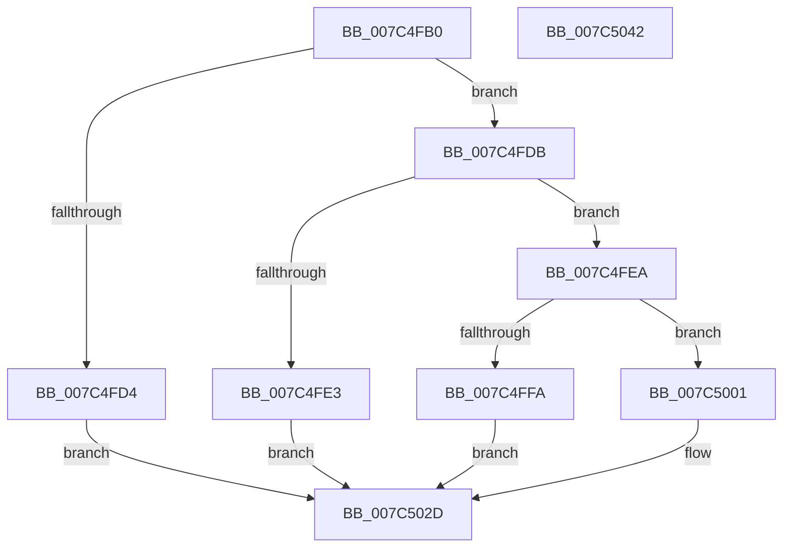

# ExpQuerySingleModuleInformation

- RVA: `0x007C4FB0`–`0x007C5043` (길이 `147` bytes)
- VA: `0x00000001407C4FB0`
- 실행 섹션: `PAGE`
- PDB 이름 있음: `예`; PDB Function 태그: `아니요`
- unwind 정보 RVA: `0x00066400`
- 디코드: `43`개 명령, `147/147` bytes 표시
- 미해석 바이트: `0` (있으면 어셈블리에 `.byte`로 보존)

> 이 문서는 커널 이미지의 기계어와 PDB 기호를 분석해 생성했습니다. 4번과 5번은 함수 원형과 자료형을 바이너리 사용 방식에서 추정한 C 해석이며 원본 소스 복구 결과는 아닙니다.

## 1. Dependencies

- 직접 호출 지점: **3**; 고유 호출 대상: **3**
- 직접 호출자로 확인된 함수: **1**
- RIP 상대 이미지 참조: **0**

### Outgoing calls
- `0x007C4FED` → [MmLockLoadedDataTableEntryShared](../../text/4B/MmLockLoadedDataTableEntryShared_function_004BD08C.md) (function, `0x004BD08C`)
- `0x007C5018` → [ExpConvertLdrEntryToModuleInfo](../AA/ExpConvertLdrEntryToModuleInfo_function_00AAA174.md) (function, `0x00AAA174`)
- `0x007C5020` → [MmUnlockLoadedDataTableEntryShared](../../text/4B/MmUnlockLoadedDataTableEntryShared_function_004BE49C.md) (function, `0x004BE49C`)

### Direct callers
- [ExpQuerySystemInformation](../A5/ExpQuerySystemInformation_function_00A57858.md) at `0x00A5A74F`

### Static image references
- 디코드된 RIP-relative 메모리 참조가 없습니다.

## 2. Other-region calls and transfers

- 다른 실행 섹션으로 향하는 call: **2**
  - `0x007C4FED` → [MmLockLoadedDataTableEntryShared](../../text/4B/MmLockLoadedDataTableEntryShared_function_004BD08C.md) (`PAGE` → `.text`)
  - `0x007C5020` → [MmUnlockLoadedDataTableEntryShared](../../text/4B/MmUnlockLoadedDataTableEntryShared_function_004BE49C.md) (`PAGE` → `.text`)
- 별도 외부 분기/꼬리 이동을 확인하지 못했습니다.

## 3. Assembly (complete function range)

```asm
007C4FB0  48 89 5C 24 08                  mov qword ptr [rsp + 8], rbx
007C4FB5  48 89 6C 24 10                  mov qword ptr [rsp + 0x10], rbp
007C4FBA  48 89 74 24 18                  mov qword ptr [rsp + 0x18], rsi
007C4FBF  57                              push rdi
007C4FC0  48 83 EC 30                     sub rsp, 0x30
007C4FC4  33 ED                           xor ebp, ebp
007C4FC6  49 8B F1                        mov rsi, r9
007C4FC9  41 89 29                        mov dword ptr [r9], ebp
007C4FCC  48 8B F9                        mov rdi, rcx
007C4FCF  45 84 C0                        test r8b, r8b
007C4FD2  74 07                           je 0x1407c4fdb
007C4FD4  B8 22 00 00 C0                  mov eax, 0xc0000022
007C4FD9  EB 52                           jmp 0x1407c502d
007C4FDB  81 FA 48 01 00 00               cmp edx, 0x148
007C4FE1  73 07                           jae 0x1407c4fea
007C4FE3  B8 04 00 00 C0                  mov eax, 0xc0000004
007C4FE8  EB 43                           jmp 0x1407c502d
007C4FEA  48 8B 09                        mov rcx, qword ptr [rcx]
007C4FED  E8 9A 80 CF FF                  call 0x1404bd08c
007C4FF2  48 8B D8                        mov rbx, rax
007C4FF5  48 85 C0                        test rax, rax
007C4FF8  75 07                           jne 0x1407c5001
007C4FFA  B8 25 02 00 C0                  mov eax, 0xc0000225
007C4FFF  EB 2C                           jmp 0x1407c502d
007C5001  48 8D 47 08                     lea rax, [rdi + 8]
007C5005  45 33 C9                        xor r9d, r9d
007C5008  45 33 C0                        xor r8d, r8d
007C500B  66 89 28                        mov word ptr [rax], bp
007C500E  48 8B D3                        mov rdx, rbx
007C5011  48 89 44 24 20                  mov qword ptr [rsp + 0x20], rax
007C5016  33 C9                           xor ecx, ecx
007C5018  E8 57 51 2E 00                  call 0x140aaa174
007C501D  48 8B CB                        mov rcx, rbx
007C5020  E8 77 94 CF FF                  call 0x1404be49c
007C5025  33 C0                           xor eax, eax
007C5027  C7 06 48 01 00 00               mov dword ptr [rsi], 0x148
007C502D  48 8B 5C 24 40                  mov rbx, qword ptr [rsp + 0x40]
007C5032  48 8B 6C 24 48                  mov rbp, qword ptr [rsp + 0x48]
007C5037  48 8B 74 24 50                  mov rsi, qword ptr [rsp + 0x50]
007C503C  48 83 C4 30                     add rsp, 0x30
007C5040  5F                              pop rdi
007C5041  C3                              ret
007C5042  CC                              int3
```

## 4. C-style interpretation (structured pseudocode)

```c
__int64 __fastcall ExpQuerySingleModuleInformation(__int64 a1, int a2, int a3, __int64 a4)
{
    __int64 result;
    __int64 v_rbp;
    __int64 v_rsp;
    unsigned __int64 v_stack_m18;
    unsigned __int64 v_stack_p10;
    unsigned __int64 v_stack_p18;
    unsigned __int64 v_stack_p8;

    v_stack_p8 = v_rbx;
    v_stack_p10 = v_rbp;
    v_stack_p18 = v_rsi;
    v_rsp = (v_rsp) - (48);
    v_rbp = 0;
    *(unsigned int *)(a4) = 0;
    if ((unsigned __int8)(a3) == 0) goto loc_007C4FDB;
    goto loc_007C502D;
loc_007C4FDB:
    if (a2 >= 328) goto loc_007C4FEA;
    goto loc_007C502D;
loc_007C4FEA:
    result = MmLockLoadedDataTableEntryShared(*(unsigned __int64 *)(a1), a2, a3, a4);
    if (result != 0) goto loc_007C5001;
    goto loc_007C502D;
loc_007C5001:
    a4 = 0;
    a3 = 0;
    *(unsigned __int16 *)(a1 + 8) = 0;
    v_stack_m18 = a1 + 8;
    a1 = 0;
    result = ExpConvertLdrEntryToModuleInfo(a1, result, a3, a4);
    result = MmUnlockLoadedDataTableEntryShared(result, result, a3, a4);
    result = 0;
    *(unsigned int *)(a4) = 328;
loc_007C502D:
    v_rsp = (v_rsp) + (48);
    return result;
}
```

## 5. (Beta) C Style

```c
int64_t ExpQuerySingleModuleInformation(void *Arg1, int32_t Arg2, int32_t Arg3, void *Arg4)
{
    uint8_t *arg1 = (uint8_t *)Arg1;
    uint8_t *arg4 = (uint8_t *)Arg4;

    int64_t result;
    int64_t local_rbp;
    int64_t local_rsp;
    uint64_t v_stack_m18;
    uint64_t v_stack_p10;
    uint64_t v_stack_p18;
    uint64_t v_stack_p8;

    v_stack_p8 = local_rbx;
    v_stack_p10 = local_rbp;
    v_stack_p18 = local_rsi;
    local_rsp = (local_rsp) - (48);
    local_rbp = 0;
    *(uint32_t *)(arg4) = 0;
    if ((uint8_t)(Arg3) == 0) goto loc_007C4FDB;
    goto loc_007C502D;
loc_007C4FDB:
    if (Arg2 >= 328) goto loc_007C4FEA;
    goto loc_007C502D;
loc_007C4FEA:
    result = MmLockLoadedDataTableEntryShared(*(uint64_t *)(arg1), Arg2, Arg3, Arg4);
    if (result != 0) goto loc_007C5001;
    goto loc_007C502D;
loc_007C5001:
    Arg4 = 0;
    Arg3 = 0;
    *(uint16_t *)(arg1 + 0x8) = 0;
    v_stack_m18 = Arg1 + 8;
    Arg1 = 0;
    result = ExpConvertLdrEntryToModuleInfo(Arg1, result, Arg3, Arg4);
    result = MmUnlockLoadedDataTableEntryShared(result, result, Arg3, Arg4);
    result = 0;
    *(uint32_t *)(arg4) = 328;
loc_007C502D:
    local_rsp = (local_rsp) + (48);
    return result;
}
```

### 관측된 메모리 오프셋

구조체 형식이 확인되지 않은 접근은 인자 기준의 오프셋으로만 기록했습니다.

| 기준 인자 | 오프셋 표현 | 폭 (bit) | 접근 |
|---|---:|---:|---|
| `Arg1` | `+ 0x0` | `16` | `W` |
| `Arg1` | `+ 0x0` | `64` | `R` |
| `Arg1` | `+ 0x8` | `64` | `R` |
| `Arg4` | `+ 0x0` | `32` | `W` |

## 6. Execution-region graph

[열기: 2D/3D 그래프와 함수 탐색 컨트롤 패널](../../../control-panel.html?section=page&rva=0x007C4FB0&view=graph)

- 2D 그래프는 위에서 아래로 흐르고, 3D 그래프는 빈 공간을 드래그해 회전합니다. Shift+드래그는 이동, 휠은 확대·축소, 함수 노드 선택은 대상 보고서 이동입니다.

### Static fallback


