# ExpReadLeapSecondData

- RVA: `0x007C5EAC`–`0x007C619F` (길이 `755` bytes)
- VA: `0x00000001407C5EAC`
- 실행 섹션: `PAGE`
- PDB 이름 있음: `예`; PDB Function 태그: `아니요`
- unwind 정보 RVA: `0x000CB330`
- 디코드: `187`개 명령, `755/755` bytes 표시
- 미해석 바이트: `0` (있으면 어셈블리에 `.byte`로 보존)

> 이 문서는 커널 이미지의 기계어와 PDB 기호를 분석해 생성했습니다. 4번과 5번은 함수 원형과 자료형을 바이너리 사용 방식에서 추정한 C 해석이며 원본 소스 복구 결과는 아닙니다.

## 1. Dependencies

- 직접 호출 지점: **22**; 고유 호출 대상: **18**
- 직접 호출자로 확인된 함수: **2**
- RIP 상대 이미지 참조: **9**

### Outgoing calls
- `0x007C5F14` → [KeAbPreAcquire](../../text/21/KeAbPreAcquire_function_00210230.md) (function, `0x00210230`)
- `0x007C5F39` → [ExfAcquirePushLockExclusiveEx](../../text/20/ExfAcquirePushLockExclusiveEx_function_0020FC90.md) (function, `0x0020FC90`)
- `0x007C5F57` → [ExpGetLeapSecondDataRegistryKeyHandle](ExpGetLeapSecondDataRegistryKeyHandle_function_007C5B30.md) (function, `0x007C5B30`)
- `0x007C5F72` → [ExAllocatePool2](../../poolcode/B8/ExAllocatePool2_function_00B820F0.md) (function, `0x00B820F0`)
- `0x007C5FD7` → [ZwNotifyChangeKey](../../text/6A/ZwNotifyChangeKey_function_006AF550.md) (function, `0x006AF550`)
- `0x007C600C` → [ZwQueryValueKey](../../text/6A/ZwQueryValueKey_function_006AD3B0.md) (function, `0x006AD3B0`)
- `0x007C6051` → [ZwQueryValueKey](../../text/6A/ZwQueryValueKey_function_006AD3B0.md) (function, `0x006AD3B0`)
- `0x007C606B` → [ExAllocatePool2](../../poolcode/B8/ExAllocatePool2_function_00B820F0.md) (function, `0x00B820F0`)
- `0x007C609B` → [ZwQueryValueKey](../../text/6A/ZwQueryValueKey_function_006AD3B0.md) (function, `0x006AD3B0`)
- `0x007C60AA` → [ExpParseAndUpdateLeapSecondData](ExpParseAndUpdateLeapSecondData_function_007C5DB0.md) (function, `0x007C5DB0`)
- `0x007C60BB` → [EtwTraceLeapSecondDataParseFailure](../7B/EtwTraceLeapSecondDataParseFailure_function_007B7F70.md) (function, `0x007B7F70`)
- `0x007C60C5` → [ExAcquireTimeRefreshLockExclusive](../9C/ExAcquireTimeRefreshLockExclusive_function_009C5810.md) (function, `0x009C5810`)
- `0x007C60CC` → [ExpRefreshTimeZoneInformation](../A6/ExpRefreshTimeZoneInformation_function_00A6B46C.md) (function, `0x00A6B46C`)
- `0x007C60D1` → [ExReleaseTimeRefreshLockExclusive](../9C/ExReleaseTimeRefreshLockExclusive_function_009C5874.md) (function, `0x009C5874`)
- `0x007C60E8` → [EtwTraceLeapSecondDataUpdate](../7B/EtwTraceLeapSecondDataUpdate_function_007B8050.md) (function, `0x007B8050`)
- `0x007C6122` → [ExfTryToWakePushLock](../../text/26/ExfTryToWakePushLock_function_00265DD0.md) (function, `0x00265DD0`)
- `0x007C612E` → [KeAbPostRelease](../../text/2E/KeAbPostRelease_function_002E1600.md) (function, `0x002E1600`)
- `0x007C6133` → [KeLeaveCriticalRegion](../../text/25/KeLeaveCriticalRegion_function_0025D8B0.md) (function, `0x0025D8B0`)
- `0x007C6145` → [ExFreePoolWithTag](../../poolcode/B8/ExFreePoolWithTag_function_00B82870.md) (function, `0x00B82870`)
- `0x007C6157` → [ExFreePoolWithTag](../../poolcode/B8/ExFreePoolWithTag_function_00B82870.md) (function, `0x00B82870`)
- `0x007C616C` → [ZwClose](../../text/6A/ZwClose_function_006AD2B0.md) (function, `0x006AD2B0`)
- `0x007C6178` → [_security_check_cookie](../../text/6A/_security_check_cookie_function_006AC640.md) (function, `0x006AC640`)

### Direct callers
- [ExInitializeLeapSecondData](ExInitializeLeapSecondData_function_007C562C.md) at `0x007C57E1`
- [ExpLeapSecondDataRegistryNotifyHandler](ExpLeapSecondDataRegistryNotifyHandler_function_007C5BC0.md) at `0x007C5BCD`

### Static image references
- `0x007C5ECE` → RVA `0x00E0A740` (`.data`; read)
- `0x007C5EF2` → RVA `0x00FD9F28` (`PAGEDATA`; read)
- `0x007C5F19` → RVA `0x00FD9F28` (`PAGEDATA`; read/write)
- `0x007C5F47` → RVA `0x00FD9C90` (`PAGEDATA`; read)
- `0x007C5FA1` → RVA `0x007C5BC0` (`ExpLeapSecondDataRegistryNotifyHandler`; read)
- `0x007C5FF7` → RVA `0x0000BD90` (`.rdata`; read)
- `0x007C603E` → RVA `0x0000BD80` (`.rdata`; read)
- `0x007C60AF` → RVA `0x00FD9BC4` (`PAGEDATA`; write)
- `0x007C60F9` → RVA `0x00FD9C90` (`PAGEDATA`; write)

## 2. Other-region calls and transfers

- 다른 실행 섹션으로 향하는 call: **15**
  - `0x007C5F14` → [KeAbPreAcquire](../../text/21/KeAbPreAcquire_function_00210230.md) (`PAGE` → `.text`)
  - `0x007C5F39` → [ExfAcquirePushLockExclusiveEx](../../text/20/ExfAcquirePushLockExclusiveEx_function_0020FC90.md) (`PAGE` → `.text`)
  - `0x007C5F72` → [ExAllocatePool2](../../poolcode/B8/ExAllocatePool2_function_00B820F0.md) (`PAGE` → `POOLCODE`)
  - `0x007C5FD7` → [ZwNotifyChangeKey](../../text/6A/ZwNotifyChangeKey_function_006AF550.md) (`PAGE` → `.text`)
  - `0x007C600C` → [ZwQueryValueKey](../../text/6A/ZwQueryValueKey_function_006AD3B0.md) (`PAGE` → `.text`)
  - `0x007C6051` → [ZwQueryValueKey](../../text/6A/ZwQueryValueKey_function_006AD3B0.md) (`PAGE` → `.text`)
  - `0x007C606B` → [ExAllocatePool2](../../poolcode/B8/ExAllocatePool2_function_00B820F0.md) (`PAGE` → `POOLCODE`)
  - `0x007C609B` → [ZwQueryValueKey](../../text/6A/ZwQueryValueKey_function_006AD3B0.md) (`PAGE` → `.text`)
  - `0x007C6122` → [ExfTryToWakePushLock](../../text/26/ExfTryToWakePushLock_function_00265DD0.md) (`PAGE` → `.text`)
  - `0x007C612E` → [KeAbPostRelease](../../text/2E/KeAbPostRelease_function_002E1600.md) (`PAGE` → `.text`)
  - `0x007C6133` → [KeLeaveCriticalRegion](../../text/25/KeLeaveCriticalRegion_function_0025D8B0.md) (`PAGE` → `.text`)
  - `0x007C6145` → [ExFreePoolWithTag](../../poolcode/B8/ExFreePoolWithTag_function_00B82870.md) (`PAGE` → `POOLCODE`)
  - `0x007C6157` → [ExFreePoolWithTag](../../poolcode/B8/ExFreePoolWithTag_function_00B82870.md) (`PAGE` → `POOLCODE`)
  - `0x007C616C` → [ZwClose](../../text/6A/ZwClose_function_006AD2B0.md) (`PAGE` → `.text`)
  - `0x007C6178` → [_security_check_cookie](../../text/6A/_security_check_cookie_function_006AC640.md) (`PAGE` → `.text`)
- 별도 외부 분기/꼬리 이동을 확인하지 못했습니다.

## 3. Assembly (complete function range)

```asm
007C5EAC  48 89 5C 24 10                  mov qword ptr [rsp + 0x10], rbx
007C5EB1  48 89 74 24 18                  mov qword ptr [rsp + 0x18], rsi
007C5EB6  48 89 7C 24 20                  mov qword ptr [rsp + 0x20], rdi
007C5EBB  55                              push rbp
007C5EBC  41 54                           push r12
007C5EBE  41 55                           push r13
007C5EC0  41 56                           push r14
007C5EC2  41 57                           push r15
007C5EC4  48 8B EC                        mov rbp, rsp
007C5EC7  48 81 EC 80 00 00 00            sub rsp, 0x80
007C5ECE  48 8B 05 6B 48 64 00            mov rax, qword ptr [rip + 0x64486b]
007C5ED5  48 33 C4                        xor rax, rsp
007C5ED8  48 89 45 F8                     mov qword ptr [rbp - 8], rax
007C5EDC  45 33 FF                        xor r15d, r15d
007C5EDF  44 8A EA                        mov r13b, dl
007C5EE2  44 89 7D D0                     mov dword ptr [rbp - 0x30], r15d
007C5EE6  4C 8B E1                        mov r12, rcx
007C5EE9  65 48 8B 04 25 88 01 00 00      mov rax, qword ptr gs:[0x188]
007C5EF2  48 8D 0D 2F 40 81 00            lea rcx, [rip + 0x81402f]
007C5EF9  48 83 CB FF                     or rbx, 0xffffffffffffffff
007C5EFD  4C 89 7D D8                     mov qword ptr [rbp - 0x28], r15
007C5F01  45 33 C0                        xor r8d, r8d
007C5F04  33 D2                           xor edx, edx
007C5F06  41 8B FF                        mov edi, r15d
007C5F09  45 8B F7                        mov r14d, r15d
007C5F0C  66 01 98 E4 01 00 00            add word ptr [rax + 0x1e4], bx
007C5F13  90                              nop
007C5F14  E8 17 A3 A4 FF                  call 0x140210230
007C5F19  F0 48 0F BA 2D 05 40 81 00 00   lock bts qword ptr [rip + 0x814005], 0
007C5F23  48 8B F0                        mov rsi, rax
007C5F26  73 16                           jae 0x1407c5f3e
007C5F28  4C 8D 05 F9 3F 81 00            lea r8, [rip + 0x813ff9]
007C5F2F  48 8B D0                        mov rdx, rax
007C5F32  48 8D 0D EF 3F 81 00            lea rcx, [rip + 0x813fef]
007C5F39  E8 52 9D A4 FF                  call 0x14020fc90
007C5F3E  48 85 F6                        test rsi, rsi
007C5F41  74 04                           je 0x1407c5f47
007C5F43  C6 46 0A 01                     mov byte ptr [rsi + 0xa], 1
007C5F47  48 8B 05 42 3D 81 00            mov rax, qword ptr [rip + 0x813d42]
007C5F4E  48 85 C0                        test rax, rax
007C5F51  75 36                           jne 0x1407c5f89
007C5F53  48 8D 4D D8                     lea rcx, [rbp - 0x28]
007C5F57  E8 D4 FB FF FF                  call 0x1407c5b30
007C5F5C  85 C0                           test eax, eax
007C5F5E  0F 88 A6 01 00 00               js 0x1407c610a
007C5F64  BA 38 00 00 00                  mov edx, 0x38
007C5F69  41 B8 4C 70 53 64               mov r8d, 0x6453704c
007C5F6F  8D 4A 08                        lea ecx, [rdx + 8]
007C5F72  E8 79 C1 3B 00                  call 0x140b820f0
007C5F77  48 8B F8                        mov rdi, rax
007C5F7A  48 85 C0                        test rax, rax
007C5F7D  0F 84 87 01 00 00               je 0x1407c610a
007C5F83  48 8B 75 D8                     mov rsi, qword ptr [rbp - 0x28]
007C5F87  EB 0A                           jmp 0x1407c5f93
007C5F89  48 8B 30                        mov rsi, qword ptr [rax]
007C5F8C  48 8B F8                        mov rdi, rax
007C5F8F  48 89 75 D8                     mov qword ptr [rbp - 0x28], rsi
007C5F93  C6 44 24 48 01                  mov byte ptr [rsp + 0x48], 1
007C5F98  4C 8D 47 08                     lea r8, [rdi + 8]
007C5F9C  44 89 7C 24 40                  mov dword ptr [rsp + 0x40], r15d
007C5FA1  48 8D 05 18 FC FF FF            lea rax, [rip - 0x3e8]
007C5FA8  4C 89 7C 24 38                  mov qword ptr [rsp + 0x38], r15
007C5FAD  33 D2                           xor edx, edx
007C5FAF  49 89 40 10                     mov qword ptr [r8 + 0x10], rax
007C5FB3  48 8B CE                        mov rcx, rsi
007C5FB6  48 8D 47 28                     lea rax, [rdi + 0x28]
007C5FBA  44 88 7C 24 30                  mov byte ptr [rsp + 0x30], r15b
007C5FBF  C7 44 24 28 04 00 00 00         mov dword ptr [rsp + 0x28], 4
007C5FC7  44 8D 4A 01                     lea r9d, [rdx + 1]
007C5FCB  4D 89 78 18                     mov qword ptr [r8 + 0x18], r15
007C5FCF  4D 89 38                        mov qword ptr [r8], r15
007C5FD2  48 89 44 24 20                  mov qword ptr [rsp + 0x20], rax
007C5FD7  E8 74 95 EE FF                  call 0x1406af550
007C5FDC  85 C0                           test eax, eax
007C5FDE  0F 88 26 01 00 00               js 0x1407c610a
007C5FE4  48 8D 45 D0                     lea rax, [rbp - 0x30]
007C5FE8  41 B8 02 00 00 00               mov r8d, 2
007C5FEE  48 89 44 24 28                  mov qword ptr [rsp + 0x28], rax
007C5FF3  4C 8D 4D E0                     lea r9, [rbp - 0x20]
007C5FF7  48 8D 15 92 5D 84 FF            lea rdx, [rip - 0x7ba26e]
007C5FFE  C7 44 24 20 14 00 00 00         mov dword ptr [rsp + 0x20], 0x14
007C6006  48 8B CE                        mov rcx, rsi
007C6009  41 B7 01                        mov r15b, 1
007C600C  E8 9F 73 EE FF                  call 0x1406ad3b0
007C6011  85 C0                           test eax, eax
007C6013  78 14                           js 0x1407c6029
007C6015  83 7D E4 04                     cmp dword ptr [rbp - 0x1c], 4
007C6019  75 0E                           jne 0x1407c6029
007C601B  83 7D E8 04                     cmp dword ptr [rbp - 0x18], 4
007C601F  75 08                           jne 0x1407c6029
007C6021  44 39 75 EC                     cmp dword ptr [rbp - 0x14], r14d
007C6025  41 0F 95 C7                     setne r15b
007C6029  45 33 C9                        xor r9d, r9d
007C602C  45 88 3C 24                     mov byte ptr [r12], r15b
007C6030  45 8B 7C 24 04                  mov r15d, dword ptr [r12 + 4]
007C6035  48 8D 45 D0                     lea rax, [rbp - 0x30]
007C6039  48 89 44 24 28                  mov qword ptr [rsp + 0x28], rax
007C603E  48 8D 15 3B 5D 84 FF            lea rdx, [rip - 0x7ba2c5]
007C6045  44 21 74 24 20                  and dword ptr [rsp + 0x20], r14d
007C604A  48 8B CE                        mov rcx, rsi
007C604D  45 8D 41 02                     lea r8d, [r9 + 2]
007C6051  E8 5A 73 EE FF                  call 0x1406ad3b0
007C6056  3D 23 00 00 C0                  cmp eax, 0xc0000023
007C605B  75 43                           jne 0x1407c60a0
007C605D  8B 55 D0                        mov edx, dword ptr [rbp - 0x30]
007C6060  B9 00 01 00 00                  mov ecx, 0x100
007C6065  41 B8 4C 70 53 64               mov r8d, 0x6453704c
007C606B  E8 80 C0 3B 00                  call 0x140b820f0
007C6070  4C 8B F0                        mov r14, rax
007C6073  48 85 C0                        test rax, rax
007C6076  74 48                           je 0x1407c60c0
007C6078  8B 4D D0                        mov ecx, dword ptr [rbp - 0x30]
007C607B  48 8D 45 D0                     lea rax, [rbp - 0x30]
007C607F  48 89 44 24 28                  mov qword ptr [rsp + 0x28], rax
007C6084  48 8D 15 F5 5C 84 FF            lea rdx, [rip - 0x7ba30b]
007C608B  89 4C 24 20                     mov dword ptr [rsp + 0x20], ecx
007C608F  4D 8B CE                        mov r9, r14
007C6092  48 8B CE                        mov rcx, rsi
007C6095  41 B8 02 00 00 00               mov r8d, 2
007C609B  E8 10 73 EE FF                  call 0x1406ad3b0
007C60A0  85 C0                           test eax, eax
007C60A2  78 1C                           js 0x1407c60c0
007C60A4  49 8B D4                        mov rdx, r12
007C60A7  49 8B CE                        mov rcx, r14
007C60AA  E8 01 FD FF FF                  call 0x1407c5db0
007C60AF  89 05 0F 3B 81 00               mov dword ptr [rip + 0x813b0f], eax
007C60B5  85 C0                           test eax, eax
007C60B7  74 07                           je 0x1407c60c0
007C60B9  8B C8                           mov ecx, eax
007C60BB  E8 B0 1E FF FF                  call 0x1407b7f70
007C60C0  45 84 ED                        test r13b, r13b
007C60C3  74 11                           je 0x1407c60d6
007C60C5  E8 46 F7 1F 00                  call 0x1409c5810
007C60CA  33 C9                           xor ecx, ecx
007C60CC  E8 9B 53 2A 00                  call 0x140a6b46c
007C60D1  E8 9E F7 1F 00                  call 0x1409c5874
007C60D6  41 0F B6 14 24                  movzx edx, byte ptr [r12]
007C60DB  45 8B CF                        mov r9d, r15d
007C60DE  45 8B 44 24 04                  mov r8d, dword ptr [r12 + 4]
007C60E3  B9 01 00 00 00                  mov ecx, 1
007C60E8  E8 63 1F FF FF                  call 0x1407b8050
007C60ED  45 33 FF                        xor r15d, r15d
007C60F0  4C 39 3D 99 3B 81 00            cmp qword ptr [rip + 0x813b99], r15
007C60F7  75 0A                           jne 0x1407c6103
007C60F9  48 89 3D 90 3B 81 00            mov qword ptr [rip + 0x813b90], rdi
007C6100  48 89 37                        mov qword ptr [rdi], rsi
007C6103  49 8B FF                        mov rdi, r15
007C6106  4C 89 7D D8                     mov qword ptr [rbp - 0x28], r15
007C610A  F0 48 0F C1 1D 15 3E 81 00      lock xadd qword ptr [rip + 0x813e15], rbx
007C6113  80 E3 06                        and bl, 6
007C6116  80 FB 02                        cmp bl, 2
007C6119  75 0C                           jne 0x1407c6127
007C611B  48 8D 0D 06 3E 81 00            lea rcx, [rip + 0x813e06]
007C6122  E8 A9 FC A9 FF                  call 0x140265dd0
007C6127  48 8D 0D FA 3D 81 00            lea rcx, [rip + 0x813dfa]
007C612E  E8 CD B4 B1 FF                  call 0x1402e1600
007C6133  E8 78 77 A9 FF                  call 0x14025d8b0
007C6138  4D 85 F6                        test r14, r14
007C613B  74 0D                           je 0x1407c614a
007C613D  BA 4C 70 53 64                  mov edx, 0x6453704c
007C6142  49 8B CE                        mov rcx, r14
007C6145  E8 26 C7 3B 00                  call 0x140b82870
007C614A  48 85 FF                        test rdi, rdi
007C614D  74 14                           je 0x1407c6163
007C614F  BA 4C 70 53 64                  mov edx, 0x6453704c
007C6154  48 8B CF                        mov rcx, rdi
007C6157  E8 14 C7 3B 00                  call 0x140b82870
007C615C  4C 89 3D 2D 3B 81 00            mov qword ptr [rip + 0x813b2d], r15
007C6163  48 8B 4D D8                     mov rcx, qword ptr [rbp - 0x28]
007C6167  48 85 C9                        test rcx, rcx
007C616A  74 05                           je 0x1407c6171
007C616C  E8 3F 71 EE FF                  call 0x1406ad2b0
007C6171  48 8B 4D F8                     mov rcx, qword ptr [rbp - 8]
007C6175  48 33 CC                        xor rcx, rsp
007C6178  E8 C3 64 EE FF                  call 0x1406ac640
007C617D  4C 8D 9C 24 80 00 00 00         lea r11, [rsp + 0x80]
007C6185  49 8B 5B 38                     mov rbx, qword ptr [r11 + 0x38]
007C6189  49 8B 73 40                     mov rsi, qword ptr [r11 + 0x40]
007C618D  49 8B 7B 48                     mov rdi, qword ptr [r11 + 0x48]
007C6191  49 8B E3                        mov rsp, r11
007C6194  41 5F                           pop r15
007C6196  41 5E                           pop r14
007C6198  41 5D                           pop r13
007C619A  41 5C                           pop r12
007C619C  5D                              pop rbp
007C619D  C3                              ret
007C619E  CC                              int3
```

## 4. C-style interpretation (structured pseudocode)

```c
__int64 __fastcall ExpReadLeapSecondData(__int64 a1, int a2, int a3)
{
    __int64 result;
    __int64 v_r15;
    __int64 v_rbx;
    __int64 v_rsp;
    unsigned __int64 v_stack_m28;
    unsigned __int64 v_stack_m30;
    unsigned int v_stack_m3C;
    unsigned int v_stack_m40;
    unsigned int v_stack_m44;
    unsigned __int64 v_stack_m48;
    unsigned __int64 v_stack_m50;
    unsigned int v_stack_m58;
    unsigned __int8 v_stack_m60;
    unsigned int v_stack_m68;
    unsigned __int64 v_stack_m70;
    unsigned __int8 v_stack_m78;
    unsigned int v_stack_m80;
    unsigned __int64 v_stack_m88;
    unsigned __int64 v_stack_p10;
    unsigned __int64 v_stack_p18;
    unsigned __int64 v_stack_p20;

    v_stack_p10 = v_rbx;
    v_stack_p18 = v_rsi;
    v_stack_p20 = v_rdi;
    v_rsp = (v_rsp) - (128);
    result = (*(unsigned __int64 *)(v_rip + 6572139)) ^ (v_rsp);
    v_stack_m30 = result;
    v_r15 = 0;
    v_stack_m58 = 0;
    v_rbx = (v_rbx) | (-1);
    v_stack_m50 = 0;
    a3 = 0;
    a2 = 0;
    result = KeAbPreAcquire(v_rip + 8470575, a2, a3, a4);
    if (!(condition_is_above_or_equal)) {
        a3 = v_rip + 8470521;
        a2 = result;
        a1 = v_rip + 8470511;
        result = ExfAcquirePushLockExclusiveEx(a1, a2, a3, a4);
    }
    if (result != 0) {
        *(unsigned __int8 *)(result + 10) = 1;
    }
    if (*(unsigned __int64 *)(v_rip + 8469826) != 0) goto loc_007C5F89;
    result = ExpGetLeapSecondDataRegistryKeyHandle(v_stack_m50, a2, a3, a4);
    if (sign_flag) goto loc_007C610A;
    result = ExAllocatePool2(56 + 8, 56, (unsigned int)(0x6453704CULL), a4);
    if (result == 0) goto loc_007C610A;
    goto loc_007C5F93;
loc_007C5F89:
    v_stack_m50 = *(unsigned __int64 *)(result);
loc_007C5F93:
    v_stack_m60 = 1;
    v_stack_m68 = 0;
    v_stack_m70 = 0;
    a2 = 0;
    *(unsigned __int64 *)(result + 8 + 16) = v_rip - 1000;
    v_stack_m78 = 0;
    v_stack_m80 = 4;
    *(unsigned __int64 *)(result + 8 + 24) = 0;
    *(unsigned __int64 *)(result + 8) = 0;
    v_stack_m88 = result + 40;
    result = ZwNotifyChangeKey(*(unsigned __int64 *)(result), a2, result + 8, a2 + 1);
    if (sign_flag) goto loc_007C610A;
    v_stack_m80 = v_stack_m58;
    v_stack_m88 = 20;
    result = ZwQueryValueKey(*(unsigned __int64 *)(result), v_rip - 8102510, 2, v_stack_m48);
    if (sign_flag) goto loc_007C6029;
    if (v_stack_m44 != 4) goto loc_007C6029;
    v_r15 = 1;
    if (v_stack_m40 == 4) {
        v_r15 = (v_stack_m3C != 0) ? 1 : 0;
    }
    a4 = 0;
    *(unsigned __int8 *)(a1) = (unsigned __int8)(v_r15);
    v_stack_m80 = v_stack_m58;
    result = ZwQueryValueKey(*(unsigned __int64 *)(result), v_rip - 8102597, a4 + 2, a4);
    if (((unsigned int)(result)) != 0xC0000023ULL) goto loc_007C60A0;
    result = ExAllocatePool2(256, (unsigned int)(v_stack_m58), (unsigned int)(0x6453704CULL), a4);
    if (result == 0) goto loc_007C60C0;
    v_stack_m80 = v_stack_m58;
    v_stack_m88 = (unsigned int)((unsigned int)(v_stack_m58));
    result = ZwQueryValueKey(*(unsigned __int64 *)(result), v_rip - 8102667, 2, result);
loc_007C60A0:
    if (sign_flag) goto loc_007C60C0;
    result = ExpParseAndUpdateLeapSecondData(result, a1, 2, result);
    *(unsigned int *)(v_rip + 8469263) = (unsigned int)(result);
    if ((unsigned int)(result) != 0) {
        a1 = (unsigned int)(result);
        result = EtwTraceLeapSecondDataParseFailure(a1, a1, 2, result);
    }
    if ((unsigned __int8)((unsigned __int8)(a2)) != 0) {
        result = ExAcquireTimeRefreshLockExclusive(a1, a1, 2, result);
        a1 = 0;
        result = ExpRefreshTimeZoneInformation(a1, a1, 2, result);
        result = ExReleaseTimeRefreshLockExclusive(a1, a1, 2, result);
    }
    result = EtwTraceLeapSecondDataUpdate(1, *(unsigned __int8 *)(a1), (unsigned int)(*(unsigned int *)(a1 + 4)), (unsigned int)((unsigned int)((unsigned int)(*(unsigned int *)(a1 + 4)))));
    v_r15 = 0;
    if ((*(unsigned __int64 *)(v_rip + 8469401)) == 0) {
        *(unsigned __int64 *)(v_rip + 8469392) = result;
        *(unsigned __int64 *)(result) = *(unsigned __int64 *)(result);
    }
    v_stack_m50 = 0;
loc_007C610A:
    v_rbx = (unsigned __int8)((v_rbx) & (6));
    if (((unsigned __int8)(v_rbx)) == 2) {
        a1 = v_rip + 8470022;
        result = ExfTryToWakePushLock(a1, *(unsigned __int8 *)(a1), (unsigned int)(*(unsigned int *)(a1 + 4)), (unsigned int)((unsigned int)((unsigned int)(*(unsigned int *)(a1 + 4)))));
    }
    result = KeAbPostRelease(v_rip + 8470010, *(unsigned __int8 *)(a1), (unsigned int)(*(unsigned int *)(a1 + 4)), (unsigned int)((unsigned int)((unsigned int)(*(unsigned int *)(a1 + 4)))));
    result = KeLeaveCriticalRegion(v_rip + 8470010, *(unsigned __int8 *)(a1), (unsigned int)(*(unsigned int *)(a1 + 4)), (unsigned int)((unsigned int)((unsigned int)(*(unsigned int *)(a1 + 4)))));
    if (result != 0) {
        a2 = 0x6453704CULL;
        a1 = result;
        result = ExFreePoolWithTag(a1, a2, (unsigned int)(*(unsigned int *)(a1 + 4)), (unsigned int)((unsigned int)((unsigned int)(*(unsigned int *)(a1 + 4)))));
    }
    if (0 != 0) {
        a2 = 0x6453704CULL;
        a1 = 0;
        result = ExFreePoolWithTag(a1, a2, (unsigned int)(*(unsigned int *)(a1 + 4)), (unsigned int)((unsigned int)((unsigned int)(*(unsigned int *)(a1 + 4)))));
        *(unsigned __int64 *)(v_rip + 8469293) = 0;
    }
    if (v_stack_m50 != 0) {
        result = ZwClose(v_stack_m50, a2, (unsigned int)(*(unsigned int *)(a1 + 4)), (unsigned int)((unsigned int)((unsigned int)(*(unsigned int *)(a1 + 4)))));
    }
    a1 = (v_stack_m30) ^ (v_rsp);
    result = _security_check_cookie(a1, a2, (unsigned int)(*(unsigned int *)(a1 + 4)), (unsigned int)((unsigned int)((unsigned int)(*(unsigned int *)(a1 + 4)))));
    return result;
}
```

## 5. (Beta) C Style

```c
int64_t ExpReadLeapSecondData(void *Arg1, int32_t Arg2, int32_t Arg3)
{
    uint8_t *arg1 = (uint8_t *)Arg1;

    int64_t result;
    int64_t local_r15;
    int64_t local_rbx;
    int64_t local_rsp;
    uint64_t v_stack_m28;
    uint64_t v_stack_m30;
    uint32_t v_stack_m3C;
    uint32_t v_stack_m40;
    uint32_t v_stack_m44;
    uint64_t v_stack_m48;
    uint64_t v_stack_m50;
    uint32_t v_stack_m58;
    uint8_t v_stack_m60;
    uint32_t v_stack_m68;
    uint64_t v_stack_m70;
    uint8_t v_stack_m78;
    uint32_t v_stack_m80;
    uint64_t v_stack_m88;
    uint64_t v_stack_p10;
    uint64_t v_stack_p18;
    uint64_t v_stack_p20;

    v_stack_p10 = local_rbx;
    v_stack_p18 = local_rsi;
    v_stack_p20 = local_rdi;
    local_rsp = (local_rsp) - (128);
    result = (*(uint64_t *)(v_rip + 0x64486B)) ^ (local_rsp);
    v_stack_m30 = result;
    local_r15 = 0;
    v_stack_m58 = 0;
    local_rbx = (local_rbx) | (-1);
    v_stack_m50 = 0;
    Arg3 = 0;
    Arg2 = 0;
    result = KeAbPreAcquire(v_rip + 8470575, Arg2, Arg3, a4);
    if (!(condition_is_above_or_equal)) {
        Arg3 = v_rip + 8470521;
        Arg2 = result;
        Arg1 = v_rip + 8470511;
        result = ExfAcquirePushLockExclusiveEx(Arg1, Arg2, Arg3, a4);
    }
    if (result != 0) {
        *(uint8_t *)(result + 0xA) = 1;
    }
    if (*(uint64_t *)(v_rip + 0x813D42) != 0) goto loc_007C5F89;
    result = ExpGetLeapSecondDataRegistryKeyHandle(v_stack_m50, Arg2, Arg3, a4);
    if (sign_flag) goto loc_007C610A;
    result = ExAllocatePool2(56 + 8, 56, (uint32_t)(0x6453704CULL), a4);
    if (result == 0) goto loc_007C610A;
    goto loc_007C5F93;
loc_007C5F89:
    v_stack_m50 = *(uint64_t *)(result);
loc_007C5F93:
    v_stack_m60 = 1;
    v_stack_m68 = 0;
    v_stack_m70 = 0;
    Arg2 = 0;
    *(uint64_t *)(result + 0x8 + 0x10) = v_rip - 1000;
    v_stack_m78 = 0;
    v_stack_m80 = 4;
    *(uint64_t *)(result + 0x8 + 0x18) = 0;
    *(uint64_t *)(result + 0x8) = 0;
    v_stack_m88 = result + 40;
    result = ZwNotifyChangeKey(*(uint64_t *)(result), Arg2, result + 8, Arg2 + 1);
    if (sign_flag) goto loc_007C610A;
    v_stack_m80 = v_stack_m58;
    v_stack_m88 = 20;
    result = ZwQueryValueKey(*(uint64_t *)(result), v_rip - 8102510, 2, v_stack_m48);
    if (sign_flag) goto loc_007C6029;
    if (v_stack_m44 != 4) goto loc_007C6029;
    local_r15 = 1;
    if (v_stack_m40 == 4) {
        local_r15 = (v_stack_m3C != 0) ? 1 : 0;
    }
    a4 = 0;
    *(uint8_t *)(arg1) = (uint8_t)(local_r15);
    v_stack_m80 = v_stack_m58;
    result = ZwQueryValueKey(*(uint64_t *)(result), v_rip - 8102597, a4 + 2, a4);
    if (((uint32_t)(result)) != 0xC0000023ULL) goto loc_007C60A0;
    result = ExAllocatePool2(256, (uint32_t)(v_stack_m58), (uint32_t)(0x6453704CULL), a4);
    if (result == 0) goto loc_007C60C0;
    v_stack_m80 = v_stack_m58;
    v_stack_m88 = (uint32_t)((uint32_t)(v_stack_m58));
    result = ZwQueryValueKey(*(uint64_t *)(result), v_rip - 8102667, 2, result);
loc_007C60A0:
    if (sign_flag) goto loc_007C60C0;
    result = ExpParseAndUpdateLeapSecondData(result, Arg1, 2, result);
    *(uint32_t *)(v_rip + 0x813B0F) = (uint32_t)(result);
    if ((uint32_t)(result) != 0) {
        Arg1 = (uint32_t)(result);
        result = EtwTraceLeapSecondDataParseFailure(Arg1, Arg1, 2, result);
    }
    if ((uint8_t)((uint8_t)(Arg2)) != 0) {
        result = ExAcquireTimeRefreshLockExclusive(Arg1, Arg1, 2, result);
        Arg1 = 0;
        result = ExpRefreshTimeZoneInformation(Arg1, Arg1, 2, result);
        result = ExReleaseTimeRefreshLockExclusive(Arg1, Arg1, 2, result);
    }
    result = EtwTraceLeapSecondDataUpdate(1, *(uint8_t *)(arg1), (uint32_t)(*(uint32_t *)(arg1 + 0x4)), (uint32_t)((uint32_t)((uint32_t)(*(uint32_t *)(arg1 + 0x4)))));
    local_r15 = 0;
    if ((*(uint64_t *)(v_rip + 0x813B99)) == 0) {
        *(uint64_t *)(v_rip + 0x813B90) = result;
        *(uint64_t *)(result) = *(uint64_t *)(result);
    }
    v_stack_m50 = 0;
loc_007C610A:
    local_rbx = (uint8_t)((local_rbx) & (6));
    if (((uint8_t)(local_rbx)) == 2) {
        Arg1 = v_rip + 8470022;
        result = ExfTryToWakePushLock(Arg1, *(uint8_t *)(arg1), (uint32_t)(*(uint32_t *)(arg1 + 0x4)), (uint32_t)((uint32_t)((uint32_t)(*(uint32_t *)(arg1 + 0x4)))));
    }
    result = KeAbPostRelease(v_rip + 8470010, *(uint8_t *)(arg1), (uint32_t)(*(uint32_t *)(arg1 + 0x4)), (uint32_t)((uint32_t)((uint32_t)(*(uint32_t *)(arg1 + 0x4)))));
    result = KeLeaveCriticalRegion(v_rip + 8470010, *(uint8_t *)(arg1), (uint32_t)(*(uint32_t *)(arg1 + 0x4)), (uint32_t)((uint32_t)((uint32_t)(*(uint32_t *)(arg1 + 0x4)))));
    if (result != 0) {
        Arg2 = 0x6453704CULL;
        Arg1 = result;
        result = ExFreePoolWithTag(Arg1, Arg2, (uint32_t)(*(uint32_t *)(arg1 + 0x4)), (uint32_t)((uint32_t)((uint32_t)(*(uint32_t *)(arg1 + 0x4)))));
    }
    if (0 != 0) {
        Arg2 = 0x6453704CULL;
        Arg1 = 0;
        result = ExFreePoolWithTag(Arg1, Arg2, (uint32_t)(*(uint32_t *)(arg1 + 0x4)), (uint32_t)((uint32_t)((uint32_t)(*(uint32_t *)(arg1 + 0x4)))));
        *(uint64_t *)(v_rip + 0x813B2D) = 0;
    }
    if (v_stack_m50 != 0) {
        result = ZwClose(v_stack_m50, Arg2, (uint32_t)(*(uint32_t *)(arg1 + 0x4)), (uint32_t)((uint32_t)((uint32_t)(*(uint32_t *)(arg1 + 0x4)))));
    }
    Arg1 = (v_stack_m30) ^ (local_rsp);
    result = _security_check_cookie(Arg1, Arg2, (uint32_t)(*(uint32_t *)(arg1 + 0x4)), (uint32_t)((uint32_t)((uint32_t)(*(uint32_t *)(arg1 + 0x4)))));
    return result;
}
```

### 관측된 메모리 오프셋

구조체 형식이 확인되지 않은 접근은 인자 기준의 오프셋으로만 기록했습니다.

| 기준 인자 | 오프셋 표현 | 폭 (bit) | 접근 |
|---|---:|---:|---|
| `Arg1` | `+ 0x0` | `8` | `R` |
| `Arg1` | `+ 0x0` | `8` | `W` |
| `Arg1` | `+ 0x4` | `32` | `R` |

## 6. Execution-region graph

[열기: 2D/3D 그래프와 함수 탐색 컨트롤 패널](../../../control-panel.html?section=page&rva=0x007C5EAC&view=graph)

- 2D 그래프는 위에서 아래로 흐르고, 3D 그래프는 빈 공간을 드래그해 회전합니다. Shift+드래그는 이동, 휠은 확대·축소, 함수 노드 선택은 대상 보고서 이동입니다.

### Static fallback

```mermaid
flowchart TD
  bb_007C5EAC[BB_007C5EAC]
  bb_007C5F28[BB_007C5F28]
  bb_007C5F3E[BB_007C5F3E]
  bb_007C5F43[BB_007C5F43]
  bb_007C5F47[BB_007C5F47]
  bb_007C5F53[BB_007C5F53]
  bb_007C5F64[BB_007C5F64]
  bb_007C5F83[BB_007C5F83]
  bb_007C5F89[BB_007C5F89]
  bb_007C5F93[BB_007C5F93]
  bb_007C5FE4[BB_007C5FE4]
  bb_007C6015[BB_007C6015]
  bb_007C601B[BB_007C601B]
  bb_007C6021[BB_007C6021]
  bb_007C6029[BB_007C6029]
  bb_007C605D[BB_007C605D]
  bb_007C6078[BB_007C6078]
  bb_007C60A0[BB_007C60A0]
  bb_007C60A4[BB_007C60A4]
  bb_007C60B9[BB_007C60B9]
  bb_007C60C0[BB_007C60C0]
  bb_007C60C5[BB_007C60C5]
  bb_007C60D6[BB_007C60D6]
  bb_007C60F9[BB_007C60F9]
  bb_007C6103[BB_007C6103]
  bb_007C610A[BB_007C610A]
  bb_007C611B[BB_007C611B]
  bb_007C6127[BB_007C6127]
  bb_007C613D[BB_007C613D]
  bb_007C614A[BB_007C614A]
  bb_007C614F[BB_007C614F]
  bb_007C6163[BB_007C6163]
  bb_007C616C[BB_007C616C]
  bb_007C6171[BB_007C6171]
  bb_007C619E[BB_007C619E]
  bb_007C5EAC -->|branch| bb_007C5F3E
  bb_007C5EAC -->|fallthrough| bb_007C5F28
  bb_007C5F28 -->|flow| bb_007C5F3E
  bb_007C5F3E -->|branch| bb_007C5F47
  bb_007C5F3E -->|fallthrough| bb_007C5F43
  bb_007C5F43 -->|flow| bb_007C5F47
  bb_007C5F47 -->|branch| bb_007C5F89
  bb_007C5F47 -->|fallthrough| bb_007C5F53
  bb_007C5F53 -->|branch| bb_007C610A
  bb_007C5F53 -->|fallthrough| bb_007C5F64
  bb_007C5F64 -->|branch| bb_007C610A
  bb_007C5F64 -->|fallthrough| bb_007C5F83
  bb_007C5F83 -->|branch| bb_007C5F93
  bb_007C5F89 -->|flow| bb_007C5F93
  bb_007C5F93 -->|branch| bb_007C610A
  bb_007C5F93 -->|fallthrough| bb_007C5FE4
  bb_007C5FE4 -->|branch| bb_007C6029
  bb_007C5FE4 -->|fallthrough| bb_007C6015
  bb_007C6015 -->|branch| bb_007C6029
  bb_007C6015 -->|fallthrough| bb_007C601B
  bb_007C601B -->|branch| bb_007C6029
  bb_007C601B -->|fallthrough| bb_007C6021
  bb_007C6021 -->|flow| bb_007C6029
  bb_007C6029 -->|branch| bb_007C60A0
  bb_007C6029 -->|fallthrough| bb_007C605D
  bb_007C605D -->|branch| bb_007C60C0
  bb_007C605D -->|fallthrough| bb_007C6078
  bb_007C6078 -->|flow| bb_007C60A0
  bb_007C60A0 -->|branch| bb_007C60C0
  bb_007C60A0 -->|fallthrough| bb_007C60A4
  bb_007C60A4 -->|branch| bb_007C60C0
  bb_007C60A4 -->|fallthrough| bb_007C60B9
  bb_007C60B9 -->|flow| bb_007C60C0
  bb_007C60C0 -->|branch| bb_007C60D6
  bb_007C60C0 -->|fallthrough| bb_007C60C5
  bb_007C60C5 -->|flow| bb_007C60D6
  bb_007C60D6 -->|branch| bb_007C6103
  bb_007C60D6 -->|fallthrough| bb_007C60F9
  bb_007C60F9 -->|flow| bb_007C6103
  bb_007C6103 -->|flow| bb_007C610A
  bb_007C610A -->|branch| bb_007C6127
  bb_007C610A -->|fallthrough| bb_007C611B
  bb_007C611B -->|flow| bb_007C6127
  bb_007C6127 -->|branch| bb_007C614A
  bb_007C6127 -->|fallthrough| bb_007C613D
  bb_007C613D -->|flow| bb_007C614A
  bb_007C614A -->|branch| bb_007C6163
  bb_007C614A -->|fallthrough| bb_007C614F
  bb_007C614F -->|flow| bb_007C6163
  bb_007C6163 -->|branch| bb_007C6171
  bb_007C6163 -->|fallthrough| bb_007C616C
  bb_007C616C -->|flow| bb_007C6171
```


