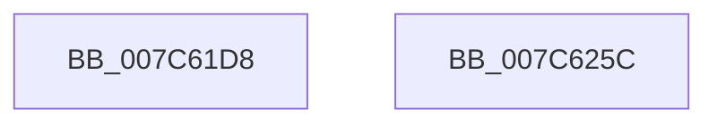

# ExpReadTimeZoneInformation

- RVA: `0x007C61D8`–`0x007C625D` (길이 `133` bytes)
- VA: `0x00000001407C61D8`
- 실행 섹션: `PAGE`
- PDB 이름 있음: `예`; PDB Function 태그: `예`
- unwind 정보 RVA: `0x000D4998`
- 디코드: `28`개 명령, `133/133` bytes 표시
- 미해석 바이트: `0` (있으면 어셈블리에 `.byte`로 보존)

> 이 문서는 커널 이미지의 기계어와 PDB 기호를 분석해 생성했습니다. 4번과 5번은 함수 원형과 자료형을 바이너리 사용 방식에서 추정한 C 해석이며 원본 소스 복구 결과는 아닙니다.

## 1. Dependencies

- 직접 호출 지점: **2**; 고유 호출 대상: **2**
- 직접 호출자로 확인된 함수: **2**
- RIP 상대 이미지 참조: **1**

### Outgoing calls
- `0x007C61FA` → [memset](../../text/6C/memset_function_006C6C40.md) (function, `0x006C6C40`)
- `0x007C6246` → [RtlpQueryRegistryValues](../8C/RtlpQueryRegistryValues_function_008C9050.md) (function, `0x008C9050`)

### Direct callers
- [ExpReadSiloTimeZoneMarker](ExpReadSiloTimeZoneMarker_function_007C61A8.md) at `0x007C61BF`
- [ExpTimeZoneInitSiloState](ExpTimeZoneInitSiloState_function_007C6430.md) at `0x007C64AC`

### Static image references
- `0x007C6221` → RVA `0x00038E80` (`.rdata`; read)

## 2. Other-region calls and transfers

- 다른 실행 섹션으로 향하는 call: **1**
  - `0x007C61FA` → [memset](../../text/6C/memset_function_006C6C40.md) (`PAGE` → `.text`)
- 별도 외부 분기/꼬리 이동을 확인하지 못했습니다.

## 3. Assembly (complete function range)

```asm
007C61D8  48 89 5C 24 08                  mov qword ptr [rsp + 8], rbx
007C61DD  89 54 24 10                     mov dword ptr [rsp + 0x10], edx
007C61E1  57                              push rdi
007C61E2  48 81 EC A0 00 00 00            sub rsp, 0xa0
007C61E9  33 D2                           xor edx, edx
007C61EB  49 8B F8                        mov rdi, r8
007C61EE  48 8B D9                        mov rbx, rcx
007C61F1  48 8D 4C 24 30                  lea rcx, [rsp + 0x30]
007C61F6  44 8D 42 70                     lea r8d, [rdx + 0x70]
007C61FA  E8 41 0A F0 FF                  call 0x1406c6c40
007C61FF  45 33 C9                        xor r9d, r9d
007C6202  C7 44 24 38 20 01 00 00         mov dword ptr [rsp + 0x38], 0x120
007C620A  48 8D 84 24 B8 00 00 00         lea rax, [rsp + 0xb8]
007C6212  48 89 5C 24 40                  mov qword ptr [rsp + 0x40], rbx
007C6217  4C 8D 44 24 30                  lea r8, [rsp + 0x30]
007C621C  48 89 7C 24 48                  mov qword ptr [rsp + 0x48], rdi
007C6221  48 8D 15 58 2C 87 FF            lea rdx, [rip - 0x78d3a8]
007C6228  C7 44 24 50 04 00 00 04         mov dword ptr [rsp + 0x50], 0x4000004
007C6230  41 8D 49 02                     lea ecx, [r9 + 2]
007C6234  48 89 44 24 58                  mov qword ptr [rsp + 0x58], rax
007C6239  C7 44 24 60 04 00 00 00         mov dword ptr [rsp + 0x60], 4
007C6241  C6 44 24 28 01                  mov byte ptr [rsp + 0x28], 1
007C6246  E8 05 2E 10 00                  call 0x1408c9050
007C624B  48 8B 9C 24 B0 00 00 00         mov rbx, qword ptr [rsp + 0xb0]
007C6253  48 81 C4 A0 00 00 00            add rsp, 0xa0
007C625A  5F                              pop rdi
007C625B  C3                              ret
007C625C  CC                              int3
```

## 4. C-style interpretation (structured pseudocode)

```c
__int64 __fastcall ExpReadTimeZoneInformation(__int64 a1, int a2, __int64 a3, int a4)
{
    __int64 result;
    __int64 v_rsp;
    unsigned int v_stack_m48;
    unsigned __int64 v_stack_m50;
    unsigned int v_stack_m58;
    unsigned __int64 v_stack_m60;
    unsigned __int64 v_stack_m68;
    unsigned int v_stack_m70;
    unsigned __int64 v_stack_m78;
    unsigned __int8 v_stack_m80;
    unsigned int v_stack_p10;
    unsigned __int64 v_stack_p8;

    v_stack_p8 = v_rbx;
    v_stack_p10 = a2;
    v_rsp = (v_rsp) - (160);
    a2 = 0;
    result = memset(v_stack_m78, a2, a2 + 112, a4);
    a4 = 0;
    v_stack_m70 = 288;
    v_stack_m68 = a1;
    v_stack_m60 = a3;
    v_stack_m58 = 0x4000004ULL;
    v_stack_m50 = v_stack_p10;
    v_stack_m48 = 4;
    v_stack_m80 = 1;
    result = RtlpQueryRegistryValues(a4 + 2, v_rip - 7918504, v_stack_m78, a4);
    v_rsp = (v_rsp) + (160);
    return result;
}
```

## 5. (Beta) C Style

```c
int64_t ExpReadTimeZoneInformation(int64_t Arg1, int32_t Arg2, int64_t Arg3, int32_t Arg4)
{
    int64_t result;
    int64_t local_rsp;
    uint32_t v_stack_m48;
    uint64_t v_stack_m50;
    uint32_t v_stack_m58;
    uint64_t v_stack_m60;
    uint64_t v_stack_m68;
    uint32_t v_stack_m70;
    uint64_t v_stack_m78;
    uint8_t v_stack_m80;
    uint32_t v_stack_p10;
    uint64_t v_stack_p8;

    v_stack_p8 = local_rbx;
    v_stack_p10 = Arg2;
    local_rsp = (local_rsp) - (160);
    Arg2 = 0;
    result = memset(v_stack_m78, Arg2, Arg2 + 112, Arg4);
    Arg4 = 0;
    v_stack_m70 = 288;
    v_stack_m68 = Arg1;
    v_stack_m60 = Arg3;
    v_stack_m58 = 0x4000004ULL;
    v_stack_m50 = v_stack_p10;
    v_stack_m48 = 4;
    v_stack_m80 = 1;
    result = RtlpQueryRegistryValues(Arg4 + 2, v_rip - 7918504, v_stack_m78, Arg4);
    local_rsp = (local_rsp) + (160);
    return result;
}
```

## 6. Execution-region graph

[열기: 2D/3D 그래프와 함수 탐색 컨트롤 패널](../../../control-panel.html?section=page&rva=0x007C61D8&view=graph)

- 2D 그래프는 위에서 아래로 흐르고, 3D 그래프는 빈 공간을 드래그해 회전합니다. Shift+드래그는 이동, 휠은 확대·축소, 함수 노드 선택은 대상 보고서 이동입니다.

### Static fallback


