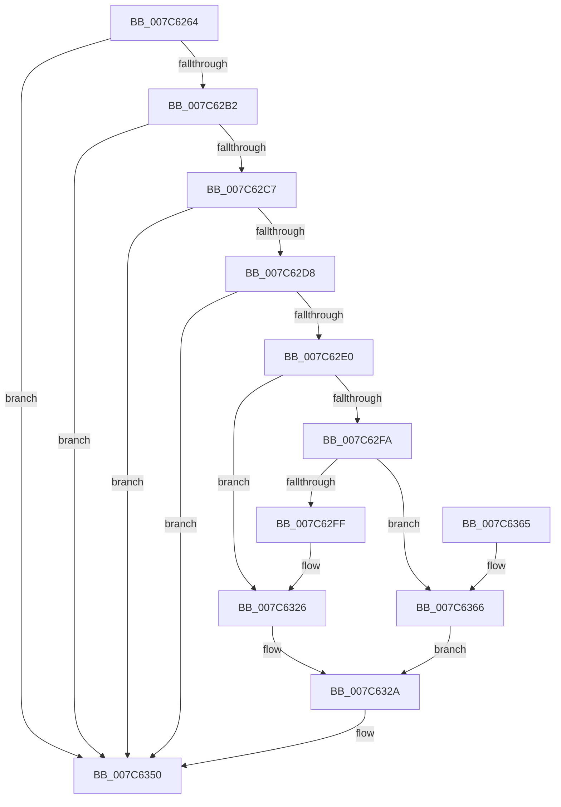

# ExpRefreshSystemTime

- RVA: `0x007C6264`–`0x007C6385` (길이 `289` bytes)
- VA: `0x00000001407C6264`
- 실행 섹션: `PAGE`
- PDB 이름 있음: `예`; PDB Function 태그: `아니요`
- unwind 정보 RVA: `0x000D48F0`
- 디코드: `72`개 명령, `289/289` bytes 표시
- 미해석 바이트: `0` (있으면 어셈블리에 `.byte`로 보존)

> 이 문서는 커널 이미지의 기계어와 PDB 기호를 분석해 생성했습니다. 4번과 5번은 함수 원형과 자료형을 바이너리 사용 방식에서 추정한 C 해석이며 원본 소스 복구 결과는 아닙니다.

## 1. Dependencies

- 직접 호출 지점: **12**; 고유 호출 대상: **12**
- 직접 호출자로 확인된 함수: **2**
- RIP 상대 이미지 참조: **2**

### Outgoing calls
- `0x007C6289` → [PsGetCurrentServerSiloGlobals](../../text/2F/PsGetCurrentServerSiloGlobals_function_002FE1F0.md) (function, `0x002FE1F0`)
- `0x007C6295` → [ExAcquireTimeRefreshLockExclusive](../9C/ExAcquireTimeRefreshLockExclusive_function_009C5810.md) (function, `0x009C5810`)
- `0x007C62A5` → [HalQueryRealTimeClock](../../text/42/HalQueryRealTimeClock_function_0042D810.md) (function, `0x0042D810`)
- `0x007C62BA` → [RtlTimeFieldsToTime](../../text/42/RtlTimeFieldsToTime_function_0042E6B0.md) (function, `0x0042E6B0`)
- `0x007C62CF` → [ExpRefreshTimeZoneInformation](../A6/ExpRefreshTimeZoneInformation_function_00A6B46C.md) (function, `0x00A6B46C`)
- `0x007C6307` → [ExSystemTimeToLocalTime](../../text/2F/ExSystemTimeToLocalTime_function_002FE1C0.md) (function, `0x002FE1C0`)
- `0x007C6314` → [RtlTimeToTimeFields](../../text/42/RtlTimeToTimeFields_function_0042E0F0.md) (function, `0x0042E0F0`)
- `0x007C631D` → [HalSetRealTimeClock](../../text/42/HalSetRealTimeClock_function_0042D310.md) (function, `0x0042D310`)
- `0x007C634B` → [PoNotifySystemTimeSet](../../text/4D/PoNotifySystemTimeSet_function_004D4F7C.md) (function, `0x004D4F7C`)
- `0x007C6350` → [ExReleaseTimeRefreshLockExclusive](../9C/ExReleaseTimeRefreshLockExclusive_function_009C5874.md) (function, `0x009C5874`)
- `0x007C636E` → [ExLocalTimeToSystemTime](../../text/49/ExLocalTimeToSystemTime_function_00494BC0.md) (function, `0x00494BC0`)
- `0x007C637E` → [KeSetSystemTime](../../text/2C/KeSetSystemTime_function_002C8E5C.md) (function, `0x002C8E5C`)

### Direct callers
- [CmpFinishSystemHivesLoad](../7D/CmpFinishSystemHivesLoad_function_007DA210.md) at `0x007DA6FE`
- [CmpFinishSystemHivesLoad](../7D/CmpFinishSystemHivesLoad_function_007DA210.md) at `0x007DA7FC`
- [CmpFinishSystemHivesLoad](../7D/CmpFinishSystemHivesLoad_function_007DA210.md) at `0x007DAB85`
- [CmCompleteRegistryInitialization](../7D/CmCompleteRegistryInitialization_function_007DF1EC.md) at `0x007DF326`

### Static image references
- `0x007C629A` → RVA `0x00E0EB98` (`.data`; read)
- `0x007C62ED` → RVA `0x00E68570` (`.data`; read)

## 2. Other-region calls and transfers

- 다른 실행 섹션으로 향하는 call: **9**
  - `0x007C6289` → [PsGetCurrentServerSiloGlobals](../../text/2F/PsGetCurrentServerSiloGlobals_function_002FE1F0.md) (`PAGE` → `.text`)
  - `0x007C62A5` → [HalQueryRealTimeClock](../../text/42/HalQueryRealTimeClock_function_0042D810.md) (`PAGE` → `.text`)
  - `0x007C62BA` → [RtlTimeFieldsToTime](../../text/42/RtlTimeFieldsToTime_function_0042E6B0.md) (`PAGE` → `.text`)
  - `0x007C6307` → [ExSystemTimeToLocalTime](../../text/2F/ExSystemTimeToLocalTime_function_002FE1C0.md) (`PAGE` → `.text`)
  - `0x007C6314` → [RtlTimeToTimeFields](../../text/42/RtlTimeToTimeFields_function_0042E0F0.md) (`PAGE` → `.text`)
  - `0x007C631D` → [HalSetRealTimeClock](../../text/42/HalSetRealTimeClock_function_0042D310.md) (`PAGE` → `.text`)
  - `0x007C634B` → [PoNotifySystemTimeSet](../../text/4D/PoNotifySystemTimeSet_function_004D4F7C.md) (`PAGE` → `.text`)
  - `0x007C636E` → [ExLocalTimeToSystemTime](../../text/49/ExLocalTimeToSystemTime_function_00494BC0.md) (`PAGE` → `.text`)
  - `0x007C637E` → [KeSetSystemTime](../../text/2C/KeSetSystemTime_function_002C8E5C.md) (`PAGE` → `.text`)
- 별도 외부 분기/꼬리 이동을 확인하지 못했습니다.

## 3. Assembly (complete function range)

```asm
007C6264  48 89 5C 24 20                  mov qword ptr [rsp + 0x20], rbx
007C6269  55                              push rbp
007C626A  56                              push rsi
007C626B  57                              push rdi
007C626C  48 8B EC                        mov rbp, rsp
007C626F  48 83 EC 50                     sub rsp, 0x50
007C6273  48 83 65 28 00                  and qword ptr [rbp + 0x28], 0
007C6278  0F 57 C0                        xorps xmm0, xmm0
007C627B  48 83 65 30 00                  and qword ptr [rbp + 0x30], 0
007C6280  48 83 65 20 00                  and qword ptr [rbp + 0x20], 0
007C6285  0F 11 45 F0                     movups xmmword ptr [rbp - 0x10], xmm0
007C6289  E8 62 7F B3 FF                  call 0x1402fe1f0
007C628E  48 8B 98 C8 04 00 00            mov rbx, qword ptr [rax + 0x4c8]
007C6295  E8 76 F5 1F 00                  call 0x1409c5810
007C629A  40 8A 3D F7 88 64 00            mov dil, byte ptr [rip + 0x6488f7]
007C62A1  48 8D 4D F0                     lea rcx, [rbp - 0x10]
007C62A5  E8 66 75 C6 FF                  call 0x14042d810
007C62AA  84 C0                           test al, al
007C62AC  0F 84 9E 00 00 00               je 0x1407c6350
007C62B2  48 8D 55 20                     lea rdx, [rbp + 0x20]
007C62B6  48 8D 4D F0                     lea rcx, [rbp - 0x10]
007C62BA  E8 F1 83 C6 FF                  call 0x14042e6b0
007C62BF  84 C0                           test al, al
007C62C1  0F 84 89 00 00 00               je 0x1407c6350
007C62C7  8B B3 B4 01 00 00               mov esi, dword ptr [rbx + 0x1b4]
007C62CD  33 C9                           xor ecx, ecx
007C62CF  E8 98 51 2A 00                  call 0x140a6b46c
007C62D4  84 C0                           test al, al
007C62D6  74 78                           je 0x1407c6350
007C62D8  3B B3 B4 01 00 00               cmp esi, dword ptr [rbx + 0x1b4]
007C62DE  74 70                           je 0x1407c6350
007C62E0  48 B8 14 00 00 00 80 F7 FF FF   movabs rax, 0xfffff78000000014
007C62EA  48 8B 00                        mov rax, qword ptr [rax]
007C62ED  83 3D 7C 22 6A 00 00            cmp dword ptr [rip + 0x6a227c], 0
007C62F4  48 89 45 28                     mov qword ptr [rbp + 0x28], rax
007C62F8  75 2C                           jne 0x1407c6326
007C62FA  40 84 FF                        test dil, dil
007C62FD  75 67                           jne 0x1407c6366
007C62FF  48 8D 55 20                     lea rdx, [rbp + 0x20]
007C6303  48 8D 4D 28                     lea rcx, [rbp + 0x28]
007C6307  E8 B4 7E B3 FF                  call 0x1402fe1c0
007C630C  48 8D 55 F0                     lea rdx, [rbp - 0x10]
007C6310  48 8D 4D 20                     lea rcx, [rbp + 0x20]
007C6314  E8 D7 7D C6 FF                  call 0x14042e0f0
007C6319  48 8D 4D F0                     lea rcx, [rbp - 0x10]
007C631D  E8 EE 6F C6 FF                  call 0x14042d310
007C6322  48 8B 45 28                     mov rax, qword ptr [rbp + 0x28]
007C6326  48 89 45 30                     mov qword ptr [rbp + 0x30], rax
007C632A  8B 83 B4 01 00 00               mov eax, dword ptr [rbx + 0x1b4]
007C6330  4C 8D 4D 20                     lea r9, [rbp + 0x20]
007C6334  40 88 7C 24 30                  mov byte ptr [rsp + 0x30], dil
007C6339  48 8D 55 28                     lea rdx, [rbp + 0x28]
007C633D  41 B8 03 00 00 00               mov r8d, 3
007C6343  89 44 24 20                     mov dword ptr [rsp + 0x20], eax
007C6347  48 8D 4D 30                     lea rcx, [rbp + 0x30]
007C634B  E8 2C EC D0 FF                  call 0x1404d4f7c
007C6350  E8 1F F5 1F 00                  call 0x1409c5874
007C6355  48 8B 9C 24 88 00 00 00         mov rbx, qword ptr [rsp + 0x88]
007C635D  48 83 C4 50                     add rsp, 0x50
007C6361  5F                              pop rdi
007C6362  5E                              pop rsi
007C6363  5D                              pop rbp
007C6364  C3                              ret
007C6365  CC                              int3
007C6366  48 8D 55 30                     lea rdx, [rbp + 0x30]
007C636A  48 8D 4D 20                     lea rcx, [rbp + 0x20]
007C636E  E8 4D E8 CC FF                  call 0x140494bc0
007C6373  45 33 C0                        xor r8d, r8d
007C6376  48 8D 55 28                     lea rdx, [rbp + 0x28]
007C637A  48 8D 4D 30                     lea rcx, [rbp + 0x30]
007C637E  E8 D9 2A B0 FF                  call 0x1402c8e5c
007C6383  EB A5                           jmp 0x1407c632a
```

## 4. C-style interpretation (structured pseudocode)

```c
__int64 __fastcall ExpRefreshSystemTime(void)
{
    __int64 result;
    __int64 v_rsp;
    unsigned __int64 v_stack_m28;
    unsigned __int8 v_stack_m38;
    unsigned int v_stack_m48;
    unsigned __int64 v_stack_p10;
    unsigned __int64 v_stack_p18;
    unsigned __int64 v_stack_p20;
    unsigned __int64 v_stack_p8;

    v_stack_p20 = v_rbx;
    v_rsp = (v_rsp) - (80);
    v_stack_m28 = v_xmm0;
    result = PsGetCurrentServerSiloGlobals(a1, a2, a3, a4);
    result = ExAcquireTimeRefreshLockExclusive(a1, a2, a3, a4);
    result = HalQueryRealTimeClock(v_stack_m28, a2, a3, a4);
    if ((unsigned __int8)(result) == 0) goto loc_007C6350;
    result = RtlTimeFieldsToTime(v_stack_m28, v_stack_p8, a3, a4);
    if ((unsigned __int8)(result) == 0) goto loc_007C6350;
    a1 = 0;
    result = ExpRefreshTimeZoneInformation(a1, v_stack_p8, a3, a4);
    if ((unsigned __int8)(result) == 0) goto loc_007C6350;
    if (((unsigned int)((unsigned int)(*(unsigned int *)(*(unsigned __int64 *)(result + 1224) + 436)))) == (*(unsigned int *)(*(unsigned __int64 *)(result + 1224) + 436))) goto loc_007C6350;
    v_stack_p10 = *(unsigned __int64 *)(result);
    if ((*(unsigned int *)(v_rip + 6955644)) != 0) goto loc_007C6326;
    if ((unsigned __int8)(*(unsigned __int8 *)(v_rip + 6588663)) != 0) goto loc_007C6366;
    result = ExSystemTimeToLocalTime(v_stack_p10, v_stack_p8, a3, a4);
    result = RtlTimeToTimeFields(v_stack_p8, v_stack_m28, a3, a4);
    result = HalSetRealTimeClock(v_stack_m28, v_stack_m28, a3, a4);
loc_007C6326:
    v_stack_p18 = v_stack_p10;
loc_007C632A:
    v_stack_m38 = (unsigned __int8)(*(unsigned __int8 *)(v_rip + 6588663));
    v_stack_m48 = (unsigned int)((unsigned int)(*(unsigned int *)(*(unsigned __int64 *)(result + 1224) + 436)));
    result = PoNotifySystemTimeSet(v_stack_p18, v_stack_p10, 3, v_stack_p8);
loc_007C6350:
    result = ExReleaseTimeRefreshLockExclusive(v_stack_p18, v_stack_p10, 3, v_stack_p8);
    v_rsp = (v_rsp) + (80);
    return result;
loc_007C6366:
    result = ExLocalTimeToSystemTime(v_stack_p8, v_stack_p18, 3, v_stack_p8);
    a3 = 0;
    result = KeSetSystemTime(v_stack_p18, v_stack_p10, a3, v_stack_p8);
    goto loc_007C632A;
}
```

## 5. (Beta) C Style

```c
void ExpRefreshSystemTime(void)
{
    int64_t result;
    int64_t local_rsp;
    uint64_t v_stack_m28;
    uint8_t v_stack_m38;
    uint32_t v_stack_m48;
    uint64_t v_stack_p10;
    uint64_t v_stack_p18;
    uint64_t v_stack_p20;
    uint64_t v_stack_p8;

    v_stack_p20 = local_rbx;
    local_rsp = (local_rsp) - (80);
    v_stack_m28 = v_xmm0;
    result = PsGetCurrentServerSiloGlobals(a1, a2, a3, a4);
    result = ExAcquireTimeRefreshLockExclusive(a1, a2, a3, a4);
    result = HalQueryRealTimeClock(v_stack_m28, a2, a3, a4);
    if ((uint8_t)(result) == 0) goto loc_007C6350;
    result = RtlTimeFieldsToTime(v_stack_m28, v_stack_p8, a3, a4);
    if ((uint8_t)(result) == 0) goto loc_007C6350;
    a1 = 0;
    result = ExpRefreshTimeZoneInformation(a1, v_stack_p8, a3, a4);
    if ((uint8_t)(result) == 0) goto loc_007C6350;
    if (((uint32_t)((uint32_t)(*(uint32_t *)(*(uint64_t *)(result + 0x4C8) + 0x1B4)))) == (*(uint32_t *)(*(uint64_t *)(result + 0x4C8) + 0x1B4))) goto loc_007C6350;
    v_stack_p10 = *(uint64_t *)(result);
    if ((*(uint32_t *)(v_rip + 0x6A227C)) != 0) goto loc_007C6326;
    if ((uint8_t)(*(uint8_t *)(v_rip + 0x6488F7)) != 0) goto loc_007C6366;
    result = ExSystemTimeToLocalTime(v_stack_p10, v_stack_p8, a3, a4);
    result = RtlTimeToTimeFields(v_stack_p8, v_stack_m28, a3, a4);
    result = HalSetRealTimeClock(v_stack_m28, v_stack_m28, a3, a4);
loc_007C6326:
    v_stack_p18 = v_stack_p10;
loc_007C632A:
    v_stack_m38 = (uint8_t)(*(uint8_t *)(v_rip + 0x6488F7));
    v_stack_m48 = (uint32_t)((uint32_t)(*(uint32_t *)(*(uint64_t *)(result + 0x4C8) + 0x1B4)));
    result = PoNotifySystemTimeSet(v_stack_p18, v_stack_p10, 3, v_stack_p8);
loc_007C6350:
    result = ExReleaseTimeRefreshLockExclusive(v_stack_p18, v_stack_p10, 3, v_stack_p8);
    local_rsp = (local_rsp) + (80);
    return result;
loc_007C6366:
    result = ExLocalTimeToSystemTime(v_stack_p8, v_stack_p18, 3, v_stack_p8);
    a3 = 0;
    result = KeSetSystemTime(v_stack_p18, v_stack_p10, a3, v_stack_p8);
    goto loc_007C632A;
}
```

## 6. Execution-region graph

[열기: 2D/3D 그래프와 함수 탐색 컨트롤 패널](../../../control-panel.html?section=page&rva=0x007C6264&view=graph)

- 2D 그래프는 위에서 아래로 흐르고, 3D 그래프는 빈 공간을 드래그해 회전합니다. Shift+드래그는 이동, 휠은 확대·축소, 함수 노드 선택은 대상 보고서 이동입니다.

### Static fallback


