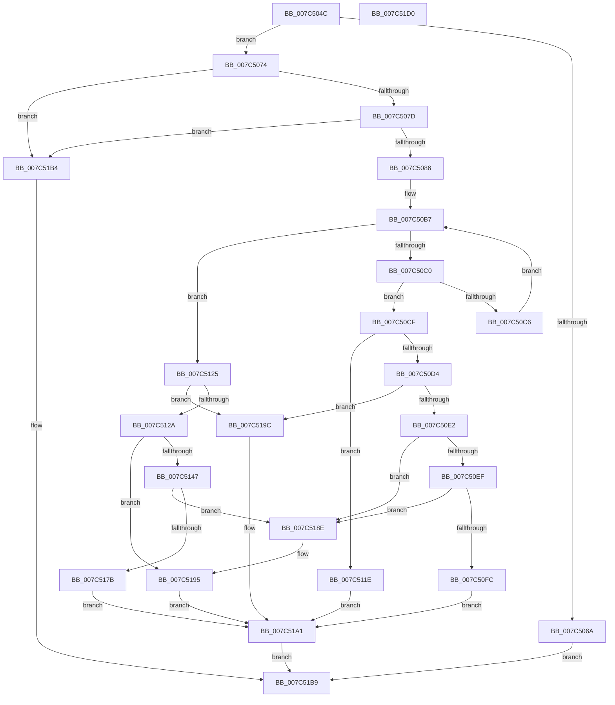

# ExpRegisterFirmwareTableInformationHandler

- RVA: `0x007C504C`–`0x007C51D1` (길이 `389` bytes)
- VA: `0x00000001407C504C`
- 실행 섹션: `PAGE`
- PDB 이름 있음: `예`; PDB Function 태그: `아니요`
- unwind 정보 RVA: `0x0005C954`
- 디코드: `100`개 명령, `389/389` bytes 표시
- 미해석 바이트: `0` (있으면 어셈블리에 `.byte`로 보존)

> 이 문서는 커널 이미지의 기계어와 PDB 기호를 분석해 생성했습니다. 4번과 5번은 함수 원형과 자료형을 바이너리 사용 방식에서 추정한 C 해석이며 원본 소스 복구 결과는 아닙니다.

## 1. Dependencies

- 직접 호출 지점: **7**; 고유 호출 대상: **7**
- 직접 호출자로 확인된 함수: **1**
- RIP 상대 이미지 참조: **4**

### Outgoing calls
- `0x007C50A0` → [ExAcquireResourceExclusiveLite](../../text/21/ExAcquireResourceExclusiveLite_function_00214E20.md) (function, `0x00214E20`)
- `0x007C5107` → [ObfDereferenceObject](../../text/2F/ObfDereferenceObject_function_002F9350.md) (function, `0x002F9350`)
- `0x007C5114` → [ExFreePoolWithTag](../../poolcode/B8/ExFreePoolWithTag_function_00B82870.md) (function, `0x00B82870`)
- `0x007C513A` → [ExAllocatePool2](../../poolcode/B8/ExAllocatePool2_function_00B820F0.md) (function, `0x00B820F0`)
- `0x007C516A` → [ObfReferenceObject](../../text/20/ObfReferenceObject_function_0020FA20.md) (function, `0x0020FA20`)
- `0x007C51A8` → [ExReleaseResourceLite](../../text/25/ExReleaseResourceLite_function_0025FA10.md) (function, `0x0025FA10`)
- `0x007C51AD` → [KeLeaveCriticalRegion](../../text/25/KeLeaveCriticalRegion_function_0025D8B0.md) (function, `0x0025D8B0`)

### Direct callers
- [NtSetSystemInformation](../AF/NtSetSystemInformation_function_00AF4A60.md) at `0x00AF550A`

### Static image references
- `0x007C508F` → RVA `0x00EFF0A0` (`.data`; read)
- `0x007C50A5` → RVA `0x00EFF080` (`.data`; read)
- `0x007C516F` → RVA `0x00EFF088` (`.data`; read)
- `0x007C5185` → RVA `0x00EFF088` (`.data`; write)

## 2. Other-region calls and transfers

- 다른 실행 섹션으로 향하는 call: **7**
  - `0x007C50A0` → [ExAcquireResourceExclusiveLite](../../text/21/ExAcquireResourceExclusiveLite_function_00214E20.md) (`PAGE` → `.text`)
  - `0x007C5107` → [ObfDereferenceObject](../../text/2F/ObfDereferenceObject_function_002F9350.md) (`PAGE` → `.text`)
  - `0x007C5114` → [ExFreePoolWithTag](../../poolcode/B8/ExFreePoolWithTag_function_00B82870.md) (`PAGE` → `POOLCODE`)
  - `0x007C513A` → [ExAllocatePool2](../../poolcode/B8/ExAllocatePool2_function_00B820F0.md) (`PAGE` → `POOLCODE`)
  - `0x007C516A` → [ObfReferenceObject](../../text/20/ObfReferenceObject_function_0020FA20.md) (`PAGE` → `.text`)
  - `0x007C51A8` → [ExReleaseResourceLite](../../text/25/ExReleaseResourceLite_function_0025FA10.md) (`PAGE` → `.text`)
  - `0x007C51AD` → [KeLeaveCriticalRegion](../../text/25/KeLeaveCriticalRegion_function_0025D8B0.md) (`PAGE` → `.text`)
- 별도 외부 분기/꼬리 이동을 확인하지 못했습니다.

## 3. Assembly (complete function range)

```asm
007C504C  48 89 5C 24 08                  mov qword ptr [rsp + 8], rbx
007C5051  48 89 6C 24 10                  mov qword ptr [rsp + 0x10], rbp
007C5056  48 89 74 24 18                  mov qword ptr [rsp + 0x18], rsi
007C505B  57                              push rdi
007C505C  48 83 EC 20                     sub rsp, 0x20
007C5060  33 DB                           xor ebx, ebx
007C5062  48 8B F1                        mov rsi, rcx
007C5065  45 84 C0                        test r8b, r8b
007C5068  74 0A                           je 0x1407c5074
007C506A  BB 61 00 00 C0                  mov ebx, 0xc0000061
007C506F  E9 45 01 00 00                  jmp 0x1407c51b9
007C5074  48 85 F6                        test rsi, rsi
007C5077  0F 84 37 01 00 00               je 0x1407c51b4
007C507D  83 FA 18                        cmp edx, 0x18
007C5080  0F 82 2E 01 00 00               jb 0x1407c51b4
007C5086  65 48 8B 04 25 88 01 00 00      mov rax, qword ptr gs:[0x188]
007C508F  48 8D 0D 0A A0 73 00            lea rcx, [rip + 0x73a00a]
007C5096  B2 01                           mov dl, 1
007C5098  66 FF 88 E4 01 00 00            dec word ptr [rax + 0x1e4]
007C509F  90                              nop
007C50A0  E8 7B FD A4 FF                  call 0x140214e20
007C50A5  48 8B 3D D4 9F 73 00            mov rdi, qword ptr [rip + 0x739fd4]
007C50AC  48 8D 2D CD 9F 73 00            lea rbp, [rip + 0x739fcd]
007C50B3  48 83 C7 E8                     add rdi, -0x18
007C50B7  48 8D 4F 18                     lea rcx, [rdi + 0x18]
007C50BB  48 3B E9                        cmp rbp, rcx
007C50BE  74 65                           je 0x1407c5125
007C50C0  8B 06                           mov eax, dword ptr [rsi]
007C50C2  39 07                           cmp dword ptr [rdi], eax
007C50C4  74 09                           je 0x1407c50cf
007C50C6  48 8B 39                        mov rdi, qword ptr [rcx]
007C50C9  48 83 EF 18                     sub rdi, 0x18
007C50CD  EB E8                           jmp 0x1407c50b7
007C50CF  38 5E 04                        cmp byte ptr [rsi + 4], bl
007C50D2  75 4A                           jne 0x1407c511e
007C50D4  48 8B 46 10                     mov rax, qword ptr [rsi + 0x10]
007C50D8  48 39 47 10                     cmp qword ptr [rdi + 0x10], rax
007C50DC  0F 85 BA 00 00 00               jne 0x1407c519c
007C50E2  48 8B 11                        mov rdx, qword ptr [rcx]
007C50E5  48 39 4A 08                     cmp qword ptr [rdx + 8], rcx
007C50E9  0F 85 9F 00 00 00               jne 0x1407c518e
007C50EF  48 8B 41 08                     mov rax, qword ptr [rcx + 8]
007C50F3  48 39 08                        cmp qword ptr [rax], rcx
007C50F6  0F 85 92 00 00 00               jne 0x1407c518e
007C50FC  48 89 10                        mov qword ptr [rax], rdx
007C50FF  48 89 42 08                     mov qword ptr [rdx + 8], rax
007C5103  48 8B 4F 10                     mov rcx, qword ptr [rdi + 0x10]
007C5107  E8 44 42 B3 FF                  call 0x1402f9350
007C510C  BA 41 52 46 54                  mov edx, 0x54465241
007C5111  48 8B CF                        mov rcx, rdi
007C5114  E8 57 D7 3B 00                  call 0x140b82870
007C5119  E9 83 00 00 00                  jmp 0x1407c51a1
007C511E  BB 00 00 00 40                  mov ebx, 0x40000000
007C5123  EB 7C                           jmp 0x1407c51a1
007C5125  38 5E 04                        cmp byte ptr [rsi + 4], bl
007C5128  74 72                           je 0x1407c519c
007C512A  BA 28 00 00 00                  mov edx, 0x28
007C512F  B9 00 01 00 00                  mov ecx, 0x100
007C5134  41 B8 41 52 46 54               mov r8d, 0x54465241
007C513A  E8 B1 CF 3B 00                  call 0x140b820f0
007C513F  48 8B C8                        mov rcx, rax
007C5142  48 85 C0                        test rax, rax
007C5145  74 4E                           je 0x1407c5195
007C5147  8B 06                           mov eax, dword ptr [rsi]
007C5149  48 8D 79 18                     lea rdi, [rcx + 0x18]
007C514D  89 01                           mov dword ptr [rcx], eax
007C514F  48 8B 46 08                     mov rax, qword ptr [rsi + 8]
007C5153  48 89 41 08                     mov qword ptr [rcx + 8], rax
007C5157  48 8B 46 10                     mov rax, qword ptr [rsi + 0x10]
007C515B  48 89 41 10                     mov qword ptr [rcx + 0x10], rax
007C515F  48 89 7F 08                     mov qword ptr [rdi + 8], rdi
007C5163  48 89 3F                        mov qword ptr [rdi], rdi
007C5166  48 8B 49 10                     mov rcx, qword ptr [rcx + 0x10]
007C516A  E8 B1 A8 A4 FF                  call 0x14020fa20
007C516F  48 8B 05 12 9F 73 00            mov rax, qword ptr [rip + 0x739f12]
007C5176  48 39 28                        cmp qword ptr [rax], rbp
007C5179  75 13                           jne 0x1407c518e
007C517B  48 89 2F                        mov qword ptr [rdi], rbp
007C517E  48 89 47 08                     mov qword ptr [rdi + 8], rax
007C5182  48 89 38                        mov qword ptr [rax], rdi
007C5185  48 89 3D FC 9E 73 00            mov qword ptr [rip + 0x739efc], rdi
007C518C  EB 13                           jmp 0x1407c51a1
007C518E  B9 03 00 00 00                  mov ecx, 3
007C5193  CD 29                           int 0x29
007C5195  BB 9A 00 00 C0                  mov ebx, 0xc000009a
007C519A  EB 05                           jmp 0x1407c51a1
007C519C  BB 0D 00 00 C0                  mov ebx, 0xc000000d
007C51A1  48 8D 0D F8 9E 73 00            lea rcx, [rip + 0x739ef8]
007C51A8  E8 63 A8 A9 FF                  call 0x14025fa10
007C51AD  E8 FE 86 A9 FF                  call 0x14025d8b0
007C51B2  EB 05                           jmp 0x1407c51b9
007C51B4  BB 04 00 00 C0                  mov ebx, 0xc0000004
007C51B9  48 8B 6C 24 38                  mov rbp, qword ptr [rsp + 0x38]
007C51BE  8B C3                           mov eax, ebx
007C51C0  48 8B 5C 24 30                  mov rbx, qword ptr [rsp + 0x30]
007C51C5  48 8B 74 24 40                  mov rsi, qword ptr [rsp + 0x40]
007C51CA  48 83 C4 20                     add rsp, 0x20
007C51CE  5F                              pop rdi
007C51CF  C3                              ret
007C51D0  CC                              int3
```

## 4. C-style interpretation (structured pseudocode)

```c
__int64 __fastcall ExpRegisterFirmwareTableInformationHandler(__int64 a1, int a2, unsigned __int8 a3)
{
    __int64 result;
    __int64 v_rbx;
    __int64 v_rdi;
    __int64 v_rsp;
    unsigned __int64 v_stack_p10;
    unsigned __int64 v_stack_p18;
    unsigned __int64 v_stack_p8;

    v_stack_p8 = v_rbx;
    v_stack_p10 = v_rbp;
    v_stack_p18 = v_rsi;
    v_rsp = (v_rsp) - (32);
    v_rbx = 0;
    if (a3 == 0) goto loc_007C5074;
    goto loc_007C51B9;
loc_007C5074:
    if (a1 == 0) goto loc_007C51B4;
    if (a2 < 24) goto loc_007C51B4;
    result = ExAcquireResourceExclusiveLite(v_rip + 7577610, 1, a3, a4);
    v_rdi = (*(unsigned __int64 *)(v_rip + 7577556)) + (-24);
loc_007C50B7:
    if ((v_rip + 7577549) == (v_rdi + 24)) goto loc_007C5125;
    if ((*(unsigned int *)(v_rdi)) == ((unsigned int)((unsigned int)(*(unsigned int *)(a1))))) goto loc_007C50CF;
    v_rdi = (*(unsigned __int64 *)(v_rdi + 24)) - (24);
    goto loc_007C50B7;
loc_007C50CF:
    if ((*(unsigned __int8 *)(a1 + 4)) != ((unsigned __int8)((unsigned int)(0xC0000061ULL)))) goto loc_007C511E;
    if ((*(unsigned __int64 *)(v_rdi + 16)) != (*(unsigned __int64 *)(a1 + 16))) goto loc_007C519C;
    if ((*(unsigned __int64 *)(*(unsigned __int64 *)(v_rdi + 24) + 8)) != (v_rdi + 24)) goto loc_007C518E;
    if ((*(unsigned __int64 *)(*(unsigned __int64 *)(v_rdi + 24 + 8))) != (v_rdi + 24)) goto loc_007C518E;
    *(unsigned __int64 *)(*(unsigned __int64 *)(v_rdi + 24 + 8)) = *(unsigned __int64 *)(v_rdi + 24);
    *(unsigned __int64 *)(*(unsigned __int64 *)(v_rdi + 24) + 8) = *(unsigned __int64 *)(v_rdi + 24 + 8);
    result = ObfDereferenceObject(*(unsigned __int64 *)(v_rdi + 16), *(unsigned __int64 *)(v_rdi + 24), a3, a4);
    result = ExFreePoolWithTag(v_rdi, (unsigned int)(0x54465241ULL), a3, a4);
    goto loc_007C51A1;
loc_007C511E:
    goto loc_007C51A1;
loc_007C5125:
    if ((*(unsigned __int8 *)(a1 + 4)) == ((unsigned __int8)((unsigned int)(0x40000000ULL)))) goto loc_007C519C;
    result = ExAllocatePool2(256, 40, (unsigned int)(0x54465241ULL), a4);
    if (result == 0) goto loc_007C5195;
    *(unsigned int *)(result) = (unsigned int)((unsigned int)(*(unsigned int *)(a1)));
    *(unsigned __int64 *)(result + 8) = *(unsigned __int64 *)(a1 + 8);
    *(unsigned __int64 *)(result + 16) = *(unsigned __int64 *)(a1 + 16);
    *(unsigned __int64 *)(result + 24 + 8) = result + 24;
    *(unsigned __int64 *)(result + 24) = result + 24;
    result = ObfReferenceObject(*(unsigned __int64 *)(result + 16), 40, (unsigned int)(0x54465241ULL), a4);
    if ((*(unsigned __int64 *)(*(unsigned __int64 *)(v_rip + 7577362))) != (v_rip + 7577549)) goto loc_007C518E;
    *(unsigned __int64 *)(result + 24) = v_rip + 7577549;
    *(unsigned __int64 *)(result + 24 + 8) = *(unsigned __int64 *)(v_rip + 7577362);
    *(unsigned __int64 *)(*(unsigned __int64 *)(v_rip + 7577362)) = result + 24;
    *(unsigned __int64 *)(v_rip + 7577340) = result + 24;
    goto loc_007C51A1;
loc_007C518E:
loc_007C5195:
    goto loc_007C51A1;
loc_007C519C:
loc_007C51A1:
    result = ExReleaseResourceLite(v_rip + 7577336, 40, (unsigned int)(0x54465241ULL), a4);
    result = KeLeaveCriticalRegion(v_rip + 7577336, 40, (unsigned int)(0x54465241ULL), a4);
    goto loc_007C51B9;
loc_007C51B4:
loc_007C51B9:
    v_rsp = (v_rsp) + (32);
    return (unsigned int)((unsigned int)((unsigned int)(0xC0000004ULL)));
}
```

## 5. (Beta) C Style

```c
int64_t ExpRegisterFirmwareTableInformationHandler(int64_t Arg1, int32_t Arg2, uint8_t Arg3)
{
    int64_t result;
    int64_t local_rbx;
    int64_t local_rdi;
    int64_t local_rsp;
    uint64_t v_stack_p10;
    uint64_t v_stack_p18;
    uint64_t v_stack_p8;

    v_stack_p8 = local_rbx;
    v_stack_p10 = local_rbp;
    v_stack_p18 = local_rsi;
    local_rsp = (local_rsp) - (32);
    local_rbx = 0;
    if (Arg3 == 0) goto loc_007C5074;
    goto loc_007C51B9;
loc_007C5074:
    if (Arg1 == 0) goto loc_007C51B4;
    if (Arg2 < 24) goto loc_007C51B4;
    result = ExAcquireResourceExclusiveLite(v_rip + 7577610, 1, Arg3, a4);
    local_rdi = (*(uint64_t *)(v_rip + 0x739FD4)) + (-24);
loc_007C50B7:
    if ((v_rip + 7577549) == (local_rdi + 24)) goto loc_007C5125;
    if ((*(uint32_t *)(local_rdi)) == ((uint32_t)((uint32_t)(*(uint32_t *)(Arg1))))) goto loc_007C50CF;
    local_rdi = (*(uint64_t *)(local_rdi + 0x18)) - (24);
    goto loc_007C50B7;
loc_007C50CF:
    if ((*(uint8_t *)(Arg1 + 0x4)) != ((uint8_t)((uint32_t)(0xC0000061ULL)))) goto loc_007C511E;
    if ((*(uint64_t *)(local_rdi + 0x10)) != (*(uint64_t *)(Arg1 + 0x10))) goto loc_007C519C;
    if ((*(uint64_t *)(*(uint64_t *)(local_rdi + 0x18) + 0x8)) != (local_rdi + 24)) goto loc_007C518E;
    if ((*(uint64_t *)(*(uint64_t *)(local_rdi + 0x18 + 0x8))) != (local_rdi + 24)) goto loc_007C518E;
    *(uint64_t *)(*(uint64_t *)(local_rdi + 0x18 + 0x8)) = *(uint64_t *)(local_rdi + 0x18);
    *(uint64_t *)(*(uint64_t *)(local_rdi + 0x18) + 0x8) = *(uint64_t *)(local_rdi + 0x18 + 0x8);
    result = ObfDereferenceObject(*(uint64_t *)(local_rdi + 0x10), *(uint64_t *)(local_rdi + 0x18), Arg3, a4);
    result = ExFreePoolWithTag(local_rdi, (uint32_t)(0x54465241ULL), Arg3, a4);
    goto loc_007C51A1;
loc_007C511E:
    goto loc_007C51A1;
loc_007C5125:
    if ((*(uint8_t *)(Arg1 + 0x4)) == ((uint8_t)((uint32_t)(0x40000000ULL)))) goto loc_007C519C;
    result = ExAllocatePool2(256, 40, (uint32_t)(0x54465241ULL), a4);
    if (result == 0) goto loc_007C5195;
    *(uint32_t *)(result) = (uint32_t)((uint32_t)(*(uint32_t *)(Arg1)));
    *(uint64_t *)(result + 0x8) = *(uint64_t *)(Arg1 + 0x8);
    *(uint64_t *)(result + 0x10) = *(uint64_t *)(Arg1 + 0x10);
    *(uint64_t *)(result + 0x18 + 0x8) = result + 24;
    *(uint64_t *)(result + 0x18) = result + 24;
    result = ObfReferenceObject(*(uint64_t *)(result + 0x10), 40, (uint32_t)(0x54465241ULL), a4);
    if ((*(uint64_t *)(*(uint64_t *)(v_rip + 0x739F12))) != (v_rip + 7577549)) goto loc_007C518E;
    *(uint64_t *)(result + 0x18) = v_rip + 7577549;
    *(uint64_t *)(result + 0x18 + 0x8) = *(uint64_t *)(v_rip + 0x739F12);
    *(uint64_t *)(*(uint64_t *)(v_rip + 0x739F12)) = result + 24;
    *(uint64_t *)(v_rip + 0x739EFC) = result + 24;
    goto loc_007C51A1;
loc_007C518E:
loc_007C5195:
    goto loc_007C51A1;
loc_007C519C:
loc_007C51A1:
    result = ExReleaseResourceLite(v_rip + 7577336, 40, (uint32_t)(0x54465241ULL), a4);
    result = KeLeaveCriticalRegion(v_rip + 7577336, 40, (uint32_t)(0x54465241ULL), a4);
    goto loc_007C51B9;
loc_007C51B4:
loc_007C51B9:
    local_rsp = (local_rsp) + (32);
    return (uint32_t)((uint32_t)((uint32_t)(0xC0000004ULL)));
}
```

## 6. Execution-region graph

[열기: 2D/3D 그래프와 함수 탐색 컨트롤 패널](../../../control-panel.html?section=page&rva=0x007C504C&view=graph)

- 2D 그래프는 위에서 아래로 흐르고, 3D 그래프는 빈 공간을 드래그해 회전합니다. Shift+드래그는 이동, 휠은 확대·축소, 함수 노드 선택은 대상 보고서 이동입니다.

### Static fallback


