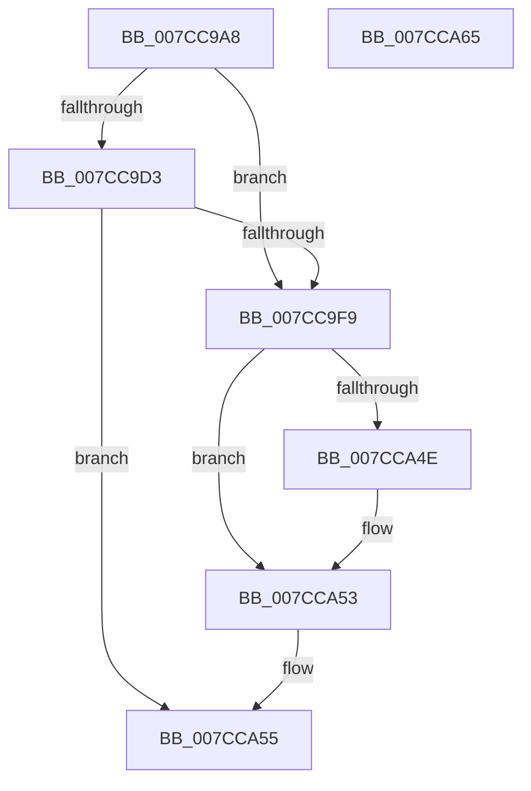

# ExpSetFirmwareEnvironmentVariable

- RVA: `0x007CC9A8`–`0x007CCA66` (길이 `190` bytes)
- VA: `0x00000001407CC9A8`
- 실행 섹션: `PAGE`
- PDB 이름 있음: `예`; PDB Function 태그: `아니요`
- unwind 정보 RVA: `0x000718AC`
- 디코드: `51`개 명령, `190/190` bytes 표시
- 미해석 바이트: `0` (있으면 어셈블리에 `.byte`로 보존)

> 이 문서는 커널 이미지의 기계어와 PDB 기호를 분석해 생성했습니다. 4번과 5번은 함수 원형과 자료형을 바이너리 사용 방식에서 추정한 C 해석이며 원본 소스 복구 결과는 아닙니다.

## 1. Dependencies

- 직접 호출 지점: **6**; 고유 호출 대상: **6**
- 직접 호출자로 확인된 함수: **2**
- RIP 상대 이미지 참조: **1**

### Outgoing calls
- `0x007CC9F0` → [ExLockUserBuffer](../95/ExLockUserBuffer_function_009533B8.md) (function, `0x009533B8`)
- `0x007CCA11` → [ExAcquireFastMutexUnsafe](../../text/3F/ExAcquireFastMutexUnsafe_function_003F3720.md) (function, `0x003F3720`)
- `0x007CCA2C` → [IoSetEnvironmentVariableEx](../A9/IoSetEnvironmentVariableEx_function_00A91A84.md) (function, `0x00A91A84`)
- `0x007CCA3A` → [ExReleaseFastMutexUnsafe](../../text/25/ExReleaseFastMutexUnsafe_function_002503A0.md) (function, `0x002503A0`)
- `0x007CCA3F` → [KeLeaveCriticalRegion](../../text/25/KeLeaveCriticalRegion_function_0025D8B0.md) (function, `0x0025D8B0`)
- `0x007CCA4E` → [ExUnlockUserBuffer](../../text/29/ExUnlockUserBuffer_function_0029F258.md) (function, `0x0029F258`)

### Direct callers
- [ExSetFirmwareEnvironmentVariable](ExSetFirmwareEnvironmentVariable_function_007CAE70.md) at `0x007CAED3`
- [NtSetSystemEnvironmentValueEx](NtSetSystemEnvironmentValueEx_function_007CE990.md) at `0x007CEBC9`

### Static image references
- `0x007CCA02` → RVA `0x00EFAB40` (`.data`; read)

## 2. Other-region calls and transfers

- 다른 실행 섹션으로 향하는 call: **4**
  - `0x007CCA11` → [ExAcquireFastMutexUnsafe](../../text/3F/ExAcquireFastMutexUnsafe_function_003F3720.md) (`PAGE` → `.text`)
  - `0x007CCA3A` → [ExReleaseFastMutexUnsafe](../../text/25/ExReleaseFastMutexUnsafe_function_002503A0.md) (`PAGE` → `.text`)
  - `0x007CCA3F` → [KeLeaveCriticalRegion](../../text/25/KeLeaveCriticalRegion_function_0025D8B0.md) (`PAGE` → `.text`)
  - `0x007CCA4E` → [ExUnlockUserBuffer](../../text/29/ExUnlockUserBuffer_function_0029F258.md) (`PAGE` → `.text`)
- 별도 외부 분기/꼬리 이동을 확인하지 못했습니다.

## 3. Assembly (complete function range)

```asm
007CC9A8  4C 8B DC                        mov r11, rsp
007CC9AB  49 89 5B 08                     mov qword ptr [r11 + 8], rbx
007CC9AF  49 89 73 10                     mov qword ptr [r11 + 0x10], rsi
007CC9B3  57                              push rdi
007CC9B4  48 83 EC 40                     sub rsp, 0x40
007CC9B8  49 83 63 F0 00                  and qword ptr [r11 - 0x10], 0
007CC9BD  41 8B D9                        mov ebx, r9d
007CC9C0  49 83 63 E8 00                  and qword ptr [r11 - 0x18], 0
007CC9C5  49 8B C0                        mov rax, r8
007CC9C8  48 8B FA                        mov rdi, rdx
007CC9CB  48 8B F1                        mov rsi, rcx
007CC9CE  45 85 C9                        test r9d, r9d
007CC9D1  74 26                           je 0x1407cc9f9
007CC9D3  44 8A 44 24 78                  mov r8b, byte ptr [rsp + 0x78]
007CC9D8  49 8D 4B F0                     lea rcx, [r11 - 0x10]
007CC9DC  49 89 4B E0                     mov qword ptr [r11 - 0x20], rcx
007CC9E0  45 33 C9                        xor r9d, r9d
007CC9E3  49 8D 4B E8                     lea rcx, [r11 - 0x18]
007CC9E7  8B D3                           mov edx, ebx
007CC9E9  49 89 4B D8                     mov qword ptr [r11 - 0x28], rcx
007CC9ED  48 8B C8                        mov rcx, rax
007CC9F0  E8 C3 69 18 00                  call 0x1409533b8
007CC9F5  85 C0                           test eax, eax
007CC9F7  78 5C                           js 0x1407cca55
007CC9F9  65 48 8B 04 25 88 01 00 00      mov rax, qword ptr gs:[0x188]
007CCA02  48 8D 0D 37 E1 72 00            lea rcx, [rip + 0x72e137]
007CCA09  66 FF 88 E4 01 00 00            dec word ptr [rax + 0x1e4]
007CCA10  90                              nop
007CCA11  E8 0A 6D C2 FF                  call 0x1403f3720
007CCA16  8B 44 24 70                     mov eax, dword ptr [rsp + 0x70]
007CCA1A  44 8B CB                        mov r9d, ebx
007CCA1D  4C 8B 44 24 30                  mov r8, qword ptr [rsp + 0x30]
007CCA22  48 8B D7                        mov rdx, rdi
007CCA25  48 8B CE                        mov rcx, rsi
007CCA28  89 44 24 20                     mov dword ptr [rsp + 0x20], eax
007CCA2C  E8 53 50 2C 00                  call 0x140a91a84
007CCA31  48 8D 0D 08 E1 72 00            lea rcx, [rip + 0x72e108]
007CCA38  8B D8                           mov ebx, eax
007CCA3A  E8 61 39 A8 FF                  call 0x1402503a0
007CCA3F  E8 6C 0E A9 FF                  call 0x14025d8b0
007CCA44  48 8B 4C 24 38                  mov rcx, qword ptr [rsp + 0x38]
007CCA49  48 85 C9                        test rcx, rcx
007CCA4C  74 05                           je 0x1407cca53
007CCA4E  E8 05 28 AD FF                  call 0x14029f258
007CCA53  8B C3                           mov eax, ebx
007CCA55  48 8B 5C 24 50                  mov rbx, qword ptr [rsp + 0x50]
007CCA5A  48 8B 74 24 58                  mov rsi, qword ptr [rsp + 0x58]
007CCA5F  48 83 C4 40                     add rsp, 0x40
007CCA63  5F                              pop rdi
007CCA64  C3                              ret
007CCA65  CC                              int3
```

## 4. C-style interpretation (structured pseudocode)

```c
__int64 __fastcall ExpSetFirmwareEnvironmentVariable(__int64 a1, __int64 a2, __int64 a3, int a4, unsigned int a5, unsigned __int8 a6)
{
    __int64 result;
    __int64 v_rsp;
    unsigned __int64 v_stack_m10;
    unsigned __int64 v_stack_m18;
    unsigned int v_stack_m28;
    unsigned __int64 v_stack_p10;
    unsigned __int64 v_stack_p8;

    *(unsigned __int64 *)(v_rsp + 8) = v_rbx;
    *(unsigned __int64 *)(v_rsp + 16) = v_rsi;
    v_rsp = (v_rsp) - (64);
    if (a4 == 0) goto loc_007CC9F9;
    *(unsigned __int64 *)(v_rsp - 32) = v_rsp - 16;
    a4 = 0;
    *(unsigned __int64 *)(v_rsp - 40) = v_rsp - 24;
    result = ExLockUserBuffer(a3, (unsigned int)((unsigned int)((unsigned int)(a4))), a6, a4);
    if (sign_flag) goto loc_007CCA55;
loc_007CC9F9:
    result = ExAcquireFastMutexUnsafe(v_rip + 7528759, (unsigned int)((unsigned int)((unsigned int)(a4))), a6, a4);
    v_stack_m28 = (unsigned int)((unsigned int)(a5));
    result = IoSetEnvironmentVariableEx(a1, a2, v_stack_m18, (unsigned int)((unsigned int)((unsigned int)(a4))));
    result = ExReleaseFastMutexUnsafe(v_rip + 7528712, a2, v_stack_m18, (unsigned int)((unsigned int)((unsigned int)(a4))));
    result = KeLeaveCriticalRegion(v_rip + 7528712, a2, v_stack_m18, (unsigned int)((unsigned int)((unsigned int)(a4))));
    if (v_stack_m10 != 0) {
        result = ExUnlockUserBuffer(v_stack_m10, a2, v_stack_m18, (unsigned int)((unsigned int)((unsigned int)(a4))));
    }
loc_007CCA55:
    v_rsp = (v_rsp) + (64);
    return (unsigned int)((unsigned int)((unsigned int)((unsigned int)(result))));
}
```

## 5. (Beta) C Style

```c
int64_t ExpSetFirmwareEnvironmentVariable(int64_t Arg1, int64_t Arg2, int64_t Arg3, int32_t Arg4, uint32_t Arg5, uint8_t Arg6)
{
    int64_t result;
    int64_t local_rsp;
    uint64_t v_stack_m10;
    uint64_t v_stack_m18;
    uint32_t v_stack_m28;
    uint64_t v_stack_p10;
    uint64_t v_stack_p8;

    *(uint64_t *)(local_rsp + 0x8) = local_rbx;
    *(uint64_t *)(local_rsp + 0x10) = local_rsi;
    local_rsp = (local_rsp) - (64);
    if (Arg4 == 0) goto loc_007CC9F9;
    *(uint64_t *)(local_rsp - 0x20) = local_rsp - 16;
    Arg4 = 0;
    *(uint64_t *)(local_rsp - 0x28) = local_rsp - 24;
    result = ExLockUserBuffer(Arg3, (uint32_t)((uint32_t)((uint32_t)(Arg4))), Arg6, Arg4);
    if (sign_flag) goto loc_007CCA55;
loc_007CC9F9:
    result = ExAcquireFastMutexUnsafe(v_rip + 7528759, (uint32_t)((uint32_t)((uint32_t)(Arg4))), Arg6, Arg4);
    v_stack_m28 = (uint32_t)((uint32_t)(Arg5));
    result = IoSetEnvironmentVariableEx(Arg1, Arg2, v_stack_m18, (uint32_t)((uint32_t)((uint32_t)(Arg4))));
    result = ExReleaseFastMutexUnsafe(v_rip + 7528712, Arg2, v_stack_m18, (uint32_t)((uint32_t)((uint32_t)(Arg4))));
    result = KeLeaveCriticalRegion(v_rip + 7528712, Arg2, v_stack_m18, (uint32_t)((uint32_t)((uint32_t)(Arg4))));
    if (v_stack_m10 != 0) {
        result = ExUnlockUserBuffer(v_stack_m10, Arg2, v_stack_m18, (uint32_t)((uint32_t)((uint32_t)(Arg4))));
    }
loc_007CCA55:
    local_rsp = (local_rsp) + (64);
    return (uint32_t)((uint32_t)((uint32_t)((uint32_t)(result))));
}
```

## 6. Execution-region graph

[열기: 2D/3D 그래프와 함수 탐색 컨트롤 패널](../../../control-panel.html?section=page&rva=0x007CC9A8&view=graph)

- 2D 그래프는 위에서 아래로 흐르고, 3D 그래프는 빈 공간을 드래그해 회전합니다. Shift+드래그는 이동, 휠은 확대·축소, 함수 노드 선택은 대상 보고서 이동입니다.

### Static fallback


