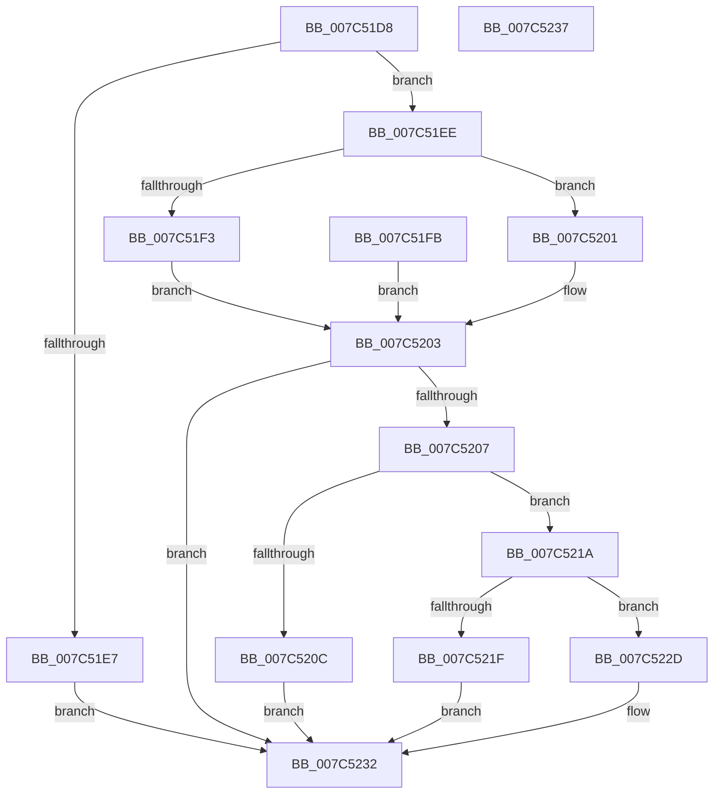

# ExpSetProcessorMicrocodeUpdateInformation

- RVA: `0x007C51D8`–`0x007C5238` (길이 `96` bytes)
- VA: `0x00000001407C51D8`
- 실행 섹션: `PAGE`
- PDB 이름 있음: `예`; PDB Function 태그: `아니요`
- unwind 정보 RVA: `0x000D4124`
- 디코드: `31`개 명령, `96/96` bytes 표시
- 미해석 바이트: `0` (있으면 어셈블리에 `.byte`로 보존)

> 이 문서는 커널 이미지의 기계어와 PDB 기호를 분석해 생성했습니다. 4번과 5번은 함수 원형과 자료형을 바이너리 사용 방식에서 추정한 C 해석이며 원본 소스 복구 결과는 아닙니다.

## 1. Dependencies

- 직접 호출 지점: **2**; 고유 호출 대상: **2**
- 직접 호출자로 확인된 함수: **1**
- RIP 상대 이미지 참조: **2**

### Outgoing calls
- `0x007C520C` → `ext-ms-win-ntos-ucode-l1-1-0.dll!ExpMicrocodeInformationLoad` (import, 간접 대상; import `ext-ms-win-ntos-ucode-l1-1-0.dll!ExpMicrocodeInformationLoad`)
- `0x007C521F` → `ext-ms-win-ntos-ucode-l1-1-0.dll!ExpMicrocodeInformationUnload` (import, 간접 대상; import `ext-ms-win-ntos-ucode-l1-1-0.dll!ExpMicrocodeInformationUnload`)

### Direct callers
- [NtSetSystemInformation](../AF/NtSetSystemInformation_function_00AF4A60.md) at `0x00AF5A3F`

### Static image references
- `0x007C520C` → RVA `0x00151608` (`ext-ms-win-ntos-ucode-l1-1-0.dll!ExpMicrocodeInformationLoad (IAT)`; read)
- `0x007C521F` → RVA `0x00151600` (`ext-ms-win-ntos-ucode-l1-1-0.dll!ExpMicrocodeInformationUnload (IAT)`; read)

## 2. Other-region calls and transfers

- 다른 실행 섹션으로 향하는 call: **0**
- 별도 외부 분기/꼬리 이동을 확인하지 못했습니다.

## 3. Assembly (complete function range)

```asm
007C51D8  48 83 EC 38                     sub rsp, 0x38
007C51DC  33 C0                           xor eax, eax
007C51DE  21 44 24 20                     and dword ptr [rsp + 0x20], eax
007C51E2  83 FA 04                        cmp edx, 4
007C51E5  73 07                           jae 0x1407c51ee
007C51E7  B8 04 00 00 C0                  mov eax, 0xc0000004
007C51EC  EB 44                           jmp 0x1407c5232
007C51EE  45 84 C0                        test r8b, r8b
007C51F1  74 0E                           je 0x1407c5201
007C51F3  8B 09                           mov ecx, dword ptr [rcx]
007C51F5  89 4C 24 20                     mov dword ptr [rsp + 0x20], ecx
007C51F9  EB 08                           jmp 0x1407c5203
007C51FB  8B 4C 24 20                     mov ecx, dword ptr [rsp + 0x20]
007C51FF  EB 02                           jmp 0x1407c5203
007C5201  8B 09                           mov ecx, dword ptr [rcx]
007C5203  85 C0                           test eax, eax
007C5205  78 2B                           js 0x1407c5232
007C5207  83 F9 01                        cmp ecx, 1
007C520A  75 0E                           jne 0x1407c521a
007C520C  48 FF 15 F5 C3 98 FF            call qword ptr [rip - 0x673c0b]
007C5213  0F 1F 44 00 00                  nop dword ptr [rax + rax]
007C5218  EB 18                           jmp 0x1407c5232
007C521A  83 F9 02                        cmp ecx, 2
007C521D  75 0E                           jne 0x1407c522d
007C521F  48 FF 15 DA C3 98 FF            call qword ptr [rip - 0x673c26]
007C5226  0F 1F 44 00 00                  nop dword ptr [rax + rax]
007C522B  EB 05                           jmp 0x1407c5232
007C522D  B8 0D 00 00 C0                  mov eax, 0xc000000d
007C5232  48 83 C4 38                     add rsp, 0x38
007C5236  C3                              ret
007C5237  CC                              int3
```

## 4. C-style interpretation (structured pseudocode)

```c
__int64 __fastcall ExpSetProcessorMicrocodeUpdateInformation(__int64 a1, int a2, unsigned __int8 a3)
{
    __int64 result;
    __int64 v_rsp;
    unsigned int v_stack_m18;

    v_rsp = (v_rsp) - (56);
    result = 0;
    if (a2 >= 4) goto loc_007C51EE;
    goto loc_007C5232;
loc_007C51EE:
    if (a3 == 0) goto loc_007C5201;
    v_stack_m18 = (unsigned int)((unsigned int)(*(unsigned int *)(a1)));
    goto loc_007C5203;
loc_007C5201:
loc_007C5203:
    if (sign_flag) goto loc_007C5232;
    if (((unsigned int)((unsigned int)(*(unsigned int *)((unsigned int)(*(unsigned int *)(a1)))))) != 1) goto loc_007C521A;
    result = ext_ms_win_ntos_ucode_l1_1_0_dll_ExpMicrocodeInformationLoad((unsigned int)(*(unsigned int *)((unsigned int)(*(unsigned int *)(a1)))), a2, a3, a4);
    goto loc_007C5232;
loc_007C521A:
    if (((unsigned int)((unsigned int)(*(unsigned int *)((unsigned int)(*(unsigned int *)(a1)))))) != 2) goto loc_007C522D;
    result = ext_ms_win_ntos_ucode_l1_1_0_dll_ExpMicrocodeInformationUnload((unsigned int)(*(unsigned int *)((unsigned int)(*(unsigned int *)(a1)))), a2, a3, a4);
    goto loc_007C5232;
loc_007C522D:
loc_007C5232:
    v_rsp = (v_rsp) + (56);
    return (unsigned int)(0xC000000DULL);
}
```

## 5. (Beta) C Style

```c
int64_t ExpSetProcessorMicrocodeUpdateInformation(void *Arg1, int32_t Arg2, uint8_t Arg3)
{
    uint8_t *arg1 = (uint8_t *)Arg1;

    int64_t result;
    int64_t local_rsp;
    uint32_t v_stack_m18;

    local_rsp = (local_rsp) - (56);
    result = 0;
    if (Arg2 >= 4) goto loc_007C51EE;
    goto loc_007C5232;
loc_007C51EE:
    if (Arg3 == 0) goto loc_007C5201;
    v_stack_m18 = (uint32_t)((uint32_t)(*(uint32_t *)(arg1)));
    goto loc_007C5203;
loc_007C5201:
loc_007C5203:
    if (sign_flag) goto loc_007C5232;
    if (((uint32_t)((uint32_t)(*(uint32_t *)((uint32_t)(*(uint32_t *)(arg1)))))) != 1) goto loc_007C521A;
    result = kernel_indirect_call((uint32_t)(*(uint32_t *)((uint32_t)(*(uint32_t *)(arg1)))), Arg2, Arg3, a4);
    goto loc_007C5232;
loc_007C521A:
    if (((uint32_t)((uint32_t)(*(uint32_t *)((uint32_t)(*(uint32_t *)(arg1)))))) != 2) goto loc_007C522D;
    result = kernel_indirect_call((uint32_t)(*(uint32_t *)((uint32_t)(*(uint32_t *)(arg1)))), Arg2, Arg3, a4);
    goto loc_007C5232;
loc_007C522D:
loc_007C5232:
    local_rsp = (local_rsp) + (56);
    return (uint32_t)(0xC000000DULL);
}
```

### 관측된 메모리 오프셋

구조체 형식이 확인되지 않은 접근은 인자 기준의 오프셋으로만 기록했습니다.

| 기준 인자 | 오프셋 표현 | 폭 (bit) | 접근 |
|---|---:|---:|---|
| `Arg1` | `+ 0x0` | `32` | `R` |

## 6. Execution-region graph

[열기: 2D/3D 그래프와 함수 탐색 컨트롤 패널](../../../control-panel.html?section=page&rva=0x007C51D8&view=graph)

- 2D 그래프는 위에서 아래로 흐르고, 3D 그래프는 빈 공간을 드래그해 회전합니다. Shift+드래그는 이동, 휠은 확대·축소, 함수 노드 선택은 대상 보고서 이동입니다.

### Static fallback


