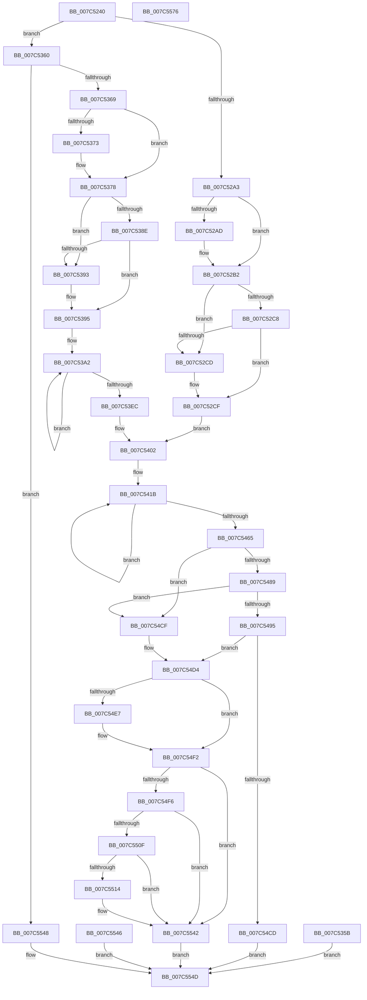

# ExpSetTimeZoneInformation

- RVA: `0x007C5240`–`0x007C5577` (길이 `823` bytes)
- VA: `0x00000001407C5240`
- 실행 섹션: `PAGE`
- PDB 이름 있음: `예`; PDB Function 태그: `아니요`
- unwind 정보 RVA: `0x000D41F4`
- 디코드: `208`개 명령, `823/823` bytes 표시
- 미해석 바이트: `0` (있으면 어셈블리에 `.byte`로 보존)

> 이 문서는 커널 이미지의 기계어와 PDB 기호를 분석해 생성했습니다. 4번과 5번은 함수 원형과 자료형을 바이너리 사용 방식에서 추정한 C 해석이며 원본 소스 복구 결과는 아닙니다.

## 1. Dependencies

- 직접 호출 지점: **17**; 고유 호출 대상: **11**
- 직접 호출자로 확인된 함수: **1**
- RIP 상대 이미지 참조: **3**

### Outgoing calls
- `0x007C527D` → [memset](../../text/6C/memset_function_006C6C40.md) (function, `0x006C6C40`)
- `0x007C528F` → [memset](../../text/6C/memset_function_006C6C40.md) (function, `0x006C6C40`)
- `0x007C52AD` → [ExRaiseDatatypeMisalignment](../89/ExRaiseDatatypeMisalignment_function_00899FD0.md) (function, `0x00899FD0`)
- `0x007C5349` → [memset](../../text/6C/memset_function_006C6C40.md) (function, `0x006C6C40`)
- `0x007C5373` → [ExRaiseDatatypeMisalignment](../89/ExRaiseDatatypeMisalignment_function_00899FD0.md) (function, `0x00899FD0`)
- `0x007C5402` → [ExAcquireTimeRefreshLockShared](../A2/ExAcquireTimeRefreshLockShared_function_00A201D0.md) (function, `0x00A201D0`)
- `0x007C5407` → [PsGetCurrentServerSiloGlobals](../../text/2F/PsGetCurrentServerSiloGlobals_function_002FE1F0.md) (function, `0x002FE1F0`)
- `0x007C547B` → [ExReleaseTimeRefreshLockShared](../A2/ExReleaseTimeRefreshLockShared_function_00A2023C.md) (function, `0x00A2023C`)
- `0x007C5480` → [PsIsCurrentThreadInServerSilo](../../text/43/PsIsCurrentThreadInServerSilo_function_004362E0.md) (function, `0x004362E0`)
- `0x007C5489` → [ExpReadSiloTimeZoneMarker](ExpReadSiloTimeZoneMarker_function_007C61A8.md) (function, `0x007C61A8`)
- `0x007C54C4` → [RtlWriteRegistryValue](../A6/RtlWriteRegistryValue_function_00A6C620.md) (function, `0x00A6C620`)
- `0x007C54DC` → [RtlpSetTimeZoneInformationWorker](../78/RtlpSetTimeZoneInformationWorker_function_0078FEC8.md) (function, `0x0078FEC8`)
- `0x007C54EB` → [NtSetSystemTime](NtSetSystemTime_function_007C65F0.md) (function, `0x007C65F0`)
- `0x007C5501` → [RtlpSetTimeZoneInformationWorker](../78/RtlpSetTimeZoneInformationWorker_function_0078FEC8.md) (function, `0x0078FEC8`)
- `0x007C5506` → [PsIsCurrentThreadInServerSilo](../../text/43/PsIsCurrentThreadInServerSilo_function_004362E0.md) (function, `0x004362E0`)
- `0x007C553D` → [RtlWriteRegistryValue](../A6/RtlWriteRegistryValue_function_00A6C620.md) (function, `0x00A6C620`)
- `0x007C5558` → [_security_check_cookie](../../text/6A/_security_check_cookie_function_006AC640.md) (function, `0x006AC640`)

### Direct callers
- [NtSetSystemInformation](../AF/NtSetSystemInformation_function_00AF4A60.md) at `0x00AF58E9`

### Static image references
- `0x007C5256` → RVA `0x00E0A740` (`.data`; read)
- `0x007C54B3` → RVA `0x00038E20` (`.rdata`; read)
- `0x007C54BA` → RVA `0x00038E80` (`.rdata`; read)

## 2. Other-region calls and transfers

- 다른 실행 섹션으로 향하는 call: **7**
  - `0x007C527D` → [memset](../../text/6C/memset_function_006C6C40.md) (`PAGE` → `.text`)
  - `0x007C528F` → [memset](../../text/6C/memset_function_006C6C40.md) (`PAGE` → `.text`)
  - `0x007C5349` → [memset](../../text/6C/memset_function_006C6C40.md) (`PAGE` → `.text`)
  - `0x007C5407` → [PsGetCurrentServerSiloGlobals](../../text/2F/PsGetCurrentServerSiloGlobals_function_002FE1F0.md) (`PAGE` → `.text`)
  - `0x007C5480` → [PsIsCurrentThreadInServerSilo](../../text/43/PsIsCurrentThreadInServerSilo_function_004362E0.md) (`PAGE` → `.text`)
  - `0x007C5506` → [PsIsCurrentThreadInServerSilo](../../text/43/PsIsCurrentThreadInServerSilo_function_004362E0.md) (`PAGE` → `.text`)
  - `0x007C5558` → [_security_check_cookie](../../text/6A/_security_check_cookie_function_006AC640.md) (`PAGE` → `.text`)
- 별도 외부 분기/꼬리 이동을 확인하지 못했습니다.

## 3. Assembly (complete function range)

```asm
007C5240  48 89 5C 24 10                  mov qword ptr [rsp + 0x10], rbx
007C5245  48 89 74 24 18                  mov qword ptr [rsp + 0x18], rsi
007C524A  57                              push rdi
007C524B  41 56                           push r14
007C524D  41 57                           push r15
007C524F  48 81 EC B0 03 00 00            sub rsp, 0x3b0
007C5256  48 8B 05 E3 54 64 00            mov rax, qword ptr [rip + 0x6454e3]
007C525D  48 33 C4                        xor rax, rsp
007C5260  48 89 84 24 A0 03 00 00         mov qword ptr [rsp + 0x3a0], rax
007C5268  8B FA                           mov edi, edx
007C526A  48 8B D9                        mov rbx, rcx
007C526D  41 BF B0 01 00 00               mov r15d, 0x1b0
007C5273  45 8B C7                        mov r8d, r15d
007C5276  33 D2                           xor edx, edx
007C5278  48 8D 4C 24 40                  lea rcx, [rsp + 0x40]
007C527D  E8 BE 19 F0 FF                  call 0x1406c6c40
007C5282  45 8B C7                        mov r8d, r15d
007C5285  33 D2                           xor edx, edx
007C5287  48 8D 8C 24 F0 01 00 00         lea rcx, [rsp + 0x1f0]
007C528F  E8 AC 19 F0 FF                  call 0x1406c6c40
007C5294  45 32 F6                        xor r14b, r14b
007C5297  81 FF AC 00 00 00               cmp edi, 0xac
007C529D  0F 85 BD 00 00 00               jne 0x1407c5360
007C52A3  BF 03 00 00 00                  mov edi, 3
007C52A8  40 84 DF                        test dil, bl
007C52AB  74 05                           je 0x1407c52b2
007C52AD  E8 1E 4D 0D 00                  call 0x140899fd0
007C52B2  48 8D 8B AC 00 00 00            lea rcx, [rbx + 0xac]
007C52B9  48 B8 00 00 FF FF FF 7F 00 00   movabs rax, 0x7fffffff0000
007C52C3  48 3B C8                        cmp rcx, rax
007C52C6  77 05                           ja 0x1407c52cd
007C52C8  48 3B CB                        cmp rcx, rbx
007C52CB  73 02                           jae 0x1407c52cf
007C52CD  8A 00                           mov al, byte ptr [rax]
007C52CF  48 8D 4C 24 40                  lea rcx, [rsp + 0x40]
007C52D4  0F 10 03                        movups xmm0, xmmword ptr [rbx]
007C52D7  0F 11 01                        movups xmmword ptr [rcx], xmm0
007C52DA  0F 10 4B 10                     movups xmm1, xmmword ptr [rbx + 0x10]
007C52DE  0F 11 49 10                     movups xmmword ptr [rcx + 0x10], xmm1
007C52E2  0F 10 43 20                     movups xmm0, xmmword ptr [rbx + 0x20]
007C52E6  0F 11 41 20                     movups xmmword ptr [rcx + 0x20], xmm0
007C52EA  0F 10 4B 30                     movups xmm1, xmmword ptr [rbx + 0x30]
007C52EE  0F 11 49 30                     movups xmmword ptr [rcx + 0x30], xmm1
007C52F2  0F 10 43 40                     movups xmm0, xmmword ptr [rbx + 0x40]
007C52F6  0F 11 41 40                     movups xmmword ptr [rcx + 0x40], xmm0
007C52FA  0F 10 4B 50                     movups xmm1, xmmword ptr [rbx + 0x50]
007C52FE  0F 11 49 50                     movups xmmword ptr [rcx + 0x50], xmm1
007C5302  0F 10 43 60                     movups xmm0, xmmword ptr [rbx + 0x60]
007C5306  0F 11 41 60                     movups xmmword ptr [rcx + 0x60], xmm0
007C530A  BE 80 00 00 00                  mov esi, 0x80
007C530F  48 03 CE                        add rcx, rsi
007C5312  0F 10 43 70                     movups xmm0, xmmword ptr [rbx + 0x70]
007C5316  0F 11 41 F0                     movups xmmword ptr [rcx - 0x10], xmm0
007C531A  48 03 DE                        add rbx, rsi
007C531D  0F 10 0B                        movups xmm1, xmmword ptr [rbx]
007C5320  0F 11 09                        movups xmmword ptr [rcx], xmm1
007C5323  0F 10 43 10                     movups xmm0, xmmword ptr [rbx + 0x10]
007C5327  0F 11 41 10                     movups xmmword ptr [rcx + 0x10], xmm0
007C532B  48 8B 43 20                     mov rax, qword ptr [rbx + 0x20]
007C532F  48 89 41 20                     mov qword ptr [rcx + 0x20], rax
007C5333  8B 43 28                        mov eax, dword ptr [rbx + 0x28]
007C5336  89 41 28                        mov dword ptr [rcx + 0x28], eax
007C5339  33 D2                           xor edx, edx
007C533B  41 B8 00 01 00 00               mov r8d, 0x100
007C5341  48 8D 8C 24 EC 00 00 00         lea rcx, [rsp + 0xec]
007C5349  E8 F2 18 F0 FF                  call 0x1406c6c40
007C534E  C6 84 24 EC 01 00 00 01         mov byte ptr [rsp + 0x1ec], 1
007C5356  E9 A7 00 00 00                  jmp 0x1407c5402
007C535B  E9 ED 01 00 00                  jmp 0x1407c554d
007C5360  41 3B FF                        cmp edi, r15d
007C5363  0F 85 DF 01 00 00               jne 0x1407c5548
007C5369  BF 03 00 00 00                  mov edi, 3
007C536E  40 84 DF                        test dil, bl
007C5371  74 05                           je 0x1407c5378
007C5373  E8 58 4C 0D 00                  call 0x140899fd0
007C5378  48 8D 8B B0 01 00 00            lea rcx, [rbx + 0x1b0]
007C537F  48 B8 00 00 FF FF FF 7F 00 00   movabs rax, 0x7fffffff0000
007C5389  48 3B C8                        cmp rcx, rax
007C538C  77 05                           ja 0x1407c5393
007C538E  48 3B CB                        cmp rcx, rbx
007C5391  73 02                           jae 0x1407c5395
007C5393  8A 00                           mov al, byte ptr [rax]
007C5395  48 8D 44 24 40                  lea rax, [rsp + 0x40]
007C539A  48 8B CF                        mov rcx, rdi
007C539D  BE 80 00 00 00                  mov esi, 0x80
007C53A2  0F 10 03                        movups xmm0, xmmword ptr [rbx]
007C53A5  0F 11 00                        movups xmmword ptr [rax], xmm0
007C53A8  0F 10 4B 10                     movups xmm1, xmmword ptr [rbx + 0x10]
007C53AC  0F 11 48 10                     movups xmmword ptr [rax + 0x10], xmm1
007C53B0  0F 10 43 20                     movups xmm0, xmmword ptr [rbx + 0x20]
007C53B4  0F 11 40 20                     movups xmmword ptr [rax + 0x20], xmm0
007C53B8  0F 10 4B 30                     movups xmm1, xmmword ptr [rbx + 0x30]
007C53BC  0F 11 48 30                     movups xmmword ptr [rax + 0x30], xmm1
007C53C0  0F 10 43 40                     movups xmm0, xmmword ptr [rbx + 0x40]
007C53C4  0F 11 40 40                     movups xmmword ptr [rax + 0x40], xmm0
007C53C8  0F 10 4B 50                     movups xmm1, xmmword ptr [rbx + 0x50]
007C53CC  0F 11 48 50                     movups xmmword ptr [rax + 0x50], xmm1
007C53D0  0F 10 43 60                     movups xmm0, xmmword ptr [rbx + 0x60]
007C53D4  0F 11 40 60                     movups xmmword ptr [rax + 0x60], xmm0
007C53D8  48 03 C6                        add rax, rsi
007C53DB  0F 10 4B 70                     movups xmm1, xmmword ptr [rbx + 0x70]
007C53DF  0F 11 48 F0                     movups xmmword ptr [rax - 0x10], xmm1
007C53E3  48 03 DE                        add rbx, rsi
007C53E6  48 83 E9 01                     sub rcx, 1
007C53EA  75 B6                           jne 0x1407c53a2
007C53EC  0F 10 03                        movups xmm0, xmmword ptr [rbx]
007C53EF  0F 11 00                        movups xmmword ptr [rax], xmm0
007C53F2  0F 10 4B 10                     movups xmm1, xmmword ptr [rbx + 0x10]
007C53F6  0F 11 48 10                     movups xmmword ptr [rax + 0x10], xmm1
007C53FA  0F 10 43 20                     movups xmm0, xmmword ptr [rbx + 0x20]
007C53FE  0F 11 40 20                     movups xmmword ptr [rax + 0x20], xmm0
007C5402  E8 C9 AD 25 00                  call 0x140a201d0
007C5407  E8 E4 8D B3 FF                  call 0x1402fe1f0
007C540C  48 8B 88 C8 04 00 00            mov rcx, qword ptr [rax + 0x4c8]
007C5413  48 8D 84 24 F0 01 00 00         lea rax, [rsp + 0x1f0]
007C541B  0F 10 01                        movups xmm0, xmmword ptr [rcx]
007C541E  0F 11 00                        movups xmmword ptr [rax], xmm0
007C5421  0F 10 49 10                     movups xmm1, xmmword ptr [rcx + 0x10]
007C5425  0F 11 48 10                     movups xmmword ptr [rax + 0x10], xmm1
007C5429  0F 10 41 20                     movups xmm0, xmmword ptr [rcx + 0x20]
007C542D  0F 11 40 20                     movups xmmword ptr [rax + 0x20], xmm0
007C5431  0F 10 49 30                     movups xmm1, xmmword ptr [rcx + 0x30]
007C5435  0F 11 48 30                     movups xmmword ptr [rax + 0x30], xmm1
007C5439  0F 10 41 40                     movups xmm0, xmmword ptr [rcx + 0x40]
007C543D  0F 11 40 40                     movups xmmword ptr [rax + 0x40], xmm0
007C5441  0F 10 49 50                     movups xmm1, xmmword ptr [rcx + 0x50]
007C5445  0F 11 48 50                     movups xmmword ptr [rax + 0x50], xmm1
007C5449  0F 10 41 60                     movups xmm0, xmmword ptr [rcx + 0x60]
007C544D  0F 11 40 60                     movups xmmword ptr [rax + 0x60], xmm0
007C5451  48 03 C6                        add rax, rsi
007C5454  0F 10 49 70                     movups xmm1, xmmword ptr [rcx + 0x70]
007C5458  0F 11 48 F0                     movups xmmword ptr [rax - 0x10], xmm1
007C545C  48 03 CE                        add rcx, rsi
007C545F  48 83 EF 01                     sub rdi, 1
007C5463  75 B6                           jne 0x1407c541b
007C5465  0F 10 01                        movups xmm0, xmmword ptr [rcx]
007C5468  0F 11 00                        movups xmmword ptr [rax], xmm0
007C546B  0F 10 49 10                     movups xmm1, xmmword ptr [rcx + 0x10]
007C546F  0F 11 48 10                     movups xmmword ptr [rax + 0x10], xmm1
007C5473  0F 10 41 20                     movups xmm0, xmmword ptr [rcx + 0x20]
007C5477  0F 11 40 20                     movups xmmword ptr [rax + 0x20], xmm0
007C547B  E8 BC AD 25 00                  call 0x140a2023c
007C5480  E8 5B 0E C7 FF                  call 0x1404362e0
007C5485  84 C0                           test al, al
007C5487  74 46                           je 0x1407c54cf
007C5489  E8 1A 0D 00 00                  call 0x1407c61a8
007C548E  44 8A F0                        mov r14b, al
007C5491  84 C0                           test al, al
007C5493  75 3A                           jne 0x1407c54cf
007C5495  C7 44 24 30 01 00 00 00         mov dword ptr [rsp + 0x30], 1
007C549D  BF 04 00 00 00                  mov edi, 4
007C54A2  89 7C 24 28                     mov dword ptr [rsp + 0x28], edi
007C54A6  48 8D 44 24 30                  lea rax, [rsp + 0x30]
007C54AB  48 89 44 24 20                  mov qword ptr [rsp + 0x20], rax
007C54B0  44 8B CF                        mov r9d, edi
007C54B3  4C 8D 05 66 39 87 FF            lea r8, [rip - 0x78c69a]
007C54BA  48 8D 15 BF 39 87 FF            lea rdx, [rip - 0x78c641]
007C54C1  8D 4F FE                        lea ecx, [rdi - 2]
007C54C4  E8 57 71 2A 00                  call 0x140a6c620
007C54C9  85 C0                           test eax, eax
007C54CB  79 07                           jns 0x1407c54d4
007C54CD  EB 7E                           jmp 0x1407c554d
007C54CF  BF 04 00 00 00                  mov edi, 4
007C54D4  41 8B D7                        mov edx, r15d
007C54D7  48 8D 4C 24 40                  lea rcx, [rsp + 0x40]
007C54DC  E8 E7 A9 FC FF                  call 0x14078fec8
007C54E1  8B D8                           mov ebx, eax
007C54E3  85 C0                           test eax, eax
007C54E5  78 0B                           js 0x1407c54f2
007C54E7  33 D2                           xor edx, edx
007C54E9  33 C9                           xor ecx, ecx
007C54EB  E8 00 11 00 00                  call 0x1407c65f0
007C54F0  8B D8                           mov ebx, eax
007C54F2  85 DB                           test ebx, ebx
007C54F4  79 4C                           jns 0x1407c5542
007C54F6  41 8B D7                        mov edx, r15d
007C54F9  48 8D 8C 24 F0 01 00 00         lea rcx, [rsp + 0x1f0]
007C5501  E8 C2 A9 FC FF                  call 0x14078fec8
007C5506  E8 D5 0D C7 FF                  call 0x1404362e0
007C550B  84 C0                           test al, al
007C550D  74 33                           je 0x1407c5542
007C550F  45 84 F6                        test r14b, r14b
007C5512  75 2E                           jne 0x1407c5542
007C5514  83 64 24 30 00                  and dword ptr [rsp + 0x30], 0
007C5519  89 7C 24 28                     mov dword ptr [rsp + 0x28], edi
007C551D  48 8D 44 24 30                  lea rax, [rsp + 0x30]
007C5522  48 89 44 24 20                  mov qword ptr [rsp + 0x20], rax
007C5527  44 8B CF                        mov r9d, edi
007C552A  4C 8D 05 EF 38 87 FF            lea r8, [rip - 0x78c711]
007C5531  48 8D 15 48 39 87 FF            lea rdx, [rip - 0x78c6b8]
007C5538  B9 02 00 00 00                  mov ecx, 2
007C553D  E8 DE 70 2A 00                  call 0x140a6c620
007C5542  8B C3                           mov eax, ebx
007C5544  EB 07                           jmp 0x1407c554d
007C5546  EB 05                           jmp 0x1407c554d
007C5548  B8 04 00 00 C0                  mov eax, 0xc0000004
007C554D  48 8B 8C 24 A0 03 00 00         mov rcx, qword ptr [rsp + 0x3a0]
007C5555  48 33 CC                        xor rcx, rsp
007C5558  E8 E3 70 EE FF                  call 0x1406ac640
007C555D  4C 8D 9C 24 B0 03 00 00         lea r11, [rsp + 0x3b0]
007C5565  49 8B 5B 28                     mov rbx, qword ptr [r11 + 0x28]
007C5569  49 8B 73 30                     mov rsi, qword ptr [r11 + 0x30]
007C556D  49 8B E3                        mov rsp, r11
007C5570  41 5F                           pop r15
007C5572  41 5E                           pop r14
007C5574  5F                              pop rdi
007C5575  C3                              ret
007C5576  CC                              int3
```

## 4. C-style interpretation (structured pseudocode)

```c
__int64 __fastcall ExpSetTimeZoneInformation(__int64 a1, int a2)
{
    __int64 result;
    __int64 v_r14;
    __int64 v_rbx;
    __int64 v_rdi;
    __int64 v_rsp;
    unsigned __int64 v_stack_m18;
    unsigned __int64 v_stack_m1D8;
    unsigned __int8 v_stack_m1DC;
    unsigned __int64 v_stack_m28;
    unsigned __int64 v_stack_m2DC;
    unsigned __int64 v_stack_m388;
    unsigned int v_stack_m398;
    unsigned int v_stack_m3A0;
    unsigned __int64 v_stack_m3A8;
    unsigned __int64 v_stack_p10;
    unsigned __int64 v_stack_p18;

    v_stack_p10 = v_rbx;
    v_stack_p18 = v_rsi;
    v_rsp = (v_rsp) - (944);
    result = (*(unsigned __int64 *)(v_rip + 6575331)) ^ (v_rsp);
    v_stack_m28 = result;
    a2 = 0;
    result = memset(v_stack_m388, a2, 432, a4);
    a2 = 0;
    result = memset(v_stack_m1D8, a2, 432, a4);
    v_r14 = 0;
    if (((unsigned int)((unsigned int)(a2))) != 172) goto loc_007C5360;
    if (((3) & ((unsigned __int8)(a1))) != 0) {
        result = ExRaiseDatatypeMisalignment(v_stack_m1D8, a2, 432, a4);
    }
    if ((a1 + 172) > result) goto loc_007C52CD;
    if ((a1 + 172) < a1) {
        result = *(unsigned __int8 *)(result);
    }
    *(unsigned __int64 *)(v_stack_m388) = v_xmm0;
    *(unsigned __int64 *)(v_stack_m388 + 16) = v_xmm1;
    *(unsigned __int64 *)(v_stack_m388 + 32) = v_xmm0;
    *(unsigned __int64 *)(v_stack_m388 + 48) = v_xmm1;
    *(unsigned __int64 *)(v_stack_m388 + 64) = v_xmm0;
    *(unsigned __int64 *)(v_stack_m388 + 80) = v_xmm1;
    *(unsigned __int64 *)(v_stack_m388 + 96) = v_xmm0;
    a1 = (v_stack_m388) + (128);
    *(unsigned __int64 *)(a1 - 16) = v_xmm0;
    v_rbx = (a1) + (128);
    *(unsigned __int64 *)(a1) = v_xmm1;
    *(unsigned __int64 *)(a1 + 16) = v_xmm0;
    *(unsigned __int64 *)(a1 + 32) = *(unsigned __int64 *)(v_rbx + 32);
    *(unsigned int *)(a1 + 40) = (unsigned int)((unsigned int)(*(unsigned int *)(v_rbx + 40)));
    a2 = 0;
    result = memset(v_stack_m2DC, a2, 256, a4);
    v_stack_m1DC = 1;
    goto loc_007C5402;
loc_007C5360:
    if (3 != 432) goto loc_007C5548;
    if (((3) & ((unsigned __int8)(v_rbx))) != 0) {
        result = ExRaiseDatatypeMisalignment(v_stack_m2DC, a2, 256, a4);
    }
    if ((v_rbx + 432) > result) goto loc_007C5393;
    if ((v_rbx + 432) < v_rbx) {
        result = *(unsigned __int8 *)(result);
    }
loc_007C53A2:
    *(unsigned __int64 *)(v_stack_m388) = v_xmm0;
    *(unsigned __int64 *)(v_stack_m388 + 16) = v_xmm1;
    *(unsigned __int64 *)(v_stack_m388 + 32) = v_xmm0;
    *(unsigned __int64 *)(v_stack_m388 + 48) = v_xmm1;
    *(unsigned __int64 *)(v_stack_m388 + 64) = v_xmm0;
    *(unsigned __int64 *)(v_stack_m388 + 80) = v_xmm1;
    *(unsigned __int64 *)(v_stack_m388 + 96) = v_xmm0;
    result = (v_stack_m388) + (128);
    *(unsigned __int64 *)(result - 16) = v_xmm1;
    v_rbx = (v_rbx) + (128);
    a1 = (3) - (1);
    if (condition_is_not_equal) goto loc_007C53A2;
    *(unsigned __int64 *)(result) = v_xmm0;
    *(unsigned __int64 *)(result + 16) = v_xmm1;
    *(unsigned __int64 *)(result + 32) = v_xmm0;
loc_007C5402:
    result = ExAcquireTimeRefreshLockShared(a1, a2, 256, a4);
    result = PsGetCurrentServerSiloGlobals(a1, a2, 256, a4);
loc_007C541B:
    *(unsigned __int64 *)(v_stack_m1D8) = v_xmm0;
    *(unsigned __int64 *)(v_stack_m1D8 + 16) = v_xmm1;
    *(unsigned __int64 *)(v_stack_m1D8 + 32) = v_xmm0;
    *(unsigned __int64 *)(v_stack_m1D8 + 48) = v_xmm1;
    *(unsigned __int64 *)(v_stack_m1D8 + 64) = v_xmm0;
    *(unsigned __int64 *)(v_stack_m1D8 + 80) = v_xmm1;
    *(unsigned __int64 *)(v_stack_m1D8 + 96) = v_xmm0;
    result = (v_stack_m1D8) + (128);
    *(unsigned __int64 *)(result - 16) = v_xmm1;
    a1 = (*(unsigned __int64 *)(result + 1224)) + (128);
    v_rdi = (3) - (1);
    if (condition_is_not_equal) goto loc_007C541B;
    *(unsigned __int64 *)(result) = v_xmm0;
    *(unsigned __int64 *)(result + 16) = v_xmm1;
    *(unsigned __int64 *)(result + 32) = v_xmm0;
    result = ExReleaseTimeRefreshLockShared(a1, a2, 256, a4);
    result = PsIsCurrentThreadInServerSilo(a1, a2, 256, a4);
    if ((unsigned __int8)(result) == 0) goto loc_007C54CF;
    result = ExpReadSiloTimeZoneMarker(a1, a2, 256, a4);
    if ((unsigned __int8)(result) != 0) goto loc_007C54CF;
    v_stack_m398 = 1;
    v_stack_m3A0 = 4;
    v_stack_m3A8 = v_stack_m398;
    result = RtlWriteRegistryValue(4 - 2, v_rip - 7915073, v_rip - 7915162, 4);
    if (!sign_flag) goto loc_007C54D4;
    goto loc_007C554D;
loc_007C54CF:
loc_007C54D4:
    result = RtlpSetTimeZoneInformationWorker(v_stack_m388, 432, v_rip - 7915162, 4);
    v_rbx = (unsigned int)((unsigned int)(result));
    if (!(sign_flag)) {
        a2 = 0;
        a1 = 0;
        result = NtSetSystemTime(a1, a2, v_rip - 7915162, 4);
        v_rbx = (unsigned int)(result);
    }
    if (!sign_flag) goto loc_007C5542;
    result = RtlpSetTimeZoneInformationWorker(v_stack_m1D8, 432, v_rip - 7915162, 4);
    result = PsIsCurrentThreadInServerSilo(v_stack_m1D8, 432, v_rip - 7915162, 4);
    if ((unsigned __int8)(result) == 0) goto loc_007C5542;
    if ((unsigned __int8)((unsigned __int8)(result)) == 0) {
        v_stack_m3A0 = 4;
        result = v_stack_m398;
        v_stack_m3A8 = result;
        a4 = 4;
        a3 = v_rip - 7915281;
        a2 = v_rip - 7915192;
        a1 = 2;
        result = RtlWriteRegistryValue(a1, a2, a3, a4);
    }
    goto loc_007C554D;
loc_007C5548:
loc_007C554D:
    a1 = (v_stack_m28) ^ (v_rsp);
    result = _security_check_cookie(a1, a2, a3, a4);
    return result;
}
```

## 5. (Beta) C Style

```c
int64_t ExpSetTimeZoneInformation(void *Arg1, int32_t Arg2)
{
    uint8_t *arg1 = (uint8_t *)Arg1;

    int64_t result;
    int64_t local_r14;
    int64_t local_rbx;
    int64_t local_rdi;
    int64_t local_rsp;
    uint64_t v_stack_m18;
    uint64_t v_stack_m1D8;
    uint8_t v_stack_m1DC;
    uint64_t v_stack_m28;
    uint64_t v_stack_m2DC;
    uint64_t v_stack_m388;
    uint32_t v_stack_m398;
    uint32_t v_stack_m3A0;
    uint64_t v_stack_m3A8;
    uint64_t v_stack_p10;
    uint64_t v_stack_p18;

    v_stack_p10 = local_rbx;
    v_stack_p18 = local_rsi;
    local_rsp = (local_rsp) - (944);
    result = (*(uint64_t *)(v_rip + 0x6454E3)) ^ (local_rsp);
    v_stack_m28 = result;
    Arg2 = 0;
    result = memset(v_stack_m388, Arg2, 432, a4);
    Arg2 = 0;
    result = memset(v_stack_m1D8, Arg2, 432, a4);
    local_r14 = 0;
    if (((uint32_t)((uint32_t)(Arg2))) != 172) goto loc_007C5360;
    if (((3) & ((uint8_t)(Arg1))) != 0) {
        result = ExRaiseDatatypeMisalignment(v_stack_m1D8, Arg2, 432, a4);
    }
    if ((Arg1 + 172) > result) goto loc_007C52CD;
    if ((Arg1 + 172) < Arg1) {
        result = *(uint8_t *)(result);
    }
    *(uint64_t *)(v_stack_m388) = v_xmm0;
    *(uint64_t *)(v_stack_m388 + 0x10) = v_xmm1;
    *(uint64_t *)(v_stack_m388 + 0x20) = v_xmm0;
    *(uint64_t *)(v_stack_m388 + 0x30) = v_xmm1;
    *(uint64_t *)(v_stack_m388 + 0x40) = v_xmm0;
    *(uint64_t *)(v_stack_m388 + 0x50) = v_xmm1;
    *(uint64_t *)(v_stack_m388 + 0x60) = v_xmm0;
    Arg1 = (v_stack_m388) + (128);
    *(uint64_t *)(arg1 - 0x10) = v_xmm0;
    local_rbx = (Arg1) + (128);
    *(uint64_t *)(arg1) = v_xmm1;
    *(uint64_t *)(arg1 + 0x10) = v_xmm0;
    *(uint64_t *)(arg1 + 0x20) = *(uint64_t *)(local_rbx + 0x20);
    *(uint32_t *)(arg1 + 0x28) = (uint32_t)((uint32_t)(*(uint32_t *)(local_rbx + 0x28)));
    Arg2 = 0;
    result = memset(v_stack_m2DC, Arg2, 256, a4);
    v_stack_m1DC = 1;
    goto loc_007C5402;
loc_007C5360:
    if (3 != 432) goto loc_007C5548;
    if (((3) & ((uint8_t)(local_rbx))) != 0) {
        result = ExRaiseDatatypeMisalignment(v_stack_m2DC, Arg2, 256, a4);
    }
    if ((local_rbx + 432) > result) goto loc_007C5393;
    if ((local_rbx + 432) < local_rbx) {
        result = *(uint8_t *)(result);
    }
loc_007C53A2:
    *(uint64_t *)(v_stack_m388) = v_xmm0;
    *(uint64_t *)(v_stack_m388 + 0x10) = v_xmm1;
    *(uint64_t *)(v_stack_m388 + 0x20) = v_xmm0;
    *(uint64_t *)(v_stack_m388 + 0x30) = v_xmm1;
    *(uint64_t *)(v_stack_m388 + 0x40) = v_xmm0;
    *(uint64_t *)(v_stack_m388 + 0x50) = v_xmm1;
    *(uint64_t *)(v_stack_m388 + 0x60) = v_xmm0;
    result = (v_stack_m388) + (128);
    *(uint64_t *)(result - 0x10) = v_xmm1;
    local_rbx = (local_rbx) + (128);
    Arg1 = (3) - (1);
    if (condition_is_not_equal) goto loc_007C53A2;
    *(uint64_t *)(result) = v_xmm0;
    *(uint64_t *)(result + 0x10) = v_xmm1;
    *(uint64_t *)(result + 0x20) = v_xmm0;
loc_007C5402:
    result = ExAcquireTimeRefreshLockShared(Arg1, Arg2, 256, a4);
    result = PsGetCurrentServerSiloGlobals(Arg1, Arg2, 256, a4);
loc_007C541B:
    *(uint64_t *)(v_stack_m1D8) = v_xmm0;
    *(uint64_t *)(v_stack_m1D8 + 0x10) = v_xmm1;
    *(uint64_t *)(v_stack_m1D8 + 0x20) = v_xmm0;
    *(uint64_t *)(v_stack_m1D8 + 0x30) = v_xmm1;
    *(uint64_t *)(v_stack_m1D8 + 0x40) = v_xmm0;
    *(uint64_t *)(v_stack_m1D8 + 0x50) = v_xmm1;
    *(uint64_t *)(v_stack_m1D8 + 0x60) = v_xmm0;
    result = (v_stack_m1D8) + (128);
    *(uint64_t *)(result - 0x10) = v_xmm1;
    Arg1 = (*(uint64_t *)(result + 0x4C8)) + (128);
    local_rdi = (3) - (1);
    if (condition_is_not_equal) goto loc_007C541B;
    *(uint64_t *)(result) = v_xmm0;
    *(uint64_t *)(result + 0x10) = v_xmm1;
    *(uint64_t *)(result + 0x20) = v_xmm0;
    result = ExReleaseTimeRefreshLockShared(Arg1, Arg2, 256, a4);
    result = PsIsCurrentThreadInServerSilo(Arg1, Arg2, 256, a4);
    if ((uint8_t)(result) == 0) goto loc_007C54CF;
    result = ExpReadSiloTimeZoneMarker(Arg1, Arg2, 256, a4);
    if ((uint8_t)(result) != 0) goto loc_007C54CF;
    v_stack_m398 = 1;
    v_stack_m3A0 = 4;
    v_stack_m3A8 = v_stack_m398;
    result = RtlWriteRegistryValue(4 - 2, v_rip - 7915073, v_rip - 7915162, 4);
    if (!sign_flag) goto loc_007C54D4;
    goto loc_007C554D;
loc_007C54CF:
loc_007C54D4:
    result = RtlpSetTimeZoneInformationWorker(v_stack_m388, 432, v_rip - 7915162, 4);
    local_rbx = (uint32_t)((uint32_t)(result));
    if (!(sign_flag)) {
        Arg2 = 0;
        Arg1 = 0;
        result = NtSetSystemTime(Arg1, Arg2, v_rip - 7915162, 4);
        local_rbx = (uint32_t)(result);
    }
    if (!sign_flag) goto loc_007C5542;
    result = RtlpSetTimeZoneInformationWorker(v_stack_m1D8, 432, v_rip - 7915162, 4);
    result = PsIsCurrentThreadInServerSilo(v_stack_m1D8, 432, v_rip - 7915162, 4);
    if ((uint8_t)(result) == 0) goto loc_007C5542;
    if ((uint8_t)((uint8_t)(result)) == 0) {
        v_stack_m3A0 = 4;
        result = v_stack_m398;
        v_stack_m3A8 = result;
        a4 = 4;
        a3 = v_rip - 7915281;
        Arg2 = v_rip - 7915192;
        Arg1 = 2;
        result = RtlWriteRegistryValue(Arg1, Arg2, a3, a4);
    }
    goto loc_007C554D;
loc_007C5548:
loc_007C554D:
    Arg1 = (v_stack_m28) ^ (local_rsp);
    result = _security_check_cookie(Arg1, Arg2, a3, a4);
    return result;
}
```

### 관측된 메모리 오프셋

구조체 형식이 확인되지 않은 접근은 인자 기준의 오프셋으로만 기록했습니다.

| 기준 인자 | 오프셋 표현 | 폭 (bit) | 접근 |
|---|---:|---:|---|
| `Arg1` | `+ 0x0` | `128` | `R` |
| `Arg1` | `+ 0x10` | `128` | `R` |
| `Arg1` | `+ 0x20` | `64` | `R` |
| `Arg1` | `+ 0x20` | `128` | `R` |
| `Arg1` | `+ 0x28` | `32` | `R` |
| `Arg1` | `+ 0x30` | `128` | `R` |
| `Arg1` | `+ 0x40` | `128` | `R` |
| `Arg1` | `+ 0x50` | `128` | `R` |
| `Arg1` | `+ 0x60` | `128` | `R` |
| `Arg1` | `+ 0x70` | `128` | `R` |
| `Arg1` | `+ 0xAC` | `64` | `R` |
| `Arg1` | `+ 0x1B0` | `64` | `R` |

## 6. Execution-region graph

[열기: 2D/3D 그래프와 함수 탐색 컨트롤 패널](../../../control-panel.html?section=page&rva=0x007C5240&view=graph)

- 2D 그래프는 위에서 아래로 흐르고, 3D 그래프는 빈 공간을 드래그해 회전합니다. Shift+드래그는 이동, 휠은 확대·축소, 함수 노드 선택은 대상 보고서 이동입니다.

### Static fallback


