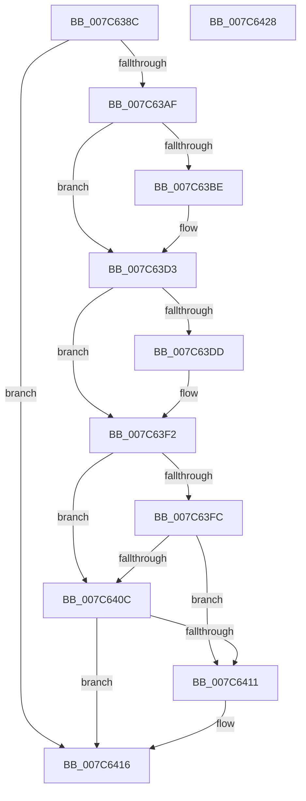

# ExpTimeZoneCleanupSiloState

- RVA: `0x007C638C`–`0x007C6429` (길이 `157` bytes)
- VA: `0x00000001407C638C`
- 실행 섹션: `PAGE`
- PDB 이름 있음: `예`; PDB Function 태그: `아니요`
- unwind 정보 RVA: `0x000927D0`
- 디코드: `40`개 명령, `157/157` bytes 표시
- 미해석 바이트: `0` (있으면 어셈블리에 `.byte`로 보존)

> 이 문서는 커널 이미지의 기계어와 PDB 기호를 분석해 생성했습니다. 4번과 5번은 함수 원형과 자료형을 바이너리 사용 방식에서 추정한 C 해석이며 원본 소스 복구 결과는 아닙니다.

## 1. Dependencies

- 직접 호출 지점: **5**; 고유 호출 대상: **3**
- 직접 호출자로 확인된 함수: **1**
- RIP 상대 이미지 참조: **0**

### Outgoing calls
- `0x007C639E` → [PsGetServerSiloGlobals](../../text/22/PsGetServerSiloGlobals_function_002250A0.md) (function, `0x002250A0`)
- `0x007C63C5` → [KeCancelTimer](../../text/23/KeCancelTimer_function_002327E0.md) (function, `0x002327E0`)
- `0x007C63E4` → [KeCancelTimer](../../text/23/KeCancelTimer_function_002327E0.md) (function, `0x002327E0`)
- `0x007C6403` → [KeCancelTimer](../../text/23/KeCancelTimer_function_002327E0.md) (function, `0x002327E0`)
- `0x007C6411` → [KeFlushQueuedDpcs](../../text/3C/KeFlushQueuedDpcs_function_003C0300.md) (function, `0x003C0300`)

### Direct callers
- [PspDeleteExternalServerSiloState](../77/PspDeleteExternalServerSiloState_function_0077FB88.md) at `0x0077FC36`

### Static image references
- 디코드된 RIP-relative 메모리 참조가 없습니다.

## 2. Other-region calls and transfers

- 다른 실행 섹션으로 향하는 call: **5**
  - `0x007C639E` → [PsGetServerSiloGlobals](../../text/22/PsGetServerSiloGlobals_function_002250A0.md) (`PAGE` → `.text`)
  - `0x007C63C5` → [KeCancelTimer](../../text/23/KeCancelTimer_function_002327E0.md) (`PAGE` → `.text`)
  - `0x007C63E4` → [KeCancelTimer](../../text/23/KeCancelTimer_function_002327E0.md) (`PAGE` → `.text`)
  - `0x007C6403` → [KeCancelTimer](../../text/23/KeCancelTimer_function_002327E0.md) (`PAGE` → `.text`)
  - `0x007C6411` → [KeFlushQueuedDpcs](../../text/3C/KeFlushQueuedDpcs_function_003C0300.md) (`PAGE` → `.text`)
- 별도 외부 분기/꼬리 이동을 확인하지 못했습니다.

## 3. Assembly (complete function range)

```asm
007C638C  48 89 5C 24 08                  mov qword ptr [rsp + 8], rbx
007C6391  48 89 6C 24 10                  mov qword ptr [rsp + 0x10], rbp
007C6396  57                              push rdi
007C6397  48 83 EC 20                     sub rsp, 0x20
007C639B  40 32 FF                        xor dil, dil
007C639E  E8 FD EC A5 FF                  call 0x1402250a0
007C63A3  48 8B 98 C8 04 00 00            mov rbx, qword ptr [rax + 0x4c8]
007C63AA  48 85 DB                        test rbx, rbx
007C63AD  74 67                           je 0x1407c6416
007C63AF  48 83 BB 30 02 00 00 00         cmp qword ptr [rbx + 0x230], 0
007C63B7  BD 01 00 00 00                  mov ebp, 1
007C63BC  74 15                           je 0x1407c63d3
007C63BE  48 8D 8B 00 02 00 00            lea rcx, [rbx + 0x200]
007C63C5  E8 16 C4 A6 FF                  call 0x1402327e0
007C63CA  84 C0                           test al, al
007C63CC  40 0F B6 FF                     movzx edi, dil
007C63D0  0F 44 FD                        cmove edi, ebp
007C63D3  48 83 BB D0 02 00 00 00         cmp qword ptr [rbx + 0x2d0], 0
007C63DB  74 15                           je 0x1407c63f2
007C63DD  48 8D 8B A0 02 00 00            lea rcx, [rbx + 0x2a0]
007C63E4  E8 F7 C3 A6 FF                  call 0x1402327e0
007C63E9  84 C0                           test al, al
007C63EB  40 0F B6 FF                     movzx edi, dil
007C63EF  0F 44 FD                        cmove edi, ebp
007C63F2  48 83 BB 70 03 00 00 00         cmp qword ptr [rbx + 0x370], 0
007C63FA  74 10                           je 0x1407c640c
007C63FC  48 8D 8B 40 03 00 00            lea rcx, [rbx + 0x340]
007C6403  E8 D8 C3 A6 FF                  call 0x1402327e0
007C6408  84 C0                           test al, al
007C640A  74 05                           je 0x1407c6411
007C640C  40 84 FF                        test dil, dil
007C640F  74 05                           je 0x1407c6416
007C6411  E8 EA 9E BF FF                  call 0x1403c0300
007C6416  48 8B 5C 24 30                  mov rbx, qword ptr [rsp + 0x30]
007C641B  33 C0                           xor eax, eax
007C641D  48 8B 6C 24 38                  mov rbp, qword ptr [rsp + 0x38]
007C6422  48 83 C4 20                     add rsp, 0x20
007C6426  5F                              pop rdi
007C6427  C3                              ret
007C6428  CC                              int3
```

## 4. C-style interpretation (structured pseudocode)

```c
__int64 __fastcall ExpTimeZoneCleanupSiloState(void)
{
    __int64 result;
    __int64 v_rdi;
    __int64 v_rsp;
    unsigned __int64 v_stack_p10;
    unsigned __int64 v_stack_p8;

    v_stack_p8 = v_rbx;
    v_stack_p10 = v_rbp;
    v_rsp = (v_rsp) - (32);
    v_rdi = 0;
    result = PsGetServerSiloGlobals(a1, a2, a3, a4);
    if (*(unsigned __int64 *)(result + 1224) == 0) goto loc_007C6416;
    if ((*(unsigned __int64 *)(*(unsigned __int64 *)(result + 1224) + 560)) != 0) {
        a1 = *(unsigned __int64 *)(result + 1224) + 512;
        result = KeCancelTimer(a1, a2, a3, a4);
        v_rdi = 0;
        if ((unsigned __int8)(result) == 0) { v_rdi = 1; }
    }
    if ((*(unsigned __int64 *)(*(unsigned __int64 *)(result + 1224) + 720)) != 0) {
        a1 = *(unsigned __int64 *)(result + 1224) + 672;
        result = KeCancelTimer(a1, a2, a3, a4);
        v_rdi = (unsigned __int8)(v_rdi);
        if ((unsigned __int8)(result) == 0) { v_rdi = 1; }
    }
    if ((*(unsigned __int64 *)(*(unsigned __int64 *)(result + 1224) + 880)) == 0) goto loc_007C640C;
    result = KeCancelTimer(*(unsigned __int64 *)(result + 1224) + 832, a2, a3, a4);
    if ((unsigned __int8)(result) == 0) goto loc_007C6411;
loc_007C640C:
    if ((unsigned __int8)(v_rdi) != 0) {
        result = KeFlushQueuedDpcs(*(unsigned __int64 *)(result + 1224) + 832, a2, a3, a4);
    }
    result = 0;
    v_rsp = (v_rsp) + (32);
    return result;
}
```

## 5. (Beta) C Style

```c
void ExpTimeZoneCleanupSiloState(void)
{
    int64_t result;
    int64_t local_rdi;
    int64_t local_rsp;
    uint64_t v_stack_p10;
    uint64_t v_stack_p8;

    v_stack_p8 = local_rbx;
    v_stack_p10 = local_rbp;
    local_rsp = (local_rsp) - (32);
    local_rdi = 0;
    result = PsGetServerSiloGlobals(a1, a2, a3, a4);
    if (*(uint64_t *)(result + 0x4C8) == 0) goto loc_007C6416;
    if ((*(uint64_t *)(*(uint64_t *)(result + 0x4C8) + 0x230)) != 0) {
        a1 = *(uint64_t *)(result + 0x4C8) + 512;
        result = KeCancelTimer(a1, a2, a3, a4);
        local_rdi = 0;
        if ((uint8_t)(result) == 0) { local_rdi = 1; }
    }
    if ((*(uint64_t *)(*(uint64_t *)(result + 0x4C8) + 0x2D0)) != 0) {
        a1 = *(uint64_t *)(result + 0x4C8) + 672;
        result = KeCancelTimer(a1, a2, a3, a4);
        local_rdi = (uint8_t)(local_rdi);
        if ((uint8_t)(result) == 0) { local_rdi = 1; }
    }
    if ((*(uint64_t *)(*(uint64_t *)(result + 0x4C8) + 0x370)) == 0) goto loc_007C640C;
    result = KeCancelTimer(*(uint64_t *)(result + 0x4C8) + 832, a2, a3, a4);
    if ((uint8_t)(result) == 0) goto loc_007C6411;
loc_007C640C:
    if ((uint8_t)(local_rdi) != 0) {
        result = KeFlushQueuedDpcs(*(uint64_t *)(result + 0x4C8) + 832, a2, a3, a4);
    }
    result = 0;
    local_rsp = (local_rsp) + (32);
    return result;
}
```

## 6. Execution-region graph

[열기: 2D/3D 그래프와 함수 탐색 컨트롤 패널](../../../control-panel.html?section=page&rva=0x007C638C&view=graph)

- 2D 그래프는 위에서 아래로 흐르고, 3D 그래프는 빈 공간을 드래그해 회전합니다. Shift+드래그는 이동, 휠은 확대·축소, 함수 노드 선택은 대상 보고서 이동입니다.

### Static fallback


