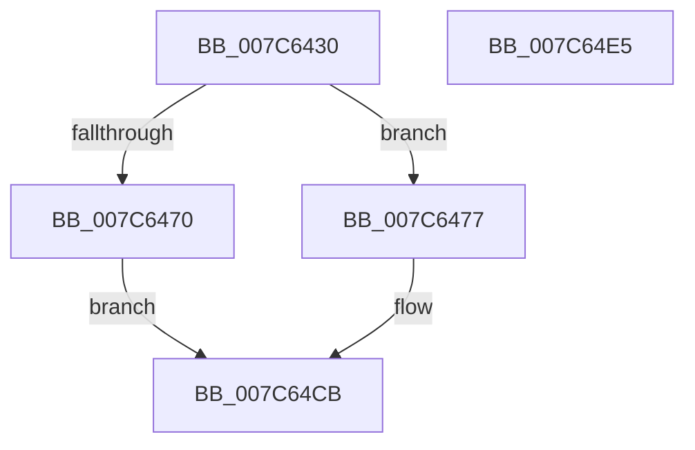

# ExpTimeZoneInitSiloState

- RVA: `0x007C6430`–`0x007C64E6` (길이 `182` bytes)
- VA: `0x00000001407C6430`
- 실행 섹션: `PAGE`
- PDB 이름 있음: `예`; PDB Function 태그: `아니요`
- unwind 정보 RVA: `0x00060BC4`
- 디코드: `45`개 명령, `182/182` bytes 표시
- 미해석 바이트: `0` (있으면 어셈블리에 `.byte`로 보존)

> 이 문서는 커널 이미지의 기계어와 PDB 기호를 분석해 생성했습니다. 4번과 5번은 함수 원형과 자료형을 바이너리 사용 방식에서 추정한 C 해석이며 원본 소스 복구 결과는 아닙니다.

## 1. Dependencies

- 직접 호출 지점: **10**; 고유 호출 대상: **10**
- 직접 호출자로 확인된 함수: **1**
- RIP 상대 이미지 참조: **1**

### Outgoing calls
- `0x007C6441` → [PsGetServerSiloGlobals](../../text/22/PsGetServerSiloGlobals_function_002250A0.md) (function, `0x002250A0`)
- `0x007C6449` → [PsAttachSiloToCurrentThread](../../text/44/PsAttachSiloToCurrentThread_function_004428C0.md) (function, `0x004428C0`)
- `0x007C645F` → [ExAllocatePool2](../../poolcode/B8/ExAllocatePool2_function_00B820F0.md) (function, `0x00B820F0`)
- `0x007C6482` → [memset](../../text/6C/memset_function_006C6C40.md) (function, `0x006C6C40`)
- `0x007C64AC` → [ExpReadTimeZoneInformation](ExpReadTimeZoneInformation_function_007C61D8.md) (function, `0x007C61D8`)
- `0x007C64B1` → [ExAcquireTimeRefreshLockExclusive](../9C/ExAcquireTimeRefreshLockExclusive_function_009C5810.md) (function, `0x009C5810`)
- `0x007C64B8` → [ExpRefreshTimeZoneInformation](../A6/ExpRefreshTimeZoneInformation_function_00A6B46C.md) (function, `0x00A6B46C`)
- `0x007C64BD` → [ExReleaseTimeRefreshLockExclusive](../9C/ExReleaseTimeRefreshLockExclusive_function_009C5874.md) (function, `0x009C5874`)
- `0x007C64C6` → [ZwSetSystemTime](../../text/6B/ZwSetSystemTime_function_006B08B0.md) (function, `0x006B08B0`)
- `0x007C64CE` → [PsDetachSiloFromCurrentThread](../../text/44/PsDetachSiloFromCurrentThread_function_00449AC0.md) (function, `0x00449AC0`)

### Direct callers
- [PspInitializeServerSiloDeferred](../77/PspInitializeServerSiloDeferred_function_0077FEE0.md) at `0x00780018`

### Static image references
- `0x007C648E` → RVA `0x00038E48` (`.rdata`; read)

## 2. Other-region calls and transfers

- 다른 실행 섹션으로 향하는 call: **6**
  - `0x007C6441` → [PsGetServerSiloGlobals](../../text/22/PsGetServerSiloGlobals_function_002250A0.md) (`PAGE` → `.text`)
  - `0x007C6449` → [PsAttachSiloToCurrentThread](../../text/44/PsAttachSiloToCurrentThread_function_004428C0.md) (`PAGE` → `.text`)
  - `0x007C645F` → [ExAllocatePool2](../../poolcode/B8/ExAllocatePool2_function_00B820F0.md) (`PAGE` → `POOLCODE`)
  - `0x007C6482` → [memset](../../text/6C/memset_function_006C6C40.md) (`PAGE` → `.text`)
  - `0x007C64C6` → [ZwSetSystemTime](../../text/6B/ZwSetSystemTime_function_006B08B0.md) (`PAGE` → `.text`)
  - `0x007C64CE` → [PsDetachSiloFromCurrentThread](../../text/44/PsDetachSiloFromCurrentThread_function_00449AC0.md) (`PAGE` → `.text`)
- 별도 외부 분기/꼬리 이동을 확인하지 못했습니다.

## 3. Assembly (complete function range)

```asm
007C6430  48 89 5C 24 08                  mov qword ptr [rsp + 8], rbx
007C6435  48 89 74 24 10                  mov qword ptr [rsp + 0x10], rsi
007C643A  57                              push rdi
007C643B  48 83 EC 20                     sub rsp, 0x20
007C643F  33 DB                           xor ebx, ebx
007C6441  E8 5A EC A5 FF                  call 0x1402250a0
007C6446  48 8B F0                        mov rsi, rax
007C6449  E8 72 C4 C7 FF                  call 0x1404428c0
007C644E  BA F0 03 00 00                  mov edx, 0x3f0
007C6453  8D 4B 40                        lea ecx, [rbx + 0x40]
007C6456  41 B8 45 78 54 5A               mov r8d, 0x5a547845
007C645C  48 8B F8                        mov rdi, rax
007C645F  E8 8C BC 3B 00                  call 0x140b820f0
007C6464  48 89 86 C8 04 00 00            mov qword ptr [rsi + 0x4c8], rax
007C646B  48 85 C0                        test rax, rax
007C646E  75 07                           jne 0x1407c6477
007C6470  BB 9A 00 00 C0                  mov ebx, 0xc000009a
007C6475  EB 54                           jmp 0x1407c64cb
007C6477  33 D2                           xor edx, edx
007C6479  41 B8 F0 03 00 00               mov r8d, 0x3f0
007C647F  48 8B C8                        mov rcx, rax
007C6482  E8 B9 07 F0 FF                  call 0x1406c6c40
007C6487  48 8B 86 C8 04 00 00            mov rax, qword ptr [rsi + 0x4c8]
007C648E  48 8D 0D B3 29 87 FF            lea rcx, [rip - 0x78d64d]
007C6495  83 CA FF                        or edx, 0xffffffff
007C6498  89 90 B0 01 00 00               mov dword ptr [rax + 0x1b0], edx
007C649E  4C 8B 86 C8 04 00 00            mov r8, qword ptr [rsi + 0x4c8]
007C64A5  49 81 C0 B4 01 00 00            add r8, 0x1b4
007C64AC  E8 27 FD FF FF                  call 0x1407c61d8
007C64B1  E8 5A F3 1F 00                  call 0x1409c5810
007C64B6  B1 01                           mov cl, 1
007C64B8  E8 AF 4F 2A 00                  call 0x140a6b46c
007C64BD  E8 B2 F3 1F 00                  call 0x1409c5874
007C64C2  33 D2                           xor edx, edx
007C64C4  33 C9                           xor ecx, ecx
007C64C6  E8 E5 A3 EE FF                  call 0x1406b08b0
007C64CB  48 8B CF                        mov rcx, rdi
007C64CE  E8 ED 35 C8 FF                  call 0x140449ac0
007C64D3  48 8B 74 24 38                  mov rsi, qword ptr [rsp + 0x38]
007C64D8  8B C3                           mov eax, ebx
007C64DA  48 8B 5C 24 30                  mov rbx, qword ptr [rsp + 0x30]
007C64DF  48 83 C4 20                     add rsp, 0x20
007C64E3  5F                              pop rdi
007C64E4  C3                              ret
007C64E5  CC                              int3
```

## 4. C-style interpretation (structured pseudocode)

```c
__int64 __fastcall ExpTimeZoneInitSiloState(void)
{
    __int64 result;
    __int64 v_rbx;
    __int64 v_rsp;
    unsigned __int64 v_stack_p10;
    unsigned __int64 v_stack_p8;

    v_stack_p8 = v_rbx;
    v_stack_p10 = v_rsi;
    v_rsp = (v_rsp) - (32);
    v_rbx = 0;
    result = PsGetServerSiloGlobals(a1, a2, a3, a4);
    result = PsAttachSiloToCurrentThread(a1, a2, a3, a4);
    result = ExAllocatePool2(v_rbx + 64, (unsigned int)(0x3F0ULL), (unsigned int)(0x5A547845ULL), a4);
    *(unsigned __int64 *)(result + 1224) = result;
    if (result != 0) goto loc_007C6477;
    goto loc_007C64CB;
loc_007C6477:
    a2 = 0;
    result = memset(result, a2, (unsigned int)(0x3F0ULL), a4);
    a2 = (unsigned int)((a2) | (0xFFFFFFFFULL));
    *(unsigned int *)(*(unsigned __int64 *)(result + 1224) + 432) = (unsigned int)(a2);
    a3 = (*(unsigned __int64 *)(result + 1224)) + (436);
    result = ExpReadTimeZoneInformation(v_rip - 7919181, a2, a3, a4);
    result = ExAcquireTimeRefreshLockExclusive(v_rip - 7919181, a2, a3, a4);
    result = ExpRefreshTimeZoneInformation(1, a2, a3, a4);
    result = ExReleaseTimeRefreshLockExclusive(1, a2, a3, a4);
    a2 = 0;
    a1 = 0;
    result = ZwSetSystemTime(a1, a2, a3, a4);
loc_007C64CB:
    result = PsDetachSiloFromCurrentThread(result, a2, a3, a4);
    v_rsp = (v_rsp) + (32);
    return (unsigned int)((unsigned int)((unsigned int)(0xC000009AULL)));
}
```

## 5. (Beta) C Style

```c
void ExpTimeZoneInitSiloState(void)
{
    int64_t result;
    int64_t local_rbx;
    int64_t local_rsp;
    uint64_t v_stack_p10;
    uint64_t v_stack_p8;

    v_stack_p8 = local_rbx;
    v_stack_p10 = local_rsi;
    local_rsp = (local_rsp) - (32);
    local_rbx = 0;
    result = PsGetServerSiloGlobals(a1, a2, a3, a4);
    result = PsAttachSiloToCurrentThread(a1, a2, a3, a4);
    result = ExAllocatePool2(local_rbx + 64, (uint32_t)(0x3F0ULL), (uint32_t)(0x5A547845ULL), a4);
    *(uint64_t *)(result + 0x4C8) = result;
    if (result != 0) goto loc_007C6477;
    goto loc_007C64CB;
loc_007C6477:
    a2 = 0;
    result = memset(result, a2, (uint32_t)(0x3F0ULL), a4);
    a2 = (uint32_t)((a2) | (0xFFFFFFFFULL));
    *(uint32_t *)(*(uint64_t *)(result + 0x4C8) + 0x1B0) = (uint32_t)(a2);
    a3 = (*(uint64_t *)(result + 0x4C8)) + (436);
    result = ExpReadTimeZoneInformation(v_rip - 7919181, a2, a3, a4);
    result = ExAcquireTimeRefreshLockExclusive(v_rip - 7919181, a2, a3, a4);
    result = ExpRefreshTimeZoneInformation(1, a2, a3, a4);
    result = ExReleaseTimeRefreshLockExclusive(1, a2, a3, a4);
    a2 = 0;
    a1 = 0;
    result = ZwSetSystemTime(a1, a2, a3, a4);
loc_007C64CB:
    result = PsDetachSiloFromCurrentThread(result, a2, a3, a4);
    local_rsp = (local_rsp) + (32);
    return (uint32_t)((uint32_t)((uint32_t)(0xC000009AULL)));
}
```

## 6. Execution-region graph

[열기: 2D/3D 그래프와 함수 탐색 컨트롤 패널](../../../control-panel.html?section=page&rva=0x007C6430&view=graph)

- 2D 그래프는 위에서 아래로 흐르고, 3D 그래프는 빈 공간을 드래그해 회전합니다. Shift+드래그는 이동, 휠은 확대·축소, 함수 노드 선택은 대상 보고서 이동입니다.

### Static fallback


