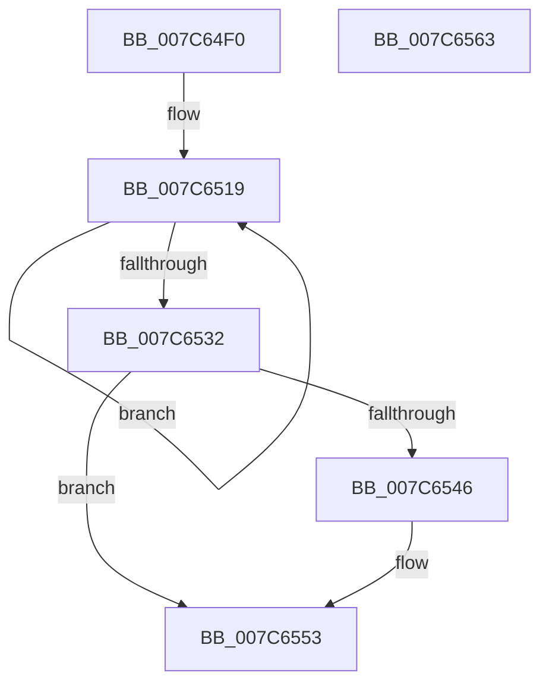

# ExpTimeZoneWork

- RVA: `0x007C64F0`–`0x007C6564` (길이 `116` bytes)
- VA: `0x00000001407C64F0`
- 실행 섹션: `PAGE`
- PDB 이름 있음: `예`; PDB Function 태그: `아니요`
- unwind 정보 RVA: `0x00060BC4`
- 디코드: `32`개 명령, `116/116` bytes 표시
- 미해석 바이트: `0` (있으면 어셈블리에 `.byte`로 보존)

> 이 문서는 커널 이미지의 기계어와 PDB 기호를 분석해 생성했습니다. 4번과 5번은 함수 원형과 자료형을 바이너리 사용 방식에서 추정한 C 해석이며 원본 소스 복구 결과는 아닙니다.

## 1. Dependencies

- 직접 호출 지점: **6**; 고유 호출 대상: **6**
- 직접 호출자로 확인된 함수: **0**
- RIP 상대 이미지 참조: **0**

### Outgoing calls
- `0x007C6502` → [PsAttachSiloToCurrentThread](../../text/44/PsAttachSiloToCurrentThread_function_004428C0.md) (function, `0x004428C0`)
- `0x007C650D` → [PsGetServerSiloGlobals](../../text/22/PsGetServerSiloGlobals_function_002250A0.md) (function, `0x002250A0`)
- `0x007C651D` → [ZwSetSystemTime](../../text/6B/ZwSetSystemTime_function_006B08B0.md) (function, `0x006B08B0`)
- `0x007C6535` → [PsDetachSiloFromCurrentThread](../../text/44/PsDetachSiloFromCurrentThread_function_00449AC0.md) (function, `0x00449AC0`)
- `0x007C653D` → [PsIsHostSilo](../../text/44/PsIsHostSilo_function_00443B30.md) (function, `0x00443B30`)
- `0x007C654E` → [ObfDereferenceObjectWithTag](../../text/2F/ObfDereferenceObjectWithTag_function_002F78E0.md) (function, `0x002F78E0`)

### Direct callers
- 이 함수 시작 RVA로 연결되는 직접 call은 확인되지 않았습니다. 간접 호출은 완전히 역산할 수 없습니다.

### Static image references
- 디코드된 RIP-relative 메모리 참조가 없습니다.

## 2. Other-region calls and transfers

- 다른 실행 섹션으로 향하는 call: **6**
  - `0x007C6502` → [PsAttachSiloToCurrentThread](../../text/44/PsAttachSiloToCurrentThread_function_004428C0.md) (`PAGE` → `.text`)
  - `0x007C650D` → [PsGetServerSiloGlobals](../../text/22/PsGetServerSiloGlobals_function_002250A0.md) (`PAGE` → `.text`)
  - `0x007C651D` → [ZwSetSystemTime](../../text/6B/ZwSetSystemTime_function_006B08B0.md) (`PAGE` → `.text`)
  - `0x007C6535` → [PsDetachSiloFromCurrentThread](../../text/44/PsDetachSiloFromCurrentThread_function_00449AC0.md) (`PAGE` → `.text`)
  - `0x007C653D` → [PsIsHostSilo](../../text/44/PsIsHostSilo_function_00443B30.md) (`PAGE` → `.text`)
  - `0x007C654E` → [ObfDereferenceObjectWithTag](../../text/2F/ObfDereferenceObjectWithTag_function_002F78E0.md) (`PAGE` → `.text`)
- 별도 외부 분기/꼬리 이동을 확인하지 못했습니다.

## 3. Assembly (complete function range)

```asm
007C64F0  48 89 5C 24 08                  mov qword ptr [rsp + 8], rbx
007C64F5  48 89 74 24 10                  mov qword ptr [rsp + 0x10], rsi
007C64FA  57                              push rdi
007C64FB  48 83 EC 20                     sub rsp, 0x20
007C64FF  48 8B D9                        mov rbx, rcx
007C6502  E8 B9 C3 C7 FF                  call 0x1404428c0
007C6507  48 8B CB                        mov rcx, rbx
007C650A  48 8B F0                        mov rsi, rax
007C650D  E8 8E EB A5 FF                  call 0x1402250a0
007C6512  48 8B B8 C8 04 00 00            mov rdi, qword ptr [rax + 0x4c8]
007C6519  33 D2                           xor edx, edx
007C651B  33 C9                           xor ecx, ecx
007C651D  E8 8E A3 EE FF                  call 0x1406b08b0
007C6522  83 C9 FF                        or ecx, 0xffffffff
007C6525  F0 0F C1 8F A0 03 00 00         lock xadd dword ptr [rdi + 0x3a0], ecx
007C652D  83 F9 01                        cmp ecx, 1
007C6530  75 E7                           jne 0x1407c6519
007C6532  48 8B CE                        mov rcx, rsi
007C6535  E8 86 35 C8 FF                  call 0x140449ac0
007C653A  48 8B CB                        mov rcx, rbx
007C653D  E8 EE D5 C7 FF                  call 0x140443b30
007C6542  84 C0                           test al, al
007C6544  75 0D                           jne 0x1407c6553
007C6546  BA 45 78 70 53                  mov edx, 0x53707845
007C654B  48 8B CB                        mov rcx, rbx
007C654E  E8 8D 13 B3 FF                  call 0x1402f78e0
007C6553  48 8B 5C 24 30                  mov rbx, qword ptr [rsp + 0x30]
007C6558  48 8B 74 24 38                  mov rsi, qword ptr [rsp + 0x38]
007C655D  48 83 C4 20                     add rsp, 0x20
007C6561  5F                              pop rdi
007C6562  C3                              ret
007C6563  CC                              int3
```

## 4. C-style interpretation (structured pseudocode)

```c
__int64 __fastcall ExpTimeZoneWork(__int64 a1, int a2)
{
    __int64 result;
    __int64 v_rsp;
    unsigned __int64 v_stack_p10;
    unsigned __int64 v_stack_p8;

    v_stack_p8 = v_rbx;
    v_stack_p10 = v_rsi;
    v_rsp = (v_rsp) - (32);
    result = PsAttachSiloToCurrentThread(a1, a2, a3, a4);
    result = PsGetServerSiloGlobals(a1, a2, a3, a4);
loc_007C6519:
    a2 = 0;
    a1 = 0;
    result = ZwSetSystemTime(a1, a2, a3, a4);
    a1 = (unsigned int)((a1) | (0xFFFFFFFFULL));
    if (((unsigned int)(a1)) != 1) goto loc_007C6519;
    result = PsDetachSiloFromCurrentThread(result, a2, a3, a4);
    result = PsIsHostSilo(a1, a2, a3, a4);
    if ((unsigned __int8)(result) == 0) {
        a2 = 0x53707845ULL;
        a1 = a1;
        result = ObfDereferenceObjectWithTag(a1, a2, a3, a4);
    }
    v_rsp = (v_rsp) + (32);
    return result;
}
```

## 5. (Beta) C Style

```c
int64_t ExpTimeZoneWork(int64_t Arg1, int32_t Arg2)
{
    int64_t result;
    int64_t local_rsp;
    uint64_t v_stack_p10;
    uint64_t v_stack_p8;

    v_stack_p8 = local_rbx;
    v_stack_p10 = local_rsi;
    local_rsp = (local_rsp) - (32);
    result = PsAttachSiloToCurrentThread(Arg1, Arg2, a3, a4);
    result = PsGetServerSiloGlobals(Arg1, Arg2, a3, a4);
loc_007C6519:
    Arg2 = 0;
    Arg1 = 0;
    result = ZwSetSystemTime(Arg1, Arg2, a3, a4);
    Arg1 = (uint32_t)((Arg1) | (0xFFFFFFFFULL));
    if (((uint32_t)(Arg1)) != 1) goto loc_007C6519;
    result = PsDetachSiloFromCurrentThread(result, Arg2, a3, a4);
    result = PsIsHostSilo(Arg1, Arg2, a3, a4);
    if ((uint8_t)(result) == 0) {
        Arg2 = 0x53707845ULL;
        Arg1 = Arg1;
        result = ObfDereferenceObjectWithTag(Arg1, Arg2, a3, a4);
    }
    local_rsp = (local_rsp) + (32);
    return result;
}
```

## 6. Execution-region graph

[열기: 2D/3D 그래프와 함수 탐색 컨트롤 패널](../../../control-panel.html?section=page&rva=0x007C64F0&view=graph)

- 2D 그래프는 위에서 아래로 흐르고, 3D 그래프는 빈 공간을 드래그해 회전합니다. Shift+드래그는 이동, 휠은 확대·축소, 함수 노드 선택은 대상 보고서 이동입니다.

### Static fallback


