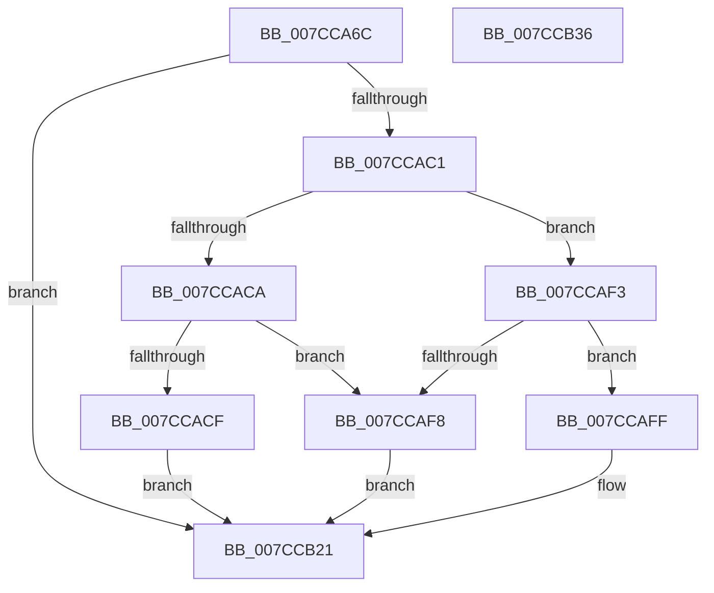

# ExpTranslateArcPath

- RVA: `0x007CCA6C`–`0x007CCB37` (길이 `203` bytes)
- VA: `0x00000001407CCA6C`
- 실행 섹션: `PAGE`
- PDB 이름 있음: `예`; PDB Function 태그: `아니요`
- unwind 정보 RVA: `0x000C4EA4`
- 디코드: `61`개 명령, `203/203` bytes 표시
- 미해석 바이트: `0` (있으면 어셈블리에 `.byte`로 보존)

> 이 문서는 커널 이미지의 기계어와 PDB 기호를 분석해 생성했습니다. 4번과 5번은 함수 원형과 자료형을 바이너리 사용 방식에서 추정한 C 해석이며 원본 소스 복구 결과는 아닙니다.

## 1. Dependencies

- 직접 호출 지점: **3**; 고유 호출 대상: **3**
- 직접 호출자로 확인된 함수: **1**
- RIP 상대 이미지 참조: **0**

### Outgoing calls
- `0x007CCAB8` → [ExpParseArcPathName](ExpParseArcPathName_function_007CB908.md) (function, `0x007CB908`)
- `0x007CCAEC` → [ExpConvertArcName](ExpConvertArcName_function_007CAF04.md) (function, `0x007CAF04`)
- `0x007CCB1C` → [ExpConvertSignatureName](ExpConvertSignatureName_function_007CB0C8.md) (function, `0x007CB0C8`)

### Direct callers
- [sub_00B37C9A](../B3/Unknown_function_00B37C9A.md) at `0x00B37D02`

### Static image references
- 디코드된 RIP-relative 메모리 참조가 없습니다.

## 2. Other-region calls and transfers

- 다른 실행 섹션으로 향하는 call: **0**
- 별도 외부 분기/꼬리 이동을 확인하지 못했습니다.

## 3. Assembly (complete function range)

```asm
007CCA6C  48 89 5C 24 10                  mov qword ptr [rsp + 0x10], rbx
007CCA71  48 89 74 24 18                  mov qword ptr [rsp + 0x18], rsi
007CCA76  55                              push rbp
007CCA77  57                              push rdi
007CCA78  41 56                           push r14
007CCA7A  48 8B EC                        mov rbp, rsp
007CCA7D  48 83 EC 50                     sub rsp, 0x50
007CCA81  48 83 65 F0 00                  and qword ptr [rbp - 0x10], 0
007CCA86  48 8D 45 20                     lea rax, [rbp + 0x20]
007CCA8A  48 83 65 E8 00                  and qword ptr [rbp - 0x18], 0
007CCA8F  49 8B F9                        mov rdi, r9
007CCA92  83 65 E0 00                     and dword ptr [rbp - 0x20], 0
007CCA96  4C 8D 4D E0                     lea r9, [rbp - 0x20]
007CCA9A  49 8B F0                        mov rsi, r8
007CCA9D  48 89 44 24 20                  mov qword ptr [rsp + 0x20], rax
007CCAA2  44 8B F2                        mov r14d, edx
007CCAA5  C6 45 20 00                     mov byte ptr [rbp + 0x20], 0
007CCAA9  48 8B D9                        mov rbx, rcx
007CCAAC  4C 8D 45 E8                     lea r8, [rbp - 0x18]
007CCAB0  48 83 C1 0C                     add rcx, 0xc
007CCAB4  48 8D 55 F0                     lea rdx, [rbp - 0x10]
007CCAB8  E8 4B EE FF FF                  call 0x1407cb908
007CCABD  85 C0                           test eax, eax
007CCABF  78 60                           js 0x1407ccb21
007CCAC1  80 7D 20 00                     cmp byte ptr [rbp + 0x20], 0
007CCAC5  8B 43 08                        mov eax, dword ptr [rbx + 8]
007CCAC8  75 29                           jne 0x1407ccaf3
007CCACA  83 F8 01                        cmp eax, 1
007CCACD  75 29                           jne 0x1407ccaf8
007CCACF  8B 45 E0                        mov eax, dword ptr [rbp - 0x20]
007CCAD2  4C 8B C7                        mov r8, rdi
007CCAD5  4C 8B 4D F0                     mov r9, qword ptr [rbp - 0x10]
007CCAD9  48 8B D6                        mov rdx, rsi
007CCADC  89 44 24 28                     mov dword ptr [rsp + 0x28], eax
007CCAE0  41 8B CE                        mov ecx, r14d
007CCAE3  48 8B 45 E8                     mov rax, qword ptr [rbp - 0x18]
007CCAE7  48 89 44 24 20                  mov qword ptr [rsp + 0x20], rax
007CCAEC  E8 13 E4 FF FF                  call 0x1407caf04
007CCAF1  EB 2E                           jmp 0x1407ccb21
007CCAF3  83 F8 02                        cmp eax, 2
007CCAF6  74 07                           je 0x1407ccaff
007CCAF8  B8 0D 00 00 C0                  mov eax, 0xc000000d
007CCAFD  EB 22                           jmp 0x1407ccb21
007CCAFF  8B 45 E0                        mov eax, dword ptr [rbp - 0x20]
007CCB02  4C 8B C7                        mov r8, rdi
007CCB05  4C 8B 4D F0                     mov r9, qword ptr [rbp - 0x10]
007CCB09  48 8B D6                        mov rdx, rsi
007CCB0C  89 44 24 28                     mov dword ptr [rsp + 0x28], eax
007CCB10  41 8B CE                        mov ecx, r14d
007CCB13  48 8B 45 E8                     mov rax, qword ptr [rbp - 0x18]
007CCB17  48 89 44 24 20                  mov qword ptr [rsp + 0x20], rax
007CCB1C  E8 A7 E5 FF FF                  call 0x1407cb0c8
007CCB21  4C 8D 5C 24 50                  lea r11, [rsp + 0x50]
007CCB26  49 8B 5B 28                     mov rbx, qword ptr [r11 + 0x28]
007CCB2A  49 8B 73 30                     mov rsi, qword ptr [r11 + 0x30]
007CCB2E  49 8B E3                        mov rsp, r11
007CCB31  41 5E                           pop r14
007CCB33  5F                              pop rdi
007CCB34  5D                              pop rbp
007CCB35  C3                              ret
007CCB36  CC                              int3
```

## 4. C-style interpretation (structured pseudocode)

```c
__int64 __fastcall ExpTranslateArcPath(__int64 a1, int a2, __int64 a3, __int64 a4)
{
    __int64 result;
    __int64 v_rsp;
    unsigned __int64 v_stack_m18;
    unsigned __int64 v_stack_m28;
    unsigned __int64 v_stack_m30;
    unsigned int v_stack_m38;
    unsigned int v_stack_m40;
    unsigned __int64 v_stack_m48;
    unsigned __int64 v_stack_p10;
    unsigned __int64 v_stack_p18;
    unsigned __int64 v_stack_p8;

    v_stack_p10 = v_rbx;
    v_stack_p18 = v_rsi;
    v_rsp = (v_rsp) - (80);
    v_stack_m48 = v_stack_p8;
    v_stack_p8 = 0;
    a1 = (a1) + (12);
    result = ExpParseArcPathName(a1, v_stack_m28, v_stack_m30, v_stack_m38);
    if (sign_flag) goto loc_007CCB21;
    if (v_stack_p8 != 0) goto loc_007CCAF3;
    if (((unsigned int)((unsigned int)(*(unsigned int *)(a1 + 8)))) != 1) goto loc_007CCAF8;
    v_stack_m40 = (unsigned int)((unsigned int)(v_stack_m38));
    v_stack_m48 = v_stack_m30;
    result = ExpConvertArcName((unsigned int)((unsigned int)((unsigned int)(a2))), a3, a4, v_stack_m28);
    goto loc_007CCB21;
loc_007CCAF3:
    if (((unsigned int)(result)) == 2) goto loc_007CCAFF;
loc_007CCAF8:
    goto loc_007CCB21;
loc_007CCAFF:
    v_stack_m40 = (unsigned int)((unsigned int)(v_stack_m38));
    v_stack_m48 = v_stack_m30;
    result = ExpConvertSignatureName((unsigned int)((unsigned int)((unsigned int)(a2))), a3, a4, v_stack_m28);
loc_007CCB21:
    return result;
}
```

## 5. (Beta) C Style

```c
int64_t ExpTranslateArcPath(void *Arg1, int32_t Arg2, int64_t Arg3, int64_t Arg4)
{
    uint8_t *arg1 = (uint8_t *)Arg1;

    int64_t result;
    int64_t local_rsp;
    uint64_t v_stack_m18;
    uint64_t v_stack_m28;
    uint64_t v_stack_m30;
    uint32_t v_stack_m38;
    uint32_t v_stack_m40;
    uint64_t v_stack_m48;
    uint64_t v_stack_p10;
    uint64_t v_stack_p18;
    uint64_t v_stack_p8;

    v_stack_p10 = local_rbx;
    v_stack_p18 = local_rsi;
    local_rsp = (local_rsp) - (80);
    v_stack_m48 = v_stack_p8;
    v_stack_p8 = 0;
    Arg1 = (Arg1) + (12);
    result = ExpParseArcPathName(Arg1, v_stack_m28, v_stack_m30, v_stack_m38);
    if (sign_flag) goto loc_007CCB21;
    if (v_stack_p8 != 0) goto loc_007CCAF3;
    if (((uint32_t)((uint32_t)(*(uint32_t *)(arg1 + 0x8)))) != 1) goto loc_007CCAF8;
    v_stack_m40 = (uint32_t)((uint32_t)(v_stack_m38));
    v_stack_m48 = v_stack_m30;
    result = ExpConvertArcName((uint32_t)((uint32_t)((uint32_t)(Arg2))), Arg3, Arg4, v_stack_m28);
    goto loc_007CCB21;
loc_007CCAF3:
    if (((uint32_t)(result)) == 2) goto loc_007CCAFF;
loc_007CCAF8:
    goto loc_007CCB21;
loc_007CCAFF:
    v_stack_m40 = (uint32_t)((uint32_t)(v_stack_m38));
    v_stack_m48 = v_stack_m30;
    result = ExpConvertSignatureName((uint32_t)((uint32_t)((uint32_t)(Arg2))), Arg3, Arg4, v_stack_m28);
loc_007CCB21:
    return result;
}
```

### 관측된 메모리 오프셋

구조체 형식이 확인되지 않은 접근은 인자 기준의 오프셋으로만 기록했습니다.

| 기준 인자 | 오프셋 표현 | 폭 (bit) | 접근 |
|---|---:|---:|---|
| `Arg1` | `+ 0x8` | `32` | `R` |

## 6. Execution-region graph

[열기: 2D/3D 그래프와 함수 탐색 컨트롤 패널](../../../control-panel.html?section=page&rva=0x007CCA6C&view=graph)

- 2D 그래프는 위에서 아래로 흐르고, 3D 그래프는 빈 공간을 드래그해 회전합니다. Shift+드래그는 이동, 휠은 확대·축소, 함수 노드 선택은 대상 보고서 이동입니다.

### Static fallback


