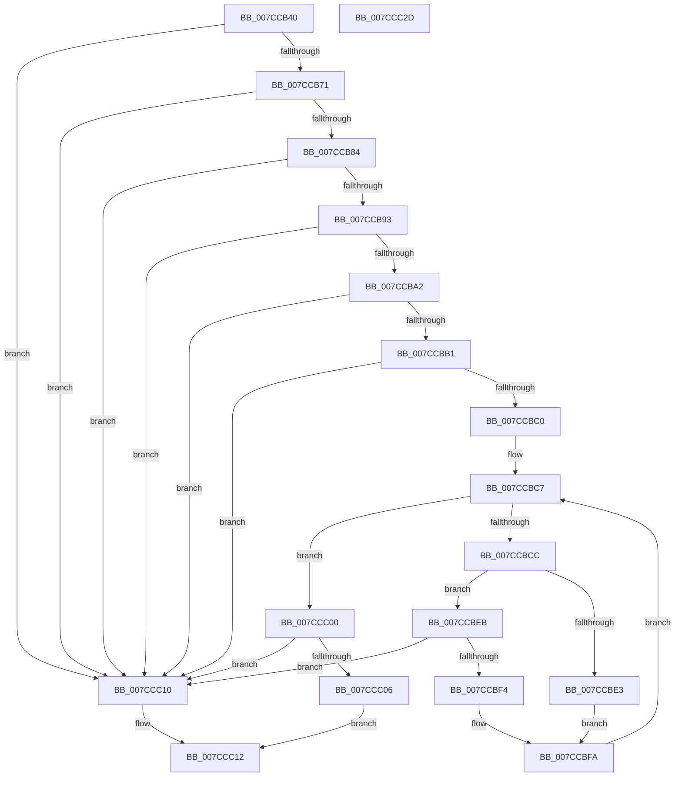

# ExpTranslateDriverEntryNameToId

- RVA: `0x007CCB40`–`0x007CCC2E` (길이 `238` bytes)
- VA: `0x00000001407CCB40`
- 실행 섹션: `PAGE`
- PDB 이름 있음: `예`; PDB Function 태그: `아니요`
- unwind 정보 RVA: `0x0005E6B4`
- 디코드: `70`개 명령, `238/238` bytes 표시
- 미해석 바이트: `0` (있으면 어셈블리에 `.byte`로 보존)

> 이 문서는 커널 이미지의 기계어와 PDB 기호를 분석해 생성했습니다. 4번과 5번은 함수 원형과 자료형을 바이너리 사용 방식에서 추정한 C 해석이며 원본 소스 복구 결과는 아닙니다.

## 1. Dependencies

- 직접 호출 지점: **7**; 고유 호출 대상: **1**
- 직접 호출자로 확인된 함수: **2**
- RIP 상대 이미지 참조: **0**

### Outgoing calls
- `0x007CCB62` → [towlower](../../text/50/towlower_function_005018E0.md) (function, `0x005018E0`)
- `0x007CCB75` → [towlower](../../text/50/towlower_function_005018E0.md) (function, `0x005018E0`)
- `0x007CCB88` → [towlower](../../text/50/towlower_function_005018E0.md) (function, `0x005018E0`)
- `0x007CCB97` → [towlower](../../text/50/towlower_function_005018E0.md) (function, `0x005018E0`)
- `0x007CCBA6` → [towlower](../../text/50/towlower_function_005018E0.md) (function, `0x005018E0`)
- `0x007CCBB5` → [towlower](../../text/50/towlower_function_005018E0.md) (function, `0x005018E0`)
- `0x007CCBD2` → [towlower](../../text/50/towlower_function_005018E0.md) (function, `0x005018E0`)

### Direct callers
- [ExpIsDriverEntry](ExpIsDriverEntry_function_007CB8C0.md) at `0x007CB8EB`
- [NtEnumerateDriverEntries](NtEnumerateDriverEntries_function_007CD5D0.md) at `0x007CD819`

### Static image references
- 디코드된 RIP-relative 메모리 참조가 없습니다.

## 2. Other-region calls and transfers

- 다른 실행 섹션으로 향하는 call: **7**
  - `0x007CCB62` → [towlower](../../text/50/towlower_function_005018E0.md) (`PAGE` → `.text`)
  - `0x007CCB75` → [towlower](../../text/50/towlower_function_005018E0.md) (`PAGE` → `.text`)
  - `0x007CCB88` → [towlower](../../text/50/towlower_function_005018E0.md) (`PAGE` → `.text`)
  - `0x007CCB97` → [towlower](../../text/50/towlower_function_005018E0.md) (`PAGE` → `.text`)
  - `0x007CCBA6` → [towlower](../../text/50/towlower_function_005018E0.md) (`PAGE` → `.text`)
  - `0x007CCBB5` → [towlower](../../text/50/towlower_function_005018E0.md) (`PAGE` → `.text`)
  - `0x007CCBD2` → [towlower](../../text/50/towlower_function_005018E0.md) (`PAGE` → `.text`)
- 별도 외부 분기/꼬리 이동을 확인하지 못했습니다.

## 3. Assembly (complete function range)

```asm
007CCB40  48 8B C4                        mov rax, rsp
007CCB43  48 89 58 08                     mov qword ptr [rax + 8], rbx
007CCB47  48 89 68 10                     mov qword ptr [rax + 0x10], rbp
007CCB4B  48 89 70 18                     mov qword ptr [rax + 0x18], rsi
007CCB4F  48 89 78 20                     mov qword ptr [rax + 0x20], rdi
007CCB53  41 56                           push r14
007CCB55  48 83 EC 20                     sub rsp, 0x20
007CCB59  48 8B D9                        mov rbx, rcx
007CCB5C  4C 8B F2                        mov r14, rdx
007CCB5F  0F B7 09                        movzx ecx, word ptr [rcx]
007CCB62  E8 79 4D D3 FF                  call 0x1405018e0
007CCB67  66 83 F8 64                     cmp ax, 0x64
007CCB6B  0F 85 9F 00 00 00               jne 0x1407ccc10
007CCB71  0F B7 4B 02                     movzx ecx, word ptr [rbx + 2]
007CCB75  E8 66 4D D3 FF                  call 0x1405018e0
007CCB7A  66 83 F8 72                     cmp ax, 0x72
007CCB7E  0F 85 8C 00 00 00               jne 0x1407ccc10
007CCB84  0F B7 4B 04                     movzx ecx, word ptr [rbx + 4]
007CCB88  E8 53 4D D3 FF                  call 0x1405018e0
007CCB8D  66 83 F8 69                     cmp ax, 0x69
007CCB91  75 7D                           jne 0x1407ccc10
007CCB93  0F B7 4B 06                     movzx ecx, word ptr [rbx + 6]
007CCB97  E8 44 4D D3 FF                  call 0x1405018e0
007CCB9C  66 83 F8 76                     cmp ax, 0x76
007CCBA0  75 6E                           jne 0x1407ccc10
007CCBA2  0F B7 4B 08                     movzx ecx, word ptr [rbx + 8]
007CCBA6  E8 35 4D D3 FF                  call 0x1405018e0
007CCBAB  66 83 F8 65                     cmp ax, 0x65
007CCBAF  75 5F                           jne 0x1407ccc10
007CCBB1  0F B7 4B 0A                     movzx ecx, word ptr [rbx + 0xa]
007CCBB5  E8 26 4D D3 FF                  call 0x1405018e0
007CCBBA  66 83 F8 72                     cmp ax, 0x72
007CCBBE  75 50                           jne 0x1407ccc10
007CCBC0  33 ED                           xor ebp, ebp
007CCBC2  8B FD                           mov edi, ebp
007CCBC4  8D 75 06                        lea esi, [rbp + 6]
007CCBC7  83 FE 0A                        cmp esi, 0xa
007CCBCA  73 34                           jae 0x1407ccc00
007CCBCC  8B CE                           mov ecx, esi
007CCBCE  0F B7 0C 4B                     movzx ecx, word ptr [rbx + rcx*2]
007CCBD2  E8 09 4D D3 FF                  call 0x1405018e0
007CCBD7  0F B7 D0                        movzx edx, ax
007CCBDA  8D 4A D0                        lea ecx, [rdx - 0x30]
007CCBDD  66 83 F9 09                     cmp cx, 9
007CCBE1  77 08                           ja 0x1407ccbeb
007CCBE3  C1 E7 04                        shl edi, 4
007CCBE6  83 C7 D0                        add edi, -0x30
007CCBE9  EB 0F                           jmp 0x1407ccbfa
007CCBEB  8D 42 9F                        lea eax, [rdx - 0x61]
007CCBEE  66 83 F8 05                     cmp ax, 5
007CCBF2  77 1C                           ja 0x1407ccc10
007CCBF4  C1 E7 04                        shl edi, 4
007CCBF7  83 C7 A9                        add edi, -0x57
007CCBFA  03 FA                           add edi, edx
007CCBFC  FF C6                           inc esi
007CCBFE  EB C7                           jmp 0x1407ccbc7
007CCC00  66 39 6B 14                     cmp word ptr [rbx + 0x14], bp
007CCC04  75 0A                           jne 0x1407ccc10
007CCC06  41 89 3E                        mov dword ptr [r14], edi
007CCC09  B8 01 00 00 00                  mov eax, 1
007CCC0E  EB 02                           jmp 0x1407ccc12
007CCC10  33 C0                           xor eax, eax
007CCC12  48 8B 5C 24 30                  mov rbx, qword ptr [rsp + 0x30]
007CCC17  48 8B 6C 24 38                  mov rbp, qword ptr [rsp + 0x38]
007CCC1C  48 8B 74 24 40                  mov rsi, qword ptr [rsp + 0x40]
007CCC21  48 8B 7C 24 48                  mov rdi, qword ptr [rsp + 0x48]
007CCC26  48 83 C4 20                     add rsp, 0x20
007CCC2A  41 5E                           pop r14
007CCC2C  C3                              ret
007CCC2D  CC                              int3
```

## 4. C-style interpretation (structured pseudocode)

```c
__int64 __fastcall ExpTranslateDriverEntryNameToId(__int64 a1, __int64 a2)
{
    __int64 result;
    __int64 v_rbp;
    __int64 v_rdi;
    __int64 v_rsi;
    __int64 v_rsp;
    unsigned __int64 v_stack_p10;
    unsigned __int64 v_stack_p18;
    unsigned __int64 v_stack_p20;
    unsigned __int64 v_stack_p8;

    *(unsigned __int64 *)(v_rsp + 8) = v_rbx;
    *(unsigned __int64 *)(v_rsp + 16) = v_rbp;
    *(unsigned __int64 *)(v_rsp + 24) = v_rsi;
    *(unsigned __int64 *)(v_rsp + 32) = v_rdi;
    v_rsp = (v_rsp) - (32);
    result = towlower(*(unsigned __int16 *)(a1), a2, a3, a4);
    if (((unsigned __int16)(result)) != 100) goto loc_007CCC10;
    result = towlower(*(unsigned __int16 *)(a1 + 2), a2, a3, a4);
    if (((unsigned __int16)(result)) != 114) goto loc_007CCC10;
    result = towlower(*(unsigned __int16 *)(a1 + 4), a2, a3, a4);
    if (((unsigned __int16)(result)) != 105) goto loc_007CCC10;
    result = towlower(*(unsigned __int16 *)(a1 + 6), a2, a3, a4);
    if (((unsigned __int16)(result)) != 118) goto loc_007CCC10;
    result = towlower(*(unsigned __int16 *)(a1 + 8), a2, a3, a4);
    if (((unsigned __int16)(result)) != 101) goto loc_007CCC10;
    result = towlower(*(unsigned __int16 *)(a1 + 10), a2, a3, a4);
    if (((unsigned __int16)(result)) != 114) goto loc_007CCC10;
    v_rbp = 0;
loc_007CCBC7:
    if (((unsigned int)(v_rbp + 6)) >= 10) goto loc_007CCC00;
    result = towlower(*(unsigned __int16 *)(a1 + (unsigned int)((unsigned int)(v_rbp + 6)) * 2), a2, a3, a4);
    if (((unsigned __int16)((unsigned __int16)(result) - 48)) > 9) goto loc_007CCBEB;
    v_rdi = (unsigned int)((0) << (4));
    v_rdi = (unsigned int)((v_rdi) + (-48));
    goto loc_007CCBFA;
loc_007CCBEB:
    if (((unsigned __int16)((unsigned __int16)(result) - 97)) > 5) goto loc_007CCC10;
    v_rdi = (unsigned int)((v_rdi) << (4));
    v_rdi = (unsigned int)((v_rdi) + (-87));
loc_007CCBFA:
    v_rdi = (unsigned int)((v_rdi) + ((unsigned int)((unsigned __int16)(result))));
    v_rsi = (unsigned int)((v_rbp + 6) + 1);
    goto loc_007CCBC7;
loc_007CCC00:
    if ((*(unsigned __int16 *)(a1 + 20)) != 0) goto loc_007CCC10;
    *(unsigned int *)(a2) = (unsigned int)(v_rdi);
    goto loc_007CCC12;
loc_007CCC10:
    result = 0;
loc_007CCC12:
    v_rsp = (v_rsp) + (32);
    return result;
}
```

## 5. (Beta) C Style

```c
int64_t ExpTranslateDriverEntryNameToId(void *Arg1, void *Arg2)
{
    uint8_t *arg1 = (uint8_t *)Arg1;
    uint8_t *arg2 = (uint8_t *)Arg2;

    int64_t result;
    int64_t local_rbp;
    int64_t local_rdi;
    int64_t local_rsi;
    int64_t local_rsp;
    uint64_t v_stack_p10;
    uint64_t v_stack_p18;
    uint64_t v_stack_p20;
    uint64_t v_stack_p8;

    *(uint64_t *)(local_rsp + 0x8) = local_rbx;
    *(uint64_t *)(local_rsp + 0x10) = local_rbp;
    *(uint64_t *)(local_rsp + 0x18) = local_rsi;
    *(uint64_t *)(local_rsp + 0x20) = local_rdi;
    local_rsp = (local_rsp) - (32);
    result = towlower(*(uint16_t *)(arg1), Arg2, a3, a4);
    if (((uint16_t)(result)) != 100) goto loc_007CCC10;
    result = towlower(*(uint16_t *)(arg1 + 0x2), Arg2, a3, a4);
    if (((uint16_t)(result)) != 114) goto loc_007CCC10;
    result = towlower(*(uint16_t *)(arg1 + 0x4), Arg2, a3, a4);
    if (((uint16_t)(result)) != 105) goto loc_007CCC10;
    result = towlower(*(uint16_t *)(arg1 + 0x6), Arg2, a3, a4);
    if (((uint16_t)(result)) != 118) goto loc_007CCC10;
    result = towlower(*(uint16_t *)(arg1 + 0x8), Arg2, a3, a4);
    if (((uint16_t)(result)) != 101) goto loc_007CCC10;
    result = towlower(*(uint16_t *)(arg1 + 0xA), Arg2, a3, a4);
    if (((uint16_t)(result)) != 114) goto loc_007CCC10;
    local_rbp = 0;
loc_007CCBC7:
    if (((uint32_t)(local_rbp + 6)) >= 10) goto loc_007CCC00;
    result = towlower(*(uint16_t *)(arg1 + (uint32_t)((uint32_t)(local_rbp + 0x6)) * 2), Arg2, a3, a4);
    if (((uint16_t)((uint16_t)(result) - 48)) > 9) goto loc_007CCBEB;
    local_rdi = (uint32_t)((0) << (4));
    local_rdi = (uint32_t)((local_rdi) + (-48));
    goto loc_007CCBFA;
loc_007CCBEB:
    if (((uint16_t)((uint16_t)(result) - 97)) > 5) goto loc_007CCC10;
    local_rdi = (uint32_t)((local_rdi) << (4));
    local_rdi = (uint32_t)((local_rdi) + (-87));
loc_007CCBFA:
    local_rdi = (uint32_t)((local_rdi) + ((uint32_t)((uint16_t)(result))));
    local_rsi = (uint32_t)((local_rbp + 6) + 1);
    goto loc_007CCBC7;
loc_007CCC00:
    if ((*(uint16_t *)(arg1 + 0x14)) != 0) goto loc_007CCC10;
    *(uint32_t *)(arg2) = (uint32_t)(local_rdi);
    goto loc_007CCC12;
loc_007CCC10:
    result = 0;
loc_007CCC12:
    local_rsp = (local_rsp) + (32);
    return result;
}
```

### 관측된 메모리 오프셋

구조체 형식이 확인되지 않은 접근은 인자 기준의 오프셋으로만 기록했습니다.

| 기준 인자 | 오프셋 표현 | 폭 (bit) | 접근 |
|---|---:|---:|---|
| `Arg1` | `+ 0x0` | `16` | `R` |
| `Arg1` | `+ 0x0 + rcx*2` | `16` | `R` |
| `Arg1` | `+ 0x2` | `16` | `R` |
| `Arg1` | `+ 0x4` | `16` | `R` |
| `Arg1` | `+ 0x6` | `16` | `R` |
| `Arg1` | `+ 0x8` | `16` | `R` |
| `Arg1` | `+ 0xA` | `16` | `R` |
| `Arg1` | `+ 0x14` | `16` | `R` |
| `Arg2` | `+ 0x0` | `32` | `W` |

## 6. Execution-region graph

[열기: 2D/3D 그래프와 함수 탐색 컨트롤 패널](../../../control-panel.html?section=page&rva=0x007CCB40&view=graph)

- 2D 그래프는 위에서 아래로 흐르고, 3D 그래프는 빈 공간을 드래그해 회전합니다. Shift+드래그는 이동, 휠은 확대·축소, 함수 노드 선택은 대상 보고서 이동입니다.

### Static fallback


