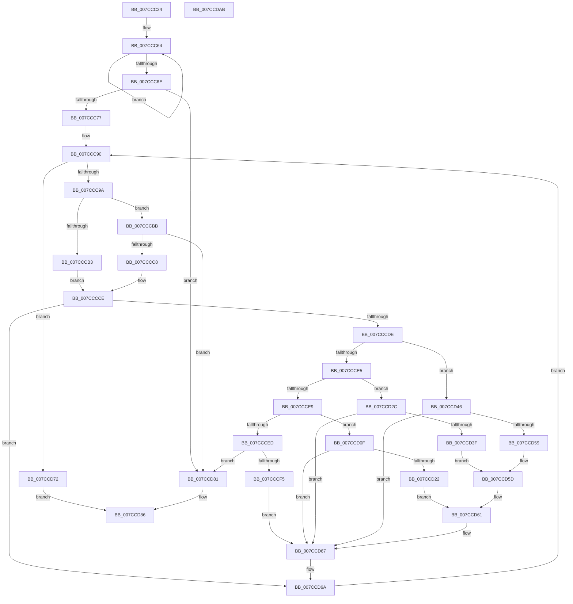

# ExpTranslateHexStringToGUID

- RVA: `0x007CCC34`–`0x007CCDAC` (길이 `376` bytes)
- VA: `0x00000001407CCC34`
- 실행 섹션: `PAGE`
- PDB 이름 있음: `예`; PDB Function 태그: `아니요`
- unwind 정보 RVA: `0x000BC37C`
- 디코드: `118`개 명령, `376/376` bytes 표시
- 미해석 바이트: `0` (있으면 어셈블리에 `.byte`로 보존)

> 이 문서는 커널 이미지의 기계어와 PDB 기호를 분석해 생성했습니다. 4번과 5번은 함수 원형과 자료형을 바이너리 사용 방식에서 추정한 C 해석이며 원본 소스 복구 결과는 아닙니다.

## 1. Dependencies

- 직접 호출 지점: **2**; 고유 호출 대상: **2**
- 직접 호출자로 확인된 함수: **1**
- RIP 상대 이미지 참조: **1**

### Outgoing calls
- `0x007CCCA2` → [towlower](../../text/50/towlower_function_005018E0.md) (function, `0x005018E0`)
- `0x007CCD8E` → [_security_check_cookie](../../text/6A/_security_check_cookie_function_006AC640.md) (function, `0x006AC640`)

### Direct callers
- [ExpParseSignatureName](ExpParseSignatureName_function_007CBA30.md) at `0x007CBB40`

### Static image references
- `0x007CCC48` → RVA `0x00E0A740` (`.data`; read)

## 2. Other-region calls and transfers

- 다른 실행 섹션으로 향하는 call: **2**
  - `0x007CCCA2` → [towlower](../../text/50/towlower_function_005018E0.md) (`PAGE` → `.text`)
  - `0x007CCD8E` → [_security_check_cookie](../../text/6A/_security_check_cookie_function_006AC640.md) (`PAGE` → `.text`)
- 별도 외부 분기/꼬리 이동을 확인하지 못했습니다.

## 3. Assembly (complete function range)

```asm
007CCC34  48 89 5C 24 18                  mov qword ptr [rsp + 0x18], rbx
007CCC39  55                              push rbp
007CCC3A  56                              push rsi
007CCC3B  57                              push rdi
007CCC3C  41 54                           push r12
007CCC3E  41 55                           push r13
007CCC40  41 56                           push r14
007CCC42  41 57                           push r15
007CCC44  48 83 EC 40                     sub rsp, 0x40
007CCC48  48 8B 05 F1 DA 63 00            mov rax, qword ptr [rip + 0x63daf1]
007CCC4F  48 33 C4                        xor rax, rsp
007CCC52  48 89 44 24 30                  mov qword ptr [rsp + 0x30], rax
007CCC57  48 83 C8 FF                     or rax, 0xffffffffffffffff
007CCC5B  4C 8B E2                        mov r12, rdx
007CCC5E  45 33 ED                        xor r13d, r13d
007CCC61  4C 8B F9                        mov r15, rcx
007CCC64  48 FF C0                        inc rax
007CCC67  66 44 39 2C 41                  cmp word ptr [rcx + rax*2], r13w
007CCC6C  75 F6                           jne 0x1407ccc64
007CCC6E  83 F8 20                        cmp eax, 0x20
007CCC71  0F 85 0A 01 00 00               jne 0x1407ccd81
007CCC77  0F 57 C0                        xorps xmm0, xmm0
007CCC7A  41 8B DD                        mov ebx, r13d
007CCC7D  0F 11 44 24 20                  movups xmmword ptr [rsp + 0x20], xmm0
007CCC82  41 0F B7 ED                     movzx ebp, r13w
007CCC86  41 0F B7 FD                     movzx edi, r13w
007CCC8A  41 8B F5                        mov esi, r13d
007CCC8D  45 8B F5                        mov r14d, r13d
007CCC90  41 83 FE 20                     cmp r14d, 0x20
007CCC94  0F 83 D8 00 00 00               jae 0x1407ccd72
007CCC9A  41 8B CE                        mov ecx, r14d
007CCC9D  41 0F B7 0C 4F                  movzx ecx, word ptr [r15 + rcx*2]
007CCCA2  E8 39 4C D3 FF                  call 0x1405018e0
007CCCA7  0F B7 D0                        movzx edx, ax
007CCCAA  8D 4A D0                        lea ecx, [rdx - 0x30]
007CCCAD  66 83 F9 09                     cmp cx, 9
007CCCB1  77 08                           ja 0x1407cccbb
007CCCB3  C1 E3 04                        shl ebx, 4
007CCCB6  83 C3 D0                        add ebx, -0x30
007CCCB9  EB 13                           jmp 0x1407cccce
007CCCBB  8D 42 9F                        lea eax, [rdx - 0x61]
007CCCBE  66 83 F8 05                     cmp ax, 5
007CCCC2  0F 87 B9 00 00 00               ja 0x1407ccd81
007CCCC8  C1 E3 04                        shl ebx, 4
007CCCCB  83 C3 A9                        add ebx, -0x57
007CCCCE  03 DA                           add ebx, edx
007CCCD0  BA 01 00 00 00                  mov edx, 1
007CCCD5  44 84 F2                        test dl, r14b
007CCCD8  0F 84 8C 00 00 00               je 0x1407ccd6a
007CCCDE  0F B7 CD                        movzx ecx, bp
007CCCE1  85 C9                           test ecx, ecx
007CCCE3  74 61                           je 0x1407ccd46
007CCCE5  2B CA                           sub ecx, edx
007CCCE7  74 43                           je 0x1407ccd2c
007CCCE9  2B CA                           sub ecx, edx
007CCCEB  74 22                           je 0x1407ccd0f
007CCCED  3B CA                           cmp ecx, edx
007CCCEF  0F 85 8C 00 00 00               jne 0x1407ccd81
007CCCF5  0F B7 C7                        movzx eax, di
007CCCF8  66 03 FA                        add di, dx
007CCCFB  66 83 FF 08                     cmp di, 8
007CCCFF  88 5C 04 28                     mov byte ptr [rsp + rax + 0x28], bl
007CCD03  8D 04 2A                        lea eax, [rdx + rbp]
007CCD06  66 0F 45 C5                     cmovne ax, bp
007CCD0A  0F B7 E8                        movzx ebp, ax
007CCD0D  EB 58                           jmp 0x1407ccd67
007CCD0F  0F B7 CF                        movzx ecx, di
007CCD12  66 03 FA                        add di, dx
007CCD15  C1 E1 03                        shl ecx, 3
007CCD18  D3 E3                           shl ebx, cl
007CCD1A  03 F3                           add esi, ebx
007CCD1C  66 83 FF 02                     cmp di, 2
007CCD20  75 45                           jne 0x1407ccd67
007CCD22  66 89 74 24 26                  mov word ptr [rsp + 0x26], si
007CCD27  41 8B FD                        mov edi, r13d
007CCD2A  EB 35                           jmp 0x1407ccd61
007CCD2C  0F B7 CF                        movzx ecx, di
007CCD2F  66 03 FA                        add di, dx
007CCD32  C1 E1 03                        shl ecx, 3
007CCD35  D3 E3                           shl ebx, cl
007CCD37  03 F3                           add esi, ebx
007CCD39  66 83 FF 02                     cmp di, 2
007CCD3D  75 28                           jne 0x1407ccd67
007CCD3F  66 89 74 24 24                  mov word ptr [rsp + 0x24], si
007CCD44  EB 17                           jmp 0x1407ccd5d
007CCD46  0F B7 CF                        movzx ecx, di
007CCD49  66 03 FA                        add di, dx
007CCD4C  C1 E1 03                        shl ecx, 3
007CCD4F  D3 E3                           shl ebx, cl
007CCD51  03 F3                           add esi, ebx
007CCD53  66 83 FF 04                     cmp di, 4
007CCD57  75 0E                           jne 0x1407ccd67
007CCD59  89 74 24 20                     mov dword ptr [rsp + 0x20], esi
007CCD5D  41 0F B7 FD                     movzx edi, r13w
007CCD61  66 03 EA                        add bp, dx
007CCD64  41 8B F5                        mov esi, r13d
007CCD67  41 8B DD                        mov ebx, r13d
007CCD6A  44 03 F2                        add r14d, edx
007CCD6D  E9 1E FF FF FF                  jmp 0x1407ccc90
007CCD72  0F 10 44 24 20                  movups xmm0, xmmword ptr [rsp + 0x20]
007CCD77  33 C0                           xor eax, eax
007CCD79  F3 41 0F 7F 04 24               movdqu xmmword ptr [r12], xmm0
007CCD7F  EB 05                           jmp 0x1407ccd86
007CCD81  B8 0D 00 00 C0                  mov eax, 0xc000000d
007CCD86  48 8B 4C 24 30                  mov rcx, qword ptr [rsp + 0x30]
007CCD8B  48 33 CC                        xor rcx, rsp
007CCD8E  E8 AD F8 ED FF                  call 0x1406ac640
007CCD93  48 8B 9C 24 90 00 00 00         mov rbx, qword ptr [rsp + 0x90]
007CCD9B  48 83 C4 40                     add rsp, 0x40
007CCD9F  41 5F                           pop r15
007CCDA1  41 5E                           pop r14
007CCDA3  41 5D                           pop r13
007CCDA5  41 5C                           pop r12
007CCDA7  5F                              pop rdi
007CCDA8  5E                              pop rsi
007CCDA9  5D                              pop rbp
007CCDAA  C3                              ret
007CCDAB  CC                              int3
```

## 4. C-style interpretation (structured pseudocode)

```c
__int64 __fastcall ExpTranslateHexStringToGUID(__int64 a1, __int64 a2)
{
    __int64 result;
    __int64 v_r13;
    __int64 v_r14;
    __int64 v_rbp;
    __int64 v_rbx;
    __int64 v_rdi;
    __int64 v_rsi;
    __int64 v_rsp;
    unsigned __int64 v_stack_m48;
    unsigned __int16 v_stack_m52;
    unsigned __int16 v_stack_m54;
    unsigned __int64 v_stack_m58;
    unsigned __int64 v_stack_p18;

    v_stack_p18 = v_rbx;
    v_rsp = (v_rsp) - (64);
    result = (*(unsigned __int64 *)(v_rip + 6544113)) ^ (v_rsp);
    v_stack_m48 = result;
    result = (result) | (-1);
    v_r13 = 0;
loc_007CCC64:
    result = (result) + 1;
    if ((*(unsigned __int16 *)(a1 + result * 2)) != 0) goto loc_007CCC64;
    if (((unsigned int)(result)) != 32) goto loc_007CCD81;
    v_stack_m58 = v_xmm0;
loc_007CCC90:
    if (0 >= 32) goto loc_007CCD72;
    result = towlower(*(unsigned __int16 *)(a1 + 0 * 2), a2, a3, a4);
    if (((unsigned __int16)((unsigned __int16)(result) - 48)) > 9) goto loc_007CCCBB;
    v_rbx = (unsigned int)((0) << (4));
    v_rbx = (unsigned int)((v_rbx) + (-48));
    goto loc_007CCCCE;
loc_007CCCBB:
    if (((unsigned __int16)((unsigned __int16)(result) - 97)) > 5) goto loc_007CCD81;
    v_rbx = (unsigned int)((v_rbx) << (4));
    v_rbx = (unsigned int)((v_rbx) + (-87));
loc_007CCCCE:
    v_rbx = (unsigned int)((v_rbx) + ((unsigned int)((unsigned __int16)(result))));
    if (((1) & (0)) == 0) goto loc_007CCD6A;
    if (0 == 0) goto loc_007CCD46;
    a1 = (unsigned int)((0) - (1));
    if (condition_is_equal) goto loc_007CCD2C;
    a1 = (unsigned int)((a1) - (1));
    if (condition_is_equal) goto loc_007CCD0F;
    if (((unsigned int)(a1)) != 1) goto loc_007CCD81;
    v_rdi = (unsigned __int16)((0) + (1));
    *(unsigned __int8 *)(v_rsp + 0 * 1 + 40) = (unsigned __int8)(v_rbx);
    result = 1 + 0 * 1;
    if (((unsigned __int16)(v_rdi)) != 8) { result = 0; }
    goto loc_007CCD67;
loc_007CCD0F:
    v_rdi = (unsigned __int16)((v_rdi) + (1));
    a1 = (unsigned int)(((unsigned __int16)(v_rdi)) << (3));
    v_rbx = (unsigned int)((v_rbx) << ((unsigned __int8)(a1)));
    v_rsi = (unsigned int)((0) + ((unsigned int)(v_rbx)));
    if (((unsigned __int16)(v_rdi)) != 2) goto loc_007CCD67;
    v_stack_m52 = (unsigned __int16)(v_rsi);
    goto loc_007CCD61;
loc_007CCD2C:
    v_rdi = (unsigned __int16)((0) + (1));
    a1 = (unsigned int)((0) << (3));
    v_rbx = (unsigned int)((v_rbx) << ((unsigned __int8)(a1)));
    v_rsi = (unsigned int)((v_rsi) + ((unsigned int)(v_rbx)));
    if (((unsigned __int16)(v_rdi)) != 2) goto loc_007CCD67;
    v_stack_m54 = (unsigned __int16)(v_rsi);
    goto loc_007CCD5D;
loc_007CCD46:
    v_rdi = (unsigned __int16)((v_rdi) + (1));
    a1 = (unsigned int)(((unsigned __int16)(v_rdi)) << (3));
    v_rbx = (unsigned int)((v_rbx) << ((unsigned __int8)(a1)));
    v_rsi = (unsigned int)((v_rsi) + ((unsigned int)(v_rbx)));
    if (((unsigned __int16)(v_rdi)) != 4) goto loc_007CCD67;
    v_stack_m58 = (unsigned int)(v_rsi);
loc_007CCD5D:
loc_007CCD61:
    v_rbp = (unsigned __int16)(((unsigned __int16)(result)) + (1));
loc_007CCD67:
loc_007CCD6A:
    v_r14 = (unsigned int)((0) + (1));
    goto loc_007CCC90;
loc_007CCD72:
    result = 0;
    *(unsigned __int64 *)(a2) = v_xmm0;
    goto loc_007CCD86;
loc_007CCD81:
loc_007CCD86:
    a1 = (v_stack_m48) ^ (v_rsp);
    result = _security_check_cookie(a1, 1, a3, a4);
    v_rsp = (v_rsp) + (64);
    return result;
}
```

## 5. (Beta) C Style

```c
int64_t ExpTranslateHexStringToGUID(void *Arg1, void *Arg2)
{
    uint8_t *arg1 = (uint8_t *)Arg1;
    uint8_t *arg2 = (uint8_t *)Arg2;

    int64_t result;
    int64_t local_r13;
    int64_t local_r14;
    int64_t local_rbp;
    int64_t local_rbx;
    int64_t local_rdi;
    int64_t local_rsi;
    int64_t local_rsp;
    uint64_t v_stack_m48;
    uint16_t v_stack_m52;
    uint16_t v_stack_m54;
    uint64_t v_stack_m58;
    uint64_t v_stack_p18;

    v_stack_p18 = local_rbx;
    local_rsp = (local_rsp) - (64);
    result = (*(uint64_t *)(v_rip + 0x63DAF1)) ^ (local_rsp);
    v_stack_m48 = result;
    result = (result) | (-1);
    local_r13 = 0;
loc_007CCC64:
    result = (result) + 1;
    if ((*(uint16_t *)(arg1 + result * 2)) != 0) goto loc_007CCC64;
    if (((uint32_t)(result)) != 32) goto loc_007CCD81;
    v_stack_m58 = v_xmm0;
loc_007CCC90:
    if (0 >= 32) goto loc_007CCD72;
    result = towlower(*(uint16_t *)(arg1 + 0x0 * 2), Arg2, a3, a4);
    if (((uint16_t)((uint16_t)(result) - 48)) > 9) goto loc_007CCCBB;
    local_rbx = (uint32_t)((0) << (4));
    local_rbx = (uint32_t)((local_rbx) + (-48));
    goto loc_007CCCCE;
loc_007CCCBB:
    if (((uint16_t)((uint16_t)(result) - 97)) > 5) goto loc_007CCD81;
    local_rbx = (uint32_t)((local_rbx) << (4));
    local_rbx = (uint32_t)((local_rbx) + (-87));
loc_007CCCCE:
    local_rbx = (uint32_t)((local_rbx) + ((uint32_t)((uint16_t)(result))));
    if (((1) & (0)) == 0) goto loc_007CCD6A;
    if (0 == 0) goto loc_007CCD46;
    Arg1 = (uint32_t)((0) - (1));
    if (condition_is_equal) goto loc_007CCD2C;
    Arg1 = (uint32_t)((Arg1) - (1));
    if (condition_is_equal) goto loc_007CCD0F;
    if (((uint32_t)(Arg1)) != 1) goto loc_007CCD81;
    local_rdi = (uint16_t)((0) + (1));
    *(uint8_t *)(local_rsp + 0x0 * 1 + 0x28) = (uint8_t)(local_rbx);
    result = 1 + 0 * 1;
    if (((uint16_t)(local_rdi)) != 8) { result = 0; }
    goto loc_007CCD67;
loc_007CCD0F:
    local_rdi = (uint16_t)((local_rdi) + (1));
    Arg1 = (uint32_t)(((uint16_t)(local_rdi)) << (3));
    local_rbx = (uint32_t)((local_rbx) << ((uint8_t)(Arg1)));
    local_rsi = (uint32_t)((0) + ((uint32_t)(local_rbx)));
    if (((uint16_t)(local_rdi)) != 2) goto loc_007CCD67;
    v_stack_m52 = (uint16_t)(local_rsi);
    goto loc_007CCD61;
loc_007CCD2C:
    local_rdi = (uint16_t)((0) + (1));
    Arg1 = (uint32_t)((0) << (3));
    local_rbx = (uint32_t)((local_rbx) << ((uint8_t)(Arg1)));
    local_rsi = (uint32_t)((local_rsi) + ((uint32_t)(local_rbx)));
    if (((uint16_t)(local_rdi)) != 2) goto loc_007CCD67;
    v_stack_m54 = (uint16_t)(local_rsi);
    goto loc_007CCD5D;
loc_007CCD46:
    local_rdi = (uint16_t)((local_rdi) + (1));
    Arg1 = (uint32_t)(((uint16_t)(local_rdi)) << (3));
    local_rbx = (uint32_t)((local_rbx) << ((uint8_t)(Arg1)));
    local_rsi = (uint32_t)((local_rsi) + ((uint32_t)(local_rbx)));
    if (((uint16_t)(local_rdi)) != 4) goto loc_007CCD67;
    v_stack_m58 = (uint32_t)(local_rsi);
loc_007CCD5D:
loc_007CCD61:
    local_rbp = (uint16_t)(((uint16_t)(result)) + (1));
loc_007CCD67:
loc_007CCD6A:
    local_r14 = (uint32_t)((0) + (1));
    goto loc_007CCC90;
loc_007CCD72:
    result = 0;
    *(uint64_t *)(arg2) = v_xmm0;
    goto loc_007CCD86;
loc_007CCD81:
loc_007CCD86:
    Arg1 = (v_stack_m48) ^ (local_rsp);
    result = _security_check_cookie(Arg1, 1, a3, a4);
    local_rsp = (local_rsp) + (64);
    return result;
}
```

### 관측된 메모리 오프셋

구조체 형식이 확인되지 않은 접근은 인자 기준의 오프셋으로만 기록했습니다.

| 기준 인자 | 오프셋 표현 | 폭 (bit) | 접근 |
|---|---:|---:|---|
| `Arg1` | `+ 0x0 + rax*2` | `16` | `R` |
| `Arg1` | `+ 0x0 + rcx*2` | `16` | `R` |
| `Arg2` | `+ 0x0` | `128` | `W` |

## 6. Execution-region graph

[열기: 2D/3D 그래프와 함수 탐색 컨트롤 패널](../../../control-panel.html?section=page&rva=0x007CCC34&view=graph)

- 2D 그래프는 위에서 아래로 흐르고, 3D 그래프는 빈 공간을 드래그해 회전합니다. Shift+드래그는 이동, 휠은 확대·축소, 함수 노드 선택은 대상 보고서 이동입니다.

### Static fallback


