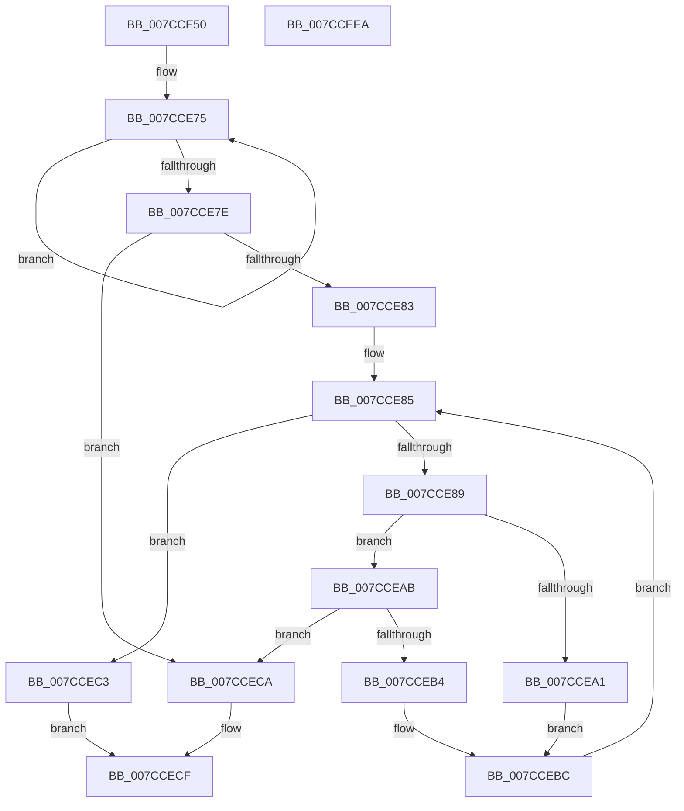

# ExpTranslateHexStringToULONGLONG

- RVA: `0x007CCE50`–`0x007CCEEB` (길이 `155` bytes)
- VA: `0x00000001407CCE50`
- 실행 섹션: `PAGE`
- PDB 이름 있음: `예`; PDB Function 태그: `아니요`
- unwind 정보 RVA: `0x0007F3F8`
- 디코드: `49`개 명령, `155/155` bytes 표시
- 미해석 바이트: `0` (있으면 어셈블리에 `.byte`로 보존)

> 이 문서는 커널 이미지의 기계어와 PDB 기호를 분석해 생성했습니다. 4번과 5번은 함수 원형과 자료형을 바이너리 사용 방식에서 추정한 C 해석이며 원본 소스 복구 결과는 아닙니다.

## 1. Dependencies

- 직접 호출 지점: **1**; 고유 호출 대상: **1**
- 직접 호출자로 확인된 함수: **1**
- RIP 상대 이미지 참조: **0**

### Outgoing calls
- `0x007CCE90` → [towlower](../../text/50/towlower_function_005018E0.md) (function, `0x005018E0`)

### Direct callers
- [ExpParseSignatureName](ExpParseSignatureName_function_007CBA30.md) at `0x007CBC46`
- [ExpParseSignatureName](ExpParseSignatureName_function_007CBA30.md) at `0x007CBCA3`

### Static image references
- 디코드된 RIP-relative 메모리 참조가 없습니다.

## 2. Other-region calls and transfers

- 다른 실행 섹션으로 향하는 call: **1**
  - `0x007CCE90` → [towlower](../../text/50/towlower_function_005018E0.md) (`PAGE` → `.text`)
- 별도 외부 분기/꼬리 이동을 확인하지 못했습니다.

## 3. Assembly (complete function range)

```asm
007CCE50  48 8B C4                        mov rax, rsp
007CCE53  48 89 58 08                     mov qword ptr [rax + 8], rbx
007CCE57  48 89 70 10                     mov qword ptr [rax + 0x10], rsi
007CCE5B  48 89 78 18                     mov qword ptr [rax + 0x18], rdi
007CCE5F  4C 89 70 20                     mov qword ptr [rax + 0x20], r14
007CCE63  41 57                           push r15
007CCE65  48 83 EC 20                     sub rsp, 0x20
007CCE69  48 83 CF FF                     or rdi, 0xffffffffffffffff
007CCE6D  4C 8B FA                        mov r15, rdx
007CCE70  33 DB                           xor ebx, ebx
007CCE72  4C 8B F1                        mov r14, rcx
007CCE75  48 FF C7                        inc rdi
007CCE78  66 39 1C 79                     cmp word ptr [rcx + rdi*2], bx
007CCE7C  75 F7                           jne 0x1407cce75
007CCE7E  83 FF 10                        cmp edi, 0x10
007CCE81  77 47                           ja 0x1407cceca
007CCE83  8B F3                           mov esi, ebx
007CCE85  3B F7                           cmp esi, edi
007CCE87  73 3A                           jae 0x1407ccec3
007CCE89  8B CE                           mov ecx, esi
007CCE8B  41 0F B7 0C 4E                  movzx ecx, word ptr [r14 + rcx*2]
007CCE90  E8 4B 4A D3 FF                  call 0x1405018e0
007CCE95  0F B7 D0                        movzx edx, ax
007CCE98  8D 4A D0                        lea ecx, [rdx - 0x30]
007CCE9B  66 83 F9 09                     cmp cx, 9
007CCE9F  77 0A                           ja 0x1407cceab
007CCEA1  48 C1 E3 04                     shl rbx, 4
007CCEA5  48 83 C3 D0                     add rbx, -0x30
007CCEA9  EB 11                           jmp 0x1407ccebc
007CCEAB  8D 42 9F                        lea eax, [rdx - 0x61]
007CCEAE  66 83 F8 05                     cmp ax, 5
007CCEB2  77 16                           ja 0x1407cceca
007CCEB4  48 C1 E3 04                     shl rbx, 4
007CCEB8  48 83 C3 A9                     add rbx, -0x57
007CCEBC  48 03 DA                        add rbx, rdx
007CCEBF  FF C6                           inc esi
007CCEC1  EB C2                           jmp 0x1407cce85
007CCEC3  49 89 1F                        mov qword ptr [r15], rbx
007CCEC6  33 C0                           xor eax, eax
007CCEC8  EB 05                           jmp 0x1407ccecf
007CCECA  B8 0D 00 00 C0                  mov eax, 0xc000000d
007CCECF  48 8B 5C 24 30                  mov rbx, qword ptr [rsp + 0x30]
007CCED4  48 8B 74 24 38                  mov rsi, qword ptr [rsp + 0x38]
007CCED9  48 8B 7C 24 40                  mov rdi, qword ptr [rsp + 0x40]
007CCEDE  4C 8B 74 24 48                  mov r14, qword ptr [rsp + 0x48]
007CCEE3  48 83 C4 20                     add rsp, 0x20
007CCEE7  41 5F                           pop r15
007CCEE9  C3                              ret
007CCEEA  CC                              int3
```

## 4. C-style interpretation (structured pseudocode)

```c
__int64 __fastcall ExpTranslateHexStringToULONGLONG(__int64 a1, __int64 a2)
{
    __int64 result;
    __int64 v_rbx;
    __int64 v_rdi;
    __int64 v_rsi;
    __int64 v_rsp;
    unsigned __int64 v_stack_p10;
    unsigned __int64 v_stack_p18;
    unsigned __int64 v_stack_p20;
    unsigned __int64 v_stack_p8;

    *(unsigned __int64 *)(v_rsp + 8) = v_rbx;
    *(unsigned __int64 *)(v_rsp + 16) = v_rsi;
    *(unsigned __int64 *)(v_rsp + 24) = v_rdi;
    *(unsigned __int64 *)(v_rsp + 32) = v_r14;
    v_rsp = (v_rsp) - (32);
    v_rdi = (v_rdi) | (-1);
    v_rbx = 0;
loc_007CCE75:
    v_rdi = (v_rdi) + 1;
    if ((*(unsigned __int16 *)(a1 + v_rdi * 2)) != 0) goto loc_007CCE75;
    if (((unsigned int)(v_rdi)) > 16) goto loc_007CCECA;
loc_007CCE85:
    if (0 >= ((unsigned int)(v_rdi))) goto loc_007CCEC3;
    result = towlower(*(unsigned __int16 *)(a1 + 0 * 2), a2, a3, a4);
    if (((unsigned __int16)((unsigned __int16)(result) - 48)) > 9) goto loc_007CCEAB;
    v_rbx = (v_rbx) << (4);
    v_rbx = (v_rbx) + (-48);
    goto loc_007CCEBC;
loc_007CCEAB:
    if (((unsigned __int16)((unsigned __int16)(result) - 97)) > 5) goto loc_007CCECA;
    v_rbx = (v_rbx) << (4);
    v_rbx = (v_rbx) + (-87);
loc_007CCEBC:
    v_rbx = (v_rbx) + ((unsigned __int16)(result));
    v_rsi = (unsigned int)((0) + 1);
    goto loc_007CCE85;
loc_007CCEC3:
    *(unsigned __int64 *)(a2) = v_rbx;
    result = 0;
    goto loc_007CCECF;
loc_007CCECA:
loc_007CCECF:
    v_rsp = (v_rsp) + (32);
    return (unsigned int)(0xC000000DULL);
}
```

## 5. (Beta) C Style

```c
int64_t ExpTranslateHexStringToULONGLONG(void *Arg1, void *Arg2)
{
    uint8_t *arg1 = (uint8_t *)Arg1;
    uint8_t *arg2 = (uint8_t *)Arg2;

    int64_t result;
    int64_t local_rbx;
    int64_t local_rdi;
    int64_t local_rsi;
    int64_t local_rsp;
    uint64_t v_stack_p10;
    uint64_t v_stack_p18;
    uint64_t v_stack_p20;
    uint64_t v_stack_p8;

    *(uint64_t *)(local_rsp + 0x8) = local_rbx;
    *(uint64_t *)(local_rsp + 0x10) = local_rsi;
    *(uint64_t *)(local_rsp + 0x18) = local_rdi;
    *(uint64_t *)(local_rsp + 0x20) = local_r14;
    local_rsp = (local_rsp) - (32);
    local_rdi = (local_rdi) | (-1);
    local_rbx = 0;
loc_007CCE75:
    local_rdi = (local_rdi) + 1;
    if ((*(uint16_t *)(arg1 + local_rdi * 2)) != 0) goto loc_007CCE75;
    if (((uint32_t)(local_rdi)) > 16) goto loc_007CCECA;
loc_007CCE85:
    if (0 >= ((uint32_t)(local_rdi))) goto loc_007CCEC3;
    result = towlower(*(uint16_t *)(arg1 + 0x0 * 2), Arg2, a3, a4);
    if (((uint16_t)((uint16_t)(result) - 48)) > 9) goto loc_007CCEAB;
    local_rbx = (local_rbx) << (4);
    local_rbx = (local_rbx) + (-48);
    goto loc_007CCEBC;
loc_007CCEAB:
    if (((uint16_t)((uint16_t)(result) - 97)) > 5) goto loc_007CCECA;
    local_rbx = (local_rbx) << (4);
    local_rbx = (local_rbx) + (-87);
loc_007CCEBC:
    local_rbx = (local_rbx) + ((uint16_t)(result));
    local_rsi = (uint32_t)((0) + 1);
    goto loc_007CCE85;
loc_007CCEC3:
    *(uint64_t *)(arg2) = local_rbx;
    result = 0;
    goto loc_007CCECF;
loc_007CCECA:
loc_007CCECF:
    local_rsp = (local_rsp) + (32);
    return (uint32_t)(0xC000000DULL);
}
```

### 관측된 메모리 오프셋

구조체 형식이 확인되지 않은 접근은 인자 기준의 오프셋으로만 기록했습니다.

| 기준 인자 | 오프셋 표현 | 폭 (bit) | 접근 |
|---|---:|---:|---|
| `Arg1` | `+ 0x0 + rcx*2` | `16` | `R` |
| `Arg1` | `+ 0x0 + rdi*2` | `16` | `R` |
| `Arg2` | `+ 0x0` | `64` | `W` |

## 6. Execution-region graph

[열기: 2D/3D 그래프와 함수 탐색 컨트롤 패널](../../../control-panel.html?section=page&rva=0x007CCE50&view=graph)

- 2D 그래프는 위에서 아래로 흐르고, 3D 그래프는 빈 공간을 드래그해 회전합니다. Shift+드래그는 이동, 휠은 확대·축소, 함수 노드 선택은 대상 보고서 이동입니다.

### Static fallback


