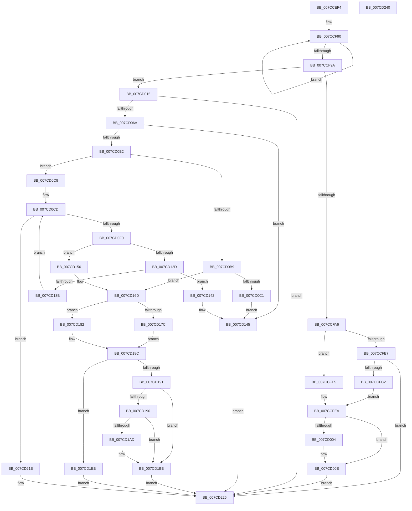

# ExpTranslateNtPath

- RVA: `0x007CCEF4`–`0x007CD241` (길이 `845` bytes)
- VA: `0x00000001407CCEF4`
- 실행 섹션: `PAGE`
- PDB 이름 있음: `예`; PDB Function 태그: `아니요`
- unwind 정보 RVA: `0x000D5170`
- 디코드: `220`개 명령, `845/845` bytes 표시
- 미해석 바이트: `0` (있으면 어셈블리에 `.byte`로 보존)

> 이 문서는 커널 이미지의 기계어와 PDB 기호를 분석해 생성했습니다. 4번과 5번은 함수 원형과 자료형을 바이너리 사용 방식에서 추정한 C 해석이며 원본 소스 복구 결과는 아닙니다.

## 1. Dependencies

- 직접 호출 지점: **17**; 고유 호출 대상: **12**
- 직접 호출자로 확인된 함수: **2**
- RIP 상대 이미지 참조: **0**

### Outgoing calls
- `0x007CCF54` → [memset](../../text/6C/memset_function_006C6C40.md) (function, `0x006C6C40`)
- `0x007CCF7B` → [RtlInitUnicodeString](../../text/42/RtlInitUnicodeString_function_0042A780.md) (function, `0x0042A780`)
- `0x007CCFAE` → [ExpTranslateSymbolicLink](../A7/ExpTranslateSymbolicLink_function_00A7B38C.md) (function, `0x00A7B38C`)
- `0x007CCFF8` → [ExpCreateOutputARC](ExpCreateOutputARC_function_007CB30C.md) (function, `0x007CB30C`)
- `0x007CD009` → [ExFreePoolWithTag](../../poolcode/B8/ExFreePoolWithTag_function_00B82870.md) (function, `0x00B82870`)
- `0x007CD05D` → [ZwOpenFile](../../text/6A/ZwOpenFile_function_006AD730.md) (function, `0x006AD730`)
- `0x007CD0A3` → [ZwDeviceIoControlFile](../../text/6A/ZwDeviceIoControlFile_function_006AD1B0.md) (function, `0x006AD1B0`)
- `0x007CD0DA` → [ExAllocatePool2](../../poolcode/B8/ExAllocatePool2_function_00B820F0.md) (function, `0x00B820F0`)
- `0x007CD11C` → [ZwDeviceIoControlFile](../../text/6A/ZwDeviceIoControlFile_function_006AD1B0.md) (function, `0x006AD1B0`)
- `0x007CD12D` → [ExFreePoolWithTag](../../poolcode/B8/ExFreePoolWithTag_function_00B82870.md) (function, `0x00B82870`)
- `0x007CD14A` → [ZwClose](../../text/6A/ZwClose_function_006AD2B0.md) (function, `0x006AD2B0`)
- `0x007CD15F` → [ExFreePoolWithTag](../../poolcode/B8/ExFreePoolWithTag_function_00B82870.md) (function, `0x00B82870`)
- `0x007CD172` → [ZwClose](../../text/6A/ZwClose_function_006AD2B0.md) (function, `0x006AD2B0`)
- `0x007CD1A4` → [BcdEnumerateDisks](../AB/BcdEnumerateDisks_function_00AB04CC.md) (function, `0x00AB04CC`)
- `0x007CD1E4` → [ExpCreateOutputEFI](../A7/ExpCreateOutputEFI_function_00A7BE84.md) (function, `0x00A7BE84`)
- `0x007CD214` → [ExpCreateOutputSIGNATURE](ExpCreateOutputSIGNATURE_function_007CB404.md) (function, `0x007CB404`)
- `0x007CD21B` → [ZwClose](../../text/6A/ZwClose_function_006AD2B0.md) (function, `0x006AD2B0`)

### Direct callers
- [ExpConvertArcName](ExpConvertArcName_function_007CAF04.md) at `0x007CB08E`
- [sub_00B37C9A](../B3/Unknown_function_00B37C9A.md) at `0x00B37CED`

### Static image references
- 디코드된 RIP-relative 메모리 참조가 없습니다.

## 2. Other-region calls and transfers

- 다른 실행 섹션으로 향하는 call: **12**
  - `0x007CCF54` → [memset](../../text/6C/memset_function_006C6C40.md) (`PAGE` → `.text`)
  - `0x007CCF7B` → [RtlInitUnicodeString](../../text/42/RtlInitUnicodeString_function_0042A780.md) (`PAGE` → `.text`)
  - `0x007CD009` → [ExFreePoolWithTag](../../poolcode/B8/ExFreePoolWithTag_function_00B82870.md) (`PAGE` → `POOLCODE`)
  - `0x007CD05D` → [ZwOpenFile](../../text/6A/ZwOpenFile_function_006AD730.md) (`PAGE` → `.text`)
  - `0x007CD0A3` → [ZwDeviceIoControlFile](../../text/6A/ZwDeviceIoControlFile_function_006AD1B0.md) (`PAGE` → `.text`)
  - `0x007CD0DA` → [ExAllocatePool2](../../poolcode/B8/ExAllocatePool2_function_00B820F0.md) (`PAGE` → `POOLCODE`)
  - `0x007CD11C` → [ZwDeviceIoControlFile](../../text/6A/ZwDeviceIoControlFile_function_006AD1B0.md) (`PAGE` → `.text`)
  - `0x007CD12D` → [ExFreePoolWithTag](../../poolcode/B8/ExFreePoolWithTag_function_00B82870.md) (`PAGE` → `POOLCODE`)
  - `0x007CD14A` → [ZwClose](../../text/6A/ZwClose_function_006AD2B0.md) (`PAGE` → `.text`)
  - `0x007CD15F` → [ExFreePoolWithTag](../../poolcode/B8/ExFreePoolWithTag_function_00B82870.md) (`PAGE` → `POOLCODE`)
  - `0x007CD172` → [ZwClose](../../text/6A/ZwClose_function_006AD2B0.md) (`PAGE` → `.text`)
  - `0x007CD21B` → [ZwClose](../../text/6A/ZwClose_function_006AD2B0.md) (`PAGE` → `.text`)
- 별도 외부 분기/꼬리 이동을 확인하지 못했습니다.

## 3. Assembly (complete function range)

```asm
007CCEF4  48 89 5C 24 18                  mov qword ptr [rsp + 0x18], rbx
007CCEF9  89 54 24 10                     mov dword ptr [rsp + 0x10], edx
007CCEFD  55                              push rbp
007CCEFE  56                              push rsi
007CCEFF  57                              push rdi
007CCF00  41 54                           push r12
007CCF02  41 55                           push r13
007CCF04  41 56                           push r14
007CCF06  41 57                           push r15
007CCF08  48 8D 6C 24 A0                  lea rbp, [rsp - 0x60]
007CCF0D  48 81 EC 60 01 00 00            sub rsp, 0x160
007CCF14  0F 57 C0                        xorps xmm0, xmm0
007CCF17  45 33 F6                        xor r14d, r14d
007CCF1A  4D 8B E8                        mov r13, r8
007CCF1D  44 89 75 9C                     mov dword ptr [rbp - 0x64], r14d
007CCF21  8B F2                           mov esi, edx
007CCF23  44 89 75 B4                     mov dword ptr [rbp - 0x4c], r14d
007CCF27  48 8B D9                        mov rbx, rcx
007CCF2A  4C 89 74 24 50                  mov qword ptr [rsp + 0x50], r14
007CCF2F  0F 57 C9                        xorps xmm1, xmm1
007CCF32  48 8D 4D D0                     lea rcx, [rbp - 0x30]
007CCF36  33 C0                           xor eax, eax
007CCF38  33 D2                           xor edx, edx
007CCF3A  41 B8 8C 00 00 00               mov r8d, 0x8c
007CCF40  89 45 D4                        mov dword ptr [rbp - 0x2c], eax
007CCF43  0F 11 44 24 68                  movups xmmword ptr [rsp + 0x68], xmm0
007CCF48  4D 8B E1                        mov r12, r9
007CCF4B  0F 11 4C 24 58                  movups xmmword ptr [rsp + 0x58], xmm1
007CCF50  0F 11 45 88                     movups xmmword ptr [rbp - 0x78], xmm0
007CCF54  E8 E7 9C EF FF                  call 0x1406c6c40
007CCF59  0F 57 C0                        xorps xmm0, xmm0
007CCF5C  44 89 B5 A0 00 00 00            mov dword ptr [rbp + 0xa0], r14d
007CCF63  48 83 C3 0C                     add rbx, 0xc
007CCF67  41 8D 7E 01                     lea edi, [r14 + 1]
007CCF6B  48 8B D3                        mov rdx, rbx
007CCF6E  48 8D 4C 24 68                  lea rcx, [rsp + 0x68]
007CCF73  0F 11 44 24 78                  movups xmmword ptr [rsp + 0x78], xmm0
007CCF78  44 8A FF                        mov r15b, dil
007CCF7B  E8 00 D8 C5 FF                  call 0x14042a780
007CCF80  0F B7 54 24 68                  movzx edx, word ptr [rsp + 0x68]
007CCF85  48 83 C2 02                     add rdx, 2
007CCF89  48 03 D3                        add rdx, rbx
007CCF8C  48 83 C8 FF                     or rax, 0xffffffffffffffff
007CCF90  48 FF C0                        inc rax
007CCF93  66 44 39 34 42                  cmp word ptr [rdx + rax*2], r14w
007CCF98  75 F6                           jne 0x1407ccf90
007CCF9A  F7 D8                           neg eax
007CCF9C  4D 1B F6                        sbb r14, r14
007CCF9F  4C 23 F2                        and r14, rdx
007CCFA2  3B F7                           cmp esi, edi
007CCFA4  75 6F                           jne 0x1407cd015
007CCFA6  48 8D 54 24 58                  lea rdx, [rsp + 0x58]
007CCFAB  48 8B CB                        mov rcx, rbx
007CCFAE  E8 D9 E3 2A 00                  call 0x140a7b38c
007CCFB3  85 C0                           test eax, eax
007CCFB5  79 2E                           jns 0x1407ccfe5
007CCFB7  3D 24 00 00 C0                  cmp eax, 0xc0000024
007CCFBC  0F 85 63 02 00 00               jne 0x1407cd225
007CCFC2  0F B7 44 24 68                  movzx eax, word ptr [rsp + 0x68]
007CCFC7  45 32 FF                        xor r15b, r15b
007CCFCA  48 8B 5C 24 70                  mov rbx, qword ptr [rsp + 0x70]
007CCFCF  66 89 44 24 58                  mov word ptr [rsp + 0x58], ax
007CCFD4  0F B7 44 24 6A                  movzx eax, word ptr [rsp + 0x6a]
007CCFD9  66 89 44 24 5A                  mov word ptr [rsp + 0x5a], ax
007CCFDE  48 89 5C 24 60                  mov qword ptr [rsp + 0x60], rbx
007CCFE3  EB 05                           jmp 0x1407ccfea
007CCFE5  48 8B 5C 24 60                  mov rbx, qword ptr [rsp + 0x60]
007CCFEA  4D 8B CE                        mov r9, r14
007CCFED  4C 8D 44 24 58                  lea r8, [rsp + 0x58]
007CCFF2  49 8B D4                        mov rdx, r12
007CCFF5  49 8B CD                        mov rcx, r13
007CCFF8  E8 0F E3 FF FF                  call 0x1407cb30c
007CCFFD  8B F0                           mov esi, eax
007CCFFF  44 3A FF                        cmp r15b, dil
007CD002  75 0A                           jne 0x1407cd00e
007CD004  33 D2                           xor edx, edx
007CD006  48 8B CB                        mov rcx, rbx
007CD009  E8 62 58 3B 00                  call 0x140b82870
007CD00E  8B C6                           mov eax, esi
007CD010  E9 10 02 00 00                  jmp 0x1407cd225
007CD015  48 8D 44 24 68                  lea rax, [rsp + 0x68]
007CD01A  C7 44 24 28 60 00 00 00         mov dword ptr [rsp + 0x28], 0x60
007CD022  0F 57 C0                        xorps xmm0, xmm0
007CD025  48 89 45 A8                     mov qword ptr [rbp - 0x58], rax
007CD029  45 33 FF                        xor r15d, r15d
007CD02C  C7 45 98 30 00 00 00            mov dword ptr [rbp - 0x68], 0x30
007CD033  4C 8D 4D 88                     lea r9, [rbp - 0x78]
007CD037  4C 89 7D A0                     mov qword ptr [rbp - 0x60], r15
007CD03B  4C 8D 45 98                     lea r8, [rbp - 0x68]
007CD03F  C7 45 B0 40 02 00 00            mov dword ptr [rbp - 0x50], 0x240
007CD046  BA 80 00 10 00                  mov edx, 0x100080
007CD04B  C7 44 24 20 03 00 00 00         mov dword ptr [rsp + 0x20], 3
007CD053  48 8D 4C 24 50                  lea rcx, [rsp + 0x50]
007CD058  F3 0F 7F 45 B8                  movdqu xmmword ptr [rbp - 0x48], xmm0
007CD05D  E8 CE 06 EE FF                  call 0x1406ad730
007CD062  85 C0                           test eax, eax
007CD064  0F 88 BB 01 00 00               js 0x1407cd225
007CD06A  48 8B 4C 24 50                  mov rcx, qword ptr [rsp + 0x50]
007CD06F  48 8D 45 D0                     lea rax, [rbp - 0x30]
007CD073  C7 44 24 48 90 00 00 00         mov dword ptr [rsp + 0x48], 0x90
007CD07B  45 33 C9                        xor r9d, r9d
007CD07E  48 89 44 24 40                  mov qword ptr [rsp + 0x40], rax
007CD083  45 33 C0                        xor r8d, r8d
007CD086  44 89 7C 24 38                  mov dword ptr [rsp + 0x38], r15d
007CD08B  48 8D 45 88                     lea rax, [rbp - 0x78]
007CD08F  4C 89 7C 24 30                  mov qword ptr [rsp + 0x30], r15
007CD094  33 D2                           xor edx, edx
007CD096  C7 44 24 28 48 00 07 00         mov dword ptr [rsp + 0x28], 0x70048
007CD09E  48 89 44 24 20                  mov qword ptr [rsp + 0x20], rax
007CD0A3  E8 08 01 EE FF                  call 0x1406ad1b0
007CD0A8  8B D8                           mov ebx, eax
007CD0AA  85 C0                           test eax, eax
007CD0AC  0F 88 93 00 00 00               js 0x1407cd145
007CD0B2  8B 45 D0                        mov eax, dword ptr [rbp - 0x30]
007CD0B5  85 C0                           test eax, eax
007CD0B7  74 0F                           je 0x1407cd0c8
007CD0B9  3B C7                           cmp eax, edi
007CD0BB  0F 84 AC 00 00 00               je 0x1407cd16d
007CD0C1  BB 14 00 00 C0                  mov ebx, 0xc0000014
007CD0C6  EB 7D                           jmp 0x1407cd145
007CD0C8  BE 30 09 00 00                  mov esi, 0x930
007CD0CD  8B D6                           mov edx, esi
007CD0CF  B9 40 00 00 00                  mov ecx, 0x40
007CD0D4  41 B8 45 6E 76 72               mov r8d, 0x72766e45
007CD0DA  E8 11 50 3B 00                  call 0x140b820f0
007CD0DF  48 8B 4C 24 50                  mov rcx, qword ptr [rsp + 0x50]
007CD0E4  48 8B D8                        mov rbx, rax
007CD0E7  48 85 C0                        test rax, rax
007CD0EA  0F 84 2B 01 00 00               je 0x1407cd21b
007CD0F0  89 74 24 48                     mov dword ptr [rsp + 0x48], esi
007CD0F4  45 33 C9                        xor r9d, r9d
007CD0F7  48 89 44 24 40                  mov qword ptr [rsp + 0x40], rax
007CD0FC  45 33 C0                        xor r8d, r8d
007CD0FF  44 89 7C 24 38                  mov dword ptr [rsp + 0x38], r15d
007CD104  48 8D 45 88                     lea rax, [rbp - 0x78]
007CD108  4C 89 7C 24 30                  mov qword ptr [rsp + 0x30], r15
007CD10D  33 D2                           xor edx, edx
007CD10F  C7 44 24 28 50 00 07 00         mov dword ptr [rsp + 0x28], 0x70050
007CD117  48 89 44 24 20                  mov qword ptr [rsp + 0x20], rax
007CD11C  E8 8F 00 EE FF                  call 0x1406ad1b0
007CD121  33 D2                           xor edx, edx
007CD123  44 8B F8                        mov r15d, eax
007CD126  48 8B CB                        mov rcx, rbx
007CD129  85 C0                           test eax, eax
007CD12B  79 29                           jns 0x1407cd156
007CD12D  E8 3E 57 3B 00                  call 0x140b82870
007CD132  41 81 FF 23 00 00 C0            cmp r15d, 0xc0000023
007CD139  75 07                           jne 0x1407cd142
007CD13B  03 F6                           add esi, esi
007CD13D  45 33 FF                        xor r15d, r15d
007CD140  EB 8B                           jmp 0x1407cd0cd
007CD142  41 8B DF                        mov ebx, r15d
007CD145  48 8B 4C 24 50                  mov rcx, qword ptr [rsp + 0x50]
007CD14A  E8 61 01 EE FF                  call 0x1406ad2b0
007CD14F  8B C3                           mov eax, ebx
007CD151  E9 CF 00 00 00                  jmp 0x1407cd225
007CD156  8B 43 08                        mov eax, dword ptr [rbx + 8]
007CD159  89 85 A0 00 00 00               mov dword ptr [rbp + 0xa0], eax
007CD15F  E8 0C 57 3B 00                  call 0x140b82870
007CD164  8B B5 A8 00 00 00               mov esi, dword ptr [rbp + 0xa8]
007CD16A  45 33 FF                        xor r15d, r15d
007CD16D  48 8B 4C 24 50                  mov rcx, qword ptr [rsp + 0x50]
007CD172  E8 39 01 EE FF                  call 0x1406ad2b0
007CD177  39 7D D0                        cmp dword ptr [rbp - 0x30], edi
007CD17A  75 06                           jne 0x1407cd182
007CD17C  48 8D 5D 00                     lea rbx, [rbp]
007CD180  EB 0A                           jmp 0x1407cd18c
007CD182  48 8D 9D A0 00 00 00            lea rbx, [rbp + 0xa0]
007CD189  41 8A FF                        mov dil, r15b
007CD18C  83 FE 04                        cmp esi, 4
007CD18F  75 5A                           jne 0x1407cd1eb
007CD191  40 84 FF                        test dil, dil
007CD194  74 25                           je 0x1407cd1bb
007CD196  48 8D 54 24 78                  lea rdx, [rsp + 0x78]
007CD19B  4C 89 7D 80                     mov qword ptr [rbp - 0x80], r15
007CD19F  48 89 5C 24 78                  mov qword ptr [rsp + 0x78], rbx
007CD1A4  E8 23 33 2E 00                  call 0x140ab04cc
007CD1A9  85 C0                           test eax, eax
007CD1AB  78 0E                           js 0x1407cd1bb
007CD1AD  8B 45 E8                        mov eax, dword ptr [rbp - 0x18]
007CD1B0  44 38 7D 84                     cmp byte ptr [rbp - 0x7c], r15b
007CD1B4  0F 45 45 80                     cmovne eax, dword ptr [rbp - 0x80]
007CD1B8  89 45 E8                        mov dword ptr [rbp - 0x18], eax
007CD1BB  40 88 7C 24 38                  mov byte ptr [rsp + 0x38], dil
007CD1C0  48 8D 45 E0                     lea rax, [rbp - 0x20]
007CD1C4  4C 89 74 24 30                  mov qword ptr [rsp + 0x30], r14
007CD1C9  4C 8D 4D E8                     lea r9, [rbp - 0x18]
007CD1CD  48 89 44 24 28                  mov qword ptr [rsp + 0x28], rax
007CD1D2  4C 8B C3                        mov r8, rbx
007CD1D5  48 8D 45 D8                     lea rax, [rbp - 0x28]
007CD1D9  49 8B D4                        mov rdx, r12
007CD1DC  49 8B CD                        mov rcx, r13
007CD1DF  48 89 44 24 20                  mov qword ptr [rsp + 0x20], rax
007CD1E4  E8 9B EC 2A 00                  call 0x140a7be84
007CD1E9  EB 3A                           jmp 0x1407cd225
007CD1EB  40 88 7C 24 38                  mov byte ptr [rsp + 0x38], dil
007CD1F0  48 8D 45 E0                     lea rax, [rbp - 0x20]
007CD1F4  4C 89 74 24 30                  mov qword ptr [rsp + 0x30], r14
007CD1F9  4C 8D 4D E8                     lea r9, [rbp - 0x18]
007CD1FD  48 89 44 24 28                  mov qword ptr [rsp + 0x28], rax
007CD202  4C 8B C3                        mov r8, rbx
007CD205  48 8D 45 D8                     lea rax, [rbp - 0x28]
007CD209  49 8B D4                        mov rdx, r12
007CD20C  49 8B CD                        mov rcx, r13
007CD20F  48 89 44 24 20                  mov qword ptr [rsp + 0x20], rax
007CD214  E8 EB E1 FF FF                  call 0x1407cb404
007CD219  EB 0A                           jmp 0x1407cd225
007CD21B  E8 90 00 EE FF                  call 0x1406ad2b0
007CD220  B8 9A 00 00 C0                  mov eax, 0xc000009a
007CD225  48 8B 9C 24 B0 01 00 00         mov rbx, qword ptr [rsp + 0x1b0]
007CD22D  48 81 C4 60 01 00 00            add rsp, 0x160
007CD234  41 5F                           pop r15
007CD236  41 5E                           pop r14
007CD238  41 5D                           pop r13
007CD23A  41 5C                           pop r12
007CD23C  5F                              pop rdi
007CD23D  5E                              pop rsi
007CD23E  5D                              pop rbp
007CD23F  C3                              ret
007CD240  CC                              int3
```

## 4. C-style interpretation (structured pseudocode)

```c
__int64 __fastcall ExpTranslateNtPath(__int64 a1, int a2, __int64 a3, __int64 a4)
{
    __int64 result;
    __int64 v_r14;
    __int64 v_r15;
    __int64 v_rbx;
    __int64 v_rsi;
    __int64 v_rsp;
    unsigned int v_stack_m100;
    unsigned __int64 v_stack_m110;
    unsigned __int8 v_stack_m114;
    unsigned __int64 v_stack_m118;
    unsigned __int64 v_stack_m120;
    unsigned __int64 v_stack_m128;
    unsigned __int16 v_stack_m12E;
    unsigned __int64 v_stack_m130;
    unsigned __int64 v_stack_m138;
    unsigned __int16 v_stack_m13E;
    unsigned __int64 v_stack_m140;
    unsigned __int64 v_stack_m148;
    unsigned int v_stack_m150;
    unsigned __int64 v_stack_m158;
    unsigned int v_stack_m160;
    unsigned __int64 v_stack_m168;
    unsigned int v_stack_m170;
    unsigned int v_stack_m178;
    unsigned __int64 v_stack_m98;
    unsigned int v_stack_mB0;
    unsigned __int64 v_stack_mB8;
    unsigned __int64 v_stack_mC0;
    unsigned int v_stack_mC4;
    unsigned __int64 v_stack_mC8;
    unsigned __int64 v_stack_mE0;
    unsigned int v_stack_mE4;
    unsigned int v_stack_mE8;
    unsigned __int64 v_stack_mF0;
    unsigned __int64 v_stack_mF8;
    unsigned int v_stack_mFC;
    unsigned int v_stack_p10;
    unsigned __int64 v_stack_p18;
    unsigned int v_stack_p8;

    v_stack_p18 = v_rbx;
    v_stack_p10 = a2;
    v_rsp = (v_rsp) - (352);
    v_r14 = 0;
    v_stack_mFC = 0;
    v_stack_mE4 = 0;
    v_stack_m148 = 0;
    result = 0;
    a2 = 0;
    v_stack_mC4 = 0;
    v_stack_m130 = v_xmm0;
    v_stack_m140 = v_xmm1;
    v_stack_m110 = v_xmm0;
    result = memset(v_stack_mC8, a2, 140, a4);
    v_stack_p8 = 0;
    v_rbx = (a1) + (12);
    v_stack_m120 = v_xmm0;
    result = RtlInitUnicodeString(v_stack_m130, v_rbx, 140, a4);
    a2 = (v_stack_m130) + (2);
    a2 = (a2) + (v_rbx);
    result = (result) | (-1);
loc_007CCF90:
    result = (result) + 1;
    if ((*(unsigned __int16 *)(a2 + result * 2)) != 0) goto loc_007CCF90;
    result = (unsigned int)(-(result));
    v_r14 = (v_r14) & (a2);
    if (((unsigned int)((unsigned int)(a2))) != ((unsigned int)(v_r14 + 1))) goto loc_007CD015;
    result = ExpTranslateSymbolicLink(v_rbx, v_stack_m140, 140, a4);
    if (!sign_flag) goto loc_007CCFE5;
    if (((unsigned int)(result)) != 0xC0000024ULL) goto loc_007CD225;
    v_r15 = 0;
    v_stack_m140 = (unsigned __int16)(v_stack_m130);
    v_stack_m13E = (unsigned __int16)(v_stack_m12E);
    v_stack_m138 = v_stack_m128;
    goto loc_007CCFEA;
loc_007CCFE5:
loc_007CCFEA:
    result = ExpCreateOutputARC(a3, a4, v_stack_m140, v_r14);
    if (0 == ((unsigned __int8)(v_r14 + 1))) {
        a2 = 0;
        a1 = v_stack_m138;
        result = ExFreePoolWithTag(a1, a2, v_stack_m140, v_r14);
    }
    goto loc_007CD225;
loc_007CD015:
    v_stack_m170 = 96;
    v_stack_mF0 = v_stack_m130;
    v_r15 = 0;
    v_stack_m100 = 48;
    v_stack_mF8 = 0;
    v_stack_mE8 = 576;
    v_stack_m178 = 3;
    v_stack_mE0 = v_xmm0;
    result = ZwOpenFile(v_stack_m148, (unsigned int)(0x100080ULL), v_stack_m100, v_stack_m110);
    if (sign_flag) goto loc_007CD225;
    v_stack_m150 = 144;
    a4 = 0;
    v_stack_m158 = v_stack_mC8;
    a3 = 0;
    v_stack_m160 = 0;
    v_stack_m168 = 0;
    a2 = 0;
    v_stack_m170 = 0x70048ULL;
    v_stack_m178 = v_stack_m110;
    result = ZwDeviceIoControlFile(v_stack_m148, a2, a3, a4);
    if (sign_flag) goto loc_007CD145;
    if ((unsigned int)((unsigned int)(v_stack_mC8)) == 0) goto loc_007CD0C8;
    if (((unsigned int)((unsigned int)(v_stack_mC8))) == ((unsigned int)(v_r14 + 1))) goto loc_007CD16D;
    goto loc_007CD145;
loc_007CD0C8:
loc_007CD0CD:
    result = ExAllocatePool2(64, (unsigned int)((unsigned int)((unsigned int)(0x930ULL))), (unsigned int)(0x72766E45ULL), a4);
    if (result == 0) goto loc_007CD21B;
    v_stack_m150 = (unsigned int)((unsigned int)(0x930ULL));
    a4 = 0;
    v_stack_m158 = result;
    a3 = 0;
    v_stack_m160 = 0;
    v_stack_m168 = 0;
    a2 = 0;
    v_stack_m170 = 0x70050ULL;
    v_stack_m178 = v_stack_m110;
    result = ZwDeviceIoControlFile(v_stack_m148, a2, a3, a4);
    a2 = 0;
    if (!sign_flag) goto loc_007CD156;
    result = ExFreePoolWithTag(result, a2, a3, a4);
    if (((unsigned int)((unsigned int)((unsigned int)(result)))) != 0xC0000023ULL) goto loc_007CD142;
    v_rsi = (unsigned int)(((unsigned int)(0x930ULL)) + ((unsigned int)((unsigned int)(0x930ULL))));
    v_r15 = 0;
    goto loc_007CD0CD;
loc_007CD142:
loc_007CD145:
    result = ZwClose(v_stack_m148, a2, a3, a4);
    goto loc_007CD225;
loc_007CD156:
    v_stack_p8 = (unsigned int)((unsigned int)(*(unsigned int *)(0 + 8)));
    result = ExFreePoolWithTag(v_stack_m148, a2, a3, a4);
    v_r15 = 0;
loc_007CD16D:
    result = ZwClose(v_stack_m148, a2, a3, a4);
    if (v_stack_mC8 != ((unsigned int)(v_r14 + 1))) goto loc_007CD182;
    goto loc_007CD18C;
loc_007CD182:
loc_007CD18C:
    if (((unsigned int)((unsigned int)(v_stack_p10))) != 4) goto loc_007CD1EB;
    if (0 == 0) goto loc_007CD1BB;
    v_stack_m118 = 0;
    v_stack_m120 = v_stack_p8;
    result = BcdEnumerateDisks(v_stack_m148, v_stack_m120, a3, a4);
    if (!(sign_flag)) {
        result = v_stack_mB0;
        if (v_stack_m114 != 0) { result = v_stack_m118; }
        v_stack_mB0 = (unsigned int)(result);
    }
    v_stack_m160 = 0;
    v_stack_m168 = v_r14;
    v_stack_m170 = v_stack_mB8;
    v_stack_m178 = v_stack_mC0;
    result = ExpCreateOutputEFI(0, 0, v_stack_p8, v_stack_mB0);
    goto loc_007CD225;
loc_007CD1EB:
    v_stack_m160 = 0;
    v_stack_m168 = v_r14;
    v_stack_m170 = v_stack_mB8;
    v_stack_m178 = v_stack_mC0;
    result = ExpCreateOutputSIGNATURE(0, 0, v_stack_p8, v_stack_mB0);
    goto loc_007CD225;
loc_007CD21B:
    result = ZwClose(0, 0, v_stack_p8, v_stack_mB0);
loc_007CD225:
    v_rsp = (v_rsp) + (352);
    return (unsigned int)(0xC000009AULL);
}
```

## 5. (Beta) C Style

```c
int64_t ExpTranslateNtPath(int64_t Arg1, int32_t Arg2, int64_t Arg3, int64_t Arg4)
{
    int64_t result;
    int64_t local_r14;
    int64_t local_r15;
    int64_t local_rbx;
    int64_t local_rsi;
    int64_t local_rsp;
    uint32_t v_stack_m100;
    uint64_t v_stack_m110;
    uint8_t v_stack_m114;
    uint64_t v_stack_m118;
    uint64_t v_stack_m120;
    uint64_t v_stack_m128;
    uint16_t v_stack_m12E;
    uint64_t v_stack_m130;
    uint64_t v_stack_m138;
    uint16_t v_stack_m13E;
    uint64_t v_stack_m140;
    uint64_t v_stack_m148;
    uint32_t v_stack_m150;
    uint64_t v_stack_m158;
    uint32_t v_stack_m160;
    uint64_t v_stack_m168;
    uint32_t v_stack_m170;
    uint32_t v_stack_m178;
    uint64_t v_stack_m98;
    uint32_t v_stack_mB0;
    uint64_t v_stack_mB8;
    uint64_t v_stack_mC0;
    uint32_t v_stack_mC4;
    uint64_t v_stack_mC8;
    uint64_t v_stack_mE0;
    uint32_t v_stack_mE4;
    uint32_t v_stack_mE8;
    uint64_t v_stack_mF0;
    uint64_t v_stack_mF8;
    uint32_t v_stack_mFC;
    uint32_t v_stack_p10;
    uint64_t v_stack_p18;
    uint32_t v_stack_p8;

    v_stack_p18 = local_rbx;
    v_stack_p10 = Arg2;
    local_rsp = (local_rsp) - (352);
    local_r14 = 0;
    v_stack_mFC = 0;
    v_stack_mE4 = 0;
    v_stack_m148 = 0;
    result = 0;
    Arg2 = 0;
    v_stack_mC4 = 0;
    v_stack_m130 = v_xmm0;
    v_stack_m140 = v_xmm1;
    v_stack_m110 = v_xmm0;
    result = memset(v_stack_mC8, Arg2, 140, Arg4);
    v_stack_p8 = 0;
    local_rbx = (Arg1) + (12);
    v_stack_m120 = v_xmm0;
    result = RtlInitUnicodeString(v_stack_m130, local_rbx, 140, Arg4);
    Arg2 = (v_stack_m130) + (2);
    Arg2 = (Arg2) + (local_rbx);
    result = (result) | (-1);
loc_007CCF90:
    result = (result) + 1;
    if ((*(uint16_t *)(Arg2 + result * 2)) != 0) goto loc_007CCF90;
    result = (uint32_t)(-(result));
    local_r14 = (local_r14) & (Arg2);
    if (((uint32_t)((uint32_t)(Arg2))) != ((uint32_t)(local_r14 + 1))) goto loc_007CD015;
    result = ExpTranslateSymbolicLink(local_rbx, v_stack_m140, 140, Arg4);
    if (!sign_flag) goto loc_007CCFE5;
    if (((uint32_t)(result)) != 0xC0000024ULL) goto loc_007CD225;
    local_r15 = 0;
    v_stack_m140 = (uint16_t)(v_stack_m130);
    v_stack_m13E = (uint16_t)(v_stack_m12E);
    v_stack_m138 = v_stack_m128;
    goto loc_007CCFEA;
loc_007CCFE5:
loc_007CCFEA:
    result = ExpCreateOutputARC(Arg3, Arg4, v_stack_m140, local_r14);
    if (0 == ((uint8_t)(local_r14 + 1))) {
        Arg2 = 0;
        Arg1 = v_stack_m138;
        result = ExFreePoolWithTag(Arg1, Arg2, v_stack_m140, local_r14);
    }
    goto loc_007CD225;
loc_007CD015:
    v_stack_m170 = 96;
    v_stack_mF0 = v_stack_m130;
    local_r15 = 0;
    v_stack_m100 = 48;
    v_stack_mF8 = 0;
    v_stack_mE8 = 576;
    v_stack_m178 = 3;
    v_stack_mE0 = v_xmm0;
    result = ZwOpenFile(v_stack_m148, (uint32_t)(0x100080ULL), v_stack_m100, v_stack_m110);
    if (sign_flag) goto loc_007CD225;
    v_stack_m150 = 144;
    Arg4 = 0;
    v_stack_m158 = v_stack_mC8;
    Arg3 = 0;
    v_stack_m160 = 0;
    v_stack_m168 = 0;
    Arg2 = 0;
    v_stack_m170 = 0x70048ULL;
    v_stack_m178 = v_stack_m110;
    result = ZwDeviceIoControlFile(v_stack_m148, Arg2, Arg3, Arg4);
    if (sign_flag) goto loc_007CD145;
    if ((uint32_t)((uint32_t)(v_stack_mC8)) == 0) goto loc_007CD0C8;
    if (((uint32_t)((uint32_t)(v_stack_mC8))) == ((uint32_t)(local_r14 + 1))) goto loc_007CD16D;
    goto loc_007CD145;
loc_007CD0C8:
loc_007CD0CD:
    result = ExAllocatePool2(64, (uint32_t)((uint32_t)((uint32_t)(0x930ULL))), (uint32_t)(0x72766E45ULL), Arg4);
    if (result == 0) goto loc_007CD21B;
    v_stack_m150 = (uint32_t)((uint32_t)(0x930ULL));
    Arg4 = 0;
    v_stack_m158 = result;
    Arg3 = 0;
    v_stack_m160 = 0;
    v_stack_m168 = 0;
    Arg2 = 0;
    v_stack_m170 = 0x70050ULL;
    v_stack_m178 = v_stack_m110;
    result = ZwDeviceIoControlFile(v_stack_m148, Arg2, Arg3, Arg4);
    Arg2 = 0;
    if (!sign_flag) goto loc_007CD156;
    result = ExFreePoolWithTag(result, Arg2, Arg3, Arg4);
    if (((uint32_t)((uint32_t)((uint32_t)(result)))) != 0xC0000023ULL) goto loc_007CD142;
    local_rsi = (uint32_t)(((uint32_t)(0x930ULL)) + ((uint32_t)((uint32_t)(0x930ULL))));
    local_r15 = 0;
    goto loc_007CD0CD;
loc_007CD142:
loc_007CD145:
    result = ZwClose(v_stack_m148, Arg2, Arg3, Arg4);
    goto loc_007CD225;
loc_007CD156:
    v_stack_p8 = (uint32_t)((uint32_t)(*(uint32_t *)(0 + 0x8)));
    result = ExFreePoolWithTag(v_stack_m148, Arg2, Arg3, Arg4);
    local_r15 = 0;
loc_007CD16D:
    result = ZwClose(v_stack_m148, Arg2, Arg3, Arg4);
    if (v_stack_mC8 != ((uint32_t)(local_r14 + 1))) goto loc_007CD182;
    goto loc_007CD18C;
loc_007CD182:
loc_007CD18C:
    if (((uint32_t)((uint32_t)(v_stack_p10))) != 4) goto loc_007CD1EB;
    if (0 == 0) goto loc_007CD1BB;
    v_stack_m118 = 0;
    v_stack_m120 = v_stack_p8;
    result = BcdEnumerateDisks(v_stack_m148, v_stack_m120, Arg3, Arg4);
    if (!(sign_flag)) {
        result = v_stack_mB0;
        if (v_stack_m114 != 0) { result = v_stack_m118; }
        v_stack_mB0 = (uint32_t)(result);
    }
    v_stack_m160 = 0;
    v_stack_m168 = local_r14;
    v_stack_m170 = v_stack_mB8;
    v_stack_m178 = v_stack_mC0;
    result = ExpCreateOutputEFI(0, 0, v_stack_p8, v_stack_mB0);
    goto loc_007CD225;
loc_007CD1EB:
    v_stack_m160 = 0;
    v_stack_m168 = local_r14;
    v_stack_m170 = v_stack_mB8;
    v_stack_m178 = v_stack_mC0;
    result = ExpCreateOutputSIGNATURE(0, 0, v_stack_p8, v_stack_mB0);
    goto loc_007CD225;
loc_007CD21B:
    result = ZwClose(0, 0, v_stack_p8, v_stack_mB0);
loc_007CD225:
    local_rsp = (local_rsp) + (352);
    return (uint32_t)(0xC000009AULL);
}
```

## 6. Execution-region graph

[열기: 2D/3D 그래프와 함수 탐색 컨트롤 패널](../../../control-panel.html?section=page&rva=0x007CCEF4&view=graph)

- 2D 그래프는 위에서 아래로 흐르고, 3D 그래프는 빈 공간을 드래그해 회전합니다. Shift+드래그는 이동, 휠은 확대·축소, 함수 노드 선택은 대상 보고서 이동입니다.

### Static fallback


